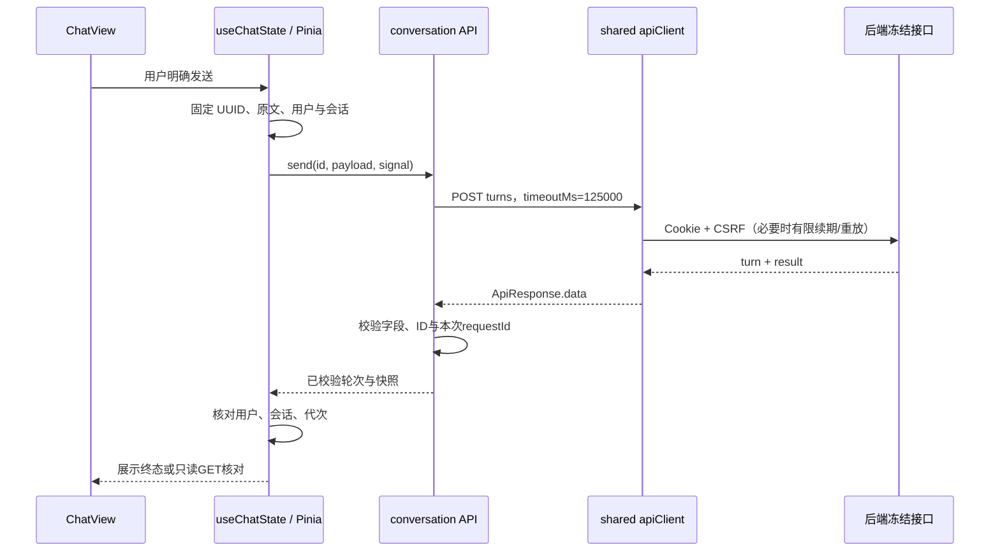

# F3-B：同步聊天与状态隔离学习说明

本文对应本次前端代码和非收费测试；后端行为以T13/T14冻结契约为依据，不表示已部署或真实模型联调通过。

## 从页面到服务器的请求流

与后端 Controller/Service/Mapper 的分工相似，页面负责接收交互，状态模块负责业务时序，API适配器负责HTTP字段与运行时响应校验，共享客户端负责认证、超时和网络传输。TypeScript类型在运行时会被擦除，所以 `validation.ts` 仍检查真实JSON，不把泛型当作已经校验的事实。

主要接线：`views/ChatView.vue` → `modules/conversation/store.ts` → `useChatState.ts`；后者调用 `api.ts`，不是页面自行fetch。`components/RecommendationPanel.vue`只渲染已选轮次的结果。

## 同步POST、HTTP成功与业务成功

T14同步发送先完成一轮处理，再返回结果。HTTP201说明请求新建了轮次，但轮次可能是FAILED，例如没有配置Key；页面必须检查 `turn.status` 和 `turn.error`。HTTP200还可能是已有终态的只读重放，HTTP202可能是已有在途轮次。不能仅按2xx弹出推荐成功提示。

`result=null`是合法状态：失败、未完成或者T13旧成功轮次都可能没有推荐快照。只有服务器返回RECOMMENDED才展示1～3张推荐卡；其余三个outcome展示服务器固定answer，不在前端生成自由答案或假助手消息。

GET messages按sequence升序，第一页是最早历史。`loadMessages()`先读第一页取得total，再定位最后一页；前后页按钮明确表示更早/更晚。只读取当前选中轮次的快照，不对全量历史逐条预取，避免N+1请求。刷新和回看历史只读GET，不重新发送POST。

## 结果未知与幂等

一次明确发送对应一个UUID和不可变原文。网络错误、超时、中断、格式异常、安全500只说明客户端无法确认结果，服务器可能已登记甚至完成。因此保留原payload为unknown，并禁止连点和自动换键。

- 未知且没有turnId：用户确认费用提示后，可重放原UUID和原文。服务器已收到时读同轮；之前未收到时可能开始执行并产生费用。
- 已知turnId：只用GET读取，自动读取最多30次，并且120秒计时器会停止最后一次客户端等待。终态立即停止；达到上限仍是尚未确认，不能改成FAILED。
- 读取次数用尽后，人工“只读核对”执行单次GET，不重启自动读取循环，也不POST。
- 已有FAILED重放不会重新执行；只有用户明确填写并发送新一轮时才产生新UUID。
- 新建会话没有requestId，未知创建不能声称幂等。页面要求先核对列表并明确允许再次创建，避免自动多建会话。

这防止本地重复执行意图，不能保证供应商计费恰好一次；幂等数据库记录与外部模型计费是两个边界。

## 代次与取消为什么同时需要

`useChatState`用用户ID、会话ID、owner/view代次核对响应；列表、消息分页和选轮读取另有请求代次。取消网络可以减少等待，但请求可能已经到服务器，或替身/网络实现忽略取消。因此迟到结果仍要经过这些核对，不能只依赖AbortController。

切换路由停止本地等待并清空当前视图；未确认发送仍绑定原会话，顶栏可返回核对。账号变化或现有sessionCleanup（退出/最终401）清空消息、草稿、结果及待确认正文。没有将它们或Key/JWT写到Web Storage。刷新后本地待确认内容丢失，应从服务器历史查找，不能假装浏览器已持久恢复原发送。

共享客户端的 `waitActive` 取消单个等待者，保留其他请求共用的CSRF/续期请求；等待完成前后检查signal，避免离开页面后旧POST才发出。原有CSRF和401单次重放仍复用原payload，没有增加第二套认证客户端。

## 超时不是服务器取消

普通请求仍默认10秒，只有turn POST使用125000ms。共享CSRF和续期仍使用原超时，不把覆盖扩散到列表、详情、收藏或设置。

125秒是浏览器等待策略；前端abort不是对模型或数据库事务的撤销。T14的90秒软阶段预算和T13的120秒数据库截止也不是前端承诺的硬网络终止。页面离开提示和unknown提示均保留“服务器可能仍在执行”，GET也不恢复过期轮次。

## 普通文本与事实边界

消息、answer、菜谱名称和摘要都用Vue文本插值，不用v-html、不自动将任意URL变为购买入口。详情RouterLink仅由合法正BIGINT十进制字符串ID生成现有本地route；ID不经过Number或parseInt。

null保留未知：预计时间、预算、厨具、query Embedding实发请求及token usage都不填0。厨具null是不设条件，空数组表示明确没有厨具。预算与已有食材只作声明，不推导费用满足、库存足量、过敏安全或健康认证。

## 面试追问与自检

1. 为什么HTTP201仍可能对应FAILED？请从Controller返回、轮次状态和UI展示三层解释。
2. 网络超时后为什么不能立即生成新UUID？重放原键是否必然不收费？
3. 为什么取消请求后还要核对请求代次？举一个旧账号响应迟到的例子。
4. 为什么不能取消所有共用CSRF/续期请求？单个等待者如何退出？
5. 为什么历史第一页不能叫“最新消息”？本实现如何限制快照请求数量？
6. 为什么GET轮次可以一直显示RUNNING？前端能否把过期状态自行改成失败？
7. TypeScript声明、HTTP envelope校验与推荐DTO运行时校验分别解决什么问题？
8. 网关尝试次数、Embedding实发请求和供应商账单有什么区别？

自检：能否找出生成UUID、固定payload、状态代次、125000ms覆盖和30次/120秒停止的真实代码；能否说明FAILED/result=null时的页面表现；能否指出本次测试替身与待真实联调的区别；能否解释ID字符串与厨具null/[]；能否解释离开、刷新、退出后三种本地状态变化。

练习一：画出“POST已到服务器但响应丢失”的时序，列出用户显式核对可能产生的两种结果与费用风险。练习二：用测试替身延迟旧账号响应，然后切换账号，说明为什么取消与代次检查都不可省略。学习说明不表示用户已经掌握这些知识。
