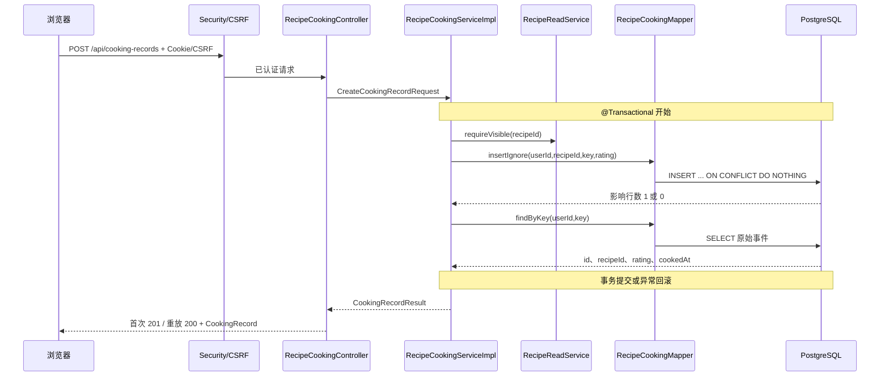

# T10 烹饪记录与统计实现详解

日期：2026-10-01。范围仅为完成烹饪事件、主动评分和做菜历史；契约为 `s2-api-v1` 第 4 节。本文描述当前后端源码与真实 PostgreSQL 测试，不代表前端浏览器联调或阶段二整体验收。

## 1. 业务与边界

用户在菜谱详情中确认“这次做完了”，客户端为**这一次操作**产生一个 UUID，连同菜谱 ID 和可选评分提交。后端记录一条不可变的完成事件。再次烹饪同一道菜应使用**新 UUID**，使次数加一；网络超时后的重试则继续使用原 UUID 和原内容。历史页按菜谱汇总事件数、最近完成时间和最近一次非空评分。完成不自动收藏，也不扣库存。“常做”只表示记录次数，不代表喜欢、实际熟练程度或营养评价。

**30 秒介绍示例**：我在 Cooker 的阶段二实现了做菜完成事件和历史统计。用户提交菜谱、UUID 和可选 1～5 分，PostgreSQL 用用户加幂等键唯一约束避免超时或并发重试重复计数。历史页面按菜谱汇总次数，查最近一次非空评分，并提供 1～2、3～5、6 次以上的展示标签。后端经过真实 HTTP 和 PostgreSQL 测试；前端浏览器联调不在这份后端证据中。

**约 2 分钟讲述示例**：入口是 `RecipeCookingController.complete`。请求先由安全过滤器检查会话和 CSRF，再交给 `RecipeCookingServiceImpl.complete`。Service 严格验证字符串菜谱 ID、规范 UUID 和可空整数评分，调用 T9 `RecipeReadService.requireVisible` 检查系统公开或本人私有菜谱。事务内，Mapper 执行 `INSERT ... ON CONFLICT (user_id,idempotency_key) DO NOTHING`。插入一行表示新事件，返回 201；冲突时读取该用户该键已有事件，菜谱和评分均相同则返回原 ID、时间、评分及 200，否则返回 409。唯一约束裁决并发，不能只靠前端禁用按钮。历史接口按当前用户执行总数查询与一条分页聚合查询；`LEFT JOIN LATERAL` 以 `cooked_at DESC,id DESC` 找最近非空评分。后端没有实现评分编辑、库存扣减或聊天工具调用，不能把它描述成已完成的业务闭环。

## 2. 代码地图

```text
backend/src/main/java/com/cooker/recipe/
├─ controller/RecipeCookingController.java          # HTTP 状态和路由
├─ service/RecipeCookingService.java                # 本模块服务接口
├─ service/impl/RecipeCookingServiceImpl.java       # 验证、可见性、事务、熟悉度
├─ mapper/RecipeCookingMapper.java                  # SQL 方法边界
├─ dto/CreateCookingRecordRequest.java              # 输入，rating 保留原 JSON 类型
├─ dto/CookingRecordRow.java                         # 事件数据库投影
├─ dto/CookedRecipeRow.java                          # 汇总数据库投影
├─ vo/CookingRecord.java                             # 稳定事件响应
├─ vo/CookingRecordResult.java                       # 内部首次写入标志
└─ vo/CookedRecipeCard.java                          # 历史响应
backend/src/main/resources/mapper/recipe/RecipeCookingMapper.xml
backend/src/main/resources/db/migration/V6__create_recipe_cook_record.sql
backend/src/test/java/com/cooker/recipe/T10CookingHttpPostgresTest.java
```

表由 Flyway V6 创建。此切片使用显式 Mapper XML 和专用投影，不经 MyBatis-Plus `BaseMapper<Entity>` CRUD；写库事实以 SQL 和 `CookingRecordRow` 映射。`CurrentUserService.requireUserId` 是跨 `identity` 的唯一身份入口，`RecipeReadService.requireVisible` 是跨现有读取能力的入口。Controller 不访问 Mapper，HTTP 不返回数据库投影。

## 3. 完整请求流



例如首次 `{ "recipeId":"1001", "idempotencyKey":"550e8400-e29b-41d4-a716-446655440000", "rating":null }`，服务器生成 `id` 与 `cookedAt`。同一用户同内容重发，结果中的四个事件字段保持不变。客户端传入的用户 ID 或时间都不会被接受为身份和事件时间；Service 从认证上下文取用户，数据库给时间。若先前同键已记录别的菜或评分，返回 `409 IDEMPOTENCY_CONFLICT`。

## 4. 幂等、事务与 SQL

核心 SQL 是：

```sql
INSERT INTO recipe_cook_record(user_id, recipe_id, idempotency_key, rating)
VALUES (#{userId}, #{recipeId}, CAST(#{key} AS uuid), #{rating})
ON CONFLICT (user_id, idempotency_key) DO NOTHING;
```

`UNIQUE(user_id,idempotency_key)` 是最终仲裁者。`DO NOTHING` 避免唯一键错误令 PostgreSQL 当前事务进入失败状态，随后另一个语句才能安全读取胜出的原事件。Service 比较旧、新 `recipeId` 和 `rating`，用 `Objects.equals` 区分 `null` 与数字。不能用“先 SELECT，不存在再 INSERT”，因为两次并发读取都可能看到不存在；也不能捕获唯一键异常后在同一已中止事务里继续查询。PostgreSQL 默认 Read Committed 下，冲突方等待另一事务结果，后续独立 SELECT 可以看到已提交的事件。[PostgreSQL INSERT 文档](https://www.postgresql.org/docs/18/sql-insert.html)、[Spring 声明式事务文档](https://docs.spring.io/spring-framework/reference/data-access/transaction/declarative/annotations.html)。

评分 DTO 的 `rating` 使用 Jackson 3 的 `JsonNode`，Service 只接受 `null` 或 `isInt()`，然后检查 1～5。这样可拒绝 `1.5`、字符串和超出整数表示范围的值。首次测试发现默认整数绑定会把 `1.5` 转成 `1`，所以保留 JSON 原类型直到显式验证。数据库 `SMALLINT` 与 CHECK 再提供一道最终约束。`idempotencyKey` 先经 `UUID.fromString` 并比较规范字符串，SQL 中显式转为 `uuid`，避免 Java UUID 缺少当前 MyBatis 类型处理器。

## 5. 历史统计与最近非空评分

`countCookedRecipes` 数本人可见菜谱的去重数量，用于分页 `total`。`listCookedRecipes` 中 `summary` 按菜谱 `count(*)`、`max(cooked_at)`；主查询只返回当前页，并 JOIN 菜谱、来源和收藏状态。`LEFT JOIN LATERAL` 对该页每一道菜找 `rating IS NOT NULL` 且 `ORDER BY cooked_at DESC,id DESC LIMIT 1` 的记录。最新事件可能未评分，不能直接取它的可空 `rating`；同一时间戳的评分以记录 ID 决定先后。最后按 `last_cooked_at DESC,r.id DESC` 分页，时间相同时稳定排序。每页固定为总数与列表两条 Mapper 查询，没有逐卡片的 N+1。

`cookCount` 为事件数，1～2 次输出 `FIRST_TRY/初尝`，3～5 次输出 `FAMILIAR/熟悉`，6 次起输出 `FREQUENT/常做`。这是呈现规则，不能推断偏好或真实技能。`RecipeCard.isFavorite` 仍由独立收藏表读取，做菜不会修改收藏。

## 6. 数据、失败路径与取舍

| 字段/约束 | 作用 |
|---|---|
| `id BIGINT IDENTITY` | 稳定事件编号，同时间评分排序的破平局字段 |
| `user_id` 外键，删除级联 | 用户删除时清理私人事件；查询始终限定当前用户 |
| `recipe_id` 外键，删除限制 | 已记录的菜谱不能被硬删；如将来需要删除，须先定义历史留存策略 |
| `idempotency_key UUID` + 复合唯一键 | 用户范围内一把钥匙只对应一件完成事件 |
| `rating SMALLINT NULL` + CHECK | 可不评分，只允许 1～5 |
| `cooked_at TIMESTAMPTZ DEFAULT CURRENT_TIMESTAMP` | 服务端时间，响应为 UTC ISO 8601 |
| `(user_id,recipe_id,cooked_at DESC,id DESC)` 索引 | 支持分菜统计与最近评分查询；写入要维护索引 |

失败与并发：未登录的历史 GET 为 401；缺 CSRF 的 POST 为 403；非法 ID/UUID/评分为 `400 VALIDATION_ERROR`；不可见或不存在的菜谱为 `404 RECIPE_NOT_FOUND`；同键不同内容为 `409 IDEMPOTENCY_CONFLICT`。先验证可见性再碰幂等键，避免用户借同键探测别人私有菜谱。外键、CHECK 等意外数据库错误由统一异常处理映射为 500 的脱敏响应，不能回显 SQL 或请求正文。一次事件只有一行，没有维护可变汇总行；汇总需实时计算，数据规模增长后可评估物化汇总，但必须处理删除、校正与并发一致性。

方案对比：① 客户端禁用按钮只能防当前页面双击，无法防超时重试、两台设备和并发请求；数据库唯一键才能保证最终唯一。② 先查再插存在并发竞态；`ON CONFLICT DO NOTHING` 可在同一事务中安全读取原记录。③ 直接在菜谱表加 `cook_count` 难保留每次完成和评分来源；事件表可审计、可重算，但查询聚合成本较高。④ MySQL 熟悉的 Controller→Service→Mapper 分层保持一致；本任务使用 PostgreSQL `ON CONFLICT`、`TIMESTAMPTZ`、`LATERAL` 和 Flyway 版本迁移表达数据规则，MySQL 实现应换相应 UPSERT 与查询写法。Mapper XML 的显式映射见 [MyBatis 官方文档](https://mybatis.org/mybatis-3/sqlmap-xml.html)。

实际依赖以 `backend/pom.xml` 为准：Java 21、Spring Boot 4.0.8、MyBatis-Plus 3.5.17、PostgreSQL 18、Flyway 和 Testcontainers 2.0.5；本任务未调用 DeepSeek、Embedding 或收费 API，也没有引入 Cloud/MQ/Agent 运行框架。没有线上吞吐、延迟或浏览器体验数据。

## 7. 测试与复现

在工作树 `backend` 使用 JDK 21 执行 `mvn -q test`。2026-10-01 全量结果：17 份测试报告、44 项测试、0 失败、0 错误、1 项既有 T6 条件跳过。`T10CookingHttpPostgresTest` 启动独立 PostgreSQL 18 Testcontainers 和真实 HTTP 服务，验证六次迁移、201/200/409、相同内容重放、评分 null/边界/小数拒绝、同键双线程、用户隔离、私有菜谱 404、分页稳定、最新非空评分和 2/3/5/6 次标签。它不连接真实收费服务。单独重跑：`mvn -q -Dtest=T10CookingHttpPostgresTest test`。执行前需启动 Docker 并已有 `cooker-postgres:pg18-zhparser` 镜像。

最小人工复现：先通过 `/api/auth/register` 与 `/api/auth/login` 获得开发账号，调用 `/api/auth/csrf` 获取令牌，在请求 Cookie 和 `X-XSRF-TOKEN` 中带入凭证；使用上述 JSON 请求 POST 两次，观察 201→200 且 `id/cookedAt` 相同；换 UUID 再 POST，做菜历史 `cookCount` 应增加。只用专用测试用户，不在已有个人数据上实验。核对 SQL 可用：

```sql
SELECT id, user_id, recipe_id, idempotency_key, rating, cooked_at
FROM recipe_cook_record WHERE user_id = :test_user_id ORDER BY id;
```

## 8. 面试追问

| 问题 | 简短回答及原理 | 继续追问与证据 |
|---|---|---|
| 1. 为什么禁用按钮不够？ | 只管当前页面；网络重试和双设备仍能重复提交。唯一键在数据库裁决。 | 并发两线程会怎样？看 `T10CookingHttpPostgresTest` 同键并发断言。 |
| 2. 事务失败后怎么重试？ | `ON CONFLICT DO NOTHING` 避开预期唯一异常；其他异常回滚，客户端保留原键及内容重试。 | 若捕获唯一错误后同事务 SELECT 呢？PG 事务已中止；看 Mapper SQL。 |
| 3. 超时如何防重复计数？ | 超时不证明服务端未提交；客户端仍用同 UUID、菜谱和评分。 | 若换新 UUID？会变成新事件；看 `complete` 和唯一约束。 |
| 4. 同键不同评分为什么 409？ | 同一操作的内容应固定，否则无法解释服务器已保存哪次意图。 | `null` 与 5 怎么比较？`Objects.equals`；看 Service 冲突分支。 |
| 5. 同一道菜第二次怎样计数？ | 用户再次明确确认，客户端生成新 UUID，数据库新增一行。 | 重放原 UUID 呢？200 且次数不加；看 HTTP 测试。 |
| 6. 事件和聚合有什么区别？ | 事件是单次事实，聚合是按菜谱从事件计算的视图。 | 为什么不维护 `cook_count` 列？维护并发与校正复杂；看历史 SQL。 |
| 7. 最新评分为何不是最新事件评分？ | 最新事件可为 null；要找最近的非空评分。 | 时间相同如何决胜？`id DESC`；看 LATERAL 子查询与测试。 |
| 8. 如何防跨用户读取？ | 身份取自 `CurrentUserService`，SQL 全部带 `user_id` 且关联可见性。 | 别人的私有菜谱呢？先 `requireVisible` 返回 404；看 Service/测试。 |
| 9. 为什么评分用原始 JSON 节点校验？ | Jackson 整数绑定曾把 1.5 转成 1，原节点可拒绝小数和字符串。 | 数据库也限制吗？V6 CHECK；看测试非法评分。 |
| 10. 历史页为什么不会 N+1？ | 先总数，再一条聚合 JOIN 查整页，不逐菜加载。 | 大量事件怎么办？看 V6 索引；进一步需实际 EXPLAIN 和负载测试。 |

## 9. 学习清单与自检

当前必须掌握：`@Transactional` 的边界和回滚、PostgreSQL 唯一约束与 `ON CONFLICT`、客户端 UUID 生命周期、`COUNT/GROUP BY`、最近非空评分、`user_id` 查询边界。后续深入：隔离级别与快照、`EXPLAIN (ANALYZE, BUFFERS)`、事件修正/留存政策、物化汇总的同步成本。官方资料：[PostgreSQL INSERT](https://www.postgresql.org/docs/18/sql-insert.html)、[Spring 事务](https://docs.spring.io/spring-framework/reference/data-access/transaction/declarative/annotations.html)、[MyBatis Mapper XML](https://mybatis.org/mybatis-3/sqlmap-xml.html)。

自检题：

1. 画出从浏览器 POST 到唯一索引、再到 HTTP 201/200 的路径，标出事务边界。
2. 解释同键不同评分为什么不能覆盖原行，以及应返回什么 code。
3. 最新事件未评分而前一次评分 4 分，`latestRating` 是多少？指出 SQL 子句。
4. 两个用户使用同一个 UUID 是否冲突？指出唯一约束和查询边界。
5. 同一道菜从第 2 次到第 3 次、第 5 次到第 6 次，展示值分别怎样变化？
6. 为什么 `SELECT` 后 `INSERT` 仍会重复或异常？为什么不能在 PG 唯一异常后直接查？

最小练习 A：用两个并发 HTTP 会话对同账号同键同内容 POST，记录状态码并查该用户该键行数。通过标准是 201/200 各一次、行数 1、响应事件相同。最小练习 B：先有一条 4 分事件，再有一条未评分事件，查历史并说明 `cookCount=2`、`latestRating=4` 的来源；换新键补一次 3 分并观察最近评分变化。

答案要点：题 1 看第 3 节；题 2 是 `409 IDEMPOTENCY_CONFLICT`；题 3 为 4；题 4 不冲突，因为唯一键包含用户；题 5 是初尝→熟悉、熟悉→常做；题 6 是检查与写入间存在竞态，且 PostgreSQL 唯一错误使当前事务失败。用户能独立说明并运行练习，才算掌握；文档完成不能代替实际理解。
