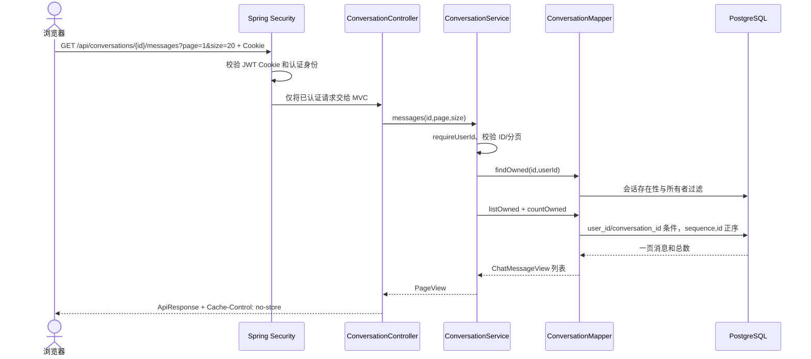

# T13 会话与轮次持久化实现详解

## 1. 业务目标与模块边界

用户登录后创建自己的会话。会话保留标题和创建/更新时间；每次未来的对话请求由内部应用服务登记为一个 turn，并留下 USER 消息。执行层随后通过 Service 将它开始、成功或失败。成功必须同时保存 ASSISTANT 消息和终态；失败保存固定错误码，不泄漏模型提示词、凭证或供应商原始报错。

T13 的 HTTP 面只开放会话创建/读取、消息历史和单个 turn 查询。当前没有 POST turn/message，也没有 SSE。控制器只依赖 conversation Service；conversation 模块依赖 identity 的 `CurrentUserService` 获取可信用户 ID。没有跨模块直接访问 identity Mapper/Entity，也没有向 agent 调用。

### 30 秒项目介绍

Cooker 的对话上下文需要可靠保存，并且必须按用户隔离。T13 先落地会话、轮次和消息三类关系数据，用 PostgreSQL 外键/唯一约束保证归属和幂等；写操作按“会话行、轮次行、消息行”的固定顺序在短事务内加锁。服务端不持锁调用模型。公开 HTTP 目前只读历史，内部 Service 提供后续执行需要的受限状态转换。

### 2 分钟实现介绍

创建会话时通过 `CurrentUserService.requireUserId()` 取得用户身份，写入 `conversation`，缺省标题为“新对话”。历史查询每一条 SQL 都把 `user_id` 纳入条件；有效但不属于当前用户的 ID 与不存在 ID 一样返回 404。轮次注册先 `SELECT ... FOR UPDATE` 锁住当前用户拥有的父会话，恢复同会话已过期的活动 turn，再检查 `(user_id, conversation_id, request_id)`。重放既比较 UTF-8 原始输入的 SHA-256，也比较 USER 消息原文，以免把哈希当成唯一事实。

若没有重放、也没有其他活动轮次，事务分配 `turn_no`，使用数据库时间设置 120 秒期限，写 PENDING turn 和 USER 消息，再增加 `next_turn_no`。start 用条件更新从 PENDING 到 RUNNING。成功时先写唯一 ASSISTANT 消息，再以状态和期限为条件更新 SUCCEEDED；任一语句失败都会回滚。失败只接收固定枚举错误码。读取 turn 不触发执行或恢复。过期恢复把 PENDING/RUNNING 改为 `FAILED/RUNTIME_INTERRUPTED`，不创建助手回复。

2026-10-02 修复了一个 replay 边界：register 先按数据库截止时间锁定并回收活动 turn，按 `expire` UPDATE 的实际影响行数累计恢复数。恢复数大于零时，在同一事务内、requestId 重放提前返回之前触碰父 conversation 的 `updated_at`；如果 UPDATE 影响零行，不触碰时间。未过期的相同 requestId replay 仍为只读式幂等命中。父会话→轮次→消息锁顺序、摘要和原文比较、事务回滚边界均未改变。

## 2. 目录与职责

```text
backend/src/main/java/com/cooker/conversation/
├─ controller/ConversationController.java
├─ dto/CreateConversationRequest.java
├─ entity/{ConversationEntity,ConversationTurnEntity,ChatMessageEntity}.java
├─ mapper/{ConversationMapper,ConversationTurnMapper,ChatMessageMapper,UuidTypeHandler}.java
├─ service/{ConversationService,ConversationTurnService}.java
├─ service/impl/{ConversationServiceImpl,ConversationTurnServiceImpl,ConversationErrors}.java
├─ vo/{ConversationView,ChatMessageView,TurnView,TurnRow,TurnError,TurnRegistration,
│      TurnStatus,MessageRole,PageView}.java
└─ ConversationIdParser.java

backend/src/main/resources/mapper/conversation/
├─ ConversationMapper.xml
├─ ConversationTurnMapper.xml
└─ ChatMessageMapper.xml

backend/src/main/resources/db/migration/V8__create_conversation_tables.sql
backend/src/test/java/com/cooker/conversation/ConversationHttpPostgresTest.java
backend/src/test/java/com/cooker/conversation/ConversationCompositeForeignKeyPostgresTest.java
```

Controller 做 HTTP 参数和响应边界。Service 校验身份、参数、所有权和状态。Mapper 接口负责声明数据库操作，关联查询、锁和条件写入放 XML。Entity 映射单表；VO 不暴露实体或输入哈希、截止时间。

## 3. 一次成功读取的完整调用链



`POST /api/conversations` 会经过相同认证链，并额外要求 Cookie CSRF token。`CurrentUserService` 从已经验证的 Spring Security principal 读取 Long 用户 ID；请求 JSON 不存在 `userId` 字段。SQL 再次加用户条件，因此不能靠伪造路径 ID 越权。

## 4. V8 数据结构、约束与 SQL

### conversation

保存 `user_id`、标题、`next_turn_no`、创建和更新时间。`(id,user_id)` 唯一键是子表复合外键的目标，`next_turn_no > 0` 防止无效分配。列表索引为 `(user_id, updated_at DESC, id DESC)`。

### conversation_turn

一行代表一次幂等请求：UUID `request_id`、64 位小写 SHA-256、单会话递增 `turn_no`、PENDING/RUNNING/SUCCEEDED/FAILED 状态、数据库创建/开始/结束/截止时间和固定错误码。复合外键保证 turn 的会话和用户归属一致。唯一约束保证请求键、会话内轮次编号和消息外键目标不重复；部分唯一索引强制每个会话最多有一个 PENDING/RUNNING turn。过期索引只覆盖活动状态。

### chat_message

保存 USER/ASSISTANT 原文、会话/用户/turn 归属、序号和时间。复合外键确保消息不能挂在其他用户或会话的 turn 下；`UNIQUE(conversation_id,sequence)` 与 `UNIQUE(turn_id,role)` 保证顺序不重用且每个 turn 每种角色最多一条。内容必须非空。

核心注册 SQL 如下，真实 XML 还包含绑定参数和条件更新：

```sql
INSERT INTO conversation_turn
  (conversation_id,user_id,request_id,input_hash,turn_no,status,deadline_at)
VALUES
  (:conversationId,:userId,:requestId,:inputHash,:turnNo,'PENDING',
   clock_timestamp() + interval '120 seconds');

INSERT INTO chat_message(conversation_id,user_id,turn_id,role,content,sequence)
VALUES (:conversationId,:userId,:turnId,'USER',:exactContent,2 * :turnNo - 1);
```

成功路径的必要约束：

```sql
INSERT INTO chat_message(..., role, content, sequence)
VALUES (..., 'ASSISTANT', :answer, 2 * :turnNo);

UPDATE conversation_turn
SET status='SUCCEEDED', finished_at=clock_timestamp()
WHERE id=:turnId AND status='RUNNING' AND deadline_at > clock_timestamp();
```

两条语句处于同一个 Spring `@Transactional` 方法。若条件更新行数不是 1，Service 抛冲突异常，助手消息也回滚。`clock_timestamp()` 每次取真实数据库当前时刻；PostgreSQL 的 `CURRENT_TIMESTAMP` 固定为事务开始时间，可能把排队等锁的时间忽略，因此这里不使用它判断 120 秒截止。

### 为什么不是 JSONB

会话所有者、状态、序号、用户、请求键和截止时间都需要 FK、唯一性、过滤、排序或并发条件，因此用关系列和索引。JSONB 适合可变元数据，本任务没有这样的对象；把这些主事实放进 JSONB 会失去约束和高效查询。

## 5. 事务、锁与幂等

所有写入口先锁 parent conversation：`SELECT ... WHERE id=? AND user_id=? FOR UPDATE`。锁顺序固定为 conversation → turn → message。PostgreSQL 默认 READ COMMITTED 下，父行锁将同一会话里的登记/终结串行化；无 JVM `synchronized`，也不需要 Redis。部分唯一索引是数据库最终防线。不同会话的父行互不阻塞。

注册顺序为：锁并验证所有者 → 锁并过期本会话已到期活动 turn → 查询 requestId → SHA-256 与原文都相等则返回旧结果 → 内容不同则 409 → 若有另一活动 turn 则 409 `CONVERSATION_BUSY` → 分配 turnNo → 插 PENDING 和 USER → 更新计数/时间。过期在幂等回查之前执行，因此同键重放得到持久化的 FAILED 结果，而不是重新执行。

USER 序号 `2n-1`，ASSISTANT 序号 `2n`。失败 turn 没有助手消息，因此历史序号允许有间隔但从不复用。达到 BIGINT 安全上限时拒绝分配，避免乘 2 溢出。

短事务的边界只包数据库操作。未来模型调用必须发生在 startTurn 已提交之后，在无数据库行锁的代码段中执行，再以新的事务调用 succeed/fail。数据库幂等只保证一条 turn/message，不承诺外部付费模型 exactly-once：若模型完成但应用在保存结果前退出，T13 只能超时标记中断，不能安全地自动重调模型。

## 6. API、错误和安全

基路径由应用 context-path 提供 `/api`。

| 方法与路径 | 用途 | 返回 |
|---|---|---|
| `POST /conversations` | 创建会话 `{ "title"?: string }` | 201 `ConversationView` |
| `GET /conversations?page=1&size=20` | 当前用户会话列表，size 最大 50 | 200 `Page<ConversationView>` |
| `GET /conversations/{id}` | 会话详情 | 200 `ConversationView` |
| `GET /conversations/{id}/messages?page=1&size=20` | 最早消息优先的历史页 | 200 `Page<ChatMessageView>` |
| `GET /conversations/{id}/turns/{turnId}` | 读取 turn 元信息/固定错误 | 200 `TurnView` |

所有私有读取返回 `Cache-Control: no-store`。ID 必须匹配 `[1-9][0-9]*` 并可解析到正 Long；格式错误/溢出为 400 `VALIDATION_ERROR`。不存在或非当前用户资源统一为 404。标题缺省/NULL 为“新对话”；非空标题去除首尾空白且最多 100 Unicode code points。消息保留用户原文，用户内容最多 4000 code points，助手结果最多 8000。

状态错误使用 409 `IDEMPOTENCY_CONFLICT`、`CONVERSATION_BUSY`、`CONVERSATION_TURN_STATE_CONFLICT`。失败只允许 `RUNTIME_INTERRUPTED`、`CREDENTIAL_NOT_CONFIGURED`、`CREDENTIAL_SERVICE_UNAVAILABLE`、`MODEL_AUTHENTICATION_FAILED`、`MODEL_RATE_LIMITED`、`MODEL_TIMEOUT`、`MODEL_UNAVAILABLE`、`MODEL_INVALID_RESPONSE`、`RETRIEVAL_FAILED`、`RESOURCE_LIMIT`、`EXECUTION_FAILED`。响应文案由本地映射产生，不接纳模型/供应商异常文本。

ID 是十进制字符串，避免 JavaScript 浮点数丢失 BIGINT 精度。读取端只返回规定的状态时间和错误对象，不暴露输入哈希、deadline、模型快照、Prompt 或 provider 响应。当前没有写消息路由；受身份认证及 CSRF 保护的未映射 POST 无法创建 turn。

## 7. 关键失败场景

1. **相同 requestId、相同原文**：返回同一 turn，`created=false`，包括先前 FAILED turn；不增加 USER 消息。若该调用先实际回收了过期活动 turn，则同事务更新时间；之后再次 replay 不重复更新时间。
2. **相同 requestId、不同原文**：SHA-256 或原文比较不一致，返回 409；不创建新 turn。
3. **并发不同 requestId**：parent row lock 让一个请求成功登记，第二个看到活动 turn 并返回 BUSY。部分唯一索引兜底。
4. **并发相同 requestId**：第一个提交后第二个在 parent lock 后查到旧 turn并返回 replay；唯一 request 约束兜底。
5. **应用等待锁时超过截止时间**：start/succeed 的数据库条件更新因 `deadline_at <= clock_timestamp()` 失败，late success 事务回滚；恢复操作写 `RUNTIME_INTERRUPTED`。
6. **助手消息写入失败或状态更新失败**：同一事务回滚，不能出现 SUCCEEDED 无消息或重复助手消息。集成测试分别在消息 INSERT 抛错，以及消息已插入但状态 UPDATE 影响零行时验证消息、状态和父会话时间都回滚。
7. **外部用户猜测其他用户 conversation/turn ID**：所有读取和行锁查询均带 user_id，统一返回 404。
8. **应用重启留下活动 turn**：没有后台执行器。下次同会话 register 或显式 recoverExpiredTurns 会按 DB 截止时间转 FAILED，不会自动重新调用模型。

## 8. Spring Boot/MySQL 类比与查询计划

在熟悉的 Spring Boot 分层中，Controller 像接收请求的 Controller，ConversationService 是业务边界，Mapper/XML 类似 Mapper + SQL `WHERE`。最关键的条件是 `WHERE user_id = 当前登录用户`：它和常规 MySQL 多租户查询一样，不能从请求参数接收用户 ID。跨模块的 identity 服务只提供当前用户 ID，不让 conversation 直接注入 identity Mapper。

Flyway V8 是显式版本迁移；与依赖 ORM 自动建表不同，迁移在独立 PG 18 上建立 FK、部分索引和检查约束。PostgreSQL 的 `FOR UPDATE`、部分唯一索引、`clock_timestamp()` 和复合 FK 都是本方案使用的数据库行为；换成 MySQL 时，索引/约束/时间函数语法需要按目标版本重写和重新测试，不能仅替换 JDBC URL。`UuidTypeHandler` 把 Java UUID 和 PostgreSQL UUID JDBC 值明确互转。

列表读取用 `user_id` 前缀索引，再按 `updated_at DESC,id DESC` 稳定排序。消息查询用 `(conversation_id,sequence,id)` 索引，避免页间顺序不稳定。过滤结果先独立计数，offset 由 64 位算术生成。单会话写入被父行串行化是明确的容量边界；不同会话仍可并行。

## 9. 测试与复现

`ConversationHttpPostgresTest` 启动本地随机 HTTP 端口和独立 `cooker_t13_test` PostgreSQL；使用真实注册/登录 Cookie、CSRF token、Spring Security 过滤器和 Flyway V1～V8。它验证未认证拒绝、写 CSRF、用户隔离与错误会话/轮次配对、标题及 USER/ASSISTANT 文本 code point 边界、无效错误码无副作用、ID 格式/溢出、跨页字段与稳定排序、长 offset、历史顺序、同键同/异内容、过期 PENDING/RUNNING 的 start/succeed 拒绝、过期读取不恢复、过期同键 replay 只触碰一次会话时间、start 单次成功、两种成功写入回滚、终态不可变、不同键竞争、相同键竞争、超时恢复与未开放 message POST 不落库。它不作为复合外键错误类型的精确证据。

`ConversationCompositeForeignKeyPostgresTest` 在两个独立可销毁的 Testcontainers PostgreSQL 中运行全部 V1～V8。约束库中先确认旧形状的 PENDING 错误 turn 与重复 USER 消息分别报 SQLState `23505`（`uq_turn_one_active_per_conversation`、`uq_message_turn_role`）；随后将 turn 改为满足 CHECK 的 FAILED 终态，并为错误 message 使用未占用角色/序号，断言底层 `PSQLException` 是 `23503` 且约束名准确为 `fk_turn_conversation_owner` / `fk_message_turn_owner`。`JdbcTemplate` 会把 JDBC 异常包装成 Spring 数据访问异常，因此测试穿过 cause/nextException 取得 PostgreSQL 原始异常。捕获后核对行数、用户、会话时间、活动轮次与原消息没有变化，并插入合法 SUCCEEDED turn 及两条合法消息作为正例。

同一测试的对照库只删除这两个目标复合 FK，保留 CHECK、用户外键、活动轮次部分唯一索引和 turn/role 唯一约束；之前触发 `23503` 的三个合法形状错误归属组合随后都能插入。此对照证明约束库拒绝来自目标复合外键，而不是 `23505` 唯一冲突。外键只在一次性测试容器里移除，绝不代表生产迁移或开发数据库关闭了约束。

`ConversationMigrationPostgresTest` 使用另一个空隔离库先运行到 V7、插入虚构用户和测试凭证记录，再升级单个 V8；验证已有数据保留、会话三表和两个复合所有者约束创建完成。

数据库故障测试创建临时 trigger，在助手消息插入时抛异常；随后验证状态仍 RUNNING 且没有 ASSISTANT 行，再删除 trigger 并成功完成。这证明事务原子性而不是只验证 Service 返回值。

在 Windows PowerShell 中设置 JDK 21 后运行：

```powershell
$env:JAVA_HOME = 'C:\Program Files\Java\jdk-21'
$env:Path = "$env:JAVA_HOME\bin;$env:Path"
Set-Location backend
mvn -o -q test
mvn -o -q -DskipTests package
git diff --check
```

复合外键回归还可单独运行 `mvn -o -q -Dtest=ConversationCompositeForeignKeyPostgresTest test`；正式交付验收仍以完整 `mvn -o -q test` 与打包命令的结果为准。

2026-10-02 R2 专项最终执行：`mvn -o -q test` 与 `mvn -o -q -DskipTests package` 均退出码 0。Surefire 共 67 项、0 失败、0 错误、1 项既有收费边界跳过（66 项实际执行）；conversation 三个 PostgreSQL 测试类共 6 项全部执行、失败/错误/跳过均为 0。外键测试两个独立容器均运行 V1～V8，真实观察到修正负例的三个 `23503`/约束名断言，以及只在对照库移除两个目标 FK 后三个错误组合成功写入。`git diff --check` 与新增测试源码空白扫描通过。该证据用于修正先前误把 `23505` 唯一冲突当成复合外键验证的记录；它不替代主架构独立复审，也不代表 T13 已签收或用户已掌握相关内容。

测试使用 Docker Desktop 和 `cooker-postgres:pg18-zhparser` 本地镜像，但数据库名称 `cooker_t13_test` 专用于测试，不读写开发数据库。普通测试无模型网络/计费调用。实际执行结果应以 T13 工作报告最终验收记录为准。

## 10. 面试自测题

1. **为什么从 `CurrentUserService` 取 userId？** 简答：身份来自已校验 principal，客户端不可伪造。理由：跨用户数据必须隔离。追问：为什么 SQL 仍带 user_id？看 `ConversationServiceImpl` 与 `findOwned` XML。
2. **为什么用复合外键？** 简答：数据库保证子行的会话、用户和 turn 三者一致。理由：服务代码之外也有完整性保障。追问：简单 FK 为何不够？看 V8 的 `fk_turn_conversation_owner`、`fk_message_turn_owner`。
3. **父会话锁解决什么？** 简答：同一会话的所有轮次写入按一个数据库锁串行。理由：避免同会话不同请求同时通过活动轮次检查。追问：是否阻塞不同会话？不会；锁键不同。看 `lockOwned` 与 `registerTurn`。
4. **部分唯一索引有什么作用？** 简答：数据库只允许每会话一条 PENDING/RUNNING。理由：即使调用方绕过预检查也有最终约束。追问：终态行为何不冲突？索引谓词不包含终态。看 V8。
5. **为什么 hash 后还比较原文？** 简答：哈希是快速/紧凑比对，持久化 USER 文本仍作为精确重放依据。理由：契约要求不只依赖摘要。追问：用什么字节计算？原始字符串 UTF-8。看 `sha256` 和 `userContent`。
6. **为什么期限用 `clock_timestamp()`？** 简答：它在语句执行时读取 PG 当前时钟。理由：事务可能等待锁，事务起始时间不代表真实剩余期限。追问：超时后怎样防止迟到成功？条件 UPDATE 同时检查期限。看 XML `start/succeed`。
7. **如何保证助手消息与成功状态一致？** 简答：写消息、状态更新在同一 Spring 事务。理由：任一失败整体回滚。追问：如何验证？测试 trigger 主动拒绝消息插入。看测试回滚断言。
8. **失败错误为什么用枚举和固定文案？** 简答：只暴露允许的 code 和本地文案。理由：避免 Prompt、Key、供应商异常透出。追问：如何加新错误？先更新契约、允许列表和测试。
9. **T13 是否保证模型 exactly-once？** 简答：不保证。理由：本地 DB 无法与付费 provider 事务原子提交。追问：崩溃发生在模型成功后如何处理？超时后标记中断，不自动重调。
10. **为什么还不开放 POST messages/SSE？** 简答：当前边界只授权持久化与历史读取，内部 Service 支持轮次状态但没有执行 API。理由：避免客户端越过后续 Agent 协议。追问：后续需要什么？独立授权、接口契约和执行事务设计。

## 11. 练习与答题检查

### 自测（5 题）

1. 解释列表 SQL 里 `user_id` 条件的安全意义。合格答案应指出身份取自认证 principal，不能由请求体指定，并且 SQL 仍做第二道边界。
2. 写出 ACTIVE 部分唯一索引覆盖的两个状态。答案：PENDING、RUNNING；FAILED/SUCCEEDED 不占活动名额。
3. 画出注册轮次的锁顺序。答案：conversation → conversation_turn → chat_message；不能反过来。
4. late succeed 为什么既要 Service 检查也要 SQL 条件？答案需指出 Service 提供明确错误，条件写入抵御时钟流逝/竞争窗口。
5. 解释失败轮次的消息序号为什么可以跳号。答案：ASSISTANT 不存在，但按 turnNo 预留序号，不复用已分配顺序。

### 练习（2 项）

1. **新增读取筛选器**：允许按状态查询当前用户的 turn。评价：参数必须枚举校验，SQL 带 user_id 和 conversation_id，结果稳定排序；不得返回哈希/deadline。
2. **模拟两会话并行**：分别在两个 conversation 上 barrier 同时 register。评价：两边都成功且数据库记录各自只有一个活动 turn；实现不使用全局 JVM 锁。

## 12. 学习路线与官方资料

建议按顺序复习：Spring Controller → Service 接口/事务代理 → MyBatis Mapper/XML 和参数绑定 → Spring Security principal/CSRF → Spring `@Transactional` 回滚 → PostgreSQL 约束、复合 FK、部分唯一索引和 `FOR UPDATE` → Flyway 版本迁移 → Testcontainers 真数据库测试。

官方资料：

- [Spring Boot Reference](https://docs.spring.io/spring-boot/reference/)
- [Spring Framework 事务管理](https://docs.spring.io/spring-framework/reference/data-access/transaction.html)
- [MyBatis XML Mapper](https://mybatis.org/mybatis-3/sqlmap-xml.html)
- [PostgreSQL 约束](https://www.postgresql.org/docs/current/ddl-constraints.html)
- [PostgreSQL 显式锁](https://www.postgresql.org/docs/current/explicit-locking.html)
- [PostgreSQL 日期时间函数](https://www.postgresql.org/docs/current/functions-datetime.html)
- [Flyway 版本迁移](https://documentation.red-gate.com/flyway/flyway-concepts/migrations/versioned-migrations)

后续 Agent 执行、模型适配、streaming、前端状态同步及进程级恢复演练均不属于 T13 当前实现范围。
