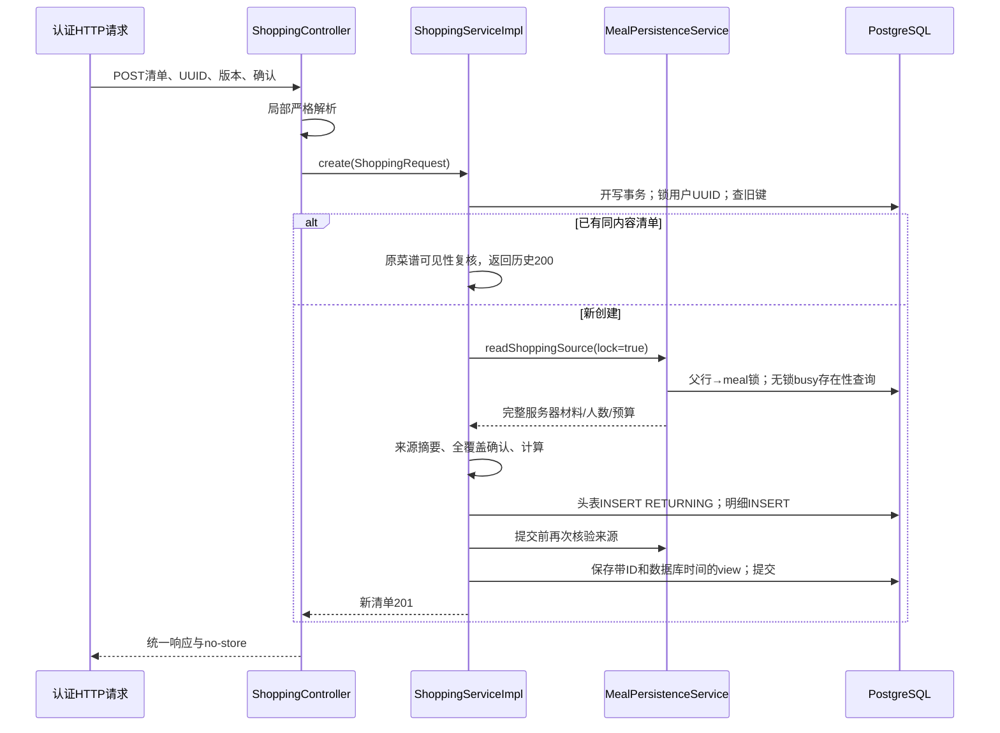

# T16：食材确认与采购需求实现详解

日期：2026-10-06；契约 shopping-demand-v1。本文对应5b09真实源码，验收数字以同目录工作报告为准。T16只形成材料需求与可回看快照；尚无商品Provider、实时价格、购买链接、持久库存或前端采购页面。

## 1. 业务介绍与技术讲述

**30秒介绍**：用户先选定整套餐单，再逐行确认“足量已有”或“需要购买”，必要时补充用量。服务器从已保存的完整材料计算缺口，同一标准食材且单位兼容才合并。未知用量保留为草稿，未知报价保留null。清单在PG中以独立快照保存，重复请求不会多建，历史不被新餐或新档案改写。

**约2分钟讲述**：入口沿用Spring Security认证和CSRF，Controller将原始JSON交给采购模块自己的严格解析器。数量要求普通十进制字符串，避免JSON数字被静默转换；用户、菜谱事实和价格均不能由前端指定。ShoppingService通过conversation公共Service获取类型化ShoppingSource，只读预览不加行锁、不写状态；创建则在同一事务先串行化用户请求UUID，再按conversation父行到meal顺序加锁，验证版本、选择、在途动作及菜谱可见性。

计算器独立处理原材料、确认与汇总：足量已有的采购缺口是0，但未知的原消耗量仍是null；未知需买项为QUANTITY_PENDING。只允许g/kg和ml/l换算，COUNT/CUSTOM保留原标签，不猜密度。PG将归属、状态、数量存关系列，将完整事实与确认存JSONB。唯一约束、ON CONFLICT和事务一起防止重试/并发重复。提交前再次核验事实，失败回滚头和明细；旧键优先重放历史，回读仍检查原菜谱权限。成本辅助函数用BigDecimal算实际用量成本与整包支出，仅测试显式报价；公开接口没有报价，所以不承诺满足预算。

## 2. 代码地图与阅读顺序

路径均相对仓库根目录，Java根为 `backend/src/main/java/com/cooker`：

```text
shopping/
  controller/ShoppingController.java          三个HTTP入口
  dto/ShoppingRequest.java                    原始JSON、ID、数量、全确认命令
  vo/ShoppingView.java                        Preview、Source、Line、Item、Costs
  entity/ShoppingList.java                    头表内部MyBatis字段映射
  service/ShoppingService.java                preview/create/get与Creation结果
  service/ShoppingJson.java                   严格解析、快照序列化、语义SHA-256
  service/ShoppingDemandCalculator.java       来源行、确认、有限换算、缺口合并
  service/ShoppingCostCalculator.java         显式规格报价纯计算与预算状态
  service/impl/ShoppingServiceImpl.java        创建事务、重放、权限回读
  mapper/ShoppingMapper.java                  本模块持久接口
conversation/
  dto/ShoppingSource.java                    类型化完整采购来源
  service/MealPersistenceService.java         readShoppingSource公共入口
  service/impl/MealPersistenceServiceImpl.java 来源核验、按模式锁父行/餐单
  mapper/ShoppingSourceMapper.java            新采购专用无锁busy查询
backend/src/main/resources/
  mapper/shopping/ShoppingMapper.xml          参数化PG SQL
  db/migration/V13__create_shopping_demand.sql 新头表/明细表及约束
```

建议先读Controller和ShoppingRequest，再读ShoppingServiceImpl.create；之后沿readShoppingSource到新busy查询，最后读计算器、XML和V13。recipe事实复核仅调用既有RecipeMealFactsService；shopping不注入conversation Mapper。旧MealMapper.active及原餐单/指导逻辑不改。

实际技术栈：Java21、Spring Boot4.0.8、Spring MVC/Security、MyBatis-Plus3.5.17及显式MyBatis XML、PostgreSQL18、Boot管理的Flyway、Jackson2局部ObjectMapper、BigDecimal。测试使用JUnit5、Mockito与Testcontainers。没有为T16新增框架或依赖版本，也没有调用Spring AI模型链路。

## 3. 一个真实创建请求如何走完整链路

API实际带全局 `/api` 前缀。先GET `/api/conversations/{conversationId}/meals/{mealId}/shopping-preview?expectedVersion=1&optionId=…`，取得sourceFingerprint与所有lineKey。POST `/api/shopping-lists` 的虚构字段形状如下，confirmations需覆盖实际全部行：

```json
{
  "requestId":"00000000-0000-4000-8000-000000000001",
  "conversationId":"1","mealId":"2","expectedVersion":1,"optionId":"3",
  "sourceFingerprint":"<预览返回的64位十六进制摘要>",
  "confirmations":[
    {"lineKey":"10:101","availability":"NEED_BUY","confirmedAmount":"10","confirmedUnitCode":"G"}
  ]
}
```

这个示例不含真实Cookie或凭证；摘要占位值不能直接提交。真实隔离HTTP测试先注册登录并获取CSRF，再建立/选定虚构餐单，完整提交所有行。



新创建的所有数据库写入由ShoppingServiceImpl.create的事务包围。Controller不持事务，不直接调Mapper；计算器不执行SQL。GET历史调用get/read，不读取当前餐单作为历史数量依据。

## 4. R1：为什么只读预览不能沿用FOR UPDATE

原只读预览沿用MealMapper.active，其SQL带FOR UPDATE，真实PG报SQLSTATE25006。FOR UPDATE是加行锁读取，不能因为语句以SELECT开头就当成普通只读查询。新采购查询实际是：

```sql
SELECT EXISTS(
  SELECT 1 FROM meal_action
  WHERE user_id=#{user} AND conversation_id=#{conversation} AND meal_id=#{meal}
    AND status IN ('PENDING','RUNNING')
)
```

参数仍由认证用户和已核验来源提供；新Mapper只在conversation内部使用。这里“无锁”指不加FOR UPDATE等显式行锁，普通SELECT仍有PG正常的表级访问锁。过期PENDING/RUNNING仍判断忙碌，采购读取不代替原动作恢复流程。

预览的只读事务只观察当前来源，不保证预览响应后来源永远不变；创建必须重新核验。创建的lock=true由可信Service调用，HTTP不能传入锁模式；父行与meal锁持续到整份清单提交。事务中的无锁busy查询依赖既有餐单写入口也先锁同一父行进行协调。并发测试在实际明细SQL后设置同步点，确认另一餐单修订在pg_stat_activity呈Lock等待，释放后才进入新版本。锁行为参见[PG显式锁文档](https://www.postgresql.org/docs/18/explicit-locking.html)。

Spring默认REQUIRED传播让采购来源读取加入外层创建事务，而不是因它标readOnly=true就另开只读事务；锁模式入口还显式拒绝当前事务为只读的误用。无外层写事务直接调用lock=true会被保护拒绝，不能偷偷把预览放宽为可写。传播概念参见[Spring事务传播](https://docs.spring.io/spring-framework/reference/data-access/transaction/declarative/tx-propagation.html)。

来源事实通过既有recipe公共Service的REQUIRES_NEW/REPEATABLE_READ独立事务查询，提交前再次比较；旧readFacts事务未设置readOnly=true，本轮不修改它。这可发现测试中独立连接已提交的事实改变，但不承诺外部无协调写入恰好发生在最后复核之后仍能被本事务完全串行化；未来菜谱写入口需另行明确协调协议。

## 5. 事实、确认、需求与未知

ShoppingSource带餐单ID/版本/选项、diningCount、budgetYuan、菜谱指纹和完整MealMaterials。事实CURRENT、选项确为SELECTED、人数为正整数才允许新需求；不要求先生成指导。readShoppingSource复用R4有界十进制投影，防止旧异常指数绕过数值资源边界。

lineKey=`recipeId:recipeIngredientId`；来源原材料归属必须与完整事实一致。Confirmation只写用户选择和数量，不覆写originalAmountMin/Max、rawLine、referenceAmount或事实。计算规则：

| 输入 | 所需量/采购缺口 | 结果 |
|---|---|---|
| 可靠reference且needsConfirmation=false | 直接用reference；拒绝客户端覆写 | NEED_BUY或HAVE_ENOUGH |
| 参考量仍需确认且未填确认 | required=null | NEED_BUY→QUANTITY_PENDING |
| 未知用量但确认足量已有 | required=null、shortage=0 | HAVE_ENOUGH，不宣称原消耗0 |
| 10g与0.01kg、同REVIEWED ingredient且optional一致 | 统一G后合并20g，保留原lineKeys | NEED_BUY |
| 区间、缺份数、未知单位/用量 | 保留原行与reason，需要显式确认 | 不猜中值或人数折算 |
| 未归一食材或optional不同 | 分行保留 | 不因为同名就合并 |

确认数组完整覆盖所有原料，可选材料也需确认。不允许输入前端食材事实、价格、URL、userId；duplicate key、尾随JSON、未知字段、JSON数字数量、科学计数法/NaN、非法类型均400。G/KG与ML/L可同维换算，原单位缺失可显式选上述四码，其余单位只按原码与原label保留。

sourceFingerprint对类型化完整来源做固定规范化SHA-256：对象属性排序，数值stripTrailingZeros后普通十进制，包含版本/人数/预算及完整材料，不含指导、档案、展示更新时间。input_hash还包含全部确认并按lineKey排序。哈希只检测冲突，不能证明用户有权访问资源；排序与数量规范化也不改变原证据快照。

## 6. PG数据设计、幂等和回滚

V13头表核心为user_id、conversation_id、meal_id、version、option_id、request_id、input_hash、source_fingerprint、状态、预算金额和created_at。JSONB保存完整evidence与view；数量是明细关系列required_amount/shortage_amount。数值列数量numeric(24,8)、金额numeric(18,2)，原始材料JSONB保留原精度。numeric的精度/特殊值行为见[PG numeric文档](https://www.postgresql.org/docs/18/datatype-numeric.html)。

头表复合FK `(option_id,meal_id,version,conversation_id,user_id)` 指向meal_option，防止各ID分别存在却属于不同餐；明细 `(list_id,user_id)` 指向头表。归属FK测试断言真实23503及指定constraint，避免被唯一键23505误导。数量状态CHECK明确IS NOT NULL，防止SQL NULL让非法状态通过；NaN单独拒绝。用户/创建时间倒序索引支持后续查询，但T16没有额外开放列表API。

conversation→meal/option→shopping_list→items沿外键级联删除；T16没有公开删除接口。ingredient_id只作历史标准标识，没有添加会删改历史需求的ingredient FK；原材料名称、原行、标准化状态在证据中保留，读取仍先核验菜谱权限。

创建先 `pg_advisory_xact_lock(hashtextextended(user||':'||UUID,0))`，同用户UUID串行；哈希碰撞只增加等待，不能代替 `UNIQUE(user_id,request_id)`。实际头表SQL尾部：

```sql
ON CONFLICT(user_id,request_id) DO NOTHING RETURNING id
```

冲突时未插入就返回空ID，随后受控读取既有记录并校验input_hash，而不是捕获23505后在失败事务继续SQL。四并发真实HTTP测试要求一个201、三个200、一个清单ID。ON CONFLICT/RETURNING行为见[PG INSERT文档](https://www.postgresql.org/docs/18/sql-insert.html)。

同键同内容优先重放，即使餐单后来修订也返回原清单；同键异内容409。新UUID使用过期版本返回409。明细故障触发器及提交前外部事实变化都验证整事务回滚，头/明细零行；失败键可以重新创建，不会留下半份结果。

GET和重放核验当前用户和原菜谱可见性：失权404、不泄露原文；仍可见但指纹不同则factsStatus=CHANGED，原数量/预算/确认保持原样，数据库view不被自动更新。

## 7. BigDecimal成本与MySQL对照

公开清单尚无报价：有任何待买项就unknownItemCount>0，三金额null，knownSubtotal=0.00；有预算则UNKNOWN，没有预算则NOT_SET。全部足量已有才三金额0.00，有预算时WITHIN_BUDGET。公开链路不能假造OVER_BUDGET或供应商价格。

纯函数接明确单位、单包量与价格，10g/100g/10元→消耗1.00、整包10.00；110g→11.00、整包20.00。中间用BigDecimal与80位MathContext，包装量单独CEILING，最终金额HALF_UP到2位，总金额最后舍入。两个1/3元需求合计0.67，不能逐项0.33后再合0.66。辅助报价接口没有CUSTOM标签参数，所以不明自定义规格保留unknown，不能仅凭相同CUSTOM编码算价。BigDecimal与舍入概念见[Java21 BigDecimal](https://docs.oracle.com/en/java/javase/21/docs/api/java.base/java/math/BigDecimal.html)。

| 熟悉的Spring Boot/MySQL思路 | 本项目对应及取舍 |
|---|---|
| Controller→Service→Mapper | 分层相同；跨模块增加类型化公共Service，不直接查别人DAO |
| DECIMAL数量/金额 | PG numeric；Java仍BigDecimal；先检查列精度，避免列保存时静默改量 |
| 唯一索引防重复 | user+UUID唯一；另验请求内容，不把所有重复都当成功 |
| 父对象SELECT FOR UPDATE | PG创建也持锁；预览用普通EXISTS；不能仅凭SELECT字样判断只读 |
| 重复插入分支 | 使用PG ON CONFLICT RETURNING；不是照搬MySQL SQL语法 |
| JSON证据字段 | PG JSONB与关系列并用，归属/状态/FK不隐藏在JSON内 |
| 本机同步锁/禁按钮 | 只能控制一个进程/页面；选择DB事务锁+唯一约束覆盖多请求 |
| 更新旧清单跟随新餐 | 会破坏历史；选择独立快照，失权拒绝、事实变更标记 |

不同方案代价：JSONB全存容易改结构但削弱FK/检索；全关系展开完整事实会重复大量菜谱历史列。因此核心关系+JSONB证据组合。悲观锁让创建与修订有明确顺序，但父会话内写操作会等待；乐观版本条件可能更并行，却需要所有来源提交条件协调，当前优先沿用既有父锁协议。没有宣称生产吞吐或大数据性能。

## 8. 失败与验证入口

401认证、403CSRF由既有过滤器处理；错误归属/不可见404；严格字段/数量/单位400；版本、选择、忙碌、事实、来源或同键异内容409。数据库内部故障安全返回500，事务回滚，不公开内部SQL、Prompt或供应商异常。

测试阅读入口：ShoppingRequestTest（严格输入）、ShoppingCalculationTest（纯计算）、ShoppingMigrationPostgresTest（V12升级/真实FK与CHECK）、ShoppingDemandPostgresHttpTest（完整HTTP/PG、并发/历史/回滚/R1）；旧MealPlanning、MealGuidance和U5测试保留回归。采购段调用前清除建餐setup的模型记录，段后验证ModelGateway/RecipeSearchService/QueryEmbeddingService无交互，不能把测试setup的替身建餐说成零模型初始化。

复现仅用已存在的隔离POM，不覆盖IDE运行classes：

```powershell
# 工作目录backend；仅当前进程设置Java与清空真实API配置
$env:JAVA_HOME='C:\Program Files\Java\jdk-21'
$env:PATH="$env:JAVA_HOME\bin;$env:PATH"
$env:DASHSCOPE_API_KEY=''
$env:LLM_CREDENTIAL_MASTER_KEY=''
$env:COOKER_JWT_SECRET=''
mvn -o -f target/t16-package-pom.xml '-Dtest=ShoppingRequestTest,ShoppingCalculationTest,ShoppingMigrationPostgresTest,ShoppingDemandPostgresHttpTest' test
mvn -o -f target/t16-package-pom.xml test
mvn -o -f target/t16-package-pom.xml -DskipTests package
```

临时Testcontainers数据库只用虚构数据；不操作开发5433库。独立验证Jar不能擅自替换IDE运行版本。工作报告记录每轮真实数字与证据，测试通过不等于前端真人联调或部署签收。

## 9. 八个面试问答

1. **预览为何报25006？** 简答：只读事务调用了FOR UPDATE。原理：普通SELECT与显式行锁读取不同；修复用采购专用无锁EXISTS，创建仍锁父行/meal。追问：无锁预览与创建冲突怎么处理？创建重新验version+fingerprint。证据：ShoppingSourceMapper.busy、readShoppingSource、在途/过期指导测试。
2. **同键重放为什么在版本检查之前？** 简答：旧请求已成功，重试应返回原结果。原理：UUID识别一次用户操作，当前新版本不能抹掉旧操作；异内容仍冲突。追问：失权后还返回吗？不，回读核验原菜谱权限。证据：ShoppingServiceImpl.create/replay/read、修订后旧键及失权测试。
3. **禁用按钮为何不能代替唯一键？** 简答：多标签、重试、多进程仍会并发。原理：DB唯一键兜底，同UUID事务建议锁让请求有序；ON CONFLICT避免失败事务续查。追问：建议锁哈希碰撞怎么办？额外等待，不错误复用。证据：ShoppingMapper.xml、四并发201/200断言。
4. **足量已有的未知用量是否变成0？** 简答：采购缺口0，原所需量仍null。原理：购买行为和原菜谱消耗是不同事实。追问：可选食材是否自动删掉？不，仍逐行确认并保留optional。证据：ShoppingDemandCalculator.calculate、未知/足量与可选原料HTTP测试。
5. **为什么数量用字符串与BigDecimal？** 简答：严格表达十进制，不接科学记数或静默数值转换。原理：HTTP校验、纯计算与PG列精度分别守边界，JSONB留原精度。追问：1与1.00000000是否冲突？input_hash规范化后不冲突。证据：ShoppingRequest.parse、ShoppingJson.canonical、请求与并发测试。
6. **怎么证明外键确实验证归属？** 简答：构造唯一键不冲突的跨用户/餐单/版本反例，断言23503和具体constraint。原理：各ID独立存在不代表属于同一来源。追问：NULL CHECK陷阱如何处理？数量状态显式IS NOT NULL。证据：V13、ShoppingMigrationPostgresTest.error。
7. **消耗成本与整包支出为何不同？** 简答：10g实际用量乘单价是1元，需买一整100g包是10元。原理：先合兼容缺口，消耗比例与CEILING包装数分算，最终舍入。追问：未知规格或者价格呢？返回unknown且总额null，保留已知小计。证据：ShoppingCostCalculator.raw/totals、纯计算测试。
8. **锁能否防所有事实变化？** 简答：当前父行/meal锁协调餐单创建与修订，不能锁住任意外部菜谱修改。原理：提交前独立事实复核可发现已提交改变，最后复核后的竞争仍需写入口协议。追问：历史数据如何处理改变？CHANGED保留原快照，失权404。证据：create.finalSource、真实锁等待/独立连接事实回滚测试。

## 10. 学习清单、自检与练习

当前必须理解：只读事务与加锁SELECT区别、REQUIRED加入外层事务、统一锁顺序、用户UUID唯一键与内容hash、复合外键、NULL与未知语义、BigDecimal/金额舍入、关系列与JSONB快照。后续深入：实际吞吐与锁等待测量、乐观并发协议、T17规格/价格来源、跨模块事实更新协调；本任务没有实现这些后续功能。

五道自检（先自行回答）：

1. 画出POST从认证到提交的流，标出跨模块Service和事务在哪里。
2. 预览后改了选餐，原UUID已成功和新UUID未成功各会怎样？
3. 原料“适量”但足量已有，required与shortage应是什么？
4. 两菜各需10g，100g一包10元，怎样计算合并后的包装支出？
5. 能否凭所有金额null、subtotal0说预算满足？原因是什么？

答案要点：1为第3节图，shopping内Mapper及conversation内部Mapper不混用；2旧键同内容优先历史、新键重新核验拒过期；3 null与0分别代表未知消耗和足量采购缺口；4先合20g，消耗2元、购买10元；5不能，有待买项时未知价格使预算UNKNOWN。

**练习一**：不查代码手算需110g、100g/包、10元/包、预算5元，再把报价改为null。答案：消耗11.00、支出20.00、OVER_BUDGET且保留清单；报价缺失则unknown，金额null，不能自动换菜。用ShoppingCalculationTest验证，公开T16接口不接报价。

**练习二**：在隔离PG测试设计“创建持锁时修订”与“第二条明细失败”的验证，写出应观察的数据库状态。答案：创建在第一明细后暂停，修订等待真实Lock；放行后清单来源v1而餐单修订v2，旧键可重放。第二明细触发器抛错后头/明细都零行，删除触发器后同UUID可重新创建。对应ShoppingDemandPostgresHttpTest，不能在开发库实验。
