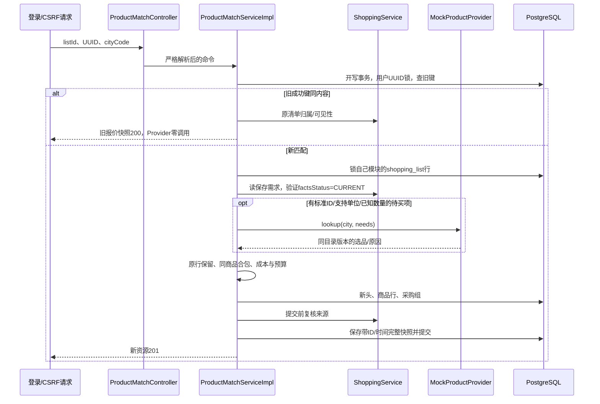

# T17：商品匹配与成本实现详解

日期：2026-10-06；契约shopping-products-v1。实现目录为5b09。本文解释当前源码，不将Mock当成真实平台、不将自动化当真人页面验收。精确验证数字见《工作报告-T17-Mock商品与成本快照》。

## 1. 用户操作、30秒与2分钟介绍

用户已用T16确认本餐材料，随后手动选城市，显式创建一次商品匹配。服务器查询本地Mock目录，保存商品规格、价格、三类成本与采购组；之后读取不再次报价。同一UUID是一次匹配操作，新UUID才显式获取新的价格快照。没有下单、支付、地址收集、持久库存或真实商家网络访问。

**30秒介绍**：购物需求与报价分开存。需求清单保留原人数、材料、确认和预算，报价通过Provider接口按标准食材ID及城市查明确Mock商品。同商品需求先合并再向上取整买包数，用BigDecimal分别算消耗成本与整包支出。价格/规格未知保留null，超预算也保存原清单；回看旧快照不受新价格影响。

**约2分钟讲述**：Controller保留项目认证与CSRF，只接UUID和六位城市字符串，客户端不能提供价格/商品/用户ID。Service先用用户UUID事务建议锁和内容hash处理旧键，再锁shopping_list自己的行，通过既有ShoppingService.get核验归属与事实CURRENT；不跨模块查Mapper，也不要求当前餐仍停在旧版本。服务器从已保存T16 items挑出明确标准ID、已知数量、支持单位的需求，调用本地Mock Provider一次，得到同一目录版本的候选选择。

Provider先分标准ID、城市、可用状态与单位维度，再用未舍入单价、包装支出、商品ID确定排序。计算器保留所有原需求项，足量已有与未知量都不送Provider；同商品/城市/单位的确定缺口合为采购组，包装支出只按组算一次，原T16 optional分组不被修改。关系列保存归属、状态、数量、报价、成本，JSONB留完整响应与报价证据；新V14不更新旧清单。创建头/明细/采购组后再次核验来源，失败全回滚；GET/latest/同键重放只读快照并重新核验权限，Provider零调用。公开响应固定MOCK、realData=false、purchaseUrl=null，不承诺真实采购价格。

## 2. 真实代码地图

Java路径根为 `backend/src/main/java/com/cooker/shopping`：

```text
controller/ProductMatchController.java          POST、GET指定、GET latest
dto/ProductMatchRequest.java                   UUID+cityCode局部严格解析
service/ProductMatchService.java               create/get/latest与Creation
service/impl/ProductMatchServiceImpl.java       锁、幂等、Provider、事务与历史
service/ProductMatchCalculator.java             needs、候选结果、合包、成本/预算
provider/ProductProvider.java                  Need/Product/Selection/Offers契约
provider/MockProductProvider.java               本地目录验证与确定性候选排序
config/MockCatalogProperties.java               cooker.shopping.mock绑定；默认空
vo/ProductMatchView.java                        匹配行、商品、采购组、总金额
entity/ProductMatchRow.java                     头表内部映射
mapper/ProductMatchMapper.java                  shopping专属SQL接口
mapper/ProductQuoteJsonTypeHandler.java         商品记录JSON证据转换
backend/src/main/resources/
  mapper/shopping/ProductMatchMapper.xml        所有新持久化SQL
  db/migration/V14__create_shopping_product_matches.sql
docs/examples/t17-mock-catalog.example.yml       空目录及注释配置形状
```

阅读顺序：Controller→Request→ServiceImpl.create→Calculator.needs→Provider.lookup→Calculator.calculate→Mapper XML/V14→ServiceImpl.read。既有ShoppingService.get、ShoppingMapper.lockRequest、ShoppingJson、ShoppingDemandCalculator.baseUnit/baseAmount复用；这些T16生产文件没有修改。新模块没有调用conversation/recipe Mapper。

技术依赖仍为Java21、Spring Boot4.0.8/MVC/Security、MyBatis-Plus3.5.17、PostgreSQL18、Boot管理Flyway、现有Jackson2与BigDecimal。配置使用Spring Boot原有ConfigurationProperties/Binder，没有加新的配置框架；Mockito/Testcontainers仅测试。T17没有新增Maven依赖、模型、MQ或Cloud。

## 3. HTTP与完整请求流

实际API有全局 `/api` 前缀：

```text
POST /api/shopping-lists/{listId}/product-matches
GET  /api/shopping-lists/{listId}/product-matches/{matchId}
GET  /api/shopping-lists/{listId}/product-matches/latest
```

POST只有两个字段，示例完全虚构：

```json
{"requestId":"00000000-0000-4000-8000-000000000001","cityCode":"110000"}
```

listId与matchId是正整数字符串；cityCode也必须字符串，数字110000不被转换接受。未知字段、重复键、尾随JSON、非法UUID都400。首次201，同键同内容200；latest没有已存结果时200且data=null。



GET和latest调用新Mapper读取已保存view_json，但先核验当前用户和原菜谱可见性；事实改变时只将响应factsStatus改为CHANGED，数据库旧view/价格不更新。latest按头表id倒序，匹配同一清单的新写事务由list行锁串行，历史顺序明确。

## 4. Provider为什么存在，Mock怎么配置

Provider把“从哪得到商品”与“怎么算/保存成本”分开。当前接口lookup一次处理一批Need，每个Need只含服务器itemKey、standard ingredientId、缺口量和单位；Offers带统一catalogVersion及逐需求Selection。名字仅用于展示，绝不把“葱/大葱”等文字模糊映射到另一个标准ID。

默认MockCatalogProperties为empty-v1、products=[]；没有目录就是NO_PRODUCT，不能为了演示内置假生产ID。目录Product含productId、ingredientId、name、cityCodes、available、包量/单位/价格、CNY以及可选referenceUnitPrice/referenceUnit。所有商品继承一次Offers的统一目录版本，避免同次响应混用目录版本。

Config在实际查询时验证：版本/商品ID受限、商品ID不重复、标准ID为正、名称/城市非空合法、货币CNY；包量可缺失，否则>0、≤1e9、最多8小数；包价可缺失，否则非负、最多2小数且在numeric(18,2)范围；参考估价及单位必须成对，量价超界/负数配置明确失败。缺失规格/价格为QUOTE_UNKNOWN，非法负值不能当免费商品。

候选顺序实际compare用交叉乘积比较单价：`priceA*basePackB` 对 `priceB*basePackA`，不用先把比例舍入到两位。单价一样再比较该需求整包支出，最后按productId排序。G/KG、ML/L先转同维基础量；COUNT按明确计数单位处理，不与质量/体积混换，CUSTOM/未知需求单位不送Provider。

城市不支持、全部缺货、目录无绑定、规格维度不兼容、报价缺失分别留下中文原因。新匹配允许部分成功，原行不丢弃。已有足量和未知用量不查询Provider；本轮纯未查询快照catalogVersion=NOT_QUERIED，诚实表示无需取目录，而不是暗示用过某版本价格。

交付示例文件的products默认空，配置项全是注释，无密钥且不自动加载。后续获环境准备允许后，可先只读核对实际标准ID，不根据名称猜ID：

```sql
-- 仅在获准的核对环境使用真实list/user参数，不自动改库。
SELECT i.ingredient_id, g.canonical_name, g.normalization_status, i.unit_code
FROM shopping_list_item i
JOIN ingredient g ON g.id=i.ingredient_id
WHERE i.list_id=:list_id AND i.user_id=:viewer_user_id;
```

核对清单原标准ID、REVIEWED状态及单位后，复制示例到个人外部配置文件，显式填对应ID/城市/包量/价格并保留Mock标识。另行获部署允许时才用Spring附加配置加载；本次不改运行application、开发库或启动参数，也不导入商品。ConfigurationProperties与附加配置机制参见[Spring Boot4.0外部配置](https://docs.spring.io/spring-boot/4.0/reference/features/external-config.html)。配置绑定已经MockCatalogBindingTest实际验证，测试标准ID42仅属于虚构绑定，不是生产ID建议。

Provider现在为本地确定性代码，允许放在短事务。未来真实平台有网络等待、失败、限额与外发权限，不能把网络调用原样搬进当前持锁流程，需另冻结事务/执行契约。

## 5. 合包、三类成本与未知

每个T16 itemKey与lineKeys原样保留。新匹配Line状态为HAVE_ENOUGH、MATCHED、QUANTITY_PENDING、UNIT_UNSUPPORTED、NO_PRODUCT、OUT_OF_STOCK或QUOTE_UNKNOWN。整体无待买项NOT_NEEDED，全明确MATCHED，部分明确PARTIAL，全不明确NO_MATCH；未知项始终留在lines。

ProductMatchCalculator先为MATCHED计算明细消耗，再按 `productId:cityCode:baseUnit` 合并采购组；T16因optional分开的两条也能合包，但原清单仍分开。PurchaseGroup给原itemKeys、合量、商品、包数、支出。明细purchaseOutlay是该行独立购买时的包价，用于解释；**总支出只累计purchaseGroups，不能把明细支出再加一遍**。

| 场景 | 消耗成本 | 采购支出 | 独立预估 |
|---|---:|---:|---|
| 需10g，100g/包10元 | 1.00 | 10.00 | 无reference则null |
| 需110g，同规格 | 11.00 | 20.00 | 无reference则null |
| 同商品两个10g行 | 合计2.00 | 合包只10.00 | 只有显式reference才算 |
| 全足量已有 | 0.00 | 0.00 | 0.00，无Provider查询 |
| 部分用量/报价未知 | 完整金额null，knownSubtotal保留 | 完整金额null | 独立未知计数 |

estimatedDemandCost仅基于显式referenceUnitPrice及referenceUnit；模拟成交包价不自动成为独立估价。只有成交成本已知、估价缺失时，budget仍可比较消耗成本，但estimatedDemandCost为null；estimatedKnownSubtotal/estimatedUnknownItemCount另说明估价完整性。

中间BigDecimal精度80位，明细最终HALF_UP两位；总消耗/估价由中间值累加后最终舍入。包装数单独CEILING，购买金额按组累计。两个1/3元需求总额0.67，不是逐行0.33后合0.66。源码用BigDecimal，无double/科学计数响应；quantityColumn在保存前检查numeric(24,8)，money检查numeric(18,2)，溢出400且回滚。规则依据见[Java21 BigDecimal文档](https://docs.oracle.com/en/java/javase/21/docs/api/java.base/java/math/BigDecimal.html)。

预算比较未具备部分的消耗成本：全已知WITHIN_BUDGET或OVER_BUDGET；有预算但未知UNKNOWN；无预算NOT_SET。超预算仍保存清单并提示，不换菜不增预算。所有消耗金额来自Mock报价，不是支付后的真实账单。

## 6. V14、事务、唯一键与历史

三个新表：shopping_product_match（头）、shopping_product_match_item（需求报价行）、shopping_product_purchase_group（实际合包组）。头含用户/清单、UUID/input_hash、source_fingerprint、城市/目录/Mock元数据、captured_at、matching/budget状态、金额和完整view_json。商品行含需求数量、规格价格/包数、成本、商品ID及quote_json；组表含总量、包数、组支出，核心数值不只藏JSON。

头复合FK `(list_id,user_id)` 指向原shopping_list；明细/组 `(match_id,list_id,user_id)` 指向新头，防止分别存在的ID拼成别人的报价。头UNIQUE(user_id,request_id)，明细按match+itemKey及顺序唯一，组按match+groupKey唯一，latest索引 `(user_id,list_id,id DESC)`。删除源清单沿FK级联报价三表；T17没有公开删除接口。CHECK限制Mock标识、状态、非负/非NaN金额、数量和整数包数，MATCHED必须有量价包数。numeric/JSONB数据分工参见[PG numeric](https://www.postgresql.org/docs/18/datatype-numeric.html)。

同键逻辑用输入摘要 `listId+cityCode`，UUID不进入内容hash，目录当前价也不进入，才能稳定重放旧价。Service复用shopping自己的用户UUID事务建议锁，先查成功键，再锁源清单行。INSERT使用 `ON CONFLICT(user_id,request_id) DO NOTHING RETURNING id`，空ID受控回读，不在已失败PG事务捕获23505继续查。四请求并发实测要求一个201、三个200且Provider仅一次。语法及原子写行为参见[PG INSERT](https://www.postgresql.org/docs/18/sql-insert.html)。

锁都在shopping内部，未删除T16创建父锁或更改旧餐单Service。锁源清单防止本次报价提交期间被删除/同清单报价错序，不锁当前餐版本作为报价依据。事实复核通过原ShoppingService.get，其中原recipe公共读取独立事务看到已提交事实变动；报价写完后再次复核，失权或CHANGED回滚全部新报价。任意外部无协调写在最后复核后发生的竞争仍需未来写入口协议，不能声称这些锁能锁住所有菜谱编辑。PG行锁概念见[显式锁](https://www.postgresql.org/docs/18/explicit-locking.html)。

历史读取从DB快照反序列化，通过原清单Service复核当前权限：失权404，仍可见但事实变化CHANGED，原金额不改。目录涨价、城市新匹配、当前餐修订均不重写旧快照；新UUID才查询Provider。GET/latest不会恢复动作、查商品或调用模型。

## 7. MySQL对照、失败与测试

| 已熟悉的Spring Boot/MySQL做法 | 当前项目对应及取舍 |
|---|---|
| Controller/Service/Mapper | 分层相同，新Provider隔离选品来源，纯计算不含SQL |
| DECIMAL+BigDecimal | PG numeric，列范围前置检查，JSONB留完整证据 |
| 需求表随价格UPDATE | 采用独立报价资源，需求不可变，报价历史可重放 |
| 普通唯一索引 | 用户UUID唯一+内容hash，防重复且拒异内容 |
| 重复键处理SQL | PG ON CONFLICT RETURNING；不能照搬MySQL语法或失败事务续查 |
| 应用同步锁/禁按钮 | 多进程不可依赖；采用数据库建议锁/源行锁/唯一约束 |
| 逐行包装金额求和 | 同商品合包后只计组支出，避免两菜各买一包 |
| JSON全存方便 | 核心数量状态归属用列/FK，报价证据用JSONB，可约束也可回看 |

选型代价：独立报价表增加存储/查询层次，但不破坏T16历史；本地目录确定性易测试但不代表真实商品覆盖；悲观锁便于顺序一致，单清单新匹配需等待上一次事务。批处理Provider避免一次响应多版本，但当前没有热更新/生产吞吐保证。

失败映射：认证401、CSRF403、归属/失权404、严格参数/数值越界400、同键异内容409 SHOPPING_MATCH_REQUEST_CONFLICT、新来源CHANGED409 SHOPPING_SOURCE_CHANGED、Provider整体异常502 SHOPPING_PROVIDER_UNAVAILABLE。部分无商品不是整体502，而是保存未知结果。明细数据库故障500且整事务回滚，不公开目录全文/SQL/堆栈。

测试入口：ProductMatchingTest（排序、成本、合包、未知/上界、严格请求）；MockCatalogBindingTest（真实Binder及空默认）；ProductMatchMigrationPostgresTest（V13→V14、复合FK23503/指定constraint、NaN/包数与级联）；ProductMatchPostgresHttpTest（认证真实HTTP、创建/GET/latest、并发、涨价历史、城市/缺货/部分匹配、回滚/失权）；T16测试与旧业务继续回归。每采购测试段验证ModelGateway/RecipeSearchService/QueryEmbeddingService无调用；建餐setup仅替身，不冒充真实模型结果。

复现使用独立POM和临时PG，避免改运行classes：

```powershell
# 工作目录backend，只在当前进程设置环境
$env:JAVA_HOME='C:\Program Files\Java\jdk-21'
$env:PATH="$env:JAVA_HOME\bin;$env:PATH"
$env:DASHSCOPE_API_KEY=''
$env:LLM_CREDENTIAL_MASTER_KEY=''
$env:COOKER_JWT_SECRET=''
mvn -o -f target/t17-package-pom.xml '-Dtest=ProductMatchingTest,MockCatalogBindingTest,ProductMatchMigrationPostgresTest,ProductMatchPostgresHttpTest,ShoppingRequestTest,ShoppingCalculationTest,ShoppingMigrationPostgresTest,ShoppingDemandPostgresHttpTest' test
mvn -o -f target/t17-package-pom.xml test
mvn -o -f target/t17-package-pom.xml -DskipTests package
```

## 8. 八个面试问答

1. **为什么新报价不更新T16清单？** 简答：需求与报价生命周期不同。原理：人数/确认是一次需求事实，报价随目录城市变化，独立资源可重放。追问：旧价格过期如何处理？新UUID显式新报价，旧快照继续可回看。证据：ProductMatchServiceImpl.create/read、涨价历史与原清单字节不变测试。
2. **为什么要Provider接口？** 简答：隔离来源与业务计算/持久化。原理：Mock只本地读取，未来平台可能网络/限额，接口不代表现事务可直接承载外部请求。追问：默认无目录如何演示？返回未匹配，不猜生产ID。证据：ProductProvider.lookup、MockCatalogProperties、空目录HTTP。
3. **候选怎样保证确定性？** 简答：精确单价、整包支出、商品ID排序。原理：交叉乘比较比例，不被金额展示舍入影响；先按城市/可用/单位过滤。追问：同单价不同包量？按当前需要整包支出比较。证据：MockProductProvider.compare、候选纯测试。
4. **为什么两份10g不能各计一包？** 简答：同商品先合20g，再CEILING包装数。原理：T16逐菜/optional需求与真实采购包装不是同一层；组表引用原itemKeys。追问：明细包价怎么用？独立行解释，不重复加到总额。证据：Calculator.groups、两个需求合一组HTTP断言。
5. **三类成本都来自商品包价吗？** 简答：不，独立预估必须显式reference。原理：成交模拟报价不能充当不存在的估价来源，actual完整未知与estimated未知计数分开。追问：价格知、reference缺失预算能否判断？按消耗成本判断，预估仍null。证据：Calculator.estimate及纯测试。
6. **幂等为何不将当前目录版本加input_hash？** 简答：重试应返回首次成功价。原理：输入hash只list+city，UUID识别操作；如果包含新目录，重试会误冲突。追问：新城市同UUID怎样？409；新UUID允许新快照。证据：ServiceImpl.inputHash、同键异内容/涨价/并发测试。
7. **Provider失败会不会留半份报价？** 简答：整体502或后续故障回滚，头/明细/组同事务。原理：唯一原子写不让事务进失败状态后续查；创建最后复核来源。追问：某条无商品是否全失败？不，部分结果保存PARTIAL/NO_MATCH。证据：故障触发器、Provider后独立事实变动测试。
8. **报价历史失权时怎么保护？** 简答：GET/重放复核原清单与菜谱可见性，404不泄漏。原理：历史存有原事实不能绕过当前授权；CHANGED与UNAVAILABLE不同。追问：当前餐修订是否拒旧报价？不会以当前餐版本否定旧需求，仍验原事实可见性。证据：ServiceImpl.read、失权和修订HTTP。

## 9. 学习清单、自检与练习

当前必须理解：Provider适配边界、ConfigurationProperties绑定、显式标准ID、确定性比例排序、BigDecimal最终舍入、合包组、独立估价来源、用户UUID幂等、复合外键、价格快照/权限复核。后续深入：真实平台网络事务、目录热更新原子性、生产吞吐/锁等待、报价有效期与库存/支付；本轮没有实现这些。

五个自检：

1. 不看图复述POST到保存的链路，指出哪一步查询Provider及哪些读取不会查询。
2. 同UUID切城市和新UUID不切城市各代表什么？
3. 两个10g同商品100g/包10元，为什么行支出相加会错？
4. knownSubtotal为4.00、unknownItemCount为1、预算10元，能否说满足预算？
5. 为什么所有商品GET中的purchaseUrl是null，realData=false不能省略？

答案要点：1新创建need非空才调用lookup，GET/latest/旧键不调用；2前者409，后者显式新价格快照；3合20g只买一包10元；4不能，UNKNOWN且完整金额null；5数据是本地Mock，不能虚构真实平台或购买入口。

**练习一（手算）**：两行各需55g，同商品100g/包10元；独立参考0.08元/g、预算10元。答案：总110g，consumption11.00、purchase20.00、estimated8.80，OVER_BUDGET仍保存；reference缺失只使estimated未知，不把11.00成交折算当独立预估。用ProductMatchingTest添加同形状断言验证。

**练习二（代码/SQL）**：设计同时四个同UUIDPOST后修改目录价格，随后GET/latest/旧键POST的实验。答案：首次一个201三个200一个ID，Provider一次；变价后上述三个历史操作Provider零调用且旧价不变；新UUID才保存新价/latest更新。用ProductMatchPostgresHttpTest复现，仅隔离PG，不能直接在开发库操作。

教学文档完成不代表已掌握；建议独立画请求流、回答追问并运行一项隔离实验再自检。
