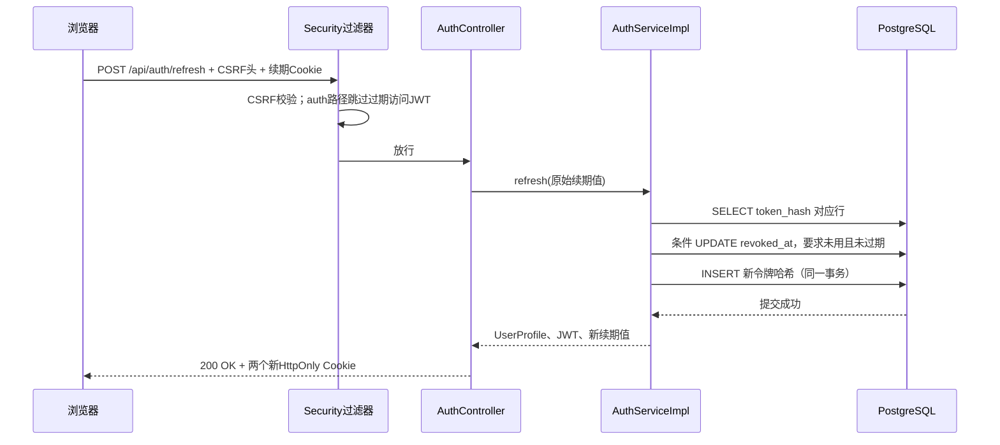

# T7 技术文档：身份与记住我实现详解

契约 `s2-api-v1`，代码工作树 `C:\Users\Omelet\.codex\worktrees\0f47\Cooker`，日期 2026-09-30。本文只讲已实现的 T7。F2-A 浏览器真实联调尚待验收，T8 凭证和 T9/T10 菜谱业务未实现。

## 1. 用业务语言讲清楚

用户注册后，用用户名密码登录。服务器给浏览器两个 HttpOnly Cookie：短期 JWT `COOKER_ACCESS` 和随机续期凭证 `COOKER_REFRESH`。访问 JWT 过期后，浏览器调用续期接口；数据库原子撤销旧续期令牌并保存新令牌。勾选“记住我”只让续期 Cookie 在浏览器持久 30 天上限，访问 JWT 仍是 15 分钟。不勾选时续期 Cookie 是会话 Cookie，数据库期限 24 小时。退出撤销当前续期令牌并清 Cookie。

**30 秒项目介绍**：我在 Cooker 阶段二做了基于 Spring Security 的用户名密码认证。密码用 Argon2id 哈希；访问端是短期签名 JWT，续期端是数据库保存哈希的随机令牌。Cookie 认证配合 CSRF，续期通过 PostgreSQL 条件更新防止并发重复消费。HTTP、迁移和两用户隔离都用真实 PostgreSQL 测过，浏览器端还需与 F2-A 联调。

**约 2 分钟技术讲述**：请求先经过 Spring Security 过滤器链，CSRF 在写操作前检查 `X-XSRF-TOKEN`；`AccessCookieFilter` 对受保护路径从 Cookie 取访问 JWT，用 `JwtService` 校验 HS256 签名、issuer、audience 和到期。`AuthController` 只收 DTO、调 `AuthService`，`AuthServiceImpl` 处理 Argon2id、用户名归一化和数据库事务。注册用唯一键防并发重复。登录生成 32 字节随机续期值，数据库只存 SHA-256 哈希。续期先查哈希，再通过 `UPDATE ... revoked_at IS NULL AND expires_at > CURRENT_TIMESTAMP` 竞争旧令牌；只有更新 1 行的事务能插入新令牌，失败者返回 409 `REFRESH_CONFLICT` 且不清 Cookie。30 天是绝对截止，不因轮换延长。退出仅撤销续期，已签发 JWT 在剩余 15 分钟内仍可能有效。真实容器测试覆盖 HTTP、CSRF、Cookie、轮换、并发和隔离；跨浏览器关闭重开仍待前端联调。

## 2. 代码地图

```text
backend/src/main/java/com/cooker/
├─ common/ApiResponse.java, ApiException.java, ApiExceptionHandler.java
└─ identity/
   ├─ controller/AuthController.java
   ├─ dto/RegisterRequest.java, LoginRequest.java
   ├─ vo/UserProfile.java
   ├─ service/AuthService.java, CurrentUserService.java, JwtService.java（接口）
   ├─ service/impl/AuthServiceImpl.java, CurrentUserServiceImpl.java,
   │              JwtServiceImpl.java（JWT 签发和验签实现）
   ├─ mapper/AppUserMapper.java, RefreshTokenMapper.java
   ├─ entity/AppUserEntity.java, RefreshTokenEntity.java
   └─ config/IdentityProperties.java, IdentitySecurityConfig.java,
              AccessCookieFilter.java, CookieService.java
backend/src/main/resources/
├─ db/migration/V4__create_identity_tables.sql
└─ mapper/identity/RefreshTokenMapper.xml
```

阅读顺序：先看 `AuthController` 六个路径，再看 `AuthService` 与 `AuthServiceImpl` 的 `register/login/refresh/logout`；随后看 `JwtService` 接口、`JwtServiceImpl.issue/verify`，读 `IdentitySecurityConfig.security` 与 `AccessCookieFilter.doFilterInternal`，最后对照 V4 和 XML `consume/revoke`。`CurrentUserServiceImpl.requireUserId` 是未来 T9/T10 获取用户边界的唯一 Service 入口，业务模块不得直接访问身份 Mapper。

## 3. 一次成功续期的完整时序



浏览器只把原始令牌作为 Cookie 发出，Service 先 SHA-256 哈希再查库。Controller 的 JSON `data` 只有 `{id, username}`，不含令牌。`CookieService.write` 把令牌写入 Set-Cookie；`AuthServiceImpl.refresh` 的 `@Transactional` 覆盖消费旧令牌和保存新令牌。受保护的 `GET /api/users/me` 则由 `AccessCookieFilter` 验 JWT，把已验证 userId 放到 SecurityContext，再由 `CurrentUserServiceImpl` 取当前用户；这与传统 Controller 直接读请求参数中的 userId 不同。

Spring Security 过滤器在 MVC Controller 之前处理认证和 CSRF；传统 MVC `HandlerInterceptor` 已进入 MVC 层，难以作为完整安全链替代品。T7 的登录与续期路径跳过访问 JWT 验证，但仍受 CSRF 保护，所以过期访问 Cookie 不会挡住续期。

## 4. 核心数据与代码

V4 的 `app_user(id, username, password_hash, created_at)` 中 `username` 唯一且数据库 CHECK 为小写规范。`user_refresh_token` 保存 `user_id`、唯一的 `token_hash`、`expires_at`、`absolute_expires_at`、`remember_me`、`revoked_at`。`token_hash` 不是密码哈希：续期令牌是服务器生成的高熵随机值，SHA-256 用于避免数据库直接暴露原值；人类密码熵低，必须用带内存成本的 Argon2id。两者不能互换。

`RefreshTokenMapper.xml` 中实际消费条件：

```sql
UPDATE user_refresh_token SET revoked_at = CURRENT_TIMESTAMP
WHERE token_hash = #{hash} AND revoked_at IS NULL
  AND expires_at > CURRENT_TIMESTAMP
```

并发时 PostgreSQL 在同一行上串行化更新，只有一个请求得到影响行数 1。`AuthServiceImpl.refresh` 若得到 0，返回 409 `REFRESH_CONFLICT`；成功者在同一事务插入新哈希。若只先 `SELECT` 再无条件更新，两线程可能都签发成功；`IdentityHttpPostgresTest` 用两个并发线程断言恰好一个成功且新令牌仍可再次续期。旧令牌重放也断言 409。用户名重复最终由数据库唯一约束裁定，不能只靠先查再插。

`JwtService` 是项目接口，`JwtServiceImpl.issue` 只把十进制 userId 写入 subject，并写 issuer、audience、issuedAt、expiresAt；`verify` 用同一密钥验签，验证 issuer、audience 以及**已有** `exp/nbf` 的时间条件。签发器总写 `iat/exp`，但当前验证器**不额外校验未来的 `iat`，也不要求 `exp` 必填**；`JwtServiceTest` 用虚构签名令牌记录了这两个边界，不能把“正常签发内容”误说成“所有输入令牌的必需声明”。没有签名密钥的人仍不能据此伪造可通过验签的令牌。JWT 是签名数据，不是加密容器，不能放密码或 Key。`IdentityProperties` 有效期必须为正，密钥至少 32 字节；本地测试用虚构密钥，实际运行从环境注入。当前采用单一 HS256 对称密钥，未来多实例轮换密钥需要协调密钥版本，T7 未实现。

`IdentitySecurityConfig` 启用 Cookie CSRF 令牌库；`GET /api/auth/csrf` 把 token 返回给页面内存，写请求在 `X-XSRF-TOKEN` 提交。认证 Cookie 为 HttpOnly、SameSite=Lax；生产默认 Secure，本地 `local` 配置关闭 Secure。SameSite 有帮助，但不能替代 CSRF，因为 Cookie 会随请求自动带上。登录、退出后 CSRF 令牌作废，前端须重新获取。访问 Cookie Path `/api`，续期 Cookie Path `/api/auth`，不设置 Domain。Cookie 持久化只用于 rememberMe；未勾选时不写 `Max-Age`，但浏览器会话恢复功能可能保存会话 Cookie，不能承诺关浏览器即注销。

## 5. 技术栈与 Spring Boot + MySQL 对照

实际依赖：Java 21；Spring Boot 4.0.8 Web MVC/Validation；Spring Security 的过滤器、Argon2id 编码器、JWT JOSE；Bouncy Castle 1.82 提供 Argon2 算法；MyBatis-Plus 3.5.17 的 BaseMapper；PostgreSQL 18 + Flyway。没有引入 Cloud、MQ、Agent 或模型调用。

| 决策 | 本实现 | 替代及取舍 |
|---|---|---|
| 登录状态 | 15 分钟 JWT + 服务端可撤销续期 | 长期 JWT 组件少但无法方便撤销且泄露窗口长；传统 Session 易撤销，但本阶段用户选 JWT |
| 密码存储 | Argon2id 强哈希 | 快速 SHA-256 不适用于人类密码；可逆加密会暴露明文 |
| 续期并发 | PostgreSQL 条件 UPDATE + 事务 | Java `synchronized` 只约束单 JVM；先查后写在多实例下不可靠 |
| 数据结构 | Flyway V4、BIGINT identity、唯一键/CHECK | MySQL 中对应 AUTO_INCREMENT、唯一索引与约束；Flyway 思路相同，不能靠 ORM 自动建表 |

熟悉的 Spring Boot + MySQL `Controller → Service → Mapper → SQL` 仍适用；T7 只是在 Controller 前增加 Security 过滤器。`@Transactional` 放在 Service 实现，类似 MySQL/InnoDB 事务。PostgreSQL 的 `TIMESTAMPTZ` 保存带时区时间；条件 UPDATE 与唯一键一起承担并发正确性，不能只靠前端按钮状态。`CurrentUserService` 让 T9 通过已验证身份取得 userId，相当于服务层明确的用户上下文，绝不能相信浏览器自报 userId。

## 6. 失败路径与真实限制

- 注册用户名无效或密码长度错误：400 `VALIDATION_ERROR`；数据库唯一键冲突：409 `USERNAME_TAKEN`。登录用户名不存在或密码错误统一 401 `LOGIN_FAILED`，响应不区分哪一项错误。
- 非法 JSON、`rememberMe` 类型错误或缺少必需请求体：400 `VALIDATION_ERROR`。`ApiExceptionHandler.invalidInput` 单独处理 MVC 的请求体读取和类型转换异常，不把原文、密码或解析器细节回传。真实内部异常仍由 `unexpected` 返回脱敏 500 `INTERNAL_ERROR`；两类故障不能混为一谈。
- 未携带访问 JWT 调 `me`：401 `AUTH_REQUIRED`；过期或验签失败：401 `ACCESS_TOKEN_EXPIRED`。后者代码名也覆盖无效签名，前端动作都是尝试一次续期；后续可细化日志指标，但不能把令牌内容写日志。
- 写请求缺少/错误 CSRF：403 `CSRF_INVALID`；已认证但无权限：403 `ACCESS_DENIED`。401 是身份欠缺，403 是请求已被拒绝，前端不能把 CSRF 403 当登录过期。
- 续期无 Cookie、未知或已过期：401 `REFRESH_REJECTED`；旧令牌已经被另一请求消费：409 `REFRESH_CONFLICT`。冲突响应不清 Cookie，因为另一标签页可能刚收到有效新 Cookie。
- 退出后续期失败；已经签发的访问 JWT 仍可能在剩余 15 分钟内有效。本版不承诺全设备即时注销。数据库记录会积累，清理过期/撤销行是未来维护任务；本任务没有删除既有数据。
- 登录接口尚无速率限制与设备清单；未知用户与错误密码存在耗时差异，统一错误文案不是完整防枚举方案。JWT 密钥如果在部署时改变，旧访问 JWT 失效；应通过稳定 Secret 注入与密钥轮换设计管理。

## 7. 测试和复现

在工作树 `backend` 用 JDK 21：`mvn -q test`。2026-09-30 修复后结果是 42 个测试、0 失败、0 错误、1 个既有收费 T6 测试跳过。Docker Desktop 可用时，`IdentityHttpPostgresTest` 使用项目 PostgreSQL 18 镜像，从空库自动跑 V1～V4，再经真实 HTTP 检查 Cookie、CSRF、注册/登录、隔离、轮换、并发、退出，并断言非法 JSON、错误类型和缺失 body 均为 400；`ApiExceptionHandlerTest` 验证内部故障脱敏 500。`JwtServiceTest` 检查签名、签发方、受众和过期，并用虚构令牌确认当前不拒绝缺失 `exp` 与未来 `iat`。已有 Compose 库运行 V4 后仍有 372 行菜谱；没有删除或覆盖数据。示例 SQL 只读：`SELECT version, success FROM flyway_schema_history ORDER BY installed_rank;`，`SELECT count(*) FROM app_user;`，`SELECT count(*) FROM recipe;`。API 复现顺序：`GET /api/auth/csrf` → 携带返回 token 与 Cookie 的 `POST /api/auth/register` → `POST /api/auth/login` → `GET /api/users/me` → `POST /api/auth/refresh` → `POST /api/auth/logout`。密码和 Cookie 使用虚构占位，不把实际值记在笔记中。

## 8. 面试问答与追问

1. **为什么不用长期 JWT 做记住我？** 答：长期签名令牌泄露后难撤销；本实现短 JWT + 可撤销随机续期。原理：把长期风险集中在可轮换数据库行。追问：退出后访问 JWT 还有效多久？证据：`CookieService`、`AuthServiceImpl.logout`。
2. **JWT 为什么仍会访问数据库？** 答：普通 JWT 校验本身不查续期表；`me` 为返回当前用户名查用户表，续期与退出必查令牌状态。原理：JWT 签名和用户资料/撤销是不同事实。追问：如果用户被删除怎么办？证据：`JwtService.verify`、`CurrentUserServiceImpl.currentProfile`。
3. **401 与 403 怎么分？** 答：缺失/失效身份是 401；CSRF 校验失败或无权操作是 403。原理：前端仅对认证 401 尝试有限续期，对 CSRF 403 重新取令牌。追问：为何不能把所有错误设 200？证据：`IdentitySecurityConfig`、`ApiExceptionHandler`、HTTP 测试。
4. **为什么密码用 Argon2id，续期令牌却用 SHA-256？** 答：密码是人选的低熵值，需慢哈希；续期令牌是 32 字节 CSPRNG 高熵值，快速单向哈希足够避免明文落库。追问：密码能否解密？证据：`passwordEncoder`、`AuthServiceImpl.issue/hash`。
5. **并发两个 refresh 为什么只会成功一个？** 答：同一哈希上的条件 UPDATE 在数据库内竞争，影响行数只可能有一个为 1；事务保证插入新令牌与撤销旧令牌同成败。追问：单 JVM 锁能否替代？证据：XML `consume`、`IdentityHttpPostgresTest` 并发断言。
6. **记住我期限为何不会无限延长？** 答：登录时保存 `absolute_expires_at`，每次续期把新到期时间限制在该值内。追问：不勾选时关浏览器一定退出吗？证据：`AuthServiceImpl.login/refresh`、`CookieService.write`。
7. **Cookie 已经 SameSite=Lax，为什么还做 CSRF？** 答：Cookie 自动随请求发送，SameSite 的保护有场景边界；写请求还需不可预测的 CSRF token。追问：登录后为什么重新取 CSRF？证据：`AuthController.csrf/login/logout`、`IdentitySecurityConfig.csrfRepository`。
8. **为什么 auth 路径忽略过期访问 JWT？** 答：续期依赖续期凭证，过期访问 Cookie 若先被认证过滤器拦截，会让登录与恢复无法执行。追问：忽略 JWT 是否也忽略了 CSRF？答案是否定的。证据：`AccessCookieFilter.doFilterInternal`、HTTP 的 CSRF 403 断言。
9. **数据库唯一约束与 Service 校验各做什么？** 答：Service 给友好校验和错误，唯一约束在并发下做最终裁决。追问：先 SELECT 后 INSERT 能防重复吗？证据：V4 `app_user.username UNIQUE` 与 `AuthServiceImpl.register`。

## 9. 学习路线、自检与练习

当前必须理解：Controller/Service/Mapper 的职责；过滤器链在 MVC 前；Argon2id 与 JWT 签名区别；Cookie Path/HttpOnly/Secure/SameSite；CSRF；事务内条件 UPDATE；401/403/409。后续深入：密钥轮换、登录限速、设备级撤销、多实例部署与过期行清理。可读官方材料：[Spring Security CSRF](https://docs.spring.io/spring-security/reference/servlet/exploits/csrf.html)、[Spring Security JWT](https://docs.spring.io/spring-security/reference/servlet/oauth2/resource-server/jwt.html)、[PostgreSQL UPDATE](https://www.postgresql.org/docs/current/sql-update.html)、[Flyway 文档](https://documentation.red-gate.com/fd/migrations-271585107.html)；密码存储参考 [OWASP Password Storage](https://cheatsheetseries.owasp.org/cheatsheets/Password_Storage_Cheat_Sheet.html)。

自检题（先自己回答，再用右侧要点核对）：

1. 从浏览器发起 refresh 到新 Cookie 返回，画出所有层和事务边界。要点：CSRF → Controller → Service 条件 UPDATE/INSERT → Cookie，auth 路径跳过访问 JWT。
2. 同一个旧令牌两线程同时刷新，哪一步决定胜负？要点：数据库 `consume` 影响行数；失败者 409 且不清 Cookie。
3. 用户登出后旧 JWT 还能否访问 `me`？要点：可能，直到签发的到期时间；续期已撤销。
4. 为什么注册不能只在 Service 先查用户名？要点：检查与插入有竞态，唯一约束最终保证。
5. `CSRF_INVALID` 与 `ACCESS_TOKEN_EXPIRED` 在前端动作有什么区别？要点：403 重新取 CSRF，401 尝试一次续期。
6. 数据库泄露后密码哈希和续期哈希分别有何风险？要点：密码低熵需 Argon2id，随机续期高熵；密钥和原始 Cookie 不在库中。

练习 A：在本地独立测试库使用两个客户端并发提交同一个旧续期 Cookie，记录 HTTP 200/409 与 `revoked_at`；检验方法参见 `IdentityHttpPostgresTest`，不可使用真实账号凭证。练习 B：把测试 JWT 的 issuer 或 audience 改掉，再调用 `JwtService.verify`；预期拒绝。完成后尝试不看文档讲清整个登录到退出的请求流，并指出本设计仍需补的限速或密钥轮换及其代价。文档只是学习材料，不能据此断言使用者已经掌握。
