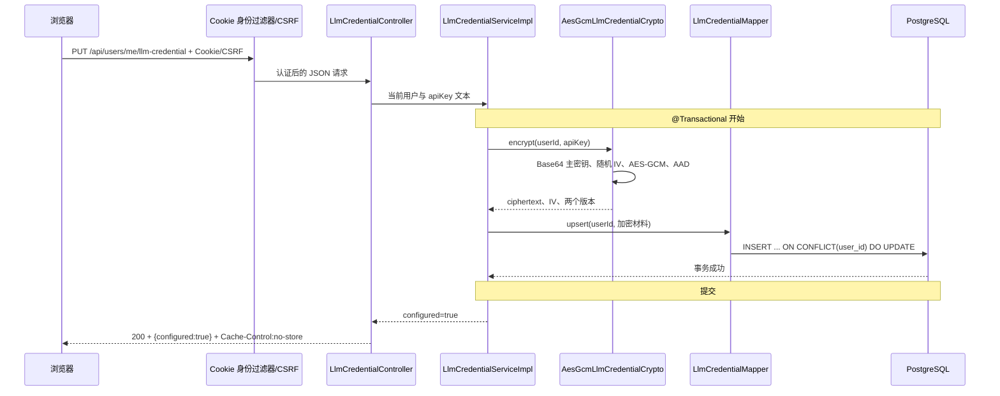

# T8 用户模型凭证实现详解

日期：2026-10-01；接口版本：`s2-api-v1`；实际代码位于指定共享工作树。本文只讲当前用户 DeepSeek Key 的密文存取和受控内部解密，不代表设置页面、Agent 接入、平台 Key 有效性验证或阶段二整体验收已经完成。

## 1. 用户操作与安全边界

用户日后在设置页提交自己的 API Key，后端按登录用户保存 AES-GCM 密文。页面只能读“已配置/未配置”；保存或覆盖都不把 Key、密文或尾号返回给浏览器。用户可以删除当前 Key，即使服务端加密主密钥暂时不可用也可删除。当前没有 Key 时状态接口返回 `configured=false`。未来 Agent 只能调用身份模块的 `decryptCurrentUserCredential()`，从当前认证上下文解密；没有按任意 `userId` 取明文的 Service 方法，也没有 HTTP 明文读取端点。本任务不向 DeepSeek 发请求，也不验证 Key 真伪。

**30 秒介绍示例**：T8 实现了按当前用户加密保存模型 Key、删除和脱敏状态查询。密码用 Argon2 单向哈希，JWT 用 HMAC 签名，模型 Key 则需要未来调用所以采用 AES-GCM 可逆认证加密。每次写入使用新的 12 字节随机 IV，认证标签覆盖用户 ID、凭证用途、算法版本和密钥版本。主密钥从 `LLM_CREDENTIAL_MASTER_KEY` 以 Base64 注入，数据库只有密文和元数据。真实平台调用和前端设置页仍未实现。

**约 2 分钟讲述示例**：写请求由 Cookie 身份过滤器和 CSRF 保护后进入 `LlmCredentialController`。`SaveLlmCredentialRequest` 用 Jackson 3 `JsonNode` 保留 JSON 原始类型，因为直接映射到 Java `String` 会把数值 42 强制转成字符串；Controller 只收文本节点，Service 再拒绝空白或超过 4096 字符的输入。Service 通过 `CurrentUserService.requireUserId()` 取得身份，`AesGcmLlmCredentialCrypto` 惰性解码环境注入的 32 字节主密钥，生成随机 IV，使用 AES/GCM/NoPadding 和 128 位标签，并将用户/用途/版本编码为 AAD。密文和 IV 通过 Mapper XML 的单用户 UPSERT 原子保存，事务提交后只返回 `{configured:true}`。状态只用 `EXISTS`，删除只用当前 `user_id` 执行 DELETE；两者不碰主密钥。未来 Agent 调用内部方法时重新查当前用户记录并用同一 AAD 解密。错误不携带 JCA 异常 cause，不打印请求体或 Key。主密钥缺失、格式错误和不匹配会让凭证操作安全失败，但应用能启动，既有登录、菜谱和状态/删除能力不依赖该密钥。

## 2. 代码地图

```text
backend/src/main/java/com/cooker/identity/
├─ controller/LlmCredentialController.java
│  ├─ save()    PUT 保存/覆盖，仅返回 configured
│  ├─ delete()  DELETE 当前用户凭证
│  └─ status()  GET 是否配置，不解密
├─ service/LlmCredentialService.java
│  ├─ saveCurrentUser / deleteCurrentUser / currentUserStatus
│  └─ decryptCurrentUserCredential（内部受控，不映射 HTTP）
├─ service/impl/LlmCredentialServiceImpl.java
│  ├─ saveCurrentUser：认证、校验、加密、事务内 UPSERT
│  ├─ deleteCurrentUser：事务内删除
│  └─ decryptCurrentUserCredential：当前身份查记录后解密
├─ service/impl/AesGcmLlmCredentialCrypto.java
│  ├─ encrypt / decrypt
│  ├─ decodeMasterKey / aad
│  └─ EncryptedCredential（数组防变更、toString 脱敏）
├─ mapper/LlmCredentialMapper.java
├─ entity/LlmCredentialEntity.java（toString 隐去密文/IV）
├─ dto/SaveLlmCredentialRequest.java（原始 JSON 类型、toString 脱敏）
└─ vo/LlmCredentialStatus.java
backend/src/main/resources/mapper/identity/LlmCredentialMapper.xml
backend/src/main/resources/db/migration/V7__create_user_llm_credential.sql
backend/src/test/java/com/cooker/identity/
├─ LlmCredentialHttpPostgresTest.java
├─ LlmCredentialMigrationPostgresTest.java
└─ service/impl/
   ├─ AesGcmLlmCredentialCryptoTest.java
   └─ LlmCredentialServiceImplTest.java
```

配置入口是根 `application.yml` 的 `cooker.identity.llm-credential.master-key`，仅映射 `${LLM_CREDENTIAL_MASTER_KEY:}`。空值是有意的启动默认值，代码不生成兜底密钥。T8 还未接入真实模型，凭证 Service 留在 `identity`，其他模块只能依赖 Service，不读 Mapper 或 Entity。

## 3. HTTP 请求与内部数据流



请求例子只用虚构占位：`PUT /api/users/me/llm-credential`，JSON `{"apiKey":"<虚构测试Key>"}`。实际成功响应是统一封装的 `{ "code":"OK", "message":"成功", "data":{"configured":true} }`。响应没有 Key、尾号、密文、IV 或版本。DELETE 同路径返回 `configured:false`，重复 DELETE 仍成功；GET `/api/users/me/llm-credential/status` 返回当前用户状态。三个响应均 `Cache-Control: no-store`。

写事务在 `LlmCredentialServiceImpl.saveCurrentUser`。加密先于 Mapper 写入；主密钥不可用时立即报通用 500，数据库不写明文也不覆盖旧行。DELETE 与数据库 `DELETE` 在同一 Spring 事务内。只读 status 使用 `SELECT EXISTS`，不加载或解密 Key。内部解密为只读事务：当前用户身份→同一用户行→校验两个版本、IV/密文长度→恢复主密钥→用记录用户 ID 重建 AAD→校验 GCM 标签并返回明文。

## 4. AES-GCM、AAD 与主密钥

真实核心调用摘录：

```java
Cipher cipher = Cipher.getInstance("AES/GCM/NoPadding");
cipher.init(Cipher.ENCRYPT_MODE, new SecretKeySpec(key, "AES"),
        new GCMParameterSpec(128, iv));
cipher.updateAAD(aad(userId, ALGORITHM_VERSION, KEY_VERSION));
byte[] ciphertext = cipher.doFinal(clear);
```

`SecureRandom` 每次产生 12 字节 IV；GCM 的 `doFinal` 输出包含认证标签，因此数据库字段 `ciphertext` 保存密文与 128 位标签，`iv` 单独保存。V7 约束 IV 长度为 12、密文至少 16 字节、版本均为正数。不能复用 IV；相同 Key 再保存会产生不同 IV 和密文。AAD 是不加密但受认证的数据，本实现按固定二进制格式编码用途字符串长度和 UTF-8 字节、`userId`、`algorithmVersion`、`keyVersion`。因此，即使数据库攻击者把 Alice 的密文行改挂到 Bob 身上，Bob 的用户 ID 进入 AAD 后，标签验证仍会失败；SQL 查询同时也始终使用当前 `user_id`。

`algorithmVersion=1` 表示 AES-GCM/编码规则版本；`keyVersion=1` 表示主密钥标识。二者不是同一概念。当前只支持各自版本 1，其他值明确拒绝。主密钥 Base64 解码必须恰为 32 字节。构造阶段不读取、不校验密钥，只有加密/解密时才懒加载，所以缺密钥不会令 Boot 上下文或不相关功能失效。Base64 错误、缺失、错误长度、错误密钥、IV/密文篡改或不支持版本，都映射为统一 `500 INTERNAL_ERROR`，不保留原始异常 cause。

解密主密钥不能静默替换。切换主密钥前需保留旧 Key，以 `keyVersion` 选择读密钥，先明确新写策略，再进行可回滚的逐行重加密并核对覆盖率，最后退役旧 Key。本版本**没有**多 Key 读取、自动热轮换或重加密迁移，部署时必须长期保留当前版本 1 主密钥。主密钥应由部署 Secret 管理注入环境变量，不应放进仓库、普通 yml、命令行参数或日志。加密只能降低“数据库副本单独泄露”风险；若应用进程和主密钥同时失陷，明文仍可被取得。

## 5. V7 数据与事务 SQL

| 列/约束 | 用途 |
|---|---|
| `id BIGINT IDENTITY` | 遵循既有身份表主键风格 |
| `user_id BIGINT UNIQUE REFERENCES app_user ON DELETE CASCADE` | 每用户最多一条当前凭证；删账号清理密文行 |
| `ciphertext BYTEA` | AES-GCM 密文与认证标签，不是明文 |
| `iv BYTEA` | 每次随机生成的 12 字节 nonce |
| `algorithm_version SMALLINT` | 认证算法/序列化版本 |
| `key_version SMALLINT` | 外部主密钥版本号 |
| `created_at/updated_at TIMESTAMPTZ` | 首次保存与最近覆盖时间，不存 Key 尾号 |

UPSERT 位于 `LlmCredentialMapper.xml`：

```sql
INSERT INTO user_llm_credential(user_id, ciphertext, iv, algorithm_version, key_version)
VALUES (?, ?, ?, ?, ?)
ON CONFLICT (user_id) DO UPDATE SET
    ciphertext = EXCLUDED.ciphertext,
    iv = EXCLUDED.iv,
    algorithm_version = EXCLUDED.algorithm_version,
    key_version = EXCLUDED.key_version,
    updated_at = CURRENT_TIMESTAMP;
```

数据库唯一约束处理首次插入与并发覆盖，不采用“先查不存在再插入”的竞态序列。覆盖后 `created_at` 保留，`updated_at` 更新；重新加密且随机 IV 不同。删除对无记录的用户执行 0 行 DELETE 仍返回成功。状态查询只回布尔值，不触碰密钥配置。

## 6. 密码哈希、JWT 签名和 API Key 加密

| 机制 | 是否可恢复原文 | 本项目使用点 | 设计原因 |
|---|---|---|---|
| Argon2 密码哈希 | 否，验证时重新算哈希比较 | `AuthServiceImpl` | 登录只需证明用户知道密码；数据库泄漏时不应能反解 |
| HMAC JWT 签名 | 不隐藏 JWT 内容；签名验证完整性和签发者 | `JwtServiceImpl` | 服务验证访问令牌声明；不能用它保存 API Key |
| AES-GCM 认证加密 | 有主密钥时可恢复明文，同时检测篡改 | `AesGcmLlmCredentialCrypto` | 未来模型请求必须拿到原 API Key；需要同时保密和认证 |

方案取舍：将用户 Key 存明文最简单，却让数据库备份直接暴露平台凭证；对 Key 做哈希虽然泄漏后安全，却无法供 Agent 调用；应用层 AES-GCM 能在数据库单独泄漏时保护内容，但引入了主密钥托管、版本管理、IV 与轮换责任。KMS/信封加密可降低进程直接持有长期主密钥的风险，当前任务卡要求标准 JCA 和环境 Secret，因此暂不引入新云依赖。以 Spring Boot + MySQL 分层作参照，Controller→Service→Mapper、事务和用户过滤逻辑相同；MySQL 迁移工具可做相同版本管理，但 V7 SQL 使用 PostgreSQL `BYTEA`、`TIMESTAMPTZ`、`ON CONFLICT`，移植时须映射为相应二进制/时间类型及 UPSERT 语法，不能原样搬运。

本切片新用到的密码学实现只有 JDK 21 的 JCA `Cipher`、`GCMParameterSpec`、`SecureRandom`；没有新增加密依赖。应用本身使用 Spring Boot 4.0.8、Java 21、MyBatis-Plus 3.5.17、PostgreSQL 18、Flyway；测试使用项目现有 Testcontainers PostgreSQL 2.0.5。参考：[JDK 21 Cipher](https://docs.oracle.com/en/java/javase/21/docs/api/java.base/javax/crypto/Cipher.html)、[GCMParameterSpec](https://docs.oracle.com/en/java/javase/21/docs/api/java.base/javax/crypto/spec/GCMParameterSpec.html)、[SecureRandom](https://docs.oracle.com/en/java/javase/21/docs/api/java.base/java/security/SecureRandom.html)、[OWASP Cryptographic Storage](https://cheatsheetseries.owasp.org/cheatsheets/Cryptographic_Storage_Cheat_Sheet.html)、[OWASP Key Management](https://cheatsheetseries.owasp.org/cheatsheets/Key_Management_Cheat_Sheet.html)。

## 7. 失败路径与安全边界

- 未登录 GET 返回 401 `AUTH_REQUIRED`；认证写请求没有有效 CSRF 返回 403 `CSRF_INVALID`。
- 缺 `apiKey`、JSON 类型不是字符串、空/纯空白或超过 4096 个 Unicode 码点，返回 400 `VALIDATION_ERROR`；统一错误体不回显输入。
- 主密钥缺失、不是合法 Base64、解码不是 32 字节：保存/解密返回通用 `500 INTERNAL_ERROR`，不写入或替代主密钥。GET status 和 DELETE 不需要主密钥。
- 错 Key、错误 IV、密文/标签篡改、AAD 用户不符或未知算法/密钥版本：解密认证失败，返回不带底层 cause 的 `INTERNAL_ERROR`，不泄露密钥或密文细节。
- 用户 A 的数据库行不会由用户 B 的状态或解密读取；身份来自 SecurityContext，HTTP DTO 没有 `userId` 字段，SQL 按当前用户过滤，AAD 再作密码学绑定。
- 请求 DTO、Entity、加密结果对象均覆盖 `toString` 避免凭证材料输出；校验和加密错误不把请求体、Key、主密钥或底层异常传入响应。响应禁止缓存。

内存中的 `byte[]` 在完成后尽力清零，但 Java `String` 不保证可擦除；应用运行时仍需要最小权限、TLS、进程与日志保护。此处没有平台 Key 可用性检查、速率限制、用户审计 UI、历史 Key 版本共存或 KMS 支持；真实模型调用必须另行授权并做独立安全审查。

## 8. 测试与复现

最终 JDK 21 全量 `mvn -q test`：21 份 Surefire 报告、51 项测试、0 失败、0 错误、1 项既有 T6 收费检索评测条件跳过。另执行 `mvn -q -Dtest=AesGcmLlmCredentialCryptoTest,LlmCredentialServiceImplTest,LlmCredentialHttpPostgresTest,LlmCredentialMigrationPostgresTest test`，7 项 T8 测试全部通过；两个 Testcontainers PostgreSQL 测试均实际执行、0 跳过。详见同目录工作报告。T8 测试包括：

- `AesGcmLlmCredentialCryptoTest`：重复加密 IV/密文不同；正确用户可解密；跨用户、密文篡改、IV 篡改、错误/缺失/错误长度主密钥、错误算法/密钥版本全部安全失败。
- `LlmCredentialServiceImplTest`：主密钥缺失时状态/删除仍工作，保存不会调用 Mapper UPSERT；DTO/Entity 的 `toString` 隐去材料。
- `LlmCredentialHttpPostgresTest`：独立 PostgreSQL 18 从空库运行 V1～V7，真实注册、Cookie、CSRF、保存覆盖、内部解密、删除/重复删除、状态、A/B 隔离、错误类型与长度、响应不回 Key、日志捕获不含虚构 Key、数据库保存非明文及 IV 随机性。
- `LlmCredentialMigrationPostgresTest`：独立数据库先迁移到 V6，插入测试用户，再只应用 V7，确认旧用户仍在且凭证表创建。

单独复跑：`mvn -q -Dtest=AesGcmLlmCredentialCryptoTest,LlmCredentialServiceImplTest,LlmCredentialHttpPostgresTest,LlmCredentialMigrationPostgresTest test`；全量命令为 `mvn test`。Docker 必须运行且本机有 `cooker-postgres:pg18-zhparser` 测试镜像；若 `@Testcontainers` 报告 skipped，不能将 PG/HTTP 验收记为通过。测试 Key 和 32 字节测试主密钥均为代码内虚构数据，不可用于任何平台。

本机/部署注入只描述变量名：`LLM_CREDENTIAL_MASTER_KEY=<Secret 管理器提供的 Base64 编码 32 字节值>`。不把真实值写进命令、代码、日志或本文。代表性查库只检查测试用户是否有一条密文行及版本/IV 长度；不要 `SELECT` 后输出 `ciphertext` 或 IV。空库完整迁移由真实 HTTP 测试验证，旧 V6 升级由专用迁移测试验证；本任务没有对开发数据库执行 V7。

## 9. 面试追问

| 问题 | 简短回答与展开 | 继续追问/证据 |
|---|---|---|
| 1. 密码、JWT、模型 Key 为什么用三种机制？ | 密码只需验证所以哈希；JWT 需验证完整性所以签名；模型 Key 需未来取回所以认证加密。 | JWT 签名是否保密？否；看本节机制表与 T7 `JwtServiceImpl`。 |
| 2. GCM 的认证标签解决什么？ | 解密时验证密文、IV、AAD 的完整性；篡改会在 `doFinal` 失败。 | 如何证明？`AesGcmLlmCredentialCryptoTest` 改一个密文字节。 |
| 3. 为什么 IV 每次随机且不能固定？ | GCM 在同一密钥下要求 nonce 不重复；固定 IV 会破坏安全保证。 | 代码在哪？`encrypt` 使用 `SecureRandom` 产生 12 字节。 |
| 4. AAD 是明文吗？ | AAD 不加密但参加认证；用户 ID、用途和版本改动会令认证失败。 | 单纯 SQL `WHERE user_id` 为何还要 AAD？防数据库行搬运；看跨用户单测。 |
| 5. AES-GCM 与 Argon2 的目标差在哪？ | AES-GCM 可逆且保密/验真；Argon2 单向并故意提高密码猜测成本。 | 为什么不能对 Key 做 Argon2？模型请求要拿回原 Key。 |
| 6. 主密钥缺失时为何应用仍能启动？ | 只在加/解密调用时惰性校验；状态、删除与登录不依赖它。 | 会不会明文降级？不会；服务单测确认缺 Key 时不调用 UPSERT。 |
| 7. AAD 和查询过滤都用 userId，是否重复？ | 过滤防止正常应用读取越权行，AAD 让密文自身也绑定归属，抵抗行搬运/误关联。 | 数据库行被复制到另一用户会怎样？标签校验失败。 |
| 8. 为什么算法版本和密钥版本分开？ | 算法/编码升级和主密钥轮换是不同演进轴。 | 当前支持几个版本？各仅版本 1，未知值拒绝；看常量与 HTTP PG 测试。 |
| 9. 主密钥怎么轮换？ | 当前版本没支持热轮换；必须保留旧 Key，设计双版本读取、新版本写入和重加密迁移。 | 直接替换会怎样？旧记录无法解密；看任务报告风险。 |
| 10. 为什么接口只返回 configured？ | 减少 Key 从服务端再次进入浏览器、缓存或日志的路径。 | 前端如何验证平台 Key 有效？T8 不做验证，未来调用前必须另行设计。 |

## 10. 自检与练习

自检题：

1. 画出 PUT 从 CSRF 到 PostgreSQL UPSERT 的完整流程并标出事务边界。
2. 解释密码哈希、JWT 签名和 AES-GCM 的输入、输出及是否可恢复。
3. 给出 AAD 的四类绑定字段，并说明篡改 userId 后失败发生在哪里。
4. 缺少主密钥时，PUT、GET status、DELETE 分别发生什么？为什么？
5. 如果 `key_version=2` 到达当前代码，是否会尝试用版本 1 Key 解密？说明理由。
6. 轮换主密钥之前必须保存什么数据并设计什么迁移步骤？

最小练习 A：运行 AES-GCM 单测，分别翻转密文、IV，并将 `userId` 从 42 改成 43；记录哪一步认证失败及 HTTP/Service 错误为何不带原异常。通过标准：三种变化均不能取得明文。最小练习 B：在隔离 PostgreSQL 中注册两个虚构用户，分别保存不同虚构 Key；检查两行 `user_id`、IV 长度和版本，确认 HTTP 只返回布尔值；把 A 的加密材料在测试事务中交给 B 的解密上下文，确认 GCM 验证失败。测试后回滚或销毁专用容器，不要碰开发用户数据。

答案要点：题 1 参照第 3 节；题 2 哈希不可逆、签名只验真而不保密、认证加密可凭密钥恢复；题 3 用户 ID/用途/算法版本/密钥版本；题 4 PUT/解密安全失败，status/delete 不依赖密钥；题 5 拒绝未知版本；题 6 保留旧 Key 并定义版本读写和可回滚重加密。能不看文档完成两项练习并解释风险才表示理解，文档本身不证明学习完成。
