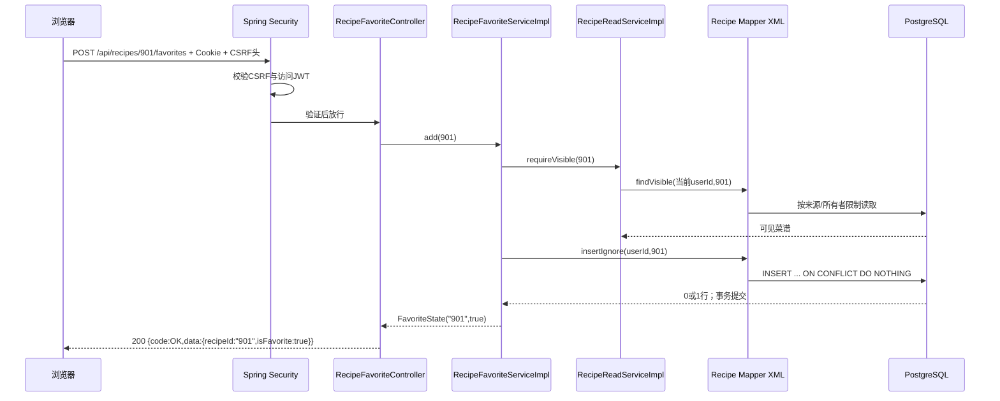

# T9 技术文档：真实菜谱读取与收藏

日期：2026-10-01；契约 `s2-api-v1`；代码工作树 `C:\Users\Omelet\.codex\worktrees\0f47\Cooker`。本任务只做菜谱浏览和收藏：系统菜谱来自已有 HowToCook 导入，普通 keyword 是菜名包含查询；不调用 T5 混合检索、向量或收费接口。用户自定义菜谱上传、做菜记录和评分均未实现。F2-B 的 real 浏览器联调仍待证据，不能凭本文档宣告阶段二签收。

## 1. 从用户操作讲起

登录用户打开 `/recipes`，后端按真实 `recipe` 数据分页返回菜谱卡片；点击卡片请求详情，展示原料、步骤、厨具和保留的未知字段。用户点击收藏或取消，数据库只修改当前用户与该菜谱的关系；再次打开 `/favorites` 看到自己的收藏。若直接猜测别人的私有菜谱 ID，详情及收藏操作都返回 404。

**30 秒项目介绍**：我在 Cooker 阶段二接入了真实菜谱浏览和个人收藏。Spring Security/T7 提供已验证的当前用户 ID，recipe Service 调显式 MyBatis SQL 从 HowToCook 导入表读数据；SQL 同时限制系统公开与本人私有可见性。列表分页和收藏状态一起查询，详情使用固定子项查询。PostgreSQL 唯一键加 `ON CONFLICT DO NOTHING` 保证重复或并发收藏只留一行。JDK21 全量和真实 PostgreSQL HTTP 测试通过，浏览器 F2-B 联调仍待验。

**约 2 分钟技术讲述**：客户端带 HttpOnly 访问 Cookie 请求 `/api/recipes`，Spring Security 在 Controller 前验 JWT。`RecipeReadController` 只收 page、size、keyword，`RecipeReadServiceImpl.list` 从 `CurrentUserService` 取得用户 ID 并验证分页与 keyword；`RecipeReadMapper.xml` 的 `countVisible/listVisible` 都连接 `recipe_source`，只让系统公开或本人私有行进入结果，分页按 recipe ID 升序。`LEFT JOIN favorite_recipe` 一次算出卡片的 isFavorite，没有每张卡再查数据库。详情 `findVisible` 先做同样的授权，再分别批量取原料、步骤、厨具；空事实按 null 返回，numeric 用十进制字符串。收藏请求在 CSRF 通过后进入 `RecipeFavoriteServiceImpl.add`，先查可见性，接着数据库唯一约束和 `ON CONFLICT DO NOTHING` 裁定并发，重复请求不刷新收藏时间。HTTP 与 PostgreSQL 测试覆盖两用户、通配符、分页排序和并发收藏；既有 372 条菜谱库也完成 V5 迁移与专用账号真实 HTTP 写入。

## 2. 代码地图与阅读路径

```text
backend/src/main/java/com/cooker/recipe/
├─ controller/RecipeReadController.java, RecipeFavoriteController.java
├─ service/RecipeReadService.java, RecipeFavoriteService.java
│  └─ impl/RecipeReadServiceImpl.java, RecipeFavoriteServiceImpl.java
├─ mapper/RecipeReadMapper.java, RecipeFavoriteMapper.java
├─ entity/FavoriteRecipeEntity.java
├─ dto/RecipeCardRow.java, IngredientRow.java, StepRow.java,
│       ToolRow.java, RecipeIdParser.java
└─ vo/RecipeCard.java, RecipeDetail.java, IngredientView.java,
        StepView.java, ToolView.java, PageView.java, FavoriteState.java
backend/src/main/resources/
├─ mapper/recipe/RecipeReadMapper.xml, RecipeFavoriteMapper.xml
└─ db/migration/V5__create_favorite_recipe.sql
```

阅读时先看 `RecipeReadController.list/detail` 和 `RecipeFavoriteController.add/remove/list`，再看两个项目 Service 接口及实现，最后看 XML 的 `visible`、`listVisible`、`findVisible`、`listFavorites` 和 `insertIgnore`。`FavoriteRecipeEntity` 是数据库对象，`RecipeCardRow` 是 Mapper 内部传输投影，`RecipeCard` 才是 HTTP VO；不能把 Entity 直接作为响应。身份模块只被 `CurrentUserService.requireUserId()` 依赖，recipe 没有访问 identity Mapper 或 Entity。

## 3. 完整请求与数据流



写事务在 `RecipeFavoriteServiceImpl.add/remove` 的 `@Transactional`，包含可见性检查与写入。Controller 不访问 Mapper，也不接收 userId。列表是 `COUNT + SELECT` 两条查询；详情先做一条可见性卡片查询，随后固定取原料、步骤、厨具三组。无论一页多少卡片，列表都不为每张卡片逐条查收藏，避免 N+1。

## 4. SQL、约束与数据表示

V5 新增 `favorite_recipe(id, user_id, recipe_id, created_at)`；`user_id`、`recipe_id` 分别有外键，`UNIQUE (user_id, recipe_id)` 表达“一名用户收藏一道菜最多一行”。`ix_favorite_recipe_user_created` 支持当前用户按收藏时间与 recipe ID 排序。没有修改 V1～V4，也没有提前建烹饪记录或模型凭证表。系统菜谱和私有菜谱仍由 V1 的 `recipe_source` 区分；查询必须带：

```sql
((s.source_type = 'SYSTEM_HOWTOCOOK' AND s.visibility = 'PUBLIC' AND s.owner_user_id IS NULL)
 OR (s.source_type = 'USER_CUSTOM' AND s.visibility = 'PRIVATE' AND s.owner_user_id = #{userId}))
```

这是 `RecipeReadMapper.xml` 的真实可见性片段，由 `countVisible/listVisible/findVisible/countFavorites/listFavorites` 复用。可见性放在 SQL 中，比先取全部再用 Java 过滤可靠：数据库返回前就排除他人数据，分页 `total` 也不会把隐私行算进去。访问不可见和不存在资源统一抛 404 `RECIPE_NOT_FOUND`，不暴露存在性。

列表实际使用 `ORDER BY r.id ASC LIMIT #{size} OFFSET #{offset}`；收藏用 `ORDER BY f.created_at DESC, r.id DESC`，同一时间仍稳定。页码从 1 开始，size 1～50；空页 items 为 `[]`，total 是可见结果总数。很大 OFFSET 会扫描并跳过许多行，MVP 按冻结契约使用页码分页，没有宣称海量数据性能。`RecipeReadServiceImpl.escapeKeyword` 先转义反斜杠，再转义 `%`、`_`，XML 使用 `LIKE ... ESCAPE '\'` 与 `#{keyword}` 参数绑定。错误写法是把 keyword 拼进 SQL 或不转义通配符：输入 `%` 会变成“匹配全部”，而不是查包含百分号的菜名。`T9RecipeHttpPostgresTest` 分别用 `%`、`_`、反斜杠断言了字面量行为。

收藏 SQL：

```sql
INSERT INTO favorite_recipe(user_id, recipe_id)
VALUES (#{userId}, #{recipeId})
ON CONFLICT (user_id, recipe_id) DO NOTHING
```

数据库唯一约束是多线程、多进程并发的最终裁决。先 SELECT 再 INSERT 会有竞态；只靠前端禁用按钮也挡不住网络重放。`DO NOTHING` 让重复添加返回同一成功状态，不更新首次收藏时间。取消用 `DELETE ... WHERE user_id = #{userId} AND recipe_id = #{recipeId}`，重复取消影响 0 行但仍成功。测试用同一账号两个独立 HTTP 会话同时添加，并核对库中只有一行。

JSON ID 一律 `Long.toString()`，因为 PostgreSQL BIGINT 可能超过 JavaScript 安全整数；前端不应把它当 JS number。原料 `numeric` 经 `BigDecimal.toPlainString()` 返回十进制字符串，未解析出的 amount、summary、servings 等为 `null`。原料按 `sort_order,id`，步骤按 `step_no,id`，厨具按名称与 tool ID 稳定排序；没有值就返回空数组，不把未知误写成 0。

## 5. 技术栈与 Spring Boot + MySQL 对照

本任务实际使用 Java 21、Spring Boot 4.0.8 Web MVC、T7 Spring Security、MyBatis-Plus 3.5.17、PostgreSQL 18、Flyway。没有新增框架，也没有用 Cloud/MQ/Agent 或收费模型。熟悉的 `Controller → Service → Mapper → SQL` 仍是主线，Security 在 Controller 前确定 userId；`@Transactional` 仍放 Service 实现。PostgreSQL 的 `ON CONFLICT` 相当于 MySQL 场景中围绕唯一键处理重复插入，但不能只用应用层预查取代唯一约束。Flyway V5 相当于版本化 SQL DDL，不依赖 ORM 自动建表。

| 设计点 | 当前方案 | 备选与代价 |
|---|---|---|
| 菜谱可见性 | SQL WHERE 限来源/所有者 | Java 取回后过滤易泄露行与分页总数；只靠前端隐藏挡不住直接请求 |
| 收藏状态 | 分页 SQL LEFT JOIN 一次带回 | 每张卡逐条查会有 N+1，页面增大时查询数随卡片数增长 |
| 重复收藏 | 唯一键 + ON CONFLICT DO NOTHING | 先查再插有并发竞态；冲突异常再捕获可行，但错误分支和事务处理更复杂 |
| 菜名筛选 | 普通 LIKE 字面量包含 | T5 混合检索可做语义召回，但会引入 Embedding/排序语义及费用，非本页入口 |

## 6. 失败路径、安全和限制

- 未登录请求：Security 在 Controller 前返回 401 `AUTH_REQUIRED`；没有 CSRF 的写请求可能先返回 403 `CSRF_INVALID`，客户端应按认证/CSRF 契约处理。
- `page<1`、`size` 不在 1～50、非数值页码、过长 keyword、非正整数或超过 BIGINT 的 ID：400 `VALIDATION_ERROR`。`RecipeIdParser` 在转换前保持 URL 字符串，避免溢出成为 500。
- 不存在或他人私有菜谱：详情、收藏添加/取消均返回 404 `RECIPE_NOT_FOUND`；列表和收藏列表也不计入他人行。`CurrentUserService` 是唯一身份来源，客户端不能提交 owner/userId 改写授权。
- 重复/并发添加：200 且只有一行；重复取消：200；网络不明结果由客户端读取状态或重试同一幂等操作，不因重放产生第二条关系。
- 数据库不可用属于内部故障，通用异常映射脱敏 500；不得把 SQL、认证 Cookie 或用户凭证写进响应。此版不支持上传私有菜谱，测试私有边界用独立测试库构造；不做图片或 HTML 渲染。普通 keyword 不是语义搜索，复杂查询能力留给后续已独立设计的入口。

## 7. 测试证据与复现

在指定工作树 `backend` 使用 JDK21：`mvn -q test`。2026-10-01 结果为 43 项、0 失败、0 错误、1 项既有收费 T6 评测跳过，T9/T7/检索 Testcontainers 均执行。`T9RecipeHttpPostgresTest` 在独立 PostgreSQL 库完成 V1～V5 迁移，真实 HTTP 验证两用户、系统/私有可见性、分页/排序、通配符、空值/numeric、重复/双会话并发收藏与取消。已有 Compose 库从 4 条迁移增至 5 条，原 372 条菜谱保留；专用测试账号在 live 后端的注册、登录、列表、详情和收藏成功，数据库只读查询确认收藏 1 行。F2-B 浏览器 real 页面尚待联调，不以该 HTTP 测试替代。

复现顺序：先 `GET /api/auth/csrf`，用专用账号注册/登录，再 `GET /api/recipes?page=1&size=20`、`GET /api/recipes/{id}`；写收藏前送最新 `X-XSRF-TOKEN`，`POST /api/recipes/{id}/favorites`，最后 `GET /api/favorites/recipes` 与 `DELETE`。ID 从实际列表取，不硬编码本机菜谱 ID。只读 SQL 可用 `SELECT version,success FROM flyway_schema_history ORDER BY installed_rank;`、`SELECT count(*) FROM recipe;`、`SELECT count(*) FROM favorite_recipe WHERE user_id=<专用测试用户ID>;`。密码、Cookie、JWT 使用虚构占位，不复制真实凭证到笔记。

## 8. 面试问题、回答与追问

1. **为什么列表不直接用 T5 混合检索？** 答：T9 是普通菜名浏览，契约指定 LIKE 字面量包含，避免查询 Embedding 和费用。原理：检索目标与排序语义不同。追问：何时该用混合检索？证据：`RecipeReadServiceImpl.list`、`RecipeReadMapper.xml`。
2. **为什么 JSON 的 recipeId 是字符串？** 答：数据库 BIGINT 可超出 JS 安全整数。原理：字符串保留精确十进制，Controller 再校验转 Long。追问：超过 Long 上限怎么办？证据：`RecipeIdParser.parse`、HTTP 非法 ID 测试。
3. **Entity、DTO/Row、VO 有何区别？** 答：Entity 贴数据库表，Row 接 SQL 投影，VO 是冻结 HTTP 字段。原理：不把 DB 列或内部字段无意泄露给前端。追问：为什么 `RecipeCardRow` 有 servings 但 `RecipeCard` 没有？证据：`RecipeCardRow`、`RecipeDetail`。
4. **为什么未知用量返回 null，不返回 0？** 答：0 表示已知且数量为零，未知是没有可证实事实。原理：保留原始数据含义。追问：前端如何显示？证据：`decimal` 映射与空事实 HTTP 断言。
5. **分页为什么还要排序 tie-breaker？** 答：无稳定排序时同一记录可能跨页重复或遗漏；收藏时间可能相同，追加 recipe ID 降序。追问：OFFSET 很大怎么办？证据：XML `ORDER BY`、同时间收藏分页测试。
6. **为什么不能只让前端隐藏他人私有菜谱？** 答：用户可直接构造 URL；SQL 必须在返回行前按来源与 owner 过滤。原理：授权是服务端数据边界。追问：不存在与不可见为何都 404？证据：XML `visible`、双用户 404 测试。
7. **重复收藏如何保证并发正确？** 答：`(user_id,recipe_id)` 唯一约束 + `ON CONFLICT DO NOTHING`，两个请求都可 200、库中仍一行。原理：数据库裁决跨线程与跨进程竞态。追问：只先查后插够吗？证据：V5、`RecipeFavoriteMapper.xml`、双会话并发测试。
8. **怎样避免 N+1？** 答：卡片的 isFavorite 在分页 SQL JOIN 得到；详情按原料、步骤、厨具各一条批量 SQL。原理：查询次数不随卡片/子项数量线性增长。追问：列表一页 50 张卡执行多少查询？证据：`listVisible/countVisible` 和 `detail` 代码路径。
9. **LIKE 的 `%` 与 `_` 为什么要转义？** 答：它们是 SQL 通配符，用户输入应按字面量查菜名；同时用 MyBatis 参数绑定防 SQL 拼接。追问：反斜杠顺序为什么先处理？证据：`escapeKeyword`、三个 HTTP 查询断言。

## 9. 学习清单、自检和练习

**当前必须理解**：SQL WHERE 可见性、`LEFT JOIN` 收藏状态、分页 COUNT/ORDER/LIMIT/OFFSET、DTO/VO/Entity、`numeric`→BigDecimal 字符串、唯一约束与事务、`ON CONFLICT`、LIKE 转义、401/403/404。**后续深入**：大 OFFSET 的 keyset 分页、索引执行计划、私有菜谱上传与索引重建、统一 API 性能观测。官方资料可读 [PostgreSQL SELECT](https://www.postgresql.org/docs/current/sql-select.html)、[PostgreSQL INSERT/ON CONFLICT](https://www.postgresql.org/docs/current/sql-insert.html)、[PostgreSQL 模式匹配](https://www.postgresql.org/docs/current/functions-matching.html)、[MyBatis 动态 SQL](https://mybatis.org/mybatis-3/dynamic-sql.html)、[Spring 声明式事务](https://docs.spring.io/spring-framework/reference/data-access/transaction/declarative.html)。

自检题（先独立回答，再看要点）：

1. 画出收藏一次的浏览器→Security→Controller→Service→Mapper→PostgreSQL 路径，指出事务在哪。要点：`RecipeFavoriteServiceImpl.add` 是写事务，Service 内先可见性后写入。
2. A、B 都能看公开菜谱，B 猜 A 的私有 recipeId 会怎样？要点：详情/收藏均 404，列表 total 不计 A 的私有行。
3. 用户搜 `%`，为什么不能直接 `LIKE '%' || keyword || '%'`？要点：`%` 会匹配任意内容，需先转义且参数绑定。
4. 两次同时收藏同一道菜，唯一约束与 `ON CONFLICT` 各做什么？要点：约束保证最多一行，冲突策略把重复变成成功无写入。
5. 为什么 `favorite_recipe.created_at` 相同时还按 recipe ID 排序？要点：稳定分页，否则同时间记录顺序不确定。
6. `1.50` 和未知用量分别如何进 JSON？要点：十进制字符串与 `null`，不能用 JS 浮点或 0 代替未知。

练习 A：在独立测试库造两名用户及一条私有菜谱，分别调用详情和收藏，预期 owner 200、另一用户 404；核验 XML 可见性条件，禁止操作真实个人数据。练习 B：用两个独立测试会话同时收藏同一公开菜谱，查询该用户关系行数应为 1，再重复取消得到 200；记录 `created_at` 是否保持首次值。完成后尝试不看文档复述请求流、定位实际 SQL，并说出本方案的大 OFFSET 限制及一种改进代价。文档完成不代表学习者已掌握，需自检与问答验证。
