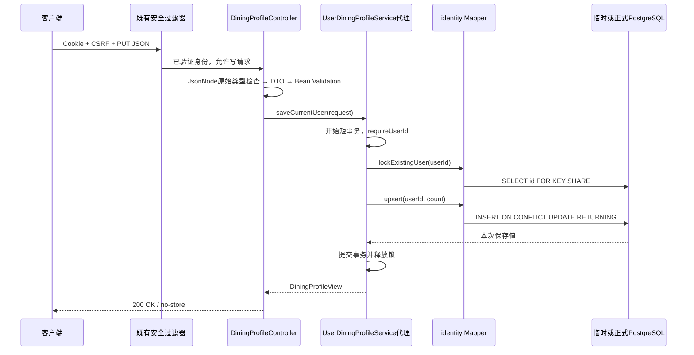

# U1 默认用餐人数：真实实现、请求流与面试自检

日期：2026-10-03。版本：`kitchen-profile-v1`。阅读范围为本会话`5b09/Cooker`当前未提交代码。

最新证据：另获U1 R1授权后，全量63项/62实际通过/0失败/0错误/1既有收费测试跳过，U1专属12项和T9/T10/检索旧业务主体全部通过，Java21离线打包成功。尚未主架构独立复审签收、部署或浏览器验收。第1～9节保留R1前讲述与失败历史，其中“当前失败/待范围确认”由第10节最新结果覆盖；完整证据见`工作报告-U1-默认用餐人数档案.md`。

## 1. 先用业务讲清楚

用户登录后显式保存“默认2人吃饭”，以后可以改成3人或清空。本次只是个人设置表与读写接口，不从聊天猜人数、不生成餐单、不修改认证Token。没有设置返回null，既不是0人，也不是自动默认2人。

30秒讲述：我给Cooker新增了独立的默认用餐人数档案。身份来自已验证JWT，HTTP只读写自己的档案；原始JSON类型严格校验，数据库用用户主键、一对一外键和正数CHECK兜底。并发设置用PostgreSQL原子UPSERT，重复请求不新增行。我在临时PG验证了隔离、迁移与应用上下文重建，专属测试通过；全量旧测试的迁移计数适配仍待授权，未上线。

2分钟讲述：Controller只接收档案JSON，校验字段必需且只能有defaultDiningCount；字符串或小数不会进入整数转换。专属DTO经过Bean Validation，再交给自定义Service接口。Service从CurrentUserService取得身份，在短事务中锁定存在的用户行，避免核验后账号被删除。Mapper参数化执行INSERT ON CONFLICT UPDATE，用RETURNING返回本次值。一对一主键保证并发最多一行，null代表清空，创建时间保持、更新时间由数据库维护。GET没有档案时只返回null，绝不插入默认行。未来后台任务通过显式用户只读Service调用，不能依赖线程身份，也不能把未核验客户端ID当可信ID。数据库测试覆盖精确约束错误与V7/V9升级、完整应用上下文重建；目前全量还有三处旧断言期待7条迁移但实际8条，不能称完整回归通过。

## 2. 代码地图与阅读顺序

```text
backend/src/main/java/com/cooker/identity/
├─ controller/DiningProfileController.java
├─ dto/SaveDiningProfileRequest.java
├─ dto/UserDiningProfile.java
├─ vo/DiningProfileView.java
├─ service/UserDiningProfileService.java
├─ service/impl/UserDiningProfileServiceImpl.java
├─ mapper/UserDiningProfileMapper.java
└─ entity/UserDiningProfileEntity.java
backend/src/main/resources/
├─ mapper/identity/UserDiningProfileMapper.xml
└─ db/migration/V10__create_user_profile.sql
backend/src/test/java/com/cooker/identity/
├─ DiningProfileHttpPostgresTest.java
├─ DiningProfileMigrationPostgresTest.java
└─ service/impl/UserDiningProfileServiceImplTest.java
```

先读Controller的`current/save`，接着读DTO的`fromJson`、Service的`currentUserProfile/saveCurrentUser/readForUser`，再看XML的`lockExistingUser/findByUserId/upsert`与V10。HTTP响应是`DiningProfileView`，跨模块值是`UserDiningProfile`，数据库实体只在identity内部使用。旧`identity.vo.UserProfile={id,username}`保持不变。

## 3. 一次保存与一次读取如何完成

示例PUT `/api/users/me/profile`请求：

```json
{"defaultDiningCount":2}
```

成功返回HTTP200与`Cache-Control: no-store`：

```json
{"code":"OK","message":"成功","data":{"defaultDiningCount":2}}
```



`/api`是已有Servlet上下文，Controller映射写`/users/me/profile`。Spring安全过滤器先处理Cookie/CSRF；不把所有未登录PUT都说成401，因为缺CSRF先得到403。本测试分别覆盖缺CSRF403和有效CSRF、无身份401。

GET走同一身份与存在性核验，再查询`user_profile WHERE user_id=?`；没有行返回`new UserDiningProfile(null)`。这里“零写入”指不执行INSERT/UPDATE/DELETE、不增加或改动档案；行锁会暂时锁定账号，不是无数据库锁的读取。使用普通`@Transactional`而非`readOnly=true`，因为事务内使用显式行锁。

## 4. 严格类型、分层与信任边界

真实`SaveDiningProfileRequest.fromJson`的核心判断为：

```java
if (body == null || !body.isObject() || body.size() != 1 || !body.has("defaultDiningCount"))
    throw invalid();
JsonNode value = body.get("defaultDiningCount");
if (value.isNull()) return new SaveDiningProfileRequest(null);
if (!value.isIntegralNumber() || !value.canConvertToInt() || value.intValue() <= 0)
    throw invalid();
return new SaveDiningProfileRequest(value.intValue());
```

不能只用`intValue()`：它是取值动作，不是原始类型检查；先证明整数节点与范围，才取int。显式null和字段不存在是两种JSON语义：前者清空，后者400。字段总数必须1且指定字段存在，因此`userId`及任何未知字段拒绝。字符串`"2"`、`2.0/2.5`、布尔、对象、数组、0/负数、超32位范围都拒绝；最大正值2147483647接受。Controller再调用Validator验证DTO的`@Positive`，Service也检查直接内部调用的非法值。没有设置产品人数上限。

选择局部JsonNode解析，是因为本项目MVC已使用Jackson3的`tools.jackson.databind.JsonNode`；安全响应和测试部分仍使用Jackson2，不能为了新接口改全局mapper或把这两个包混用。此方法不会对旧登录、评分DTO改变转换策略。当前协议列明场景由测试覆盖；不声称已完成任意深度、任意长度或重复键攻击测试。

当前用户方法只能由`CurrentUserService.requireUserId()`取得ID。内部`readForUser(long userId)`不读SecurityContext，避免后台任务线程没有HTTP身份时误用；它仅核验用户存在，不代替调用方的资源归属授权。未来调用者必须从已验证任务/会话得到ID，不能直接透传客户端参数。不对HTTP开放该显式ID方法，Controller注册路径测试证明只有me路径。

Service不跨模块读Mapper；未来agent只能调用Service并取得DTO，不取得Entity或SQL接口。

## 5. 数据、UPSERT与事务

| 字段或约束 | 作用 |
| --- | --- |
| user_id BIGINT PRIMARY KEY | 复用用户键，一人最多一行，同时提供查询索引 |
| default_dining_count INTEGER NULL | 未设置/清空为null，范围由32位类型限制 |
| ck_user_profile_positive_count | 非null必须大于0，防止绕过HTTP的非法写入 |
| fk_user_profile_user | 引用app_user(id)，不存在账号不能落档案 |
| ON DELETE CASCADE | 删除账号时清理其档案 |
| created_at/updated_at TIMESTAMPTZ | 数据库维护时间，客户端不提交 |

真实XML中的写入语句：

```sql
INSERT INTO user_profile(user_id, default_dining_count)
VALUES (#{userId}, #{defaultDiningCount,jdbcType=INTEGER})
ON CONFLICT (user_id) DO UPDATE SET
    default_dining_count = EXCLUDED.default_dining_count,
    updated_at = CURRENT_TIMESTAMP
RETURNING user_id, default_dining_count, created_at, updated_at
```

`#{...}`是MyBatis绑定参数语法，运行时由驱动绑定值，不能改为用户输入字符串拼SQL。`RETURNING`的写SQL在MyBatis使用`<select affectData="true" flushCache="true">`声明，让框架识别它会改变数据。[MyBatis XML说明](https://mybatis.org/mybatis-3/sqlmap-xml.html)包含这种返回数据的写语句用法。

并发不同值由数据库写入顺序决定最终值；本次没有版本CAS或餐单状态。`RETURNING`让每个请求返回自己的写入值，后续GET可能读到另一个请求的新值，这符合设置语义。[PostgreSQL INSERT说明](https://www.postgresql.org/docs/18/sql-insert.html)描述了ON CONFLICT与RETURNING。

账号核验SQL为`SELECT id FROM app_user WHERE id=#{userId} FOR KEY SHARE`。它在当前短事务内阻止账号删除，不把不同档案请求全部排他串行化；事务提交后锁释放。不能把锁放在事务外，否则核验完成后仍可能被删除。[PostgreSQL锁说明](https://www.postgresql.org/docs/18/explicit-locking.html)提供行锁冲突关系。

Spring代理在公共Service入口创建事务；private辅助方法处于该已有事务内，并非靠自调用重新开启事务。此任务不包含外部网络调用，不存在等待模型持有事务。[Spring事务注解说明](https://docs.spring.io/spring-framework/reference/data-access/transaction/declarative/annotations.html)可用于理解代理边界。

重复PUT同值/清空不新增行、不改变created_at，可能改变updated_at，因此属于设置结果幂等，不是所有元数据逐字节不变。`CURRENT_TIMESTAMP`是事务时间，不能用它在并发场景证明最终提交顺序。

## 6. 与Spring Boot + MySQL对照及方案选择

| 熟悉的概念 | 本实现对应 |
| --- | --- |
| Controller → Service → DAO | Controller → 自定义Service/impl → MyBatis Mapper/XML |
| 用户设置表 | 独立user_profile，用户键就是档案主键 |
| INSERT ... ON DUPLICATE KEY UPDATE | PostgreSQL ON CONFLICT(user_id) DO UPDATE |
| 先SELECT是否存在再INSERT/UPDATE | 此任务用原子UPSERT，避免两请求都发现不存在后竞争插入 |
| 后端固定设置值 | JsonNode保留原始JSON语义，然后DTO和业务校验 |
| 手动执行变更SQL | Flyway专属V10，隔离库验证旧版本升级 |

没有额外引入新框架。实际基线为Java21、Boot4.0.8、MyBatis-Plus3.5.17、Spring MVC/Security/Bean Validation、Flyway与PG18；Testcontainers本次日志版本2.0.5、临时PG18.6。具体传递依赖遵循已有pom，不通过阅读官网自动升级。

三个取舍：

1. 在app_user增加字段 vs 独立表：独立表保持原登录实体/接口，未设置无需生成行，迁移隔离清晰；代价是一次额外档案查询。
2. 先查再插 vs UPSERT：UPSERT把并发竞争交给唯一约束；读写拆开需要额外冲突处理，容易误以为Service判断可保证一行。
3. 改全局Jackson强制严格 vs 新入口局部解析：局部避免影响已有API；代价是新增字段时必须明确更新解析和测试，不能自动接收所有字段。

主键已承担索引，不新增重复user_id索引；一次GET为账号核验加档案查询，一次PUT为账号核验加UPSERT。未做大规模压力测试，不给虚构吞吐或延迟。

## 7. 失败、安全与证据

| 场景 | 行为/证据 |
| --- | --- |
| 缺字段/未知字段/非法类型 | 400 VALIDATION_ERROR；19种输入逐次验证原档案包括时间不变 |
| 未登录GET | 401 AUTH_REQUIRED |
| 未登录PUT缺CSRF | 403 CSRF_INVALID；有效CSRF再验证401 |
| 已登录PUT无效CSRF | 403，不写档案 |
| 无效JWT | 401 ACCESS_TOKEN_EXPIRED，沿用旧过滤器 |
| 账号已删除但JWT仍有效 | Service核验得到401，不产生新档案 |
| 并发保存2/7 | 两个Service请求分别返回2/7，最终一行、值为最后成功写入的值之一 |
| 直接写非法数据库值 | PG按精确约束拒绝：正数23514、外键23503、主键23505 |

外键测试使用从未存在的用户ID与合法正数，断言SQLSTATE及`fk_user_profile_user`，避免重复主键先失败造成“外键测试通过”的假阳性。CHECK、主键与外键责任不同；[PostgreSQL约束说明](https://www.postgresql.org/docs/18/ddl-constraints.html)是学习入口。

复用既有HttpOnly/Cookie/CSRF，不保存JWT到Web Storage。身份过滤器和Controller响应采用no-store，不将人数请求扩展成凭证读取，不日志输出请求体。[Spring Security CSRF](https://docs.spring.io/spring-security/reference/servlet/exploits/csrf.html)解释CSRF处理链。

不存在的`/users/999/profile`请求在首次专属测试中观察为500，属于旧全局异常映射；本任务未修改common。最终测试用实际路由注册仅包含`/users/me/profile`证明没有他人查询入口，不能将该观察写成404已修复。

### 测试阅读入口

- `UserDiningProfileServiceImplTest`：4项，缺行不写、失效用户拒绝、可信显式读取不依赖身份线程、内部非法输入与清空。
- `DiningProfileHttpPostgresTest`：3项多场景，真实HTTP与Cookie登录/退出再登录、严格JSON、两账号、CSRF/失效身份、旧登录/me响应兼容。
- `DiningProfileMigrationPostgresTest`：5项，空库、V7升级、V9fixture原文哈希/升级、PG约束与并发、完整应用上下文关闭/重建。

V7升级保留用户、菜谱、收藏、做菜、续期及虚构凭证全列快照；V9升级额外保留会话、轮次、消息和推荐。fixture为df67原始字节、不改换行，哈希见工作报告；生产迁移目录没有复制V8/V9。没有启用out-of-order。Testcontainers通过随机映射端口连接临时数据库；[PG模块说明](https://java.testcontainers.org/modules/databases/postgres/)可用于理解隔离测试。

### 不收费复现

在本工作树backend执行，测试命令需要Docker可用；此环境Docker调用使用正规审批。

```powershell
$env:JAVA_HOME = 'C:\Program Files\Java\jdk-21'
$env:PATH = "$env:JAVA_HOME\bin;$env:PATH"
# 只清空当前测试进程，不读取或覆盖用户环境配置。
$env:DASHSCOPE_API_KEY = ''
$env:LLM_CREDENTIAL_MASTER_KEY = ''
$env:COOKER_JWT_SECRET = ''
mvn -o '-Dcooker.t6.enabled=false' '-Dtest=UserDiningProfileServiceImplTest,DiningProfileHttpPostgresTest,DiningProfileMigrationPostgresTest' test
mvn -o '-Dcooker.t6.enabled=false' test
mvn -o '-Dcooker.t6.enabled=false' -DskipTests package
```

最终已执行的是全量命令：63项/59通过/3失败/0错误/1跳过，其中专属12项全部通过。前面的专属命令给出复现入口，不把尚未重新单独执行的命令声称为独立绿色记录。package成功但跳过测试。三个旧失败在业务主体前期待7条迁移，实际为8条；需要允许调整recipe/retrieval测试后再跑，不能从此文自行改范围。

SQL练习只在隔离测试容器进行，例如：

```sql
SELECT user_id, default_dining_count, created_at, updated_at FROM user_profile;
SELECT version, description, success FROM flyway_schema_history ORDER BY installed_rank;
```

不要运行当前Jar替换8080，不连接5433或迁移开发库。完整上下文重建已经测试，但真实浏览器、生产与现有服务重启另待授权。

## 8. 面试追问：简答、原理、继续追问与证据

1. **为什么默认null，不填2？** 简答：没有用户事实。原理：没有行和清空都表达未配置，避免隐藏的业务假设。继续追问：如何区分“从未设置”与“清空”？当前API不区分，数据库是否有行可表达，但不暴露。证据：Service `readVerifiedUser`、HTTP GET零新增行断言。
2. **为什么不改UserProfile？** 简答：它已属于登录响应。原理：业务配置与认证资料分开，保留API兼容。继续追问：跨模块读什么？专属DTO而非VO/Entity。证据：DiningProfileView、UserDiningProfile及旧响应两字段断言。
3. **Integer和@Positive为什么还不够？** 简答：不能单独证明客户端提交的原始类型。原理：转换后的对象可能已经丢失小数/字符串语义。继续追问：2.0数学上是整数为何拒绝？本契约要求JSON整数节点。证据：fromJson和19类非法请求。
4. **为什么需要UPSERT？** 简答：避免先查再写竞态。原理：用户主键冲突由单条SQL处理。继续追问：它是否保证每个客户端看到的值永远不变？不保证，后续设置会覆盖。证据：XML upsert与并发两个返回值/一行断言。
5. **RETURNING解决什么？** 简答：直接得到本次保存结果。原理：后续SELECT可能被另一写请求赶在前面。继续追问：为何XML不是insert标签？返回行使用select且affectData=true。证据：Mapper XML及Service返回saved.defaultDiningCount。
6. **账号核验为什么要锁？** 简答：防止核验后被删除。原理：同事务的用户键共享锁阻止删除穿过，再由外键兜底。继续追问：为什么不是FOR UPDATE？不必排他串行所有档案读写。证据：lockExistingUser、@Transactional；未做独立并发删除时序测试须诚实说明。
7. **GET是否完全无副作用？** 简答：不写业务数据，但有短期行锁。原理：不自动创建档案，锁随事务结束释放。继续追问：为什么不用readOnly=true？显式锁定查询不适合只读事务。证据：GET与Service注解、行数断言。
8. **内部readForUser为什么不看SecurityContext？** 简答：后台线程不能假定有HTTP身份。原理：调用方先验证资源归属，再传显式ID；本Service核验账号存在。继续追问：传任意有效ID能读吗？可信内部调用可以，因此不能开放给任意客户端。证据：接口注释与verifyNoInteractions(current)测试。
9. **401与403如何解释？** 简答：身份无效通常401，CSRF失败403。原理：请求先经过过滤器，缺CSRF可能早于未登录处理。继续追问：怎么证明未登录PUT401？先给有效CSRF。证据：HTTP安全过滤顺序测试。
10. **如何证明迁移没损坏旧数据？** 简答：临时库先到V7/V9，插入旧数据快照再升V10比较全部列。原理：新表隔离，测试必须真实执行，迁移数量不能冒充业务断言。继续追问：为什么全量还失败？旧测试固定7条而本目录8条，相关适配超出授权。证据：MigrationPostgresTest、工作报告失败清单及全量日志。

## 9. 学习清单、自检与练习

当前必须理解：JsonNode原始类型与DTO验证的先后；nullable语义；PRIMARY KEY/CHECK/FK/CASCADE各自职责；ON CONFLICT/EXCLUDED/RETURNING；共享行锁和Spring代理事务；Cookie身份与CSRF；Flyway target/迁移版本；Testcontainers临时端口及数据快照。

后续深入：事务隔离/锁等待与死锁观察、账号删除竞态测试、接口资源限制、未来餐单人数快照与修改版本。这些是学习方向，不属于本次新增实现。官方入口已分别链接于相应章节；阅读时固定仓库依赖版本，不从官网当前版推定项目已升级。

### 五道自检题

1. 不看代码画出一个PUT和一个GET，标明身份来源、事务开始/结束、DTO/Entity/VO所在位置。
2. 按解析顺序解释`{}`、`{"defaultDiningCount":null}`、`{"defaultDiningCount":2.0}`分别在哪层通过或失败。
3. 两个客户端同时将人数设2和7：画出允许的最终状态和各自响应，为什么不需要requestId事件表？
4. 解释用户存在但档案不存在、用户不存在、JWT无效、CSRF缺失四种情况，并说明为何不能一律401。
5. 说出当前12项通过能证明什么、不能证明什么；解释63项全量为何不能签收，以及V9fixture为何不等于运行时继承T14。

答案要点：身份来自CurrentUserService；public Service代理建立短事务；GET只有核验与查询。缺字段400、null清空、小数节点400。并发最终只一行，RETURNING给本次值，设置无事件追加。用户无档案null、失效用户401、无效JWT401、缺CSRF403。专属验证包含真实PG，但浏览器/部署/全量业务主体及完整运行时整合未签收。

### 两个最小练习（仅隔离测试环境）

1. **约束定位**：在临时PG写入一个合法用户和档案，再分别尝试重复主键、非正人数、不存在用户。记录每次SQLSTATE和约束名，确保外键用一个未占用的user_id。检验：分别23505/user_profile_pkey、23514/ck_user_profile_positive_count、23503/fk_user_profile_user。不能只断言“抛异常”。
2. **并发与持久化复述**：先阅读MigrationPostgresTest中两个虚拟线程经Service同时保存的代码，预测两个返回值和最终行数，再复跑专属测试；画出first上下文关闭、second上下文连接同一PG的路径。检验：各请求分别2/7、最终一行、重建另场景读取6。解释它为什么不能代替重启当前8080或真实浏览器验收。

教学文件提供代码阅读与检验材料，不保证用户已掌握；实际掌握需独立作答与复现。当前停在U1待范围确认/主架构复审，不自动启动U2或前端。

## 10. R1最小适配：迁移版本和迁移数量

2026-10-03用户另行允许修改三份旧测试的迁移核验，冻结卡为主架构`派发修复-U1-R1-旧测试迁移断言.md`。新增允许目录只覆盖T9、T10、RecipeSearchPostgresTest的迁移历史核验及本任务文档；不允许改生产、旧迁移、fixture或业务主体。

本工作树生产目录只有V1～V7和V10：最高版本号是10，成功版本数量是8。版本号是迁移标识，并不要求无间断连续，更不能由最高版本号推导执行了10份文件。V8/V9只在专属测试fixture中，不为让旧测试通过而复制到生产目录。

三个旧测试的真实断言统一为：

```java
// 当前稳定基线为V1～V7加U1的V10；按数字排序核验版本，不能把版本号当迁移条数。
assertThat(jdbc.queryForList("SELECT version::integer FROM flyway_schema_history WHERE success ORDER BY version::integer",
        Integer.class)).containsExactly(1, 2, 3, 4, 5, 6, 7, 10);
```

数字排序避免把文本`10`排在`2`前面。`containsExactly`同时证明顺序、内容与8项数量，缺一个、重复一个或出现额外版本都失败；不使用`>=7`或只核验“共8条”。本契约为整数版本，故使用`version::integer`，不泛化为支持任意点分版本或repeatable迁移的通用代码。

`RecipeSearchPostgresTest`中的第二次Flyway迁移`migrationsExecuted.isZero()`原样保留，证明相同迁移目录重复执行时不新增迁移。三份测试的业务fixture与后续业务断言未修改。

仅修改入口断言不能证明收藏、做菜或检索已经通过；必须重新跑完整测试，让这些业务主体实际执行并核对最终Surefire结果。R1的实际命令、结果及签收边界以工作报告最新节为准，前文3失败为修复前历史。

追加自检：如果迁移历史恰好有8条，但将V6换成V8，只更新数量会怎样？答案：数量断言仍通过；本精确列表断言失败，因此不能用数量代替版本内容。

R1实际结果：2026-10-03 22:34:07，Java21离线`mvn -o '-Dcooker.t6.enabled=false' test`成功，63项/62通过/0失败/0错误/1既有收费跳过。T9、T10、检索三个主体各1项均实际通过，检索第二次迁移仍零执行；U1的12项通过。22:35:23离线package成功。三份Java仅改入口迁移核验，所有原业务断言/fixture保持；本轮无需新增生产逻辑，保护范围SHA256未变化。

更新后的30秒结尾可说：“我发现新增V10使旧测试固定迁移计数过时，另获最小授权后改成完整数字版本列表，并重新执行真实PG/HTTP业务主体。全量63项有62项实际通过、仅既有收费评测跳过，打包成功；目前待独立复审，未部署。”不能只说“把7改成8所以测试通过”，也不能把本轮实现会话成功说成主架构签收。
