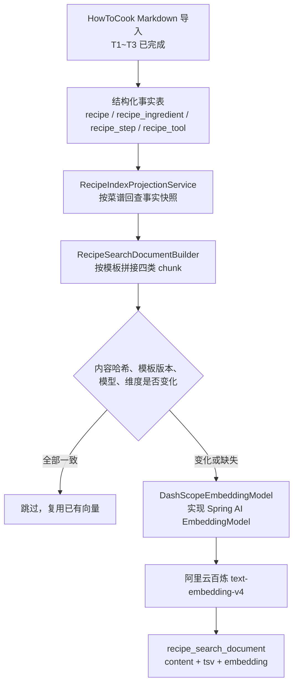

# Cooker 检索投影与向量化技术文档

> 阶段：阶段 1 / T4，已授权并完成
> 覆盖范围：结构化事实 → 检索投影 → chunk 拼接 → 百炼向量化 → 投影落库
> 不覆盖：词法/向量召回 SQL、RRF 融合（T5）、检索评测（T6）
> 关联文档：`docs/adr/ADR-003-HowToCook快照导入与宽容解析.md`、`docs/adr/ADR-004-混合检索与向量版本化.md`、`docs/数据库说明-菜谱导入.md`

## 1. 这一层解决什么问题

结构化事实表擅长精确条件，例如“30 分钟内”“只要电饭煲”“含鸡蛋”。但用户真正说出的是“想吃点清淡的”“今天喉咙不舒服”这类意图，关系查询和关键词匹配都无法可靠覆盖。

检索投影层的作用是在不改变事实数据的前提下，额外维护一份**可以随时重建**的检索冗余：每个菜谱被拼成若干段文本，每段文本都带有中文全文索引和语义向量。检索时词法与语义两条通道各取所长，融合后仍以 `recipe_id` 回查真实菜谱。

三个关键设计约束：

1. `recipe` 模块拥有事实数据，`retrieval` 模块只拥有可重建的投影；投影可以删除后重建，事实不能。
2. 投影生成过程是确定性的，不调用 LLM 推断内容，同样的输入必然得到同样的文本和哈希。
3. 只有内容真正变化时才调用收费的 Embedding 接口。

## 2. 端到端流程



流程按菜谱逐个推进，一道菜谱内部再按批调用模型。任何一步失败只影响当前批次，不会回滚已经导入的事实数据，也不会中断后续菜谱。

## 3. 代码结构与职责

| 组件 | 位置 | 职责 |
|---|---|---|
| `RecipeIndexApplicationRunner` | `retrieval/config` | 显式任务入口；启动后触发一次全量重建并打印统计 |
| `RetrievalIndexProperties` | `retrieval/config` | 索引任务的配置载体，仅由环境变量注入敏感值 |
| `RetrievalEmbeddingConfiguration` | `retrieval/config` | 创建文档侧 `EmbeddingModel` Bean，缺少 Key 或地址即快速失败 |
| `RecipeIndexService` / `RecipeIndexServiceImpl` | `retrieval/service` | 重建编排：过期判定、分批调用、失败隔离、过期块清理 |
| `RecipeSearchDocumentBuilder` | `retrieval/service/impl` | 纯内存的 chunk 拼接与内容哈希计算，不访问数据库 |
| `DashScopeEmbeddingModel` | `retrieval/service/impl` | 唯一了解百炼 HTTP 结构的地方，实现 Spring AI `EmbeddingModel` |
| `EmbeddingProviderException` | `retrieval/service/impl` | 脱敏的外部调用异常类型 |
| `RecipeSearchDocumentMapper` | `retrieval/mapper` | 投影表的显式 SQL：回查、幂等写入、过期块删除 |
| `RecipeIndexProjectionService` / `Impl` | `recipe/service` | 跨模块只读契约；由 `recipe` 模块负责回查事实并组装快照 |

依赖方向符合模块化单体规则：`retrieval` 只依赖 `recipe` 的 Service 接口和 DTO，不接触菜谱的 Mapper 或 Entity。

T1～T3 的导入侧组件（`HowToCookMarkdownParser`、`RecipeImportService`、`V1` 迁移等）属于 `recipe` 模块，已在提交 `2c12c7c` 中实现并验证，本文档不再重复描述，只说明它们提供给本层的输入：可回查的结构化事实。

## 4. chunk 设计

### 4.1 四类块

每道菜谱生成 `overview`、`ingredients`、`tools` 以及一到多个 `steps` 块。所有块都以“菜名 + 分类”开头，再拼接各自内容。

| `chunk_type` | 内容模板 | 典型数量 | 设计意图 |
|---|---|---|---|
| `overview` | 菜名、分类、简介、难度、预计用时、份数、热量（按字段存在性拼装） | 每菜谱 1 个 | 承载菜谱的整体语义，回答“这道菜是什么” |
| `ingredients` | 菜名、分类、`原料：A、B、C` | 有原料时 1 个 | 让“家里有鸡蛋和番茄”这类食材诉求稳定命中 |
| `tools` | 菜名、分类、`需要厨具：A、B` | 有识别到厨具时 1 个 | 支撑厨具约束的语义召回 |
| `steps` | 菜名、分类、`步骤N：...` 若干条 | 按长度 1～多个 | 步骤级召回，命中“怎么炒糖色”这类过程性问题 |

内容在入库前会折叠所有空白，最终每块都是一行规范化文本，避免 Markdown 换行影响哈希稳定性。

### 4.2 步骤块拆分规则

`RecipeSearchDocumentBuilder#stepChunks` 按顺序扫描步骤，满足任一条件就先收束当前块：

- 当前块已达到 `max-step-chunk-steps`（默认 4，允许 3～5）个连续步骤；
- 再加入下一个步骤会超过 `max-chunk-characters`（默认 4000，下限 500）。

单个异常长的步骤整体保留，不按字符截断；截断会让烹饪动作语义失真，代价比块偏大更高。步骤编号使用原文顺序，块之间既不重复也不丢步。

### 4.3 为什么每个块都重复菜名与分类

只对步骤做向量时，一个孤立块可能只包含“热锅倒油”，脱离菜谱后既无法解释也无法排序。重复上下文让每个块都能独立成篇，检索命中后仍能还原所属菜谱。

### 4.4 多步骤块如何避免抬高得分

步骤较多的菜谱天然会产生更多 `steps` 块，如果在融合阶段直接累加命中数量，长菜谱会被系统性放大。因此 ADR-004 规定：每条召回通道先按 `recipe_id` 只保留最佳 chunk，再在菜谱粒度上做 RRF 融合。该规则属于 T5 的检索实现约束，投影层只负责提供可区分的 `chunk_no`。

## 5. 向量化实现

### 5.1 只依赖 Spring AI 的 EmbeddingModel

业务代码只注入 `EmbeddingModel` 接口，`retrieval` 模块之外没有出现任何百炼专有类型。这样做的原因是后续可能更换模型提供方，而更换成本应局限在一个适配器内。

项目没有引入官方 starter，也没有引入 `VectorStore`、`ChatClient` 或 TextSplitter：`backend/pom.xml` 只依赖 `spring-ai-model`，因为百炼没有与 Spring Boot 4 / Spring AI 2 兼容的 Starter，而切分逻辑由业务字段决定，交给通用的 TextSplitter 反而会破坏可解释性。

### 5.2 百炼请求参数

适配器按批调用百炼原生接口 `POST /api/v1/services/embeddings/text-embedding/text-embedding`：

| 参数 | 取值 | 说明 |
|---|---|---|
| `model` | `text-embedding-v4` | 由配置提供，写入投影表并参与过期判断 |
| `input.texts` | 本批文本 | 每批最多 10 条，符合模型上限 |
| `parameters.text_type` | `document` | 入库侧固定使用文档类型；查询侧应使用 `query` |
| `parameters.dimension` | `1024` | 与投影表 `vector(1024)` 严格一致 |
| `parameters.output_type` | `dense` | 只取稠密向量 |

`dimensions()` 直接返回配置值，避免 Spring AI 默认实现为了探测维度而额外发起一次收费调用。

### 5.3 响应解析

百炼返回的是 JSON，但不同网关环境下的响应 `Content-Type` 不稳定，Spring 的转换器可能因为媒体类型不匹配抛出 `HttpMessageConversionException`。适配器的做法是先按字符串接收响应体，再用 Jackson 显式解析，并且只读取 `output.embeddings[*].text_index` 与 `output.embeddings[*].embedding`。

解析阶段会校验三件事：返回条数与请求条数一致、`text_index` 落在合法区间、向量维度等于配置维度。任一不符都转为 `EmbeddingProviderException`，不会把残缺数据写入数据库。

### 5.4 异常分类与脱敏

所有外部异常都被归类为有限的几种摘要，例如“百炼服务请求失败，HTTP 状态码：401”“百炼服务网络或 TLS 连接失败”。第三方异常的原始消息、请求地址和响应正文都不会进入 `failure_message`，也不会进入日志，避免 Key 或业务数据经异常链路外泄。

## 6. 版本化、幂等与重建

### 6.1 过期判定

`RecipeIndexServiceImpl#isCurrent` 要求四个条件同时满足才复用已有向量：

| 条件 | 作用 |
|---|---|
| `content_hash` 相同 | 文本没有变化 |
| `document_template_version` 相同 | chunk 拼接规则没有变化 |
| `embedding_model` 相同 | 没有更换模型 |
| `embedding_dimension` 相同 | 没有更换维度 |

再加上状态必须是 `READY`。因此修改拼接模板只需递增 `document-template-version` 即可触发重建，不需要手工清表。

### 6.2 失败隔离

每一批调用包在独立的 `try/catch` 中。失败时该批全部标记为 `FAILED`，保留文本与哈希但清空向量，`indexed_at` 置空；其余批次和其余菜谱继续执行。下次重建会重新尝试这些块，因为失败状态的块不满足“可复用”条件。

### 6.3 过期块清理

当模板变化导致块数量减少时，多余的历史块需要删除。删除条件很保守：只有整道菜谱本次没有任何失败块时才执行 `deleteChunksNotIn`。否则一次网络抖动就可能让可检索文本无故缩减。

### 6.4 重复执行的结果

对同一份快照重复执行索引任务是幂等的：已是最新的块全部跳过，不产生任何模型调用；接口返回的统计会体现为 `新建或更新=0、跳过=全部`。这一点与 T1～T3 的导入幂等策略保持一致。

## 7. 投影表

`recipe_search_document` 由 Flyway `V2` 创建，完整字段字典见 `docs/数据库说明-菜谱导入.md`。这里只强调与本次实现直接相关的部分：

- 唯一约束 `(recipe_id, chunk_type, chunk_no)` 是写入幂等的唯一依据，`upsertReady` 与 `upsertFailed` 都依赖它做冲突更新。
- `tsv` 是 `STORED` 生成列，由 `to_tsvector('cooker_zh', content)` 自动维护；`cooker_zh` 是 `zhparser` 上的项目专用配置，只保留名词、动词、形容词等实词。业务代码从不手工写 `tsv`。
- `embedding` 为 `vector(1024)`，写入时以文本字面量传入并 `CAST(... AS vector)`，绕开 ORM 对 pgvector 类型的不完整支持。
- 状态机为 `PENDING` / `READY` / `FAILED`，检索只允许读取 `READY`。
- `ix_recipe_search_document_ready_version` 服务于“按当前模型版本筛出可检索块”，`ix_recipe_search_document_tsv` 是中文全文检索的 GIN 索引。
- 当前数据量只有数百条，向量检索使用精确扫描，尚未创建 HNSW 或 IVFFlat。

## 8. 配置与运行

### 8.1 配置项

| 配置 | 环境变量 | 默认值 | 说明 |
|---|---|---|---|
| `cooker.retrieval.index.enabled` | `COOKER_RETRIEVAL_INDEX_ENABLED` | `false` | 必须显式开启，仅激活 profile 不会产生调用 |
| `batch-size` | `COOKER_RETRIEVAL_INDEX_BATCH_SIZE` | `10` | 每批文本数，取值 1～10 |
| `max-step-chunk-steps` | `COOKER_RETRIEVAL_INDEX_MAX_STEP_CHUNK_STEPS` | `4` | 每个 steps 块的连续步骤数，取值 3～5 |
| `max-chunk-characters` | `COOKER_RETRIEVAL_INDEX_MAX_CHUNK_CHARACTERS` | `4000` | 块的字符上限 |
| `document-template-version` | `COOKER_RETRIEVAL_INDEX_DOCUMENT_TEMPLATE_VERSION` | `1` | 拼接模板版本，递增即触发重建 |
| `embedding-model` | `COOKER_RETRIEVAL_EMBEDDING_MODEL` | `text-embedding-v4` | 模型标识 |
| `embedding-dimension` | `COOKER_RETRIEVAL_EMBEDDING_DIMENSION` | `1024` | 维度，必须为 1024 |
| `endpoint` | `COOKER_RETRIEVAL_DASHSCOPE_ENDPOINT` | 百炼中国站默认地址 | 可按地域或业务空间覆盖 |
| `api-key` | `DASHSCOPE_API_KEY` | 无 | 只允许环境变量注入 |

### 8.2 运行前置条件

1. 结构化事实已通过 `recipe-import` profile 导入，`recipe` 及子表有数据。
2. 数据库使用项目提供的 Compose 镜像：它在 `pgvector/pgvector:pg18` 基础上构建了 `zhparser`，缺少该扩展时 `V2` 迁移会直接失败。
3. 当前终端已设置 `DASHSCOPE_API_KEY`，且该值不写入任何文件。

### 8.3 运行方式

本地 Maven：

```powershell
Set-Location backend
$env:JAVA_HOME = 'C:\Program Files\Java\jdk-21'
$env:Path = "$env:JAVA_HOME\bin;$env:Path"
$env:DB_URL = 'jdbc:postgresql://localhost:5432/cooker'
$env:DB_USERNAME = 'root'
$env:DB_PASSWORD = 'root'
$env:DASHSCOPE_API_KEY = '<仅当前终端设置>'
$env:COOKER_RETRIEVAL_INDEX_ENABLED = 'true'
mvn spring-boot:run "-Dspring-boot.run.profiles=local,recipe-index" "-Dspring-boot.run.arguments=--spring.main.web-application-type=none"
```

Docker 一次性任务（不占用终端，适合上千个块的批量调用）：

```powershell
docker compose run -d --name cooker-vector-index `
  -e SPRING_PROFILES_ACTIVE=docker,recipe-index `
  -e COOKER_RETRIEVAL_INDEX_ENABLED=true `
  -e DASHSCOPE_API_KEY=<仅当前终端设置> `
  backend --spring.main.web-application-type=none
```

两种方式都只在显式开启时生效。普通 `mvn spring-boot:run` 或不带 profile 的容器启动不会读取 Key、不会扫描菜谱、也不会调用模型。

## 9. 可观测性

任务结束时输出一行汇总日志，字段与 `RecipeIndexReport` 一一对应：

```text
菜谱检索投影完成：菜谱=372, 块=1850, 新建或更新=1850, 跳过=0, 失败=0
```

数据库侧可以直接按状态核对，不需要解析日志：

```sql
SELECT embedding_status, count(*) FROM recipe_search_document GROUP BY embedding_status;
SELECT vector_dims(embedding), count(*) FROM recipe_search_document WHERE embedding IS NOT NULL GROUP BY vector_dims(embedding);
SELECT chunk_type, count(*) FROM recipe_search_document GROUP BY chunk_type ORDER BY chunk_type;
```

失败原因只以脱敏摘要形式保存在 `failure_message`，例如“百炼服务请求失败，HTTP 状态码：401”。

## 10. 本机实测结果（2026-09-26）

在 PostgreSQL 18 + `cooker` 数据库上，对固定 HowToCook `1.6.0-a0b14bd` 快照的 372 道结构化菜谱执行完整索引：

| 指标 | 数量 |
|---|---:|
| 菜谱 | 372 |
| 检索块总数 | 1850 |
| 成功（`READY`） | 1850 |
| 失败 | 0 |
| 向量维度 | 1024（1850 条全部一致） |
| `tsv` 已生成 | 1850 |

块类型分布：

| `chunk_type` | 数量 | 说明 |
|---|---:|---|
| `overview` | 372 | 每道菜谱一块 |
| `ingredients` | 363 | 9 道菜谱没有可结构化原料，未生成该块 |
| `steps` | 1022 | 按连续步骤分组后展开，平均每道菜谱约 2.7 块 |
| `tools` | 93 | 其余菜谱未识别出词典内厨具，未生成该块 |

验证方式：`mvn test` 全部 22 项通过；索引任务容器退出码为 0；上述查询结果与日志汇总一致。

## 11. 已知问题与经验记录

### 11.1 百炼响应解析的两个坑

首次真实运行时全部块失败，实际原因是响应转换而非鉴权：

1. `RestClient` 以 `JsonNode` 为响应类型时，转换器会依据响应 `Content-Type` 选择解码器，百炼网关返回的媒体类型不稳定，导致 `HttpMessageConversionException`。改为按 `String` 接收后显式用 Jackson 解析。
2. 该轻量依赖组合不会自动注册 `ObjectMapper` Bean，无法通过构造方法注入。适配器改为自行创建一个只用于解析简单 JSON 响应的实例。

这两处都限制在适配器内部，业务层始终只看到 `EmbeddingModel`。

### 11.2 已应用的迁移不能再补注释

Flyway 的校验和把 SQL 注释计入内容。给已经执行过的 `V2` 补行内注释会导致下次启动直接失败：

```text
Migration checksum mismatch for migration version 2
```

因此 `V2` 保持原样，表结构与列的语义集中记录在本文档与 `docs/数据库说明-菜谱导入.md`。后续新增迁移可以正常写注释，但不要回改已应用的文件。

## 12. 边界与后续

本次实现停在向量入库为止，以下内容尚未实现，属于 T5/T6 范围：

- 词法召回 SQL（`tsv @@ tsquery` 与 `ts_rank`）；
- 向量召回 SQL（`embedding <=> query_vec`）；
- 先按 `recipe_id` 取最佳 chunk、再做 RRF 融合的排序逻辑；
- 检索评测集与验收指标。

检索实现必须遵守两条硬约束：查询只能读取 `embedding_status = 'READY'` 且模型、维度、模板版本与当前配置一致的块；返回前必须按 `source_type`、`owner_user_id`、`visibility` 完成权限过滤，避免用户自定义菜谱泄露给其他用户。

已知的实现取舍：`RecipeIndexProjectionServiceImpl` 采用按菜谱聚合的逐条查询，在数百条数据规模下足够直观；数据量增长到数千条以上时应改为批量查询，避免 N+1。
