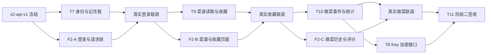

# 阶段 2 双会话任务与真实联调验收

> 最终签收（2026-10-02）：用户明确确认T11剩余浏览器清单5项“全部通过”，结合既有独立审查、V7部署、真实HTTP/PG和后端重启证据，T11及阶段二签收。用户反馈与工具证据分别记录，Cookie偏差按ADR-007保留；第9节Offline不冒充服务端已提交响应丢失实验。只进入阶段三架构讨论，两个实现会话空闲，未派发实现、收费调用或提交合并。详见T11报告第10节；下方未签收为历史。

> 最新进展（2026-10-02）：按用户对稳定密钥生成/保存及部署重启的具体授权，已完成Windows User配置、开发V7和真实HTTP重启持久化验收。原有数据保留，浏览器真实清单仍待用户反馈，见T11报告第8～9节；下方缺配置/V6/未重启均是历史记录。两个实现会话继续空闲，不派发阶段三或修复。

> 最新用户取舍（2026-10-01）：记住我访问Cookie偏差按用户“不用修复”决定接受，继续T11剩余部署和真实验收；原两个实现会话保持空闲，不派发修复或阶段三。当前缺稳定开发密钥，尚未停止健康旧后端或执行开发V7；待配置与残余人工证据。见ADR-007、T11报告最新节。

> 最新T11授权/验收（2026-10-01）：用户明确要求T8复审与T11。本次主架构完成T8独立复审、后端51项与前端60项回归，真实HTTP注册/收藏/烹饪/隔离/续期回读通过。T11尚未签收：记住我访问Cookie持久化P2待具体修复授权，开发后端仍V6且残余浏览器和重启证据未齐。两个实现会话空闲，未发送新任务；不启动阶段三。详见 `工作报告-T11-阶段2真实联调验收.md`；下方T11未授权和T8执行中均为历史。

> 最新T8授权（2026-10-01）：原后端会话本任务按用户指定使用 `gpt-6-luna` / `high`，只实施 `docs/派发任务-T8-用户模型凭证.md`。交付后由主架构独立复审，T11及阶段三仍未授权；前端会话不领取新任务。旧模型配置与T8不启动说明是历史基线，不扩大本次范围。

> 最新修复签收（2026-10-01）：原前端会话已按授权完成F2-C R1；主架构独立源码/页面接线审查及前端60项测试、类型检查、构建、diff-check通过。结合用户人工清单1～8和已有T10后端审查，本对验收通过。超时路径由实际页面逻辑自动化覆盖，尚无该路径的真实浏览器演练；T7残余浏览器项保留。下方“未修复/未签收”为历史状态，T8/T11及阶段三仍不启动。

> 最新闸门（2026-10-01）：用户确认T10/F2-C人工清单1～8全项通过并要求继续，解除暂停。正常页面闭环取得用户人工证据，但清单不覆盖超时重试；本次源码核对确认P2重试成功弹框缺陷仍在。本对不整体签收，具体修复授权待确认，尚未派发新任务；T8/T11及阶段三仍待授权。44项后端与55项前端测试为此前独立审查结果，本次未复跑。证据见 `docs/审查报告-T10与F2-C.md` 最新节；下方旧状态记录仅为历史。

> 最新签收/派发（2026-10-01）：用户明确回复“1.2.3.4项全部通过”，T9/F2-B人工主流程通过，结合已有源码/自动化/HTTP证据本对签收。沿原授权派发T10/F2-C，冻结卡见 `docs/派发任务-T10与F2-C.md`。下方早先“待人工/未派发”为历史记录，以本条为最新状态；不等于阶段二整体完成。

> 最新状态（2026-10-01）：用户明确回复“继续吧”，解除9月30日暂停，恢复 T9/F2-B 派发。T7/F2-A 指定修复复审结果保留；原两会话继续按各自目录和契约领取本次切片，实际完成与真实联调仍待验。原排期是目标窗口，不按日期自动签收。

> 验收更新（2026-10-01）：T9后端源码/数据库回归通过；F2-B R1/R2已按明确授权修复，经主架构独立复审，前端40项测试/type-check/build/diff-check通过。用户已同意人工补真实页面验收，结果尚未反馈。本对暂不签收，T10/F2-C未派发。证据及人工清单见 `docs/审查报告-T9与F2-B.md` 最新节。

> 更新：2026-09-30。状态：用户已授权创建后端/前端两个实现会话，按既定顺序推进至 T10。读入口：AGENTS.md、技术文档.md、阶段 2 架构、s2-api-v1 接口契约、ADR-005/006 及后端技术文档要求。

## 1. 会话配置与协作边界

| 会话 | 指定模型 | 思考强度 | 代码归属 |
|---|---|---|---|
| 后端实现会话 | GPT-6-sol（`gpt-6-sol`） | 中（`medium`） | `backend/`，按 T7、T9、T10、T8 逐项交付 |
| 前端页面会话 | GPT-6-luna（`gpt-6-luna`） | 高（`high`） | `frontend/`，按 F2-A、F2-B、F2-C 逐项交付；后续前端会话沿用此配置 |
| 本架构会话 | 当前会话 | 当前设置 | 共享契约、ADR、审查和集成决策 |

模型配置是用户已确认的偏好，不构成任务派发授权。任何工具不能识别指定模型时应报告并等用户选择，不能自动替换成相近名称。

实际派发授权已由 2026-09-30 用户消息给出：后端 T7→T9→T10，前端 F2-A→F2-B→F2-C；原顺序随后执行的 T8 与 T11 不启动。每项独立交付并审查后，主架构可继续派发上述已授权下一任务。本次使用主架构现有工作树 `C:\Users\Omelet\.codex\worktrees\0f47\Cooker`，两个会话共享同一工作树并严格按 backend/frontend 目录分工，不修改主目录 `E:\Cooker`。实现会话不得自行运行 git add/commit/switch/merge 或覆盖共享文档，避免共享索引/分支竞争；主架构负责审查并在取得相应授权后协调提交和集成。

两会话共用契约版本 s2-api-v1，但不共同修改代码目录。根目录 AGENTS.md、技术文档.md 和三份阶段 2 共享文档由主架构维护；实现会话可写自己的工作报告。跨目录变更需求先在报告中列明，经主架构审查后处理。派发前必须保证两会话读到相同文档基线；当前架构文档未提交时，不能让新会话从旧分支开始并猜测契约。

一个会话每次只领取一个已明确授权的任务，完成后报告并停止新增功能；下一任务须在主架构审查后领取。本次 T7/T9/T10、F2-A/F2-B/F2-C 已获得批量授权，无需重复申请；范围外任务仍需新的明确授权。阶段名称或“建议继续”不自动扩大边界。实现报告只能作为事实证据，不能自行宣告阶段已验收。

### 2026-09-30 实际派发记录

| 会话名称 | 会话 ID | 配置 | 首项任务 | 当前状态 |
|---|---|---|---|---|
| 阶段二后端实现：T7至T10 | `01a0f143-7d3e-71f2-ad47-9e995167b1ef` | 本次T8为 `gpt-6-luna` / `high`；此前 `gpt-6-sol` / `medium` | T7 | T8已交付且主架构独立复审通过；会话空闲，记住我修复未派发 |
| 阶段二前端实现：登录收藏与做菜历史 | `01a0f144-7c62-7a42-a1c0-86c64a3110c3` | `gpt-6-luna` / `high` | F2-A | F2-C人工清单1～8通过；R1修复经独立复审、60项前端测试通过；会话空闲，不领取后续任务 |

两个会话已置顶，便于用户后续查看和对话。会话归属保存项目 `E:\Cooker`，任务提示明确指定实际修改工作树为 `C:\Users\Omelet\.codex\worktrees\0f47\Cooker`；已核验后端写入该工作树、前端开始请求层方案。创建成功或开始编码不代表功能完成，后续逐项记录测试、真实联调和主架构审查。

2026-09-30 的修复复审结果见 `docs/审查报告-T7与F2-A.md` 第6节。R1～R3 已修复并独立复测，通过源码及已测主流程的依赖闸门；下一对 T9/F2-B 冻结于 `docs/派发任务-T9与F2-B.md`，按原授权由原会话领取。真实浏览器测试账号保留，未删除既有数据。记住我关闭重开等未测场景仍保留在最终验收表，不声明阶段二签收。

## 2. 顺序与并行安排

后端会话按任务串行，优先让登录、收藏、做菜能力逐步可见，T8 在 T10 后完成以沿用 V7 迁移预留；不能同时让该会话修改多份尚未冻结的安全契约。前端在对应接口完成前使用显式 Mock 做组件/交互开发，收到后端验收证据后切 real。各次“真实联调”是对应任务的验收步骤，不额外授权两个会话相互发送任务。

日历目标：9 月 30 日完成契约与首批身份切片，10 月 1 日争取完成阶段 2 真实联调；这是排期目标，取决于实现授权、测试与环境。阶段 3 后续排期按实际签收时间调整，10 月 5 日 MVP 截止日期不变。

## 3. 后端任务卡

### T7：身份与记住我

- 背景/目标：建立当前用户边界，真实注册、登录、续期和退出，支持浏览器再次打开恢复登录。
- 输入：s2-api-v1 第 1、2、6 节，ADR-005，现有 Java21/Boot4/MyBatis-Plus；现有 V1～V3。
- 允许修改：`backend/pom.xml`，`backend/src/main/java/com/cooker/identity/`、`common/` 内无业务归属的统一响应/异常，身份相关 Mapper XML、新 V4 迁移、身份配置与对应测试；必要的非敏感环境变量占位只可通过主架构同步根目录配置。
- 输出：`CurrentUserService` 项目接口、身份 HTTP 接口、Cookie/CSRF/JWT 配置、续期持久化与轮换、统一错误响应、中文注释、`docs/工作报告-T7-身份与记住我.md`。
- 技术/学习：Spring Security 过滤器链如何在 Controller 前验证身份；密码强哈希；JWT 和续期为何分离；Cookie/CSRF；数据库事务和约束。
- 验收：JDK21 下 `mvn test`；用户唯一、登录错误、JWT 验签/到期/签发方/受众、CSRF、续期原子轮换/并发、退出撤销、非持久/持久 Cookie；V4 在空库和含既有菜谱数据的数据库验证。与 F2-A 真实联调登录；不能拿 Mock 截图证明完成。
- 不做/踩坑：不做菜谱、收藏、做菜、模型 Key/模型调用或前端。不能关闭 CSRF 使测试通过；登录/续期路径不能被过期访问 JWT 阻断；不能日志输出请求体或令牌。

### T9：真实菜谱读取与收藏

- 背景/目标：为页面提供真实菜谱入口，完成个人收藏闭环；接口不依赖收费向量召回。
- 输入：T7 已冻结身份接口；s2-api-v1 第 3 节；既有 recipe/source/ingredient/step/tool 数据。
- 允许修改：`backend/src/main/java/com/cooker/recipe/` 的读取/收藏能力与测试、`resources/mapper/recipe/`、新 V5 迁移；不得重写现有导入/解析流程或 V1～V4。
- 输出：`RecipeReadService`、`RecipeFavoriteService` 项目接口与实现、列表/详情/收藏 API、收藏表、`docs/工作报告-T9-菜谱读取与收藏.md`。
- 技术/学习：Service 和 VO 的边界；SQL 分页与稳定排序；关系唯一约束；SQL 关联查询和用户授权；未知解析字段的展示。
- 验收：JDK21 `mvn test`；真实 recipe 列表和详情、参数校验、可见性、重复收藏/取消、跨用户隔离、列表分页；与 F2-B real 模式联调，刷新和重新登录后收藏保留。
- 不做/踩坑：不修改 T5 排序/向量配置、不调用 Embedding、不引入图片服务、不新增自定义菜谱上传。未解析时间/用量不得假造。收藏与做菜历史不可联动删除。

### T10：完成事件、次数与主动评分

- 背景/目标：记录用户做过的菜谱，每次完成事件可追溯；次数、熟悉度和喜爱评分可在页面显示。
- 输入：T7 身份接口、T9 菜谱读取接口、s2-api-v1 第 4 节。
- 允许修改：`backend/src/main/java/com/cooker/recipe/` 的做菜记录能力与测试、相关 recipe Mapper XML、新 V6 迁移。
- 输出：`RecipeCookingService` 接口与实现、完成/历史 API、事件表及汇总 SQL、`docs/工作报告-T10-烹饪记录与统计.md`。
- 技术/学习：一次事件与累计统计的区别；幂等键和唯一约束；并发事务；按最近非空评分展示偏好。
- 验收：JDK21 `mvn test`；同键并发只增一次、同键不同内容 409、新键增加一次、1～5 分与 null、排序/分页、跨用户隔离、熟悉度边界 2/3/5/6；与 F2-C 真实联调完成记录及刷新恢复。
- 不做/踩坑：不建库存表、不扣库存、不用收藏或聊天次数替代做菜记录。相同 recipeId 的不同事件必须能重复记录；网络重试不能生成新记录。

### T8：按用户保存模型 Key

- 背景/目标：为阶段 3 准备安全凭证存取接口，本阶段不验证真实模型。
- 输入：T7 身份接口；s2-api-v1 第 5 节；ADR-005 的密码/Key 分别处理规则。
- 允许修改：`identity` 凭证能力、对应 Mapper XML/测试、新 V7 迁移；T8 最后执行以固定迁移序号。若执行顺序改变，主架构先重排未执行迁移。
- 输出：加密保存/删除/状态接口和内部受控凭证 Service、中文注释、`docs/工作报告-T8-用户模型凭证.md`。
- 技术/学习：认证加密、随机 IV、主密钥 Secret 与算法/密钥版本；可逆加密与密码哈希区别。
- 验收：JDK21 `mvn test`；存取、篡改失败、明文不落库、不回显和不入日志、跨用户拒绝、重复删除。测试使用虚构 Key，真实主密钥不在报告中出现。
- 不做/踩坑：不调用 DeepSeek、不做前端设置页、不读出历史会话中的真实 Key。算法版本与密钥版本不能混为同一含义。

迁移预留为 V4 身份、V5 收藏、V6 做菜事件、V7 凭证；主架构会话不执行业务实现。已授权实现会话可按当前任务验证对应迁移，不得提前建立尚未领取任务的业务表，V7 暂不启动。

## 4. 前端任务卡

### F2-A：登录注册与共享请求层

- 背景/目标：最小页面能真实登录；“记住我”、CSRF 与续期机制具备统一实现，供后续页面复用。
- 输入：s2-api-v1 第 1、2、6、7 节，现有 Vue3/TS/Vite/Pinia/Vitest 骨架。
- 允许修改：`frontend/` 内 identity、shared 请求层、路由、公共布局/基础样式与测试；必要测试依赖可在 frontend 声明，不替换核心技术栈。
- 输出：登录/注册页、用户 Store、路由守卫、fetch 请求层、显式 Mock 开关、登录成功后的 `/recipes` 最小身份布局（仅用户名/退出与待接入说明，F2-B 再填真实菜谱列表）、`docs/工作报告-F2-A-登录页面与认证联调.md`。
- 技术/学习：TS 接口类型；Vue 表单与状态；Pinia；Cookie/CSRF；单页面并发续期的 Promise 合并；加载与错误状态。
- 验收：`npm run type-check`、`npm run test`、`npm run build`；Vitest 验证401/403不混淆、refresh不递归、至多重放一次；T7 可用后用 real 模式注册登录、刷新页面、退出和记住我。未完成真实联调只能报告“页面完成、联调待验”。
- 不做/踩坑：不存 JWT、密码或续期凭证于 Web Storage；不得在 API 失败时静默换成 Mock；不实现聊天、收藏、做菜和购物。

### F2-B：真实菜谱列表、详情与收藏

- 背景/目标：用户可以选择真实菜谱并收藏，提供随后完成烹饪的操作入口。
- 输入：F2-A 已验收请求层；s2-api-v1 第 3 节和 T9 接口。
- 允许修改：`frontend/` 的 recipe API/类型/列表/详情/收藏组件、路由和对应测试；复用共享认证，不更改后端契约。
- 输出：`/recipes`、`/recipes/:id`、`/favorites`，稳定的加载/空/错/分页状态，`docs/工作报告-F2-B-菜谱页面与收藏联调.md`。
- 技术/学习：模块 API 与组件分离；分页与 URL 参数；可空事实；文本安全展示。
- 验收：三项 npm 命令；real 模式显示已导入数据，收藏/取消后刷新仍正确，换账号不残留上一用户列表；不硬编码 recipeId。
- 不做/踩坑：不渲染未经处理的 HTML，不添加无来源图片，不接混合检索收费 API；本任务不做“完成烹饪”。

### F2-C：完成烹饪与做菜历史

- 背景/目标：用户确认做完一道菜、可选给喜爱评分，并看到后端统计结果。
- 输入：F2-A/F2-B 页面基线；s2-api-v1 第 4 节，T10 API。
- 允许修改：`frontend/` 的 recipe 完成弹窗、做菜历史页面、API/类型及对应测试。
- 输出：`/cooked-recipes`、详情完成弹窗、幂等键生命周期和错误提示、`docs/工作报告-F2-C-做菜历史与评分联调.md`。
- 技术/学习：客户端单次操作与网络重试；UUID；请求结果未知时的 UI；服务端聚合统计与本地状态区别。
- 验收：三项 npm 命令；real 模式完成一次/新一次、同键重放、不评分/1～5分、刷新后统计仍存在，切用户隔离；Vitest 验证失败重试复用幂等键。
- 不做/踩坑：不本地假增次数，不扣库存，不用同一道菜一个固定键，不能在超时后自动换键；既有评分编辑后置。

## 5. 汇报与审查机制

每项任务开始报告目标、允许目录、依赖、输出、验收命令和不做内容。过程中关键技术解释应对照用户熟悉的 Spring Boot + MySQL 分层方式；每项完成附学习清单和自检问题。

完成报告包含：修改文件、实现及设计理由、已运行测试与结果、尚未完成项、风险/建议、是否同步文档。另补：分支/提交与基线（未提交如实写未提交）、契约版本、API 是 Mock 还是 real、真实浏览器联调结果与复现步骤、数据库持久化证据（不含凭证）。接口未就绪或真联调未完成时必须明确标记，不能把单元测试 Mock 通过等同业务签收。

后端每完成 T7/T9/T10，还需分别生成 `技术文档-T7-身份与记住我实现详解.md`、`技术文档-T9-菜谱读取与收藏实现详解.md`、`技术文档-T10-烹饪记录与统计实现详解.md`，位于 docs 下；内容要求及理解自检见 `docs/阶段2-后端技术文档与面试自检要求.md`。缺少教学文档不能交付“该 T 实现完成”。

实现会话以各自工作报告提供结果，用户和主架构读取报告审查；不得因接收到其他会话的消息就自行回复或派发新任务。代码合并、额外修复或下一个任务遵循 AGENTS 的授权边界。

## 6. T11：阶段 2 真实签收

输入为 T7～T10、F2-A～F2-C 的独立报告与契约；输出为 `docs/工作报告-T11-阶段2真实联调验收.md`，包含代码基线、测试证据、浏览器操作步骤、已知限制和用户验收状态。主架构审查报告并记录阶段状态；需要实现或修复时再按对应任务授权处理。

签收环境必须明确前端 URL、后端进程、PostgreSQL 端点和数据库名。使用已有 HowToCook 数据与专用演示用户，不删除或覆盖已有个人数据。真实模式页面不得有 Mock 标识或静默回退；网络请求确实到达后端，写入在 PostgreSQL 可核验，重启后端与刷新页面仍保留。

| 场景 | 操作与预期 | 必要证据 |
|---|---|---|
| 注册登录 | 两个独立用户分别注册、登录，用户名冲突有中文提示 | 真实 HTTP 成功/失败、账号持久化、页面加载 |
| 记住我 | 用户 A 勾选；独立测试浏览器关闭后重开恢复；退出后不能再续期 | 持久 Cookie 属性、续期 HTTP、撤销测试；关闭重开使用测试配置或用户确认，不能关闭用户其他工作标签页 |
| 菜谱读取 | 浏览真实列表和详情；未知字段保持未知 | 真实 recipeId、页面与数据库一致 |
| 收藏 | 收藏/取消/重复添加；刷新或重新登录结果相同 | 收藏唯一关系、真实接口和界面 |
| 完成烹饪 | 同键并发/重放只记一次；新事件再增一次 | HTTP201/200、唯一事件数和统计 |
| 评分与熟悉度 | null显示未评分、1～5分正常；次数2/3/5/6边界正确 | 自动化边界测试、至少一次真实页面评分 |
| 数据隔离 | A 的收藏/做菜记录不出现在 B；直接越权请求也失败 | 界面切账号清状态与接口授权测试 |
| 真实持久化 | 刷新页面、重启后端后数据仍在 | 数据库行与接口回读；不能只看 Pinia 内存 |
| 安全及回归 | CSRF、凭证加密、Flyway、阶段1测试保持通过 | 后端/前端测试报告，常规测试无收费调用 |

阶段 2 不必具备 Agent、聊天或购物页面，但必须具备上述浏览器真实交互。实现完成、自动化通过、真实联调通过、用户审定分别记录；只有证据齐全后才能标记阶段 2 已完成。阶段 4 保留全产品页面打磨及 Agent/购物联调。
