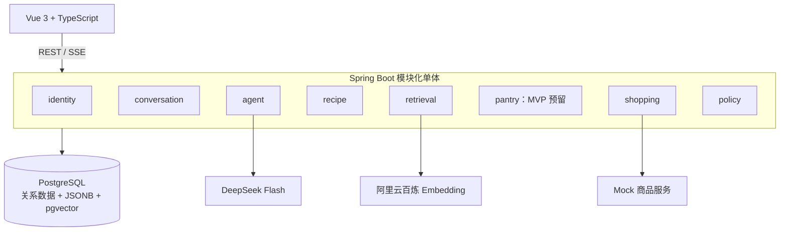

# Cooker 技术文档

> 文档版本：0.32
> 更新日期：2026-10-02

> 最新恢复授权：用户认可“稳定后端基线审查/提交→原后端会话Handoff到自己的工作树→同步基线并验证环境”。保留原会话和历史，不新建会话、不强改ACL；前端代码和F3-A交付不纳入本次提交。主架构可提交稳定后端及必要架构/教学/验收上下文，再将该提交同步至目标工作树，但不合并到E:\Cooker/main、不推送、不调用收费API或部署。后端T12迁移后使用自己的平台workspace，前端仍为0f47；任务卡及排障报告记录精确状态。下方接替会话建议及提交禁令属于此前状态，不覆盖本次明确授权。

> 最新T12排障：原后端会话在E:\Cooker沙箱setup refresh阶段发生Git目录ACL设置失败，未进入Maven/业务执行；附加当前0f47受会话所有权限制，且E盘缺少T8未提交基线。本次原因已定位但原环境尚未恢复，不强改ACL或绕过归属。建议经用户具体允许后新增绑定当前环境的T12后端会话；现阶段未创建、未迁移、未编码、未收费调用。证据与恢复验收条件见 `docs/排障报告-T12-会话执行环境.md`。

> 首批派发回执：T12/F3-A已分别成功发送给原后端/前端会话，工具返回对应threadId且无错误；本批均 `gpt-6-luna` / `high`，未创建新会话。当前等待实现交付及主架构独立审查，不能把派发成功称为完成或验收通过。主架构本次只更新文档/派发；后续任务、收费调用、部署、提交合并仍不在授权内。

> 最新首批授权：用户明确允许将T12与F3-A派发给原两个实现会话，两者按任务卡建议采用 `gpt-6-luna` / `high`，实际开发在当前0f47共享工作树而不是元数据cwd的E:\Cooker。允许模型网关手工适配/非收费协议测试、Key设置页和各自教学/工作文档；主架构不写业务代码。首批正在派发、尚未验收，详见 `docs/派发任务-T12与F3-A.md`；不启动后续任务，不真实调用模型/Embedding、不部署、不提交合并。下方待授权状态为历史。

> 最新首批架构准备：T12模型网关与F3-A模型设置页的建议范围、契约、并行目录、验收及教学要求已整理，见 `docs/派发任务-T12与F3-A.md`。待用户对两个具体任务确认并授权派发，后端执行模型待确认；本次仅文档，不实现、不派发、不部署、不收费调用或提交合并。其余阶段三接口/任务及预算规则仍待后续冻结。

> 最新阶段三确认：用户认可3A→3B推进顺序，使用DeepSeek官方API Key、deepseek-flash及官方文档。已只读核验模型参数/能力与Spring AI v2.0.1源码，推荐按用户手工DeepSeek客户端、非思考及有界编排；详见ADR-008、阶段三讨论稿和 `docs/阶段3-架构与任务计划.md`。T12～T18/F3-A～F3-D是任务草案，不是派发授权；预算未知/超出规则和具体接口仍待确认。不改业务代码、依赖/数据库，不调用模型或提交合并。

> 最新签收：用户明确回复“全部通过”，确认T11剩余浏览器5项人工验收。结合已有独立回归、V7、真实HTTP/PG及实际后端重启证据，T11和阶段二正式签收；Cookie偏差按ADR-007接受，不宣称修复。用户反馈不是工具自动浏览器证据，也不额外证明服务端提交后响应丢失。当前只进入阶段三目标和架构讨论，见 `docs/阶段3-目标与架构讨论.md`；不编码、不派发、不收费调用、不提交合并。下方“阶段二未签收/待浏览器”为历史记录。

> 最新部署与T11证据：用户已明确授权生成稳定开发密钥、保存到Windows User环境变量并部署/重启。两项密钥已配置且未展示或入库入仓；停止旧开发Java后正常打包成功，开发库由V6升V7，原有372菜谱、2收藏、10做菜事件保留。专用虚构账号的真实HTTP凭证隔离、重启后收藏/做菜次数/评分/凭证状态回读、同键重放、访问JWT和续期凭证跨重启有效均通过；不是浏览器关闭重开或真实模型解密调用的证据。本次新增1收藏、1做菜事件，虚构凭证已删除。8080 PID40684、5173 PID13936；剩余用户浏览器验收见T11报告第9节，阶段二尚未整体签收，不派发阶段三。下方未配置/V6/待重启说明均是历史状态。

> 最新用户取舍：用户明确表示“可以不用修复，继续推进”。保留未勾选时访问Cookie900秒的行为，记为接受的已知偏差，不宣称修复且不再阻断T11；见ADR-007。仅推进T11剩余部署/验收，不派发阶段三。当前稳定JWT签名密钥及LLM凭证主密钥在Windows各环境范围均未配置；旧后端健康且V6，未停止或迁移，需先完成稳定密钥配置。下方“先修复”是历史决定。

> 最新复审与T11：用户明确授权T8复审与T11。T8独立源码/教学文档复审及真实PostgreSQL回归通过；本次后端51项、0失败/错误、1项收费条件跳过，前端60项/type-check/build通过。T11真实HTTP的注册、收藏、烹饪幂等、评分、隔离及重新登录回读通过，但未整体签收：未勾选记住我仍持久化访问Cookie900秒，确认为P2待修；开发后端仍运行V6，T8未部署；残余真实浏览器及后端重启验收待补。仅维护架构与验收文档，不派发修复或后续任务。详见 `docs/审查报告-T8-用户模型凭证.md`、`docs/工作报告-T11-阶段2真实联调验收.md`；下方T11未授权或T8执行中的叙述均为历史。

> 最新T8授权：用户在T8范围确认后，指定原后端会话本任务使用 `gpt-6-luna` / `high`。T8边界冻结于 `docs/派发任务-T8-用户模型凭证.md`，包括AES-GCM凭证存取、V7、隔离数据库测试及独立学习文档，尚未验收。不调用真实模型、不做前端设置页、不启动T11/阶段三；下方T8未授权为历史状态。

> 最新修复签收：F2-C R1已按用户“收尾修复吧”授权完成；主架构独立复跑前端60项测试、类型检查、构建及diff-check通过。页面接入共用 `useCookingCompletion`，首次成功与同键重试成功一致关闭弹窗、清空评分，并隔离路由/账号变化。结合用户人工清单1～8和T10已有后端审查，T10/F2-C本对验收通过；阶段二未整体签收，T8/T11及阶段三仍待授权。超时重试为实际页面逻辑自动化证据，不冒充真实浏览器演练。详见 `docs/审查报告-T10与F2-C.md` 最新节；下方未修复状态是历史记录。
> MVP 截止日期：2026-10-05  
> 当前状态：阶段1与阶段2/T11已签收。阶段三首批T12/F3-A已获明确实现与派发允许、尚未验收，后续任务及接口仍为草案。记住我偏差按ADR-007保留，收费调用、部署与提交合并未授权。

> 最新人工验收与恢复（2026-10-01）：用户回复“全项通过，继续推进”，确认T10/F2-C人工清单1～8通过，解除暂停要求。记录为用户真实浏览器人工证据，不冒充工具自动验收。清单明确未覆盖超时重试；本次核对源码，该P2缺陷仍在，本对不整体签收。此前后端44项及前端55项自动化结果保留为历史审查证据，本次未复跑。先确认该缺陷的具体修复授权；尚未派发修复，T8/T11及后续阶段仍待授权。下方旧状态为历史记录，证据见 `docs/审查报告-T10与F2-C.md` 最新节。

> 最新恢复指令（2026-10-01）：用户明确回复“继续吧”，解除任务暂停，恢复 T9/F2-B 派发。原两个实现会话沿用模型和目录边界，每项交付后须经主架构审查，不自动越过切片；主架构不实现业务代码。T7/F2-A 测试数字保留为9月30日证据，不代表 T9/F2-B 已完成。

> 本日验收：后端43项测试无失败/错误、1项收费评测跳过（本日前次独立审查，修复未动后端）。F2-B R1/R2 经明确授权修复及主架构独立复审，前端40项测试/type-check/build/diff-check通过；详情保留原始食材说明和可选标识，收藏写后受控重读使旧响应失效并处理分页与加载。用户已同意亲自补真实浏览器验收，尚无操作结果，本对暂不整体签收，T10/F2-C未派发。证据和人工清单见 `docs/审查报告-T9与F2-B.md` 最新节。

## 1. 文档用途

最新验收/推进（2026-10-01）：用户确认人工清单1～4全部通过，T9/F2-B本对签收；证据是用户人工反馈，范围仅为菜谱详情、收藏/取消、刷新/重新登录持久化及账号隔离，不推定额外浏览器场景已测。按原批量授权冻结并派发T10/F2-C，见 `docs/派发任务-T10与F2-C.md`；原上方“待人工”是本日前次审查历史状态。本次未复跑收费API或提交合并。阶段二仍待后续实现/签收，T8/T11未授权，T7残余浏览器项继续保留。

本文档是 Cooker 项目的架构与开发上下文入口，供主会话和并行开发会话共同使用。

新会话开始任务时，应按顺序阅读：

1. 根目录 `AGENTS.md`；
2. 本文档；
3. 与任务相关的 `docs/adr/`；
4. 与任务相关的专题文档：`docs/数据库说明-菜谱导入.md`、`docs/技术文档-检索投影与向量化.md`、`docs/阶段1-菜谱数据与混合检索架构.md`；阶段 2 任务还需阅读 `docs/阶段2-账号与用户菜谱记录架构.md`、`docs/阶段2-前后端接口契约.md`、`docs/阶段2-双会话任务与真实联调验收.md` 和 ADR-005/006；
   T5 实现还应阅读 `docs/阶段1-T5混合检索任务契约.md`；
   T5 的学习对照与自检见 `docs/阶段1-T5学习笔记.md`，数据库验证见 `docs/工作报告-T5-混合检索.md`；
5. 任务涉及模块的现有代码与测试。

本文档记录当前已确认的业务范围、模块边界、技术选型、数据模型草图、接口草案、阶段计划和未决事项。代码与本文档冲突时，不应自行选择一方，应交由主架构 Agent 判断并修正文档或代码。

## 2. 产品目标

Cooker 是一个面向家庭烹饪场景的 Web 单 Agent。用户不必输入准确菜名，可以直接表达模糊需求，例如：

- “我想吃点清淡的。”
- “今天喉咙有点难受，有什么可以吃？”
- “半小时以内，预算 30 元，家里只有电饭煲。”
- “家里有鸡蛋和番茄，还能做什么？”

系统需要完成以下闭环：

```text
自然语言需求
  → 提取饮食和烹饪约束
  → 混合检索真实菜谱
  → 解释推荐理由
  → 用户选择菜谱
  → 用户确认本次已有食材（不读取持久库存）
  → 生成缺货购物清单
  → 匹配具体商品
  → 展示购买链接和成本
  → 用户完成烹饪
  → 幂等记录做菜历史、次数和主动评分
```

## 3. 已确认需求

### 3.1 菜谱与检索

- MVP 菜谱只来自 HowToCook。
- HowToCook 固定快照只在项目初始化时导入一次，不做定时、实时或增量同步；初始化失败允许幂等重试。
- 保存原始 Markdown、来源路径、来源 commit 和内容哈希。
- 将菜谱解析为结构化数据。
- 同时支持结构化过滤、词法检索和向量语义检索。
- Embedding 由阿里云百炼生成，服务端提供 API Key。
- 向量存入 PostgreSQL 的 pgvector。
- 后续允许用户上传符合 HowToCook 模板的私有自定义菜谱。
- 系统菜谱和用户自定义菜谱复用同一套解析与索引管线，并统一保留原始数据、结构化数据和向量化数据。

### 3.2 用户与个性化

- 用户名密码注册登录，采用 JWT，并支持“记住我”。
- 保存历史对话。
- 收藏菜谱。
- 记录做过的菜谱、次数和最近完成时间；熟悉度由次数展示，喜爱程度由用户主动给出的 1～5 分评分展示。做菜历史与历史对话分开。
- 家庭持久库存、库存自动扣减暂缓。第一版推荐约束包括本次对话声明的已有食材、烹饪时间、预算和厨具。
- 商品查询时允许用户选择城市或配送位置。
- 阶段 2 最小页面必须真实调用 Spring Boot 并读写 PostgreSQL；开发 Mock 不等于阶段验收完成。

### 3.3 Agent

- 运行时使用一个 Agent。
- LLM 使用 DeepSeek Flash。
- DeepSeek API Key 由用户提供，加密保存到用户账户。
- Agent 只能推荐数据库中存在的菜谱。
- 健康相关表达只转化为一般饮食偏好，不提供诊断和治疗建议。

### 3.4 采购与预算

- MVP 开发阶段使用 Mock 商品服务。
- 每种缺少食材匹配一个具体商品。
- 自动生成完整购物清单。
- 不自动加入购物车、不下单、不支付。
- 同时展示以下金额：
  - 预估菜谱成本；
  - 根据具体商品单价折算的实际消耗成本；
  - 购买完整包装的实际采购支出。
- 用户本次明确声明并确认已有的食材可暂不计入采购预算；系统不声称已核验家庭库存，未确认的食材按需购买处理。
- 菜谱消耗 10g、商品包装 100g 时，消耗成本只计算 10g，但采购支出显示完整包装价格。

### 3.5 做菜历史与库存边界

- 用户明确点击“完成烹饪”时，追加一条做菜记录，不扣减库存。
- 同一次烹饪事件的请求重试只能记一次；再次做同一道菜应产生新事件。
- 收藏、做菜次数、熟悉度和喜爱评分是不同信息；不能用次数推断用户喜爱程度。
- 后续如恢复库存，应先解决食材别名、标准食材 ID 和单位换算的匹配验证，再讨论自动扣减。

## 4. MVP 非目标

以下内容不属于 2026-10-05 前的完成条件：

- 医疗诊断、治疗或专业营养处方；
- 自动加入购物车、支付和下单；
- 运行时多 Agent；
- 多菜谱数据源；
- 用户上传自定义菜谱；
- 家庭持久库存、库存流水和自动扣减；
- Spring Cloud 微服务；
- RabbitMQ；
- Redis；
- Elasticsearch/OpenSearch；
- Kubernetes；
- 复杂长期记忆和用户画像推断。

## 5. 总体架构

### 5.1 当前形态

采用前后端分离的模块化单体：



### 5.2 为什么先模块化单体

- 截止时间只有约 10 天，优先确保业务闭环。
- 当前外部采购接口尚未验证，过早拆分会固化错误边界。
- 单体事务便于先实现登录续期、收藏和做菜事件幂等；未来恢复库存时也容易控制事务边界。
- 清晰模块边界可以在后续直接作为服务拆分候选。

对应决策见 `docs/adr/ADR-001-先模块化单体后微服务.md`。

## 6. 技术栈

### 6.1 后端基线

| 技术 | 版本/范围 | 用途 |
|---|---|---|
| Java | 21 | 运行时与语言版本 |
| Spring Boot | 4.0.8 | Web、配置、Actuator |
| Maven | 3.8.8+ | 构建工具 |
| MyBatis-Plus | 3.5.17 | CRUD 与 Mapper 集成 |
| PostgreSQL | 18 | 主数据库 |
| pgvector | 数据库镜像提供 | 向量存储与相似度查询 |
| pg_trgm | PostgreSQL 扩展 | 中文短文本和名称模糊匹配 |
| Flyway | 由 Boot 管理 | 数据库迁移 |
| Spring AI | 2.0.1 | 当前只使用 `EmbeddingModel` 抽象；后续再引入 Chat/Tool Calling 能力 |

MyBatis-Plus 官方从 3.5.13 开始提供 Spring Boot 4 Starter，本项目锁定 `mybatis-plus-spring-boot4-starter:3.5.17`。

### 6.2 前端基线

| 技术 | 版本 | 用途 |
|---|---:|---|
| Vue | 3.5.43 | UI 框架 |
| TypeScript | 5.9.3 | 类型系统；避免 TypeScript 7 与当前 vue-tsc 的兼容问题 |
| Vite | 8.3.1 | 开发与构建 |
| Vue Router | 5.3.1 | 路由 |
| Pinia | 4.0.3 | 状态管理 |
| Vitest | 5.0.1 | 单元测试 |

### 6.3 后续技术

- Spring Cloud Alibaba + Nacos：服务注册与配置中心。
- Spring Cloud Gateway：统一入口。
- Resilience4j：超时、重试、限流和熔断。
- Micrometer + OpenTelemetry：指标和链路追踪。
- RabbitMQ：菜谱解析、Embedding 生成和跨服务事件。

这些依赖不得在 MVP 主链路完成前提前加入。

## 7. 仓库结构

```text
Cooker/
├─ AGENTS.md
├─ 技术文档.md
├─ README.md
├─ compose.yaml
├─ .env.example
├─ backend/
│  ├─ pom.xml
│  ├─ Dockerfile
│  └─ src/
│     ├─ main/
│     │  ├─ java/com/cooker/
│     │  │  ├─ common/
│     │  │  ├─ identity/
│     │  │  ├─ conversation/
│     │  │  ├─ recipe/
│     │  │  ├─ retrieval/
│     │  │  ├─ agent/
│     │  │  ├─ pantry/
│     │  │  ├─ shopping/
│     │  │  └─ policy/
│     │  └─ resources/
│     │     ├─ db/migration/
│     │     └─ mapper/<module>/
│     └─ test/
├─ frontend/
│  ├─ package.json
│  ├─ Dockerfile
│  └─ src/
│     ├─ modules/
│     ├─ shared/
│     ├─ router/
│     ├─ stores/
│     └─ views/
├─ infra/
│  ├─ nginx/
│  └─ postgres/init/
├─ docs/adr/
└─ scripts/
```

## 8. 后端分层规范

### 8.1 业务模块内部结构

```text
recipe/
├─ controller/
├─ service/
│  └─ impl/
├─ mapper/
├─ entity/
├─ dto/
└─ vo/
```

各层职责：

- `controller`：接收 HTTP 请求、校验 DTO、调用 Service、返回 VO。
- `service`：定义模块业务能力和跨模块可用接口。
- `service.impl`：业务规则、事务边界和多个 Mapper/外部适配器协调。
- `mapper`：数据库操作，承担传统 DAO 职责。
- `entity`：数据库表映射，不作为接口模型。
- `dto`：请求、命令、查询条件和内部数据传输。
- `vo`：面向前端的稳定响应结构。

### 8.2 MyBatis-Plus 使用约定

- Mapper 接口使用 `@Mapper`。
- 简单 CRUD 使用 `BaseMapper<Entity>`。
- 不在 Controller 中使用 `QueryWrapper`。
- 不将 `IService` 直接作为业务接口。
- 多表关联、窗口函数、pgvector 距离查询、全文/三元组检索使用 Mapper XML 或显式 SQL。
- XML 路径为 `src/main/resources/mapper/<module>/`。
- SQL 必须参数化，禁止字符串拼接用户输入。

对应决策见 `docs/adr/ADR-002-MyBatis-Plus持久层规范.md`。

## 9. 模块职责与依赖

| 模块 | 主要职责 | 可以依赖 | 禁止直接依赖 |
|---|---|---|---|
| `identity` | 用户、JWT 与“记住我”续期、凭证加密 | `common` | 其他业务 Mapper |
| `conversation` | 会话和消息 | `identity` 公共接口 | `recipe` Mapper |
| `recipe` | 菜谱、食材、解析导入、收藏和做菜记录 | `common`、`identity` 的当前用户接口 | 用户库存及其他模块 Mapper |
| `retrieval` | 混合检索、排序 | `recipe` Service | `recipe` Mapper 内部实现 |
| `agent` | 对话编排、工具调用 | 各模块 Service、`policy` | 任意 Mapper |
| `pantry` | 预留模块；MVP 不实现持久库存 | 后续再定 | 当前不得参与 MVP 业务链路 |
| `shopping` | 基于本次用户确认的食材计算缺口、商品和成本 | `recipe` 公共接口 | 用户凭证实体、`pantry` Mapper |
| `policy` | 健康边界、输出策略 | `common` | 业务数据持久层 |

依赖方向需要保持无环。出现循环依赖时，应重新审视职责，而不是使用懒加载绕过。

## 10. 核心业务流程

### 10.1 推荐流程

1. 用户发送消息。
2. `conversation` 保存用户消息。
3. `agent` 调用 DeepSeek，将消息转换为结构化 `RecipeConstraints`。
4. `policy` 将健康表达限制为一般饮食偏好。
5. `retrieval` 执行硬过滤、词法召回和向量召回。
6. 检索结果融合并返回候选菜谱。
7. `agent` 只能根据候选数据生成推荐解释。
8. `conversation` 保存 Agent 回复和候选引用。

### 10.2 购物清单流程

1. 用户选定菜谱和份数。
2. 读取用户在本次请求中明确确认的已有食材；不存在持久库存时，未声明的食材视为需要购买。
3. 仅对能确认的标准食材和单位计算缺口；不确定的匹配或用量应要求确认，不能自动抵扣。
4. `shopping` 使用位置和缺货食材调用商品 Provider。
5. 每种缺货食材选择一个具体商品。
6. 计算预估成本、实际消耗成本和采购支出。
7. 保存购物清单和商品快照。

### 10.3 完成烹饪流程

1. 用户实际完成烹饪后点击“完成烹饪”。
2. 服务端验证当前用户、菜谱可见性和本次烹饪事件幂等键。
3. 在事务中新增 `recipe_cook_record`；同一事件重试返回既有记录，不重复计数。
4. 可选记录用户主动给出的 1～5 分喜爱评分；没有评分时保持未知。
5. 展示做菜次数、最近完成时间与次数驱动的熟悉度，不触发库存操作。

### 10.4 菜谱数据进入系统的方式

HowToCook 与用户自定义菜谱共享核心处理管线，但入口和生命周期不同：

```text
HowToCook 固定快照 ──一次性初始化──┐
                                  ├─→ 原始 Markdown → 结构化菜谱 → 检索文档与向量
用户自定义 Markdown ──创建/修改───┘
```

- HowToCook：系统级公开种子数据，部署初始化时导入一次，不轮询 GitHub，不监听上游更新，也不提供自动升级。
- 用户自定义菜谱：后续功能，使用与 HowToCook 一致的模板；默认仅创建者可见。
- 初始化命令必须幂等，以便失败恢复和开发测试；幂等不代表持续同步。
- 用户每次修改菜谱时追加原始文档版本，更新当前结构化数据，并按内容哈希重建对应检索文档和向量。
- 删除或停用用户菜谱时必须同步使其检索投影不可见，避免检索到无权访问或已删除的数据。

系统快照导入仅在 `recipe-import` profile 且 `cooker.recipe-import.enabled=true` 时执行；`dataset-path` 没有默认值，必须由命令参数或环境变量显式提供。普通应用启动只运行常规数据库迁移，不扫描本地快照。JDK 21 与 PostgreSQL 可用时，可使用以下形式执行：

```powershell
Set-Location backend
$env:JAVA_HOME = 'C:\Program Files\Java\jdk-21'
$env:Path = "$env:JAVA_HOME\bin;$env:Path"
mvn spring-boot:run "-Dspring-boot.run.profiles=local,recipe-import" "-Dspring-boot.run.arguments=--cooker.recipe-import.enabled=true --cooker.recipe-import.dataset-path=<本地快照目录>"
```

## 11. 混合检索设计

### 11.1 MVP 召回通道

1. **结构化过滤**：时间、厨具、菜谱状态等硬条件。
2. **精确匹配**：菜名、标准食材和食材别名。
3. **词法匹配**：使用现有 `zhparser + tsv` 做中文全文检索，以精确菜名/原料匹配和 `pg_trgm` 菜名模糊匹配补充。
4. **向量召回**：使用 pgvector 的余弦距离处理语义需求。
5. **业务加权**：未来可结合本次请求中经确认的已有食材覆盖率、辣度、油炸方式、时间接近度和预算；不得声称使用持久库存。阶段 1 的 T5 不包含预算或食材覆盖率加权。
6. **融合排序**：首选 RRF，避免直接混合不可比的原始分数。

### 11.2 初始策略

HowToCook 数据量较小，MVP 首先采用精确向量扫描，暂不建立 HNSW。数据量和查询性能达到需要后再新增索引。

### 11.3 检索评测

T6 固定评测集包含 40 条候选查询，覆盖精确菜名、原料及别名、短中文/模糊菜名、自然语言偏好、时间、厨具和排除食材。预算与本次用户声明食材的覆盖率不属于 T5 Criteria，留待后续业务闭环验收；持久库存覆盖率已退出 MVP。

- 清淡、少油、少辣；
- 时间限制；
- 厨具限制；
- 排除食材；
- 模糊菜名和食材别名。

评测分别报告 Hit@3（至少 75%）、Hit@5（至少 80%）、Recall@5 和 MRR@10；硬过滤违规数必须为 0，本地链路 p95 目标小于 300ms。边界样例不计入相关性分母。2026-09-29 用户整体认可固定候选标签，标签版本为 `t6-labels-v1-2026-09-29`；这是整套标签的总体审定，不代表逐条审定记录。词法单路不可冒充真实混合结果。旧的 320 次百炼测量使用测试直接编排入口，仅作历史基准；同日经用户单次授权的修订版复测经过生产 `RecipeSearchService.search`，Hit@3 为 75.0%、Hit@5 为 87.5%、独立硬条件违规 0、本地 p95 为 122.449ms，达到阶段 1 门槛。再次收费复测仍需重新授权。

## 12. 数据模型草图

阶段 0 不创建业务表。以下仅用于后续任务对齐，最终字段通过 Flyway 和 ADR 确认。

### 12.1 用户、认证与个人菜谱记录

T7 已新增并验证 Flyway V4：`app_user` 保存规范用户名和 Argon2id 密码哈希；`user_refresh_token` 保存随机续期凭证的 SHA-256 哈希、用户 ID、到期/绝对截止、记住我标志及撤销时间。主键沿用 BIGINT identity；续期通过同一事务内的条件 UPDATE 与新令牌插入实现原子轮换。Mapper XML 属于 identity，其他模块只调用 `CurrentUserService`。T7 源码及已测主流程经修复复审通过，可供 T9 依赖；记住我的浏览器关闭重开等证据仍待补验。

T9 新增 Flyway V5 `favorite_recipe`，BIGINT identity、用户/菜谱外键、`UNIQUE(user_id,recipe_id)`与按用户/时间/菜谱排序的索引；收藏添加使用ON CONFLICT DO NOTHING，不改首次收藏时间，取消绑定当前用户。普通浏览与收藏复用recipe_source可见性，数值数量以十进制字符串返回、原始说明保留rawLine；不调用T5收费查询，不修改既有导入表和V1～V4。T10现已实现V6 `recipe_cook_record`，BIGINT identity、用户外键CASCADE/菜谱外键RESTRICT、用户与UUID幂等键唯一约束、nullable 1～5评分和服务端时间；事件不更新，历史按事件聚合并查最近非空评分。T10后端已有审查通过，F2-C缺陷修复经独立复审，正常真实页面清单获用户确认；本对验收通过，不等于阶段二整体签收。

- `app_user`
- `user_refresh_token`（随机续期令牌的哈希、轮换和撤销信息；具体表名以阶段 2 迁移契约为准）
- `user_llm_credential`
- `user_address`
- `conversation`
- `chat_message`
- `favorite_recipe`
- `recipe_cook_record`

### 12.2 菜谱与检索

- `recipe_import_batch`
- `recipe_source`
- `recipe_source_document`
- `recipe`
- `ingredient`
- `ingredient_alias`
- `recipe_ingredient`
- `recipe_step`
- `cooking_tool`
- `recipe_tool`
- `recipe_search_document`

三类数据职责：

- `recipe_source_document`：原始数据层，保存完整 Markdown、内容哈希、来源版本和解析诊断。
- `recipe` 及其原料、步骤、厨具关联表：结构化事实层，保存当前生效的可查询业务数据。
- `recipe_search_document`：检索投影层，保存词法文本、Embedding 元数据和 pgvector 向量，可由结构化事实重建。

`recipe_source` 必须区分系统 HowToCook 与用户自定义来源，并支持可空的所有者标识。系统来源没有用户所有者；用户来源必须绑定 `owner_user_id`，默认私有。

### 12.3 后续可选的库存数据（非 MVP）

- `pantry_item`
- `inventory_movement`
- `cooking_session`
- `cooking_consumption`

以上四表目前仅为未来候选，不应在阶段 2 建立。MVP 的完成烹饪事件只写 `recipe_cook_record`，与库存流水无关。

### 12.4 推荐与采购

- `recommendation_session`
- `recommendation_candidate`
- `shopping_list`
- `shopping_list_item`
- `product_match`

### 12.5 关键字段原则

- 金额：`numeric(12, 2)` 或统一最小货币单位。
- 食材数量：`numeric`，同时保存标准单位。
- 原始 Markdown：`text`。
- 可变源元数据：JSONB。
- 向量：固定维度 `vector(n)`，同时记录模型和版本。
- 幂等操作：业务唯一键或独立幂等键。
- 用户数据：所有唯一约束和查询都考虑 `user_id`。
- 菜谱可见性：检索范围必须限制为系统公开菜谱或当前用户拥有的私有菜谱。

## 13. API 草案

接口统一以 `/api` 为上下文路径。阶段 2 已冻结的字段、分页、错误码、身份恢复与 Cookie/CSRF 规则以 `docs/阶段2-前后端接口契约.md` 的 s2-api-v1 为准；以下列表省略 `/api` 前缀。尚未实现的接口不得被描述为已可用。

### 13.1 身份

- `GET /auth/csrf`
- `POST /auth/register`
- `POST /auth/login`
- `POST /auth/logout`
- `POST /auth/refresh`
- `GET /users/me`
- `PUT /users/me/llm-credential`
- `DELETE /users/me/llm-credential`
- `GET /users/me/llm-credential/status`

登录请求包含 `rememberMe`；真实 DeepSeek Key 验证留待 Agent 阶段。认证 Cookie 为 `HttpOnly`，修改数据的请求保留 CSRF 防护。具体契约见阶段 2 架构文档和 ADR-005。

### 13.2 对话与推荐

- `POST /conversations`
- `GET /conversations`
- `GET /conversations/{id}`
- `POST /conversations/{id}/messages`
- `GET /conversations/{id}/stream`

### 13.3 菜谱

- `GET /recipes`（阶段 2 普通菜谱浏览，不调用收费混合检索）
- `GET /recipes/{id}`
- `POST /recipes/search`
- `POST /recipes/{id}/favorites`
- `DELETE /recipes/{id}/favorites`
- `GET /favorites/recipes`
- `POST /cooking-records`（明确完成烹饪，仅写记录，不扣库存）
- `GET /users/me/cooked-recipes`（次数、熟悉度、最近完成时间和用户评分）

以下为后续非 MVP 的用户自定义菜谱接口草案：

- `POST /users/me/recipes`
- `PUT /users/me/recipes/{id}`
- `DELETE /users/me/recipes/{id}`
- `GET /users/me/recipes`

### 13.4 后续可选的库存接口（非 MVP）

- `GET /pantry/items`
- `POST /pantry/items`
- `PUT /pantry/items/{id}`
- `DELETE /pantry/items/{id}`
- `POST /cooking-sessions`
- `POST /cooking-sessions/{id}/complete`

这些接口均非阶段 2 或 MVP 验收范围；不得把旧的 `cooking-sessions/{id}/complete` 当成当前做菜记录接口。

### 13.5 购物清单

- `POST /shopping-lists`
- `GET /shopping-lists/{id}`
- `POST /shopping-lists/{id}/match-products`

## 14. 模型与凭证设计

### 14.1 DeepSeek

- 逻辑模型名为 DeepSeek Flash。
- 2026-10-02用户确认使用官方API：Base URL `https://api.deepseek.com`、模型字符串 `deepseek-flash`、Chat Completions路径 `/chat/completions`。模型名显式配置，不沿用框架的旧默认名。依据：[官方首次调用文档](https://api-docs.deepseek.com/zh-cn/)。
- 实际模型 ID 通过配置提供，不能散落在业务代码中。
- 每个用户使用自己的 API Key。
- 需要一个 `ChatModelFactory` 或等价适配层，根据当前用户凭证创建受控客户端。
- 不使用全局明文 Key 单例满足多用户需求。

后续推荐引入锁定版本的spring-ai-deepseek手工配置，不用全局Key自动配置代替账户凭证；MVP显式关闭thinking，先结构化理解/真实检索/约束解释，再引入有界Tool Calling。3候选适配对比、源码日志/重试风险、真实调用闸门见ADR-008。当前pom未新增Chat依赖，没有用用户Key做真实调用，源码核验不能当作本项目编译/协议或付费联调通过。

### 14.2 Embedding

- 模型固定为阿里百炼 `text-embedding-v4`，维度固定为 1024。
- 业务层通过 Spring AI `EmbeddingModel` 调用；项目内 DashScope 适配器通过 Spring `RestClient` 请求原生 HTTP 接口。
- 入库使用 `text_type=document`，查询使用 `text_type=query`，输出固定为 dense。
- Embedding Key 由服务端配置。
- 检索文档、模型、维度和文档模板版本必须记录并参与查询过滤。
- 原文内容发生变化时根据内容哈希重新生成向量；哈希未变化不得重复调用收费接口。
- 阶段 1 仅引入 Spring AI 的模型接口模块，不引入 `VectorStore`、`ChatClient`、TextSplitter 或 Agent 能力。

对应决策见 `docs/adr/ADR-004-混合检索与向量版本化.md`。

### 14.3 Key 加密

- 密码使用强哈希，不可逆。
- LLM Key 需要可逆读取，因此使用认证加密。
- 数据库存储密文、随机 IV、算法版本和更新时间。
- 主密钥通过环境变量 `LLM_CREDENTIAL_MASTER_KEY` 注入。
- 日志和异常不得包含明文 Key。

本地开发已按用户授权将首次生成的稳定JWT签名材料及Base64编码32字节LLM主密钥保存到Windows User环境变量。Windows用户变量并非加密保险箱，生产需Secret管理；旧IDE/终端不一定自动继承新变量，需要重开或在启动进程内从User范围读取。JWT密钥稳定可以避免重启导致既有访问JWT失验；LLM主密钥稳定用于未来解密既有凭证，丢失或直接替换会使原密文不可解密。不得每次启动重新随机生成，也不得将变量值写入文档、启动参数或仓库。

### 14.4 登录与“记住我”

- 用户于2026-10-01接受现有偏差：访问Cookie始终持久900秒；未勾选时续期Cookie非持久且服务端期限最长24小时，勾选时续期Cookie持久且最长30天。访问JWT自身仍15分钟到期；不把15分钟解释为届时必然重新输入密码。不承诺关闭浏览器必然注销；该接受记录不是代码修复，见ADR-007。
- 登录采用短有效期访问 JWT + 服务端可撤销的随机续期凭证。“记住我”只延长续期凭证及持久 Cookie 的生命周期，不延长访问 JWT。
- 续期令牌数据库只存哈希，并原子轮换；退出时撤销续期令牌并清除 Cookie。已签发访问 JWT 在自身到期前仍可能有效，除非另加撤销校验。
- 不将 JWT 或续期令牌放进浏览器 Web Storage；生产环境 Cookie 使用 `HttpOnly`、`Secure` 及适当 `SameSite`，并保留 CSRF 防护。
- 方案对比、默认有效期及复审条件见 `docs/adr/ADR-005-JWT记住我与烹饪记录边界.md`。

## 15. 前端规划

### 15.1 页面

- 登录和注册；
- 聊天主页；
- 菜谱详情；
- 收藏菜谱；
- 做过的菜谱（次数、熟悉度和主动评分）；
- 历史对话；
- 购物清单；
- 模型 Key 和地址设置。

### 15.2 模块映射

| 前端模块 | 后端模块 |
|---|---|
| `identity` | `identity` |
| `conversation` | `conversation`、`agent` |
| `recipe` | `recipe`、`retrieval` |
| `pantry` | 预留；MVP 不实现页面或业务接口 |
| `shopping` | `shopping` |
| `settings` | `identity`、地址设置 |

### 15.3 阶段 2 最小页面与真实联调

阶段 2 提前实现 `/login`、`/register`、`/recipes`、`/recipes/:id`、`/favorites`、`/cooked-recipes`。使用共享 fetch 请求层、Pinia 身份 Store、路由守卫及简单组件/CSS，沿用现有 Vite `/api` 代理。JWT 与续期令牌由 HttpOnly Cookie 保存，前端不读取；同源写请求提交 CSRF token。

前端在后端接口未就绪时可使用显式固定 Mock，默认 real；页面 real 模式不能在请求失败时退回 Mock。阶段 2 签收必须真实登录、收藏、完成烹饪、显示次数和评分，刷新/重新登录后仍由 PostgreSQL 回读。阶段 4 继续全产品页面打磨及 Agent/购物联调。

## 16. 部署规划

### 16.1 MVP

```text
Nginx
├─ 托管 Vue 静态文件
└─ /api 反向代理到 Spring Boot

Spring Boot
└─ PostgreSQL + pgvector
```

根目录 `compose.yaml` 中：

- `postgres` 默认启动；
- `backend` 和 `frontend` 位于 `app` profile；
- 使用 `.env` 提供本地配置；
- `.env` 不进入版本控制。

### 16.2 后续微服务演进

候选拆分顺序：

1. `recipe + retrieval` 拆为菜谱检索服务；
2. `agent + conversation` 拆为 Agent 服务；
3. `identity` 拆为身份服务；
4. `shopping` 根据负载和边界再决定是否拆分；持久库存恢复后再评估 `pantry`。

演进组件：

- Nacos：注册发现和配置中心；
- Spring Cloud Gateway：入口；
- Resilience4j：容错；
- RabbitMQ：异步导入、向量化和领域事件；
- OpenTelemetry：跨服务链路。

## 17. 阶段计划与状态

### 阶段 0：项目骨架（2026-09-25）

状态：**项目骨架已完成；前端构建验证通过，后端完整构建和 Docker 联调受当前执行环境限制，待本机终端复验。**

已完成：

- 根目录协作规范和技术文档；
- Spring Boot 4 + MyBatis-Plus 后端骨架；
- Vue 3 + TypeScript 前端骨架；
- 业务模块与内部层级目录；
- PostgreSQL + pgvector Compose 配置；
- Nginx 反向代理配置；
- 基础 ADR；
- 环境检查脚本。

未实现：所有业务功能、业务表和外部 API 调用。

### 阶段 1：菜谱数据与混合检索（2026-09-26～27）

状态：**阶段 1 的 T1～T6 已完成验收。T1～T5 已实现、验证并合并到 `main`；T5 曾有 32 项测试通过，独立 PostgreSQL 空库成功迁移至 V3。T6 固定标签经用户整体审定，修订版生产 Service 入口已完成真实混合复测，达到质量、性能与独立硬条件审计门槛。**

- 固定 HowToCook commit；
- 只提供一次性初始化导入，不实现上游同步；
- 建立菜谱和食材迁移；
- 实现 Markdown 导入；
- 使用 `zhparser` 构建中文全文检索列；
- 基于结构化事实构建 chunk 化检索投影并使用百炼生成向量；
- 混合检索 T5 已完成并合并；
- T6 建立 40 条固定评测集及离线指标/手动基准框架；用户对整套候选 ID 与理由作总体认可（非逐条记录）。旧的 320 次真实 Embedding 历史基准来自测试直接编排入口；2026-09-29 经单次授权重新调用 320 次百炼 query Embedding，修订版生产 `RecipeSearchService.search` 真实混合复测通过。Hit@3 为 75.0%、Hit@5 为 87.5%、Recall@5 为 68.75%、MRR@10 为 67.82%；本地/端到端 p95 分别为 122.449/494.365ms，独立硬条件违规、失败和超时均为 0。详见 T6 契约和工作报告。

当前本机数据集：`E:\数据集\dishes`，共 373 个 Markdown；导入时排除 `template` 目录中的 1 个模板文件，候选菜谱数为 372。该路径只能作为运行参数或环境变量传入，禁止硬编码和提交数据集。

T4 检索投影与向量化的实现细节、配置项、失败隔离策略和本机实测结果见 `docs/技术文档-检索投影与向量化.md`。

阶段 1 的边界、数据模型、跨模块契约、任务卡和验收标准见 `docs/阶段1-菜谱数据与混合检索架构.md`。阶段 1 已完成；后续阶段的新实现任务仍须分别获得用户明确授权。

### 阶段 2：账号、凭证、最小前端与用户菜谱记录（2026-09-30 架构更新）

最新状态（2026-10-02）：阶段二已签收。T7/T8/T9/T10与F2-A～F2-C分项审查、稳定配置、V7开发部署、真实HTTP/PG及后端重启证据齐备；用户确认T11残余浏览器5项“全部通过”。Cookie已知偏差依ADR-007保留。签收不等于Git提交/合并、收费调用或阶段三实现授权；以下原始授权段保留为历史。

状态：**2026-09-30 用户已授权创建两个实现会话并按既定顺序推进至 T10：后端 T7/T9/T10，前端 F2-A/F2-B/F2-C；尚未完成验收。T8 在原顺序中位于 T10 后，与 T11 均待后续授权。** 共享契约为 s2-api-v1；任务目录、模型配置、汇报及真实签收见阶段 2 专题文档。后端每个 T 需独立技术文档，要求见 `docs/阶段2-后端技术文档与面试自检要求.md`。

2026-09-30 T7/F2-A 主架构初审发现认证失效状态处理、400 错误映射和 Service 分层问题，用户明确授权修复。修复后主架构独立复跑：后端 42 项、0 失败/错误、1 项既有收费评测跳过，身份及检索 PostgreSQL 测试实际执行；前端 25 项测试、类型检查、构建通过。修复版真实 HTTP 的三类非法请求均返回 400，实际 Pinia 失效路径清身份并跳转一次。此前真实浏览器主流程与数据库证据保留。允许原会话继续领取 T9/F2-B，边界见 `docs/派发任务-T9与F2-B.md`；详细证据见 `docs/审查报告-T7与F2-A.md`。真实浏览器关闭重开、过期续期和双标签 Cookie 竞争尚未核验，不将普通刷新等同记住我完整验收，不宣告阶段二完成。

- 用户名密码注册登录、短期 JWT 和“记住我”续期；
- 用户数据隔离；
- LLM Key 加密保存；
- 真实菜谱列表和详情 API；
- 收藏菜谱；
- 做过的菜谱：完成事件幂等、次数、熟悉度展示和用户主动 1～5 分评分。
- 登录注册、菜谱、收藏、做菜历史最小页面与逐项真实浏览器联调。

家庭持久库存、库存流水和自动扣减退出 MVP。阶段 2 不实现聊天历史、Agent 或购物；Key 设置页面在 Agent 阶段接入。9 月 30 日至 10 月 1 日为阶段 2 实现/联调的目标窗口，实际进度以任务授权和签收证据为准；若顺延，后续阶段日程须据实调整，不能按日期自动标记完成。

### 阶段 3：Agent 与购物链路（阶段 2 签收后，原日期窗口据实调整）

状态：**3A→3B顺序、DeepSeek官方API及deepseek-flash已获确认；T12/F3-A首批已获具体派发允许，其他技术细节/API/任务卡待确认。** 顺序为自然语言菜谱推荐与对话历史→受限工具/SSE→用户选菜后的购物清单/Mock商品闭环→集成签收。讨论稿见 `docs/阶段3-目标与架构讨论.md`，详细推荐及T12～T18/F3-A～F3-D草案见 `docs/阶段3-架构与任务计划.md`，首批边界见 `docs/派发任务-T12与F3-A.md`，模型适配见ADR-008。预算未知/超出交互仍待确认；不在聊天中粘贴API Key。旧日期窗口是目标而非完成证明，后续按授权切片重排。

- 结构化约束提取；
- Tool Calling；
- 对话历史和 SSE；
- Mock 商品 Provider；
- 基于本次用户确认的已有食材生成购物清单和三类成本，不读取持久库存。

### 阶段 4：全产品页面打磨与联调（目标 2026-10-02～03）

- 登录；
- 聊天；
- 菜谱详情；
- 做过的菜谱及评分；
- 收藏与历史；
- 购物清单。

### 阶段 5：测试和部署（2026-10-04）

- 自动化测试；
- Docker 构建；
- Linux 部署验证；
- README 和演示脚本。

### 缓冲（2026-10-05）

只修复阻断演示的问题，不增加新功能。

## 18. 多会话建议拆分

阶段 1 当前状态：

- T1：数据迁移与持久层契约，已完成并合并；
- T2：纯内存 HowToCook 兼容模板解析器，已完成并合并，并为后续用户自定义菜谱复用；
- T3：一次性幂等导入编排，已完成并合并；
- T4：检索投影与百炼向量化，已实现并验证；实现提交为 `9b50715`，工作报告为 `3406aaf`，已经用户明确允许合并到 `main`；
- T5：词法召回、向量召回与 RRF，已实现、验证并合并；范围和验收见 `docs/阶段1-T5混合检索任务契约.md` 与 `docs/工作报告-T5-混合检索.md`；
- T6：固定集标签已由用户于 2026-09-29 整体审定；生产 Service 入口的词法及真实混合手动评测均已通过，独立硬条件审计为 0。2026-09-29 的单次收费复测授权已使用完毕。

### 18.1 任务派发授权规则

- 任何新实现会话、子智能体或对已有会话的新任务，都必须先获得用户对具体任务的明确允许。
- 任务卡、架构方案、审查结论、前置任务完成和阶段依赖满足都只是准备状态，不代表授权。
- 授权按任务逐次生效，不自动延伸到后续任务、修复、合并或同阶段其他任务。
- 未获授权时，主架构会话可以审查、记录风险和准备任务草案，但不得创建会话或发送实现指令。

阶段 1 的 T6 仅覆盖评测代码、固定集标签批准元数据及相关文档；未改动生产检索、Embedding 模型和维度、RRF 公式，也未实现用户自定义菜谱 API。修订后真实百炼复测已按 2026-09-29 的单次用户授权完成；后续再次收费运行仍须另行说明调用数和费用风险并取得明确批准。历史旧入口指标不得冒充修订后 Service 入口的真实复测。

2026-09-30 用户明确授权创建后端与前端实现会话，按 T7/F2-A → T9/F2-B → T10/F2-C 逐项实现、审查和真实联调，后端模型 `gpt-6-sol`/`medium`，前端 `gpt-6-luna`/`high`。当前授权不扩展到原顺序位于 T10 后的 T8、T11、收费 API、库存、Agent/购物功能或自动合并。每个后端 T 必须交付独立技术学习文档，讲清真实代码、分层、技术栈、取舍与面试追问；理解验收仍需用户自检，不能作无条件保证。

## 19. 当前开发环境状态

2026-09-26 检测结果：

- Java：已安装 JDK 21；执行 Maven 前需将当前进程切到 `C:\Program Files\Java\jdk-21`，默认 `JAVA_HOME`/`PATH` 仍指向 1.8.0_131；
- Maven：3.8.8，可用；
- Node.js：24.21.0，可用；
- npm：11.19.0，可用；
- Docker：可用，PostgreSQL 使用项目自建镜像 `cooker-postgres:pg18-zhparser`，在 `pgvector/pgvector:pg18` 基础上额外构建 `zhparser`。

因此：

- 前端依赖安装、类型检查、测试命令和生产构建已验证；
- 后端完整 `mvn test` 已在 JDK 21 下通过（22 项用例）；
- 后端构建需将当前进程切换到 `C:\Program Files\Java\jdk-21`；项目内置 HTTPS Maven 镜像和仓库缓存配置，以规避全局配置中的旧 HTTP 镜像及异常用户目录设置；
- HowToCook 快照导入与检索投影向量化均已在本机 PostgreSQL 18 上完成真实验证，结果见 `docs/数据库说明-菜谱导入.md` 与 `docs/技术文档-检索投影与向量化.md`。
- T5 的 Testcontainers 集成测试使用项目自建 `cooker-postgres:pg18-zhparser` 镜像；新机器先执行 `docker compose build postgres`，再用 JDK 21 执行 `mvn test`。

## 20. 新会话启动模板

复制以下内容作为后续开发会话的开头，并替换任务部分：

```text
请先完整阅读仓库根目录 AGENTS.md、技术文档.md，以及与本任务相关的 ADR。

本次只负责：【填写任务名称】
允许修改：【填写目录】
输入依赖：【填写已冻结接口或数据结构】
需要产出：【填写代码、测试和文档】
验收方式：【填写命令和业务场景】
明确不做：【填写边界】

开始编码前先检查现有代码和未提交修改，不要改变全局技术栈或跨模块契约。
完成后报告修改文件、测试结果、剩余风险和文档更新。
```

## 21. 当前未决事项

这些事项在对应阶段开始前通过 ADR 冻结：

- 若未来恢复持久库存，标准食材与单位换算的匹配和自动扣减策略；
- DeepSeek 客户端缓存和凭证轮换策略；
- Mock 商品数据集和真实采购 Provider 契约。

阶段2已冻结并签收：用户名密码 + JWT、可撤销续期凭证实现“记住我”、收藏与做菜记录分离、熟悉度由次数展示、喜爱程度由用户主动给出的1～5分表示、无持久库存与自动扣减；最小前端真实后端/PostgreSQL闭环、T8加密凭证、T11验收已完成，共享契约s2-api-v1及Cookie例外见ADR-005/006/007。当前仅阶段三架构讨论，阶段二签收不自动授权下一阶段实现。

阶段 1 已冻结的事项：HowToCook 一次性种子导入、统一模板解析与三层数据形态见 ADR-003；Embedding、chunk 化检索投影、中文分词和 RRF 聚合边界见 ADR-004。T5 SQL 与 T6 评测已完成验收；后续任务若改动检索契约或排序，须重新审查相关证据。
