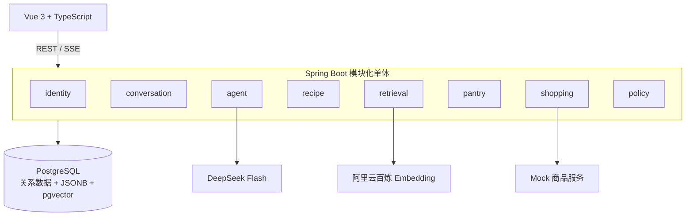

# Cooker 技术文档

> 文档版本：0.6
> 更新日期：2026-09-28
> MVP 截止日期：2026-10-05  
> 当前状态：阶段 1 的 T1～T5 已完成并合并；T6 框架、历史混合测量及收尾修订已完成，修订后的 Service 词法评测已通过，真实混合复测仍待单独授权及主架构审查

## 1. 文档用途

本文档是 Cooker 项目的架构与开发上下文入口，供主会话和并行开发会话共同使用。

新会话开始任务时，应按顺序阅读：

1. 根目录 `AGENTS.md`；
2. 本文档；
3. 与任务相关的 `docs/adr/`；
4. 与任务相关的专题文档：`docs/数据库说明-菜谱导入.md`、`docs/技术文档-检索投影与向量化.md`、`docs/阶段1-菜谱数据与混合检索架构.md`；
   T5 实现还应阅读 `docs/阶段1-T5混合检索任务契约.md`；
   T5 的学习对照与自检见 `docs/阶段1-T5学习笔记.md`，数据库验证见 `docs/工作报告-T5-混合检索.md`；
5. 任务涉及模块的现有代码与测试。

本文档记录当前已确认的业务范围、模块边界、技术选型、数据模型草图、接口草案、阶段计划和未决事项。代码与本文档冲突时，不应自行选择一方，应交由主架构 Agent 判断并修正文档或代码。

## 2. 产品目标

Cooker 是一个面向家庭烹饪场景的 Web 单 Agent。用户不必输入准确菜名，可以直接表达模糊需求，例如：

- “我想吃点清淡的。”
- “今天喉咙有点难受，有什么可以吃？”
- “半小时以内，预算 30 元，家里只有电饭煲。”
- “家里有鸡蛋和番茄，还能做什么？”

系统需要完成以下闭环：

```text
自然语言需求
  → 提取饮食和烹饪约束
  → 混合检索真实菜谱
  → 解释推荐理由
  → 用户选择菜谱
  → 抵扣家庭已有食材
  → 生成缺货购物清单
  → 匹配具体商品
  → 展示购买链接和成本
  → 用户完成烹饪
  → 幂等扣减库存
```

## 3. 已确认需求

### 3.1 菜谱与检索

- MVP 菜谱只来自 HowToCook。
- HowToCook 固定快照只在项目初始化时导入一次，不做定时、实时或增量同步；初始化失败允许幂等重试。
- 保存原始 Markdown、来源路径、来源 commit 和内容哈希。
- 将菜谱解析为结构化数据。
- 同时支持结构化过滤、词法检索和向量语义检索。
- Embedding 由阿里云百炼生成，服务端提供 API Key。
- 向量存入 PostgreSQL 的 pgvector。
- 后续允许用户上传符合 HowToCook 模板的私有自定义菜谱。
- 系统菜谱和用户自定义菜谱复用同一套解析与索引管线，并统一保留原始数据、结构化数据和向量化数据。

### 3.2 用户与个性化

- 用户注册和登录。
- 保存历史对话。
- 收藏菜谱。
- 管理家庭已有食材。
- 第一版推荐约束包括：已有食材、烹饪时间、预算和厨具。
- 商品查询时允许用户选择城市或配送位置。

### 3.3 Agent

- 运行时使用一个 Agent。
- LLM 使用 DeepSeek Flash。
- DeepSeek API Key 由用户提供，加密保存到用户账户。
- Agent 只能推荐数据库中存在的菜谱。
- 健康相关表达只转化为一般饮食偏好，不提供诊断和治疗建议。

### 3.4 采购与预算

- MVP 开发阶段使用 Mock 商品服务。
- 每种缺少食材匹配一个具体商品。
- 自动生成完整购物清单。
- 不自动加入购物车、不下单、不支付。
- 同时展示以下金额：
  - 预估菜谱成本；
  - 根据具体商品单价折算的实际消耗成本；
  - 购买完整包装的实际采购支出。
- 已有库存不计入本次预算。
- 菜谱消耗 10g、商品包装 100g 时，消耗成本只计算 10g，但采购支出显示完整包装价格。

### 3.5 库存

- 选择菜谱后计算缺少食材。
- 用户点击“完成烹饪”后扣减库存。
- 同一烹饪会话只能扣减一次。
- 库存变化需要保存流水。

## 4. MVP 非目标

以下内容不属于 2026-10-05 前的完成条件：

- 医疗诊断、治疗或专业营养处方；
- 自动加入购物车、支付和下单；
- 运行时多 Agent；
- 多菜谱数据源；
- 用户上传自定义菜谱；
- Spring Cloud 微服务；
- RabbitMQ；
- Redis；
- Elasticsearch/OpenSearch；
- Kubernetes；
- 复杂长期记忆和用户画像推断。

## 5. 总体架构

### 5.1 当前形态

采用前后端分离的模块化单体：



### 5.2 为什么先模块化单体

- 截止时间只有约 10 天，优先确保业务闭环。
- 当前外部采购接口尚未验证，过早拆分会固化错误边界。
- 单体事务更适合先实现库存幂等扣减等核心规则。
- 清晰模块边界可以在后续直接作为服务拆分候选。

对应决策见 `docs/adr/ADR-001-先模块化单体后微服务.md`。

## 6. 技术栈

### 6.1 后端基线

| 技术 | 版本/范围 | 用途 |
|---|---|---|
| Java | 21 | 运行时与语言版本 |
| Spring Boot | 4.0.8 | Web、配置、Actuator |
| Maven | 3.8.8+ | 构建工具 |
| MyBatis-Plus | 3.5.17 | CRUD 与 Mapper 集成 |
| PostgreSQL | 18 | 主数据库 |
| pgvector | 数据库镜像提供 | 向量存储与相似度查询 |
| pg_trgm | PostgreSQL 扩展 | 中文短文本和名称模糊匹配 |
| Flyway | 由 Boot 管理 | 数据库迁移 |
| Spring AI | 2.0.1 | 当前只使用 `EmbeddingModel` 抽象；后续再引入 Chat/Tool Calling 能力 |

MyBatis-Plus 官方从 3.5.13 开始提供 Spring Boot 4 Starter，本项目锁定 `mybatis-plus-spring-boot4-starter:3.5.17`。

### 6.2 前端基线

| 技术 | 版本 | 用途 |
|---|---:|---|
| Vue | 3.5.43 | UI 框架 |
| TypeScript | 5.9.3 | 类型系统；避免 TypeScript 7 与当前 vue-tsc 的兼容问题 |
| Vite | 8.3.1 | 开发与构建 |
| Vue Router | 5.3.1 | 路由 |
| Pinia | 4.0.3 | 状态管理 |
| Vitest | 5.0.1 | 单元测试 |

### 6.3 后续技术

- Spring Cloud Alibaba + Nacos：服务注册与配置中心。
- Spring Cloud Gateway：统一入口。
- Resilience4j：超时、重试、限流和熔断。
- Micrometer + OpenTelemetry：指标和链路追踪。
- RabbitMQ：菜谱解析、Embedding 生成和跨服务事件。

这些依赖不得在 MVP 主链路完成前提前加入。

## 7. 仓库结构

```text
Cooker/
├─ AGENTS.md
├─ 技术文档.md
├─ README.md
├─ compose.yaml
├─ .env.example
├─ backend/
│  ├─ pom.xml
│  ├─ Dockerfile
│  └─ src/
│     ├─ main/
│     │  ├─ java/com/cooker/
│     │  │  ├─ common/
│     │  │  ├─ identity/
│     │  │  ├─ conversation/
│     │  │  ├─ recipe/
│     │  │  ├─ retrieval/
│     │  │  ├─ agent/
│     │  │  ├─ pantry/
│     │  │  ├─ shopping/
│     │  │  └─ policy/
│     │  └─ resources/
│     │     ├─ db/migration/
│     │     └─ mapper/<module>/
│     └─ test/
├─ frontend/
│  ├─ package.json
│  ├─ Dockerfile
│  └─ src/
│     ├─ modules/
│     ├─ shared/
│     ├─ router/
│     ├─ stores/
│     └─ views/
├─ infra/
│  ├─ nginx/
│  └─ postgres/init/
├─ docs/adr/
└─ scripts/
```

## 8. 后端分层规范

### 8.1 业务模块内部结构

```text
recipe/
├─ controller/
├─ service/
│  └─ impl/
├─ mapper/
├─ entity/
├─ dto/
└─ vo/
```

各层职责：

- `controller`：接收 HTTP 请求、校验 DTO、调用 Service、返回 VO。
- `service`：定义模块业务能力和跨模块可用接口。
- `service.impl`：业务规则、事务边界和多个 Mapper/外部适配器协调。
- `mapper`：数据库操作，承担传统 DAO 职责。
- `entity`：数据库表映射，不作为接口模型。
- `dto`：请求、命令、查询条件和内部数据传输。
- `vo`：面向前端的稳定响应结构。

### 8.2 MyBatis-Plus 使用约定

- Mapper 接口使用 `@Mapper`。
- 简单 CRUD 使用 `BaseMapper<Entity>`。
- 不在 Controller 中使用 `QueryWrapper`。
- 不将 `IService` 直接作为业务接口。
- 多表关联、窗口函数、pgvector 距离查询、全文/三元组检索使用 Mapper XML 或显式 SQL。
- XML 路径为 `src/main/resources/mapper/<module>/`。
- SQL 必须参数化，禁止字符串拼接用户输入。

对应决策见 `docs/adr/ADR-002-MyBatis-Plus持久层规范.md`。

## 9. 模块职责与依赖

| 模块 | 主要职责 | 可以依赖 | 禁止直接依赖 |
|---|---|---|---|
| `identity` | 用户、认证、凭证加密 | `common` | 其他业务 Mapper |
| `conversation` | 会话和消息 | `identity` 公共接口 | `recipe` Mapper |
| `recipe` | 菜谱、食材、解析导入 | `common` | 用户库存 |
| `retrieval` | 混合检索、排序 | `recipe` Service | `recipe` Mapper 内部实现 |
| `agent` | 对话编排、工具调用 | 各模块 Service、`policy` | 任意 Mapper |
| `pantry` | 库存、流水、烹饪扣减 | `identity`、`recipe` 公共接口 | `shopping` Mapper |
| `shopping` | 缺货、商品、成本 | `pantry`、`recipe` 公共接口 | 用户凭证实体 |
| `policy` | 健康边界、输出策略 | `common` | 业务数据持久层 |

依赖方向需要保持无环。出现循环依赖时，应重新审视职责，而不是使用懒加载绕过。

## 10. 核心业务流程

### 10.1 推荐流程

1. 用户发送消息。
2. `conversation` 保存用户消息。
3. `agent` 调用 DeepSeek，将消息转换为结构化 `RecipeConstraints`。
4. `policy` 将健康表达限制为一般饮食偏好。
5. `retrieval` 执行硬过滤、词法召回和向量召回。
6. 检索结果融合并返回候选菜谱。
7. `agent` 只能根据候选数据生成推荐解释。
8. `conversation` 保存 Agent 回复和候选引用。

### 10.2 购物清单流程

1. 用户选定菜谱和份数。
2. `pantry` 查询用户已有食材。
3. 根据标准单位计算缺口。
4. `shopping` 使用位置和缺货食材调用商品 Provider。
5. 每种缺货食材选择一个具体商品。
6. 计算预估成本、实际消耗成本和采购支出。
7. 保存购物清单和商品快照。

### 10.3 完成烹饪流程

1. 用户点击“完成烹饪”。
2. 根据 `cooking_session` 检查是否已完成。
3. 锁定或校验相关库存版本。
4. 扣减食材并写入 `inventory_movement`。
5. 标记烹饪会话已完成。
6. 整个过程在一个事务中完成。

重复请求必须返回同一个完成结果，不得重复扣减。

### 10.4 菜谱数据进入系统的方式

HowToCook 与用户自定义菜谱共享核心处理管线，但入口和生命周期不同：

```text
HowToCook 固定快照 ──一次性初始化──┐
                                  ├─→ 原始 Markdown → 结构化菜谱 → 检索文档与向量
用户自定义 Markdown ──创建/修改───┘
```

- HowToCook：系统级公开种子数据，部署初始化时导入一次，不轮询 GitHub，不监听上游更新，也不提供自动升级。
- 用户自定义菜谱：后续功能，使用与 HowToCook 一致的模板；默认仅创建者可见。
- 初始化命令必须幂等，以便失败恢复和开发测试；幂等不代表持续同步。
- 用户每次修改菜谱时追加原始文档版本，更新当前结构化数据，并按内容哈希重建对应检索文档和向量。
- 删除或停用用户菜谱时必须同步使其检索投影不可见，避免检索到无权访问或已删除的数据。

系统快照导入仅在 `recipe-import` profile 且 `cooker.recipe-import.enabled=true` 时执行；`dataset-path` 没有默认值，必须由命令参数或环境变量显式提供。普通应用启动只运行常规数据库迁移，不扫描本地快照。JDK 21 与 PostgreSQL 可用时，可使用以下形式执行：

```powershell
Set-Location backend
$env:JAVA_HOME = 'C:\Program Files\Java\jdk-21'
$env:Path = "$env:JAVA_HOME\bin;$env:Path"
mvn spring-boot:run "-Dspring-boot.run.profiles=local,recipe-import" "-Dspring-boot.run.arguments=--cooker.recipe-import.enabled=true --cooker.recipe-import.dataset-path=<本地快照目录>"
```

## 11. 混合检索设计

### 11.1 MVP 召回通道

1. **结构化过滤**：时间、厨具、菜谱状态等硬条件。
2. **精确匹配**：菜名、标准食材和食材别名。
3. **词法匹配**：使用现有 `zhparser + tsv` 做中文全文检索，以精确菜名/原料匹配和 `pg_trgm` 菜名模糊匹配补充。
4. **向量召回**：使用 pgvector 的余弦距离处理语义需求。
5. **业务加权**：库存覆盖率、辣度、油炸方式、时间接近度和预算。
6. **融合排序**：首选 RRF，避免直接混合不可比的原始分数。

### 11.2 初始策略

HowToCook 数据量较小，MVP 首先采用精确向量扫描，暂不建立 HNSW。数据量和查询性能达到需要后再新增索引。

### 11.3 检索评测

T6 固定评测集包含 40 条候选查询，覆盖精确菜名、原料及别名、短中文/模糊菜名、自然语言偏好、时间、厨具和排除食材。预算与库存覆盖率不属于 T5 Criteria，留待后续业务闭环验收。

- 清淡、少油、少辣；
- 时间限制；
- 厨具限制；
- 排除食材；
- 模糊菜名和食材别名。

评测分别报告 Hit@3（至少 75%）、Hit@5（至少 80%）、Recall@5 和 MRR@10；硬过滤违规数必须为 0，本地链路 p95 目标小于 300ms。边界样例不计入相关性分母。2026-09-29 用户整体认可固定候选标签，标签版本为 `t6-labels-v1-2026-09-29`；这是整套标签的总体审定，不代表逐条审定记录。词法单路不可冒充真实混合结果。历史 320 次百炼混合测量使用旧测试直接编排入口，修订后的评测改经 `RecipeSearchService.search`；新的真实混合复测须经主架构会话说明风险并获得单次授权。

## 12. 数据模型草图

阶段 0 不创建业务表。以下仅用于后续任务对齐，最终字段通过 Flyway 和 ADR 确认。

### 12.1 用户与会话

- `app_user`
- `user_llm_credential`
- `user_address`
- `conversation`
- `chat_message`
- `favorite_recipe`

### 12.2 菜谱与检索

- `recipe_import_batch`
- `recipe_source`
- `recipe_source_document`
- `recipe`
- `ingredient`
- `ingredient_alias`
- `recipe_ingredient`
- `recipe_step`
- `cooking_tool`
- `recipe_tool`
- `recipe_search_document`

三类数据职责：

- `recipe_source_document`：原始数据层，保存完整 Markdown、内容哈希、来源版本和解析诊断。
- `recipe` 及其原料、步骤、厨具关联表：结构化事实层，保存当前生效的可查询业务数据。
- `recipe_search_document`：检索投影层，保存词法文本、Embedding 元数据和 pgvector 向量，可由结构化事实重建。

`recipe_source` 必须区分系统 HowToCook 与用户自定义来源，并支持可空的所有者标识。系统来源没有用户所有者；用户来源必须绑定 `owner_user_id`，默认私有。

### 12.3 库存与烹饪

- `pantry_item`
- `inventory_movement`
- `cooking_session`
- `cooking_consumption`

### 12.4 推荐与采购

- `recommendation_session`
- `recommendation_candidate`
- `shopping_list`
- `shopping_list_item`
- `product_match`

### 12.5 关键字段原则

- 金额：`numeric(12, 2)` 或统一最小货币单位。
- 食材数量：`numeric`，同时保存标准单位。
- 原始 Markdown：`text`。
- 可变源元数据：JSONB。
- 向量：固定维度 `vector(n)`，同时记录模型和版本。
- 幂等操作：业务唯一键或独立幂等键。
- 用户数据：所有唯一约束和查询都考虑 `user_id`。
- 菜谱可见性：检索范围必须限制为系统公开菜谱或当前用户拥有的私有菜谱。

## 13. API 草案

接口统一以 `/api` 为上下文路径。以下路径尚未实现，但新会话不得擅自改变资源命名。

### 13.1 身份

- `POST /auth/register`
- `POST /auth/login`
- `POST /auth/logout`
- `GET /users/me`
- `PUT /users/me/llm-credential`
- `DELETE /users/me/llm-credential`
- `POST /users/me/llm-credential/verify`

### 13.2 对话与推荐

- `POST /conversations`
- `GET /conversations`
- `GET /conversations/{id}`
- `POST /conversations/{id}/messages`
- `GET /conversations/{id}/stream`

### 13.3 菜谱

- `GET /recipes/{id}`
- `POST /recipes/search`
- `POST /recipes/{id}/favorites`
- `DELETE /recipes/{id}/favorites`
- `GET /favorites/recipes`

以下为后续非 MVP 的用户自定义菜谱接口草案：

- `POST /users/me/recipes`
- `PUT /users/me/recipes/{id}`
- `DELETE /users/me/recipes/{id}`
- `GET /users/me/recipes`

### 13.4 库存和烹饪

- `GET /pantry/items`
- `POST /pantry/items`
- `PUT /pantry/items/{id}`
- `DELETE /pantry/items/{id}`
- `POST /cooking-sessions`
- `POST /cooking-sessions/{id}/complete`

### 13.5 购物清单

- `POST /shopping-lists`
- `GET /shopping-lists/{id}`
- `POST /shopping-lists/{id}/match-products`

## 14. 模型与凭证设计

### 14.1 DeepSeek

- 逻辑模型名为 DeepSeek Flash。
- 实际模型 ID 通过配置提供，不能散落在业务代码中。
- 每个用户使用自己的 API Key。
- 需要一个 `ChatModelFactory` 或等价适配层，根据当前用户凭证创建受控客户端。
- 不使用全局明文 Key 单例满足多用户需求。

### 14.2 Embedding

- 模型固定为阿里百炼 `text-embedding-v4`，维度固定为 1024。
- 业务层通过 Spring AI `EmbeddingModel` 调用；项目内 DashScope 适配器通过 Spring `RestClient` 请求原生 HTTP 接口。
- 入库使用 `text_type=document`，查询使用 `text_type=query`，输出固定为 dense。
- Embedding Key 由服务端配置。
- 检索文档、模型、维度和文档模板版本必须记录并参与查询过滤。
- 原文内容发生变化时根据内容哈希重新生成向量；哈希未变化不得重复调用收费接口。
- 阶段 1 仅引入 Spring AI 的模型接口模块，不引入 `VectorStore`、`ChatClient`、TextSplitter 或 Agent 能力。

对应决策见 `docs/adr/ADR-004-混合检索与向量版本化.md`。

### 14.3 Key 加密

- 密码使用强哈希，不可逆。
- LLM Key 需要可逆读取，因此使用认证加密。
- 数据库存储密文、随机 IV、算法版本和更新时间。
- 主密钥通过环境变量 `LLM_CREDENTIAL_MASTER_KEY` 注入。
- 日志和异常不得包含明文 Key。

## 15. 前端规划

### 15.1 页面

- 登录和注册；
- 聊天主页；
- 菜谱详情；
- 家庭库存；
- 收藏菜谱；
- 历史对话；
- 购物清单；
- 模型 Key 和地址设置。

### 15.2 模块映射

| 前端模块 | 后端模块 |
|---|---|
| `identity` | `identity` |
| `conversation` | `conversation`、`agent` |
| `recipe` | `recipe`、`retrieval` |
| `pantry` | `pantry` |
| `shopping` | `shopping` |
| `settings` | `identity`、地址设置 |

## 16. 部署规划

### 16.1 MVP

```text
Nginx
├─ 托管 Vue 静态文件
└─ /api 反向代理到 Spring Boot

Spring Boot
└─ PostgreSQL + pgvector
```

根目录 `compose.yaml` 中：

- `postgres` 默认启动；
- `backend` 和 `frontend` 位于 `app` profile；
- 使用 `.env` 提供本地配置；
- `.env` 不进入版本控制。

### 16.2 后续微服务演进

候选拆分顺序：

1. `recipe + retrieval` 拆为菜谱检索服务；
2. `agent + conversation` 拆为 Agent 服务；
3. `identity` 拆为身份服务；
4. `pantry + shopping` 根据负载和边界再决定是否拆分。

演进组件：

- Nacos：注册发现和配置中心；
- Spring Cloud Gateway：入口；
- Resilience4j：容错；
- RabbitMQ：异步导入、向量化和领域事件；
- OpenTelemetry：跨服务链路。

## 17. 阶段计划与状态

### 阶段 0：项目骨架（2026-09-25）

状态：**项目骨架已完成；前端构建验证通过，后端完整构建和 Docker 联调受当前执行环境限制，待本机终端复验。**

已完成：

- 根目录协作规范和技术文档；
- Spring Boot 4 + MyBatis-Plus 后端骨架；
- Vue 3 + TypeScript 前端骨架；
- 业务模块与内部层级目录；
- PostgreSQL + pgvector Compose 配置；
- Nginx 反向代理配置；
- 基础 ADR；
- 环境检查脚本。

未实现：所有业务功能、业务表和外部 API 调用。

### 阶段 1：菜谱数据与混合检索（2026-09-26～27）

状态：**T1～T5 已实现、验证并合并到 `main`；T5 有 32 项测试通过，独立 PostgreSQL 空库成功迁移至 V3；T6 固定集、历史混合测量与收尾修订已完成，标签于 2026-09-29 经用户整体审定；修订后的生产 Service 词法评测已通过，真实混合复测仍待单独付费授权及主架构审查。**

- 固定 HowToCook commit；
- 只提供一次性初始化导入，不实现上游同步；
- 建立菜谱和食材迁移；
- 实现 Markdown 导入；
- 使用 `zhparser` 构建中文全文检索列；
- 基于结构化事实构建 chunk 化检索投影并使用百炼生成向量；
- 混合检索 T5 已完成并合并；
- T6 建立 40 条固定评测集及离线指标/手动基准框架；用户对整套候选 ID 与理由作总体认可（非逐条记录）。已有 320 次真实 Embedding 历史基准，但使用旧测试直接编排入口；修订版已通过生产 `RecipeSearchService.search` 词法手动评测（0 次 Embedding、独立硬条件违规 0），收费混合复测仍未进行。详见 T6 契约和工作报告。

当前本机数据集：`E:\数据集\dishes`，共 373 个 Markdown；导入时排除 `template` 目录中的 1 个模板文件，候选菜谱数为 372。该路径只能作为运行参数或环境变量传入，禁止硬编码和提交数据集。

T4 检索投影与向量化的实现细节、配置项、失败隔离策略和本机实测结果见 `docs/技术文档-检索投影与向量化.md`。

候选边界、数据模型、跨模块契约、任务卡和验收标准见 `docs/阶段1-菜谱数据与混合检索架构.md`。用户明确批准进入阶段 1 后，需先由主架构会话复核并冻结，再允许实现会话领取。

### 阶段 2：账号、凭证和库存（2026-09-28～29）

- 注册登录；
- 用户隔离；
- LLM Key 加密；
- 库存 CRUD；
- 库存流水；
- 烹饪完成幂等扣减。

### 阶段 3：Agent 与购物链路（2026-09-30～10-01）

- 结构化约束提取；
- Tool Calling；
- 对话历史和 SSE；
- Mock 商品 Provider；
- 购物清单和三类成本。

### 阶段 4：前端与联调（2026-10-02～03）

- 登录；
- 聊天；
- 菜谱详情；
- 库存；
- 收藏与历史；
- 购物清单。

### 阶段 5：测试和部署（2026-10-04）

- 自动化测试；
- Docker 构建；
- Linux 部署验证；
- README 和演示脚本。

### 缓冲（2026-10-05）

只修复阻断演示的问题，不增加新功能。

## 18. 多会话建议拆分

阶段 1 当前状态：

- T1：数据迁移与持久层契约，已完成并合并；
- T2：纯内存 HowToCook 兼容模板解析器，已完成并合并，并为后续用户自定义菜谱复用；
- T3：一次性幂等导入编排，已完成并合并；
- T4：检索投影与百炼向量化，已实现并验证；实现提交为 `9b50715`，工作报告为 `3406aaf`，已经用户明确允许合并到 `main`；
- T5：词法召回、向量召回与 RRF，已实现、验证并合并；范围和验收见 `docs/阶段1-T5混合检索任务契约.md` 与 `docs/工作报告-T5-混合检索.md`；
- T6：固定集标签已由用户于 2026-09-29 整体审定；历史混合基准已运行。主架构审查要求的 Service 入口修订及词法手动验证已完成；修订后的真实混合复测须单独获批。

### 18.1 任务派发授权规则

- 任何新实现会话、子智能体或对已有会话的新任务，都必须先获得用户对具体任务的明确允许。
- 任务卡、架构方案、审查结论、前置任务完成和阶段依赖满足都只是准备状态，不代表授权。
- 授权按任务逐次生效，不自动延伸到后续任务、修复、合并或同阶段其他任务。
- 未获授权时，主架构会话可以审查、记录风险和准备任务草案，但不得创建会话或发送实现指令。

T6 仅授权评测代码、固定集标签批准元数据及相关文档；不得改动生产检索、Embedding 模型和维度、RRF 公式或实现用户自定义菜谱 API。修订后真实百炼运行须由主架构会话说明本次调用数和费用风险，并取得针对该次手动运行的明确批准。历史旧入口指标不得冒充修订后 Service 入口的真实复测。

## 19. 当前开发环境状态

2026-09-26 检测结果：

- Java：已安装 JDK 21；执行 Maven 前需将当前进程切到 `C:\Program Files\Java\jdk-21`，默认 `JAVA_HOME`/`PATH` 仍指向 1.8.0_131；
- Maven：3.8.8，可用；
- Node.js：24.21.0，可用；
- npm：11.19.0，可用；
- Docker：可用，PostgreSQL 使用项目自建镜像 `cooker-postgres:pg18-zhparser`，在 `pgvector/pgvector:pg18` 基础上额外构建 `zhparser`。

因此：

- 前端依赖安装、类型检查、测试命令和生产构建已验证；
- 后端完整 `mvn test` 已在 JDK 21 下通过（22 项用例）；
- 后端构建需将当前进程切换到 `C:\Program Files\Java\jdk-21`；项目内置 HTTPS Maven 镜像和仓库缓存配置，以规避全局配置中的旧 HTTP 镜像及异常用户目录设置；
- HowToCook 快照导入与检索投影向量化均已在本机 PostgreSQL 18 上完成真实验证，结果见 `docs/数据库说明-菜谱导入.md` 与 `docs/技术文档-检索投影与向量化.md`。
- T5 的 Testcontainers 集成测试使用项目自建 `cooker-postgres:pg18-zhparser` 镜像；新机器先执行 `docker compose build postgres`，再用 JDK 21 执行 `mvn test`。

## 20. 新会话启动模板

复制以下内容作为后续开发会话的开头，并替换任务部分：

```text
请先完整阅读仓库根目录 AGENTS.md、技术文档.md，以及与本任务相关的 ADR。

本次只负责：【填写任务名称】
允许修改：【填写目录】
输入依赖：【填写已冻结接口或数据结构】
需要产出：【填写代码、测试和文档】
验收方式：【填写命令和业务场景】
明确不做：【填写边界】

开始编码前先检查现有代码和未提交修改，不要改变全局技术栈或跨模块契约。
完成后报告修改文件、测试结果、剩余风险和文档更新。
```

## 21. 当前未决事项

这些事项在对应阶段开始前通过 ADR 冻结：

- 标准食材与单位换算模型；
- 用户登录采用 Session 还是 JWT；
- DeepSeek 客户端缓存和凭证轮换策略；
- Mock 商品数据集和真实采购 Provider 契约。

阶段 1 已冻结的事项：HowToCook 一次性种子导入、统一模板解析与三层数据形态见 ADR-003；Embedding、chunk 化检索投影、中文分词和 RRF 聚合边界见 ADR-004。混合检索 SQL 与评测仍须在后续任务开始前复审。
