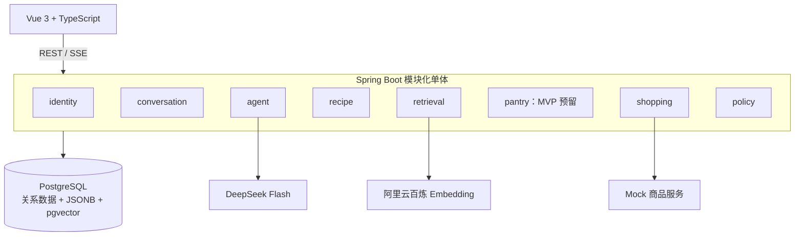

# Cooker 技术文档

> 文档版本：1.27
> 更新日期：2026-10-10

> 用户已授权整合至main并反馈部署完成：E:\Cooker/main现整合后端b90eea4与前端/架构27aa6f2，仅五处文档冲突，采用最新架构版本，未改业务源码。两个原实现分支保留，不自动切换会话、不推送、不重启服务。实际线上镜像与此整合提交的对应关系和线上验收尚未独立核验；部署报告不等于T18指标通过。详见 `docs/合并回执-20261010-主分支与部署反馈.md`。下方未合并/E:\Cooker旧代码描述保留为历史。

> 已获用户明确允许整理并本地提交已验收版本；后端/部署提交b90eea4，前端/架构与本条随本次独立提交归档。来源、检查结果和验收限制见 `docs/发布版本-20261010-已验收基线.md`。本次不合并、不推送、不更新E:\Cooker、不导出数据库或启停服务；下方未提交记录保留为历史。

> 已按用户明确要求新建部署专用会话“Cooker 部署：Ubuntu 24.04 与 Docker 上线”，thread01a124c1-db72-77b0-a55b-9047c7f8ba4f，默认模型配置、独立输出目录、不新建Git工作树。交接卡 `docs/派发任务-D2-C-部署专用会话交接.md` 记录用户已提供的实际环境预检、Docker源TLS阻塞、误建文件及权限边界；新会话先解决安装阻塞，再分阶段指导部署，不业务开发。来源仍5b09后端/部署、0f47前端/架构，只读不覆盖；实际服务器动作与数据迁移另确认。主本轮仅交接文档与创建，不连接服务器/收费/Git提交，不当创建为上线。

> 最新部署目标：用户确认Ubuntu 24.04 LTS、4核/4GB，替代22.04/2核目标。完整教程更新为 `docs/部署教程-Ubuntu24.04-零基础公网IP版.md`，Docker软件源使用noble，新增CPU数量预检；旧教程路径仅保留提示入口。保持已有4GB容器资源限制和连接池/入口保护，未调整业务或部署配置、未做新性能测量。下一先核验实际服务器系统/架构/磁盘/端口，再分步部署；本轮仅文档，未联系实现会话或安装/上传/导出恢复/收费调用/启停/Git提交。下方旧环境与教程链接为历史记录。

> D2-B/B1已轻量签收：主独立24项部署工具与9项厨房配置全部通过；执行者隔离Nginx与静默CLI证据已核对，仅准备/配置，不是服务器上线。用户明确允许厨房LLM/query费用，B1默认安全关闭但显式true＋百炼Key可开启，用户DeepSeekKey仍网页账户加密；累计费用缺口不再阻止本次演示，不新增计费系统。完整教程 `docs/部署教程-Ubuntu22.04-零基础公网IP版.md` 包含Windows/Linux逐步操作、环境与秘密生成、原文/结构化/已有向量白名单迁移、IP HTTPS自动续期、启动验收/模型开启/排错备份。主只读三个镜像均linux/amd64、ID一致；实际架构/磁盘仍先由用户预检。未服务器连接/安装/证书申请/实际归档上传或导出恢复/收费/启停/Git，T18指标仍待执行。下方B1执行中与累计费用必须禁用为历史。

> D2-B准备已成功派发原D1会话、gpt-6.1-sol/medium、实际5b09；首快照active/inProgress/error=null，turn01a12138-bfde-7b02-a755-e517ee9346b7，尚无本turn可见回复。仅待实现/非收费隔离专项与两报告，不代表完成；真实服务器操作和收费均未执行，下方发送待记为历史。

> D2环境已明确：Ubuntu22.04、2核/4GB、Docker未安装，公网IP先行、公开注册。用户允许原D1/gpt-6.1-sol/medium执行D2-B准备，卡 `docs/派发任务-D2-B准备-公网IP与公开注册保护.md`；范围仅部署配置/证书续期模板/入口限流/资源起点与非收费隔离证据。不能把Nginx限流当项目费用硬配额，生产保护不足保持模型关闭并提出后续候选；不改业务源码。不连接服务器/安装/上传/实际菜谱导出或恢复/签证书/收费/启停/Git，发送与执行回执另记。旧CentOS与无服务器记录为历史，T18指标仍待执行。

> D2-A轻量验收通过：独立14项工具测试全部通过，源码499份与R1文本一致；三个本地Linux镜像与执行者隔离迁移/HTTPS证据已核对，测试组件已清理。回执 `docs/审查回执-D2-A-部署准备轻量验收.md`，实现/手册在5b09的deploy/d2，工作与教学两报告齐。不是线上部署、生产RepoDigest或真实菜谱迁移签收。下一确认D2-B服务器实际版本/资源、域名和演示访问方式，再冻结操作授权；未导出业务数据、启停、收费、Git或派发新任务，18题指标仍未执行。下方D2-A执行中为历史。

> D2-A已获用户允许并成功派发原D1会话，显式gpt-6.1-sol/medium、实际5b09；首快照active/inProgress/error=null并确认边界。冻结卡 `docs/派发任务-D2-A-部署文件与迁移工具准备.md`：独立部署配置/双树显式发布装配/系统菜谱与已有向量白名单迁移工具、非收费隔离验证及工作/教学报告待交付。不导出宿主业务数据、不上线/启停/收费/Git或改前端，非任务完成；下方D2-A待允许为历史。

> 用户明确确认本次R1真实指导内容“符合”，该单例技术与内容验收收尾。下一D2-A部署文件、明确双工作树来源的发布装配、仅系统菜谱和向量迁移工具准备，仍待允许派发；不实际上线或新增模型调用。18题指标保持待执行，不将本次满意度扩写为全T18质量成绩。下方内容待确认为历史。

> R1后单次真实指导验证通过：用户确认弹窗后1LLM方法/1HTTP、query/document0；action12成功、guide2保存，页面四菜逐菜讲解/整餐备菜/补充分区/末端参考链接可见，只读刷新不增加调用。单次metrics耗时16585ms、Token11962，不是p95或实付金额。回执 `docs/运行回执-T18-R1-单次真实指导验证.md`。本批额度已用完，服务保持运行，不自动再次生成或恢复旧GLOBAL_STOP。内容满意度待用户确认，18题指标仍待执行，D2-A未派发；下方真实复测未授权/尚未调用为历史。

> T18-R1主独立46项全部通过、失败/错误/跳过0，签收有限诊断/停止分类/实际Service拒绝停批，保留事实和安全校验；不是第二餐真实生成通过。用户确认CentOS计划服务器＋域名演示，仅迁系统菜谱原始/结构化/投影与向量，线上重新注册，不迁测试用户/密钥/历史。部署方案与候选D2-A见 `docs/阶段D2-单机Linux部署与交付计划.md`，建议Stream10＋Compose＋HTTPS，后端5b09/前端0f47装配来源明确。尚未派发部署实现/实际导出/收费/启停/Git/上线；旧停批不可恢复，真实指导复测另批，18题指标仍待执行，下方待交付为历史。

> T18-R1修复已按用户允许派发原D1/gpt-6.1-sol/medium、实际5b09，首快照active/inProgress/error=null并确认范围。冻结卡 `docs/派发修复-T18-R1-指导诊断与停批错误映射.md`：安全校验原因、构建/调用停批映射、GUIDE业务校验失败立即停批，非收费专项和两报告待交付；不是已修复或真实重测。原响应未保存不假造精确重放，不放宽安全/事实或改Prompt/档位，不触达宿主业务库/真实Key、启停当前程序、恢复旧账本或收费，主复审后真实重测另批，下方待允许为历史。

> T18第二餐实际指导失败：第6次LLM响应成功、业务VALIDATE_GUIDE拒绝MODEL_INVALID_RESPONSE；诊断未记具体字段/规则，原失败响应未保存，具体原因仍未知。再次请求触发额度GLOBAL_STOP，后续“凭证服务不可用”由构建异常通用映射导致，非Key失效证据。当前6LLM/2query出站成功、LLM usage36296，第一餐指导保留，第二餐指导未保存；两餐最终签收未完成。只读排查记录见 `docs/排查记录-T18-第二餐指导失败.md`，安全校验诊断/错误映射/业务拒绝停批候选待允许，未自动实现或派发/收费/启停；原账本禁止恢复，真实重测另批，下方余量为失败前历史。

> T18真人1—6项用户报告全通过；主只读核对5LLM/2query均成功、无失败未知停止，两餐各两套数量/去重正确。第一餐已选/指导保存，第二餐仅OPTIONS_READY尚未选定/生成指导，限定签收人工反馈和已完成路径，不扩写为两餐完整结束。采购3份显式Mock/NO_MATCH，非真实商家成功；LLM usage24353、实付及query usage未知。详见 `docs/验收记录-T18-真人全流程与调用核对.md`。用户补第二餐选定/一次指导/采购在原额度内，剩余最多1LLM/2query，不自动调用；18题收费及部署另批。本轮仅只读/记录，未启停/Git/追加调用。

> T18真人两餐集中方案已获用户允许并实际启动：5b09最新JDK21编译类后端38432/8080、0f47 real前端43856/5173，最终5433新库V15/372菜/1856 READY、健康与代理200/UP。独立受控账本T18-human-20261009-01上限6LLM/4query方法及HTTP，document0；就绪检查调用0，用户自行填写账户LLM Key。运行回执及1—6项真人清单已交付，尚非真人/模型/质量签收；异常即停不自动补发。没有package/部署/重建/持久改环境/Git或18题调用，下方集中待允许为历史。

> T18-B1轻量签收：两默认生产客户端已接入受控HTTP传输，主独立JDK21离线27项全部通过（失败/错误/跳过0），源码变化限定2修改+6生产新增+2测试新增、diff通过；未重复全量/package/数据库哈希。回执 `docs/审查回执-T18-B1-默认客户端接入与真人准备.md`。下一直接集中确认最新源码前后端启动、6LLM/4query方法与HTTP上限及必要测试写入后，由用户做两餐真人全流程；没有新准备会话，18题统计独立后置，打包部署仍后续。当前未收费/宿主业务库或真实Key访问/业务启停/Git/部署，真实观测0，下方B1待交付及默认客户端未接为历史。

> T18-B1用户允许后已发送原D1后端gpt-6.1-sol/medium、实际5b09，首快照active，turn01a11f84-0b9e-7f00-a075-d22d07c8e0b3 inProgress/error=null，待两客户端受控HTTP接缝/非收费专项与教学交付。按用户提速目标先真人全流程再打包部署：B1一次轻量复审后集中确认，拟两餐覆盖随机/语义及指导/Mock采购/回看，18题统计独立后置，不重复全量/哈希或拆中间准备。见真人候选清单；未收费/宿主业务库读写/启停/环境/Git/前端或部署，下方待允许为历史。

> T18-B0限定签收：主独立副本Python22项、Java13项（HTTP账本9＋Service临时PG4）全部通过，首次沙箱临时文件权限错误同源宿主重跑排除，未改断言/ACL或重跑全量/哈希。原目标集与副本逐字段一致，17/1/2口径保留，真实观测0。回执 `docs/审查回执-T18-B0-目标指标与采样保护准备.md`。默认query/DeepSeek自行new的HTTP工厂尚未接守卫，测试本机成功不等于生产限费已成立；下一B1最小依赖注入/受控传输候选另待允许，不派发/收费/宿主业务库读写/启停/Git。下方待交付为历史。

> T18-B0已按用户明确允许派发原D1后端gpt-6.1-sol/medium、实际5b09；首快照active，turn01a11f60-8d83-7e60-87fa-e73a826d3506 inProgress/error=null，暂无本turn可见回复。仅测试侧目标指标/Service隔离采样/方法HTTP计数与停止保护，两教学报告待交付，不当执行状态为实现完成。17目标+1空结果+2除外保持，真实样本0；不读取Key/连接宿主业务库/收费/启停/环境/Git或派发真实批次。下方候选待允许为历史。

> T18人工目标集已获用户认可并冻结：`docs/t18/retrieval-targets-v1.json`共17人工目标题、1已知时间无匹配题、2除外，真实观测0。只报告人工目标Hit及首目标MRR，不把未标注视为不相关或报全库Recall。Q03原步骤支持蒜末；Q18未知不当空集合；Q20普通烤箱替代不能当满足指定厨具。下一非收费T18-B0候选适配新指标与测试侧采样保护，待允许派发；18题query/4餐LLM及启动/写库仍另批。未改用户原始填写/后端模板/产品代码、未哈希/收费/数据库写入/启停/Git，下方全部待审为历史。

> T18-A轻量签收：主独立13项Python/3项Java及diff通过，不重跑全量/哈希；执行者393通过/1收费跳过与package单列。真实观测0，已审gold0。已只读最终库公开372菜身份/原文用料与来源，整理`docs/T18-人工标注-20条检索问题.md`与新库目录，用户可填菜名不必改JSON，未按排名造标签。下一`docs/阶段T18-B-真实评测范围待确认.md`，先审全20及阈值再另批检索与4餐真实调用；守卫/HTTP上限尚未实现，不收费/写库/启停/Key/Git/T18-C。下方执行中为历史。

> T18-A实际派发：用户允许原后端gpt-6.1-sol/medium仅非收费准备，冻结卡已成功发送原D1/local、实际5b09，首快照active，turn01a11bb0-e74c-7f60-97bb-8fe75d86755a inProgress/error=null并确认gold待人工审定。20检索问句/12类整餐场景、汇总工具、隔离基线与两中文报告待交付，不是质量指标已完成。模型/供应商真实调用和业务库写入、启停、Git、T18-B/C仍不执行；下方未派发为历史。

> 最新推进：D1-D3主独立10项及类型/构建/diff通过，限定签收详情原文右列留空，未声称新真人复验；先前D1-D2五项人工通过有效。D1批准范围收尾，未知/未审事实保留。下一 `docs/阶段T18-集成验收与评测计划.md` 与非收费T18-A候选卡：固定检索标注/整餐集成及汇总，真实query/LLM另批，最后可追溯指标和演示。不沿用旧库T6当新成绩，不以Mock时延充真实p95，未派发T18/收费/数据库写入/启停/Git。下方执行中为历史。

> D1-D3已按用户指定gpt-6.1-sol/medium派发原前端/local、实际0f47；首快照active，turn01a11b9e-40e7-7181-b771-3829740a072b inProgress/error=null，暂无可见回复。仅菜谱详情原文用料右列留空、定向验证与短中文交付记录，未改采购契约，待交付/轻量复审，不是已调整完成。不收费/数据库写入/启停/环境/Git/T18，下方待允许为历史。

> 最新用户人工反馈：D1-D2五项全部通过，限定基本页面闭环签收，不代表真实模型/采购或统计质量通过。新增原文用料详情右列留空策略已冻结 `docs/调整任务-D1-D3-菜谱原文用料右列留空.md`；仅菜谱详情不再显示待确认短提示，完整原文、明确数量、NULL和采购确认契约保持。未派发实现，向原前端发送待允许，不收费/数据库写入/启停/Git/T18。下方页面待反馈为历史。

> 最新D1-D2：两切片限定签收，后端主6项实际隔离PG/HTTP及package、前端主37文件239项/type-check/build通过。按已有授权切最终新库及12项审定Mock目录，5b09后端PID32076、0f47前端PID35856健康200/UP、V15无需迁移；真实非收费注册登录、菜谱9原文/数量NULL、收藏及做菜幂等历史验证通过，仅保留QA账号1与1收藏/1做菜记录。旧两库保留，模型/导入/索引关闭，未持久改环境/收费/Git/T18。见 `docs/部署与验收记录-D1-D2-最终新库本地切换.md`、5项真人清单，页面待用户反馈；新库没有旧餐单/指导，厨房/采购展示自动化不冒充真实模型验收。下方未交付/未切库为历史。

> 最新D1-D1复审：后端V15收尾通过主独立6项实际PG/HTTP及package，两报告齐；前端本轮回报旧UF2而非D1-D1F，缺改动/两报告，暂不签收。已在原卡授权内向原前端gpt-6-luna/high恢复，turn01a11ae2-7772-7341-98b8-8a523e6155b6 active/inProgress/error=null并准确复述新切片。见 `docs/审查回执-D1-D1-测试收尾与原文展示.md`。前端通过前不切库，已有过闸切库启动许可保持；当前未收费/启停/写业务库/Git/T18，下方双接单为历史。

> D1-D1派发回执：前端原会话gpt-6-luna/high、0f47与后端原D1 gpt-6.1-sol/high、5b09均成功收到新冻结卡，首快照active/inProgress/error=null。前端turn01a11967-2200-7871-8da1-7ea12b7726a3尚无可见回复；后端turn01a11967-3df7-7790-8127-cbe0dec6c542已确认限定3个V15测试及临时PG验证/两报告。待实现及轻量复审，不是已修复/切库；通过后依已获授权切新库启动，当前不收费/启停/业务写入/Git/T18。下方待发为冻结历史。

> D1-D最新授权：用户允许原前端原文用料展示、原D1后端3处完整V15测试断言收尾，并在主轻量复审通过后切最终新库/启动前后端供真人验收，含最小新库注册/收藏/做菜历史非收费写入。两卡 `docs/派发任务-D1-D1F-原文用料展示.md`、`docs/派发任务-D1-D1B-V15测试基线收尾.md` 已冻结待发送，非已实现或已切库；不收费/重新生成向量/持久改环境/Git/T18，旧两库保留。下方“另需允许切库”为旧状态。

> 最新D1-C签收：主架构独立43项非收费专项及package通过；真实最终库1856块全部READY、覆盖372菜，向量/版本/权限异常0。独立账本首轮375＋恢复4＝379HTTP，成功块重发0；成功usage178940 Token，4次失败usage及账单未知。回执 `docs/审查回执-D1-C-真实向量与后续推进.md`。仍有3处旧V14完整基线断言，不称全量回归或新库检索质量通过。下一 `docs/阶段D1-D-原文用料展示与切库准备.md`：原文用料按rawLine展示、未知不补0/不按名称猜商品，不把每生蚝比例当整餐总量；先展示/旧测试收尾，再另获允许切库和真人验收。当前仅准备，未派发新实现/启停切库/query或LLM收费/T18；下方接单/索引0为历史。

> D1-C派发回执：已发送原D1会话gpt-6.1-sol/high、实际5b09；首快照active、turn01a118ed-7e7d-7760-bbb2-e6bd37a90166 inProgress/error=null，执行者已确认先非收费预检与保护专项，再按同批授权生成真实document向量。当前仅接单，不是向量完成；主架构未调用供应商。不切库/启停、LLM/query收费评测/Git/T18，完成后停等轻量复审；下方待发为冻结时历史。

> 最新D1-R2复审：独立24项非收费专项及package通过，真实最终库V15/372菜和原文/3102材料/976食材、12个准确审定ID与同源372跳过核验通过，签收限定修复重导及采购原因收尾。544未知量/296未知人数、条件配方及964未审食材如实保留，目录未激活/网页未切库/索引0。回执 `docs/审查回执-D1-R2-解析重导与采购绑定.md`。依已批准收费授权冻结D1-C `docs/派发任务-D1-C-检索投影与真实向量重建.md`：原D1/gpt-6.1-sol/high、5b09先预检和保护验证，再正常首轮及一次仅失败块恢复；最小允许独立入口、索引/适配器计数与全局错误停止保护，不改排序/模板/事实。当前待发、非向量完成，不启停切库/LLM/query付费评测/Git/T18，下方待验为历史。

> D1-R2派发回执：已成功发送原D1会话gpt-6.1-sol/high、实际5b09；首快照active、turn01a116b8-260a-7eb3-9fde-85a5aaf5b57d inProgress/error=null，尚无本turn可见回复。前两项待实际交付及主架构轻量复审；通过后在本次条件授权内另派D1-C收费document向量。目前未完成修复/重导/采购绑定，未索引收费或切换程序，不启停/Git/T18，下方待发送为冻结历史。

> 最新授权：用户允许推进残留解析/重导与采购ID绑定、未知原因收尾，完成验收后收费生成检索投影与document向量。D1-R2卡已冻结待发原D1/gpt-6.1-sol/high、5b09，最终库cooker_rebuild_d1r2_20261007新建重导，旧两库保留；不伪造sourceVersion或猜量/全库REVIEWED。D1-C已获条件收费授权，须先主架构签收前两项、零费用核对chunk及逐菜请求上界，再正常首轮和一次仅失败块有界恢复，不提前收费或附带LLM/query评测。顺序与授权见 `docs/阶段D1-R2与D1-C-顺序及收费授权.md`。不启停切库/Git/T18或派发前端，下方未授权为历史；当前不是已修复或向量就绪。

> 最新D1-R验收：备份、新库V15、372道原文/结构化菜谱和幂等流程签收；独立13专项及package通过、真实只读统计3072用料/1044食材，账号历史为空，旧库保留。食材残留厨具/说明与公式名称问题尚未闭合，530未知用料/296未知人数不全是错误；索引0，不能宣称完整数据修复/混合检索或网页已切库。建议先残留解析修复和明确重导，再采购新ID确认/未知原因、收费向量另批、切库真人、T18；回执 `docs/审查回执-D1-R-新库导入与后续计划.md`。本轮仅验收和计划，不派发/重导/收费/启停/Git，不做哈希审计，下方待交付为历史。

> D1-R派发回执：已成功发送原D1-A/B会话，gpt-6.1-sol/high、实际5b09；首快照active、turn01a1167c-0cb7-7702-8446-08606e8dea61 inProgress/error=null，尚无本turn可见回复。新库建立和原文/结构化导入待实际交付；测试账号历史不迁移，现有网页暂仍使用旧库，不把接单当完成，下方待发送为冻结历史。

> 最新D1-R范围：用户最新确认账号和历史为测试数据无需保留，覆盖此前保留要求。旧5433/cooker备份保留，在新cooker_rebuild_20261007执行当前迁移与v2菜谱原文/结构化一次导入，不迁移用户/账户模型Key/历史，无需逐项补丁。执行卡 `docs/派发任务-D1-R-新库菜谱重建.md` 待发原D1-A/B gpt-6.1-sol/high、5b09，发送另记；不重复数据库哈希审计、不删除旧库/卷、不切换8080/5173运行数据源或启停、不收费LLM/Embedding/Git/T18。新向量/Mock标准ID重绑定后续单独确认，下方范围待定为历史。

> 最新验收/路线变更：D1-B实现轻量签收，主架构独立临时PG15项及package通过，不追加数据库哈希审计/测试；1416项待审、开发库实际应用0。用户改为修复后重构数据库，后续转D1-R重建准备，范围待明确整库新建/保留用户仅重建菜谱/仅结构调整；推荐旧库备份保留、新库迁移导入。文档 `docs/审查回执-D1-B-轻量验收与重建策略.md`、`docs/阶段D1-R-数据库重建范围待确认.md`，本轮不实际删除/清空/建库/迁移、派发/收费/启停/Git，T18未开始。取消复审哈希不等于删除既有业务安全校验或向量内容版本，下方逐条治理/待交付为历史。

> D1-B发送回执：已发原D1-A/gpt-6.1-sol/high，首快照active、turn01a1162c-a569-70b2-a54f-7a947bf2d327 inProgress/error=null，尚无可见回复。待审定包与治理工具实际交付；没有实际审批/开发库修复或索引重建，后续应用仍另批，下方待发送为历史。

> 最新进度：用户确认P1真人验收通过。D1-A仅完成解析器、测试与只读差异提案，既有结构化数据尚未修复、治理工具尚未交付。用户允许继续D1-B审定表/受控治理工具实现与隔离PG验收，原D1-A会话gpt-6.1-sol/high、5b09；冻结卡 `docs/派发任务-D1-B-候选审定与受控治理工具.md` 已准备，发送另记。允许独占V15审计批次/条目、Mapper与事务Service及显式诊断入口，仅隔离测试；没有开发库迁移或应用授权。后续审定→备份/实际应用另批→D1-C投影一致性→D1-D采购原因→T18；不收费/启停/Git，下方人工待验/实现待允许为历史。

> 最新验收与推进：D1-A v2独立隔离190项及打包通过，437保护文件不变、7允许变化；同原始快照重跑manifest同hash，约2取2/2到3取2通过。前端PF1/PF2实际交付，独立233项/type-check/build通过，签收实现与非收费自动化。开发库脏数据尚未应用修复、前端真人验收未完成；回执 `docs/审查回执-D1-A-v2与P1-最终交付.md`。下一进入D1-B候选审定/受控治理准备，52词典冲突需逐组审定；后续D1-C投影一致性→D1-D采购原因语义→T18。实现派发和实际写库分别待允许，本轮仅复审/文档，不收费/启停/Git。P1真人清单 `docs/验收清单-P1-导航与厨房指导真人试用.md`，下方运行中/未交付为历史。

> 人数策略同步回执：已发送原D1-A会话，gpt-6.1-sol/high、实际5b09，首快照active/turn01a1152f-1cfa-71e0-81fd-847e4d25ca35 inProgress/error=null、尚无可见回复。新规则待实现/复审，不当旧R1通过或文档同步为完成；前端范围及不应用开发库/收费/启停部署/Git/T18约束不变。

> 最新人数基准策略：用户改为约人数按给定值、范围按最小值；约2→2、2到3→2，保留原文和约量/范围依据，不承诺精确份量。规则 `docs/阶段D1-人数折算策略.md` 覆盖旧R1 null预期；缺人数/冲突/份尺寸产量及材料数量/单位规则不变。原D1-A已交付旧R1但未复审，新策略将同步原会话，只改人数解析/测试、预览依据标签/版本和本地报告；不开发库应用/收费/启停部署/Git/T18，P1不扩大。

> 恢复派发回执：原D1-A/gpt-6.1-sol/high已收到R1卡，active/turn01a1151f-2bec-7fa1-baff-c207dcbfaf6a inProgress/error=null，确认仅5b09人数边界；原前端/gpt-6-luna/high收到P1恢复澄清，active/turn01a1151f-4c45-7143-ae0e-606396b65305 inProgress/error=null，首快照尚无可见回复。实际交付/非收费复审未完成，不宣称关闭R1或完成前端；不写开发库/收费/启停部署/Git/T18。

> 最新恢复授权：用户允许原D1-A会话gpt-6.1-sol/high在5b09只修R1人数约量/范围并更新本地提案、测试教学；原前端gpt-6-luna/high在0f47恢复PF1→PF2，旧UF2仅保护、不重做。卡已更新，发送回执另记，不以授权当修复/改版交付。开发库应用、索引费用、启停部署、Git和T18仍不在范围；下方待允许是复审时历史。

> 最新D1-A/P1复审：独立98项受影响回归和打包通过、manifest复现，但新增2项人数边界探针均失败；真实约2人四样例仍确定化，到字范围截取末端，D1-A R1待关闭，不应用数据库。前端交付实际仍旧UF2，PF1/PF2四份报告、导航/逐菜/材料页未交付，暂不签收。回执 `docs/审查回执-D1-A与P1-解析修复及前端改版.md`，最小R1修复卡待允许；本轮未联系实现会话/恢复任务，不业务修复/开发库写入/模型费用/启停部署/Git/T18。

> P1派发回执：已发送原前端会话，显式gpt-6-luna/high、实际0f47；首个快照active、turn01a11508-d48e-7282-970a-91acf80d94d7 inProgress/error=null，先核对目录与规则再顺序PF1→PF2。接单不等于写权限/实现/验收完成，待四份报告和实际非收费验证后轻量复审；不T18/收费/开发库写入/启停部署/Git，下方待发送是历史。

> 最新P1实现派发授权：用户明确派发，原前端0f47/gpt-6-luna/high顺序PF1→PF2，卡 `docs/派发任务-P1-PF1与PF2-前端阅读改版.md` 已冻结，发送及执行快照另记。仅导航/档案层级、展示投影/只读材料页与非收费验证、四份教学工作报告；保留证据/旧记录/未知操作/采购门槛，不改后端或D1-A，不开发库写入/收费/启停/部署/Git/T18。下方未授权为历史，不以授权冒充已实现。

> 最新P1前端改版：用户9条浏览器批注已整理为 `docs/前端改版-P1-导航与厨房指导方案.md`。建议PF1导航/档案层级→PF2逐菜指导/已选右侧摘要/只读材料详情；现有指导数据可支持前端投影，不改Prompt/后端契约。保留旧助手记录及原操作核对、后台引用校验、历史快照/未知材料和模型补充边界；与D1-A解析修复独立并行，不以展示调整替代数据修复。当前只方案，尚未派发前端、不编码/收费/写库/启停/Git或T18。

> D1-A新会话启动回执：已创建“Cooker D1-A：菜谱解析修复与只读预览”，thread01a114ed-c464-7e70-a539-4fb4d9089550/local，gpt-6.1-sol/high；首个快照active/inProgress/error=null，开始核对规则和基线。任务明确5b09实际实现目录（项目默认绑定E:\Cooker），不创建新工作树、不自动Git整合；不冒充写权限已验、修复完成或数据库应用。派发卡第6节为回执，前端及D1-B/C/D、T18未派发，下方待创建为此前状态。

> 最新D1-A实现授权：用户要求新建修复会话，gpt-6.1-sol/high；仅解析/单位修复、非收费回归、只读变更预览和教学。新会话复用5b09最新未提交后端检出（HEAD26c33ace），不以E:\Cooker旧源码为基线，不自动Git整合；冻结卡 `docs/派发任务-D1-A-解析修复与只读预览.md`，创建/执行回执另记。前端布局样式可并行，采购提示/用量确认需先冻结契约；当前未获得具体前端实施派发允许。开发库应用、索引收费、部署/启停、Git及T18不在本次范围，下方D1-A待允许是历史。

> 最新D1数据质量闸门：按用户允许完成全量只读审计及修复卡，未派发或修复。372道菜/3025条原料中218名称含等号、559量/单位缺失、310道缺原份数、9道零用料；疑似异常规则不能当人工错误率。372原文与本地hash一致，原始资料可用于重解析。当前采购29条材料中23因原份数未知；12个Mock标准ID仅覆盖494条菜谱用料，不代表采购匹配成功率。报告 `docs/审计报告-D1-菜谱解析与采购未知.md`；任务草案 `docs/修复任务卡-D1-菜谱解析与数据治理.md` 分解析/预览→审定受控应用→影响投影→待确认采购交互，各步授权独立。原3B有限Mock样例签收保留，新增全量数据质量问题待修复，T18不派发。本轮仅审计和文档，无业务实现/写开发库/收费/启停/Git。

> 最新3B人工签收：用户明确反馈采购真人试用1～6项全部通过；结合既有非收费自动化签收及10月6日真实页面/HTTP/PG记录，正式签收采购最小闭环（显式Mock商品）。原料确认、商品与金额边界、合包、城市与固定历史回看、账号隔离获得用户人工认可；不宣称真实商家、支付、线上部署或统计质量完成。本样例无预算，超预算/完整已知总额等未新增真人证据。回执见 `docs/验收清单-3B-采购真人试用.md`。下一T18集成与评测具体范围另冻结、另获允许，本轮仅文档，不派发/收费/启停/开发库写入/Git。下方待人工反馈为历史。

> 最新3B部署与非收费联调：获用户明确允许后已精确备份5433 cooker、从V12正常升V14，最新5b09后端10724与0f47 real前端6608就绪，健康/代理200。显式Mock目录12商品、价格虚构，模型执行关闭。真实页面→HTTP→PG保存清单1/报价1～2，黄油10g消耗1元/整包10元、生抽25ml合包10元、未知项及固定旧价回看通过，第二账号读写404；临时账号17已精确清理。24/25原业务表摘要一致、认证刷新表随登录变动，原餐单/指导/模型动作不增。详见 `docs/部署与验收记录-3B-采购本地真实联调.md`；用户人工6项待反馈，不整体签收3B/派发T18，不收费/Git。下方未部署/待允许是历史。

> 最新F3-D修复签收：主架构独立217项＋原5项探针、类型/构建/diff及11修复文件空白检查通过，R1～R3关闭，F3-D实现/非收费自动化签收，部署/真实HTTP/PG/浏览器采购闭环未验。进入真实联调准备，见 `docs/阶段3B-采购真实联调与人工验收计划.md`；只读确认5433 PG健康、8080/5173未监听，当前库迁移版本待准备前核对。备份/V14/显式Mock配置/前后端启动及非收费真实联调需另获用户明确允许，本轮不启停/开发库写入/收费/Git或派发T18。下方派发执行中为历史。

> F3-D R1～R3派发回执：原前端gpt-6-luna/high已收到冻结修复卡，0f47；即时快照active、turn01a1119c-2805-7332-986a-b7fc6ed5f9a8 inProgress/error=null。待修复交付、非收费回归/教学及轻量复审，不当派发为完成。未联系后端/派发T18，不部署/启停/收费/开发库写入/Git；下方待发送为冻结时历史。

> 最新F3-D修复授权：用户明确允许原前端gpt-6-luna/high在0f47执行冻结的R1～R3最小修复及非收费回归/教学，卡 `docs/派发修复-F3-D-R1至R3.md` 当前待发送，回执另记。主架构不业务编码，未修复或签收F3-D；部署/启停/开发库写入/收费/Git/T18仍未授权，下方待允许为历史。

> 最新F3-D轻量复审：真实交付已齐，独立207项/type-check/build/diff及新增空白检查通过；5项独立审查探针复现迟到报价发布/同上下文取消busy/旧写错误隔离和回原报价丢matchId问题。成功固定报价链接、取消等待及默认短超时契约仍需补齐，F3-D暂不签收，不将自动化通过冒充部署/真人验收。最小修复范围见 `docs/派发修复-F3-D-R1至R3.md`，待用户明确允许后另记发送回执；本轮只审查探针与文档，没有业务修复/派发/收费/启停/开发库写入/Git。T16/T17签收保留，下方恢复派发和未交付记录为历史。

> F3-D恢复派发：用户明确允许执行，原前端gpt-6-luna/high已收到原冻结卡及只做F3-D/0f47、不重做UF2澄清；即时快照active、turn01a11163-4ad2-7801-874e-8a6f39e95962 inProgress/error=null。等待实际代码、专项测试与两份报告后轻量复审，不当接收为完成。不派发后续/收费/启停/开发库写入/Git，下方未交付为恢复前状态。

> 最新F3-D复审：原前端现idle，最后回复旧UF2而非F3-D；实际采购模块只有占位，无ShoppingView/采购测试/约定报告与接线，F3-D未交付、不签收，不将会话completed或旧测试作为完成证据。回执 `docs/审查回执-F3-D-采购确认与成本页面.md`；本轮仅检查与状态文档，没有恢复执行/派发、业务编码、部署/收费/开发库写入/Git。T16/T17原签收保留，继续F3-D待用户确认，下方执行中是旧即时快照。

> F3-D派发回执：原前端gpt-6-luna/high已收到冻结卡，即时快照active、turn01a11151-d7a0-7863-9dc5-868119dc01fd inProgress/error=null；等待实现交付与轻量复审，不是部署/真人验收。未派发后端新任务，不收费/启停/开发库写入/Git/T18，下方待发送为历史。

> 最新T17/F3-D：主架构独立46项全部通过、隔离package/diff与537原文件保护通过，T17实现及非收费验收签收，未部署或真人/商家签收。用户明确允许原前端gpt-6-luna/high的F3-D，冻结卡 `docs/派发任务-F3-D-采购确认与商品成本页面.md`：原料逐行确认、城市/Mock匹配、分列金额与未知、独立报价回看；只新增shopping及精确路由/厨房入口/退出保护，不改后端/共享认证或旧厨房状态。当前待发送，回执另记。不收费/启停/开发库写入/Git/T18；后端无全量清单列表API，当前支持已知ID/链接回看，不冒充完整历史索引。

> T17派发回执：原5b09后端已收到shopping-products-v1冻结卡，显式gpt-6.1-sol/medium；即时快照active、turn01a1112c-9567-77c2-a7ad-ac53aa3b22b6 inProgress/error=null，待交付和轻量复审，不等于实现/部署完成。不F3-D/T18/收费/启停/开发库写入/Git。

> 最新T16签收与T17：主架构独立24项全部通过，真实HTTP/隔离PG实际执行；隔离package/diff及517原文件保护检查通过，报告齐备，采购无锁查询R1关闭。签收实现/非收费部分，不含开发部署/浏览器/商品真实价格。按用户明确允许，冻结T17的shopping-products-v1、新V14、独立Mock Provider/城市报价快照及消费成本/整包支出；见 `docs/阶段3B-T17商品匹配与成本快照契约.md`、`docs/派发任务-T17-Mock商品与成本快照.md`，派发回执另记。旧T16清单快照/API不覆盖，不跨模块Mapper，不模型/收费/启停/开发库写入/Git或F3-D。

> T16 R1派发回执：原后端gpt-6.1-sol/medium已收到修复及T16剩余交付任务，即时快照active、turn01a1106d-2480-7e52-98e0-499febf63f26 inProgress/error=null；待交付/轻量复审，未签收或部署，T17/F3-D未派发。不收费/启停/开发库写入/Git，下方待发送为历史。

> 最新T16 R1授权：用户允许新增conversation采购专用无锁ShoppingSourceMapper及注入/测试、完成原T16剩余交付，旧查询/创建锁不变。原5b09后端gpt-6.1-sol/medium，修复卡冻结待发送，回执另记；尚未修复或签收，T17等T16轻量复审通过再派发。本轮不收费/启停/开发库写入/Git，下方范围待允许为历史。

> 最新T16复审：独立19项非收费隔离专项11通过/8运行错误，采购HTTP类setup因只读预览调用FOR UPDATE失败，SQLSTATE25006；源码/V13已有，工作/教学报告尚缺，T16不签收。最小修复需额外允许采购专用conversation无锁Mapper扩展，不改旧锁查询/创建锁；详见 `docs/审查回执-T16-食材确认与采购需求.md`。T17前置未通过，尚未派发；本轮未收费/启停/开发库写入/Git，下方执行中为历史。

> T16派发回执：已成功发送原5b09后端，显式gpt-6.1-sol/medium；即时快照active、turn01a10ff0-f983-7fc1-a92f-3a57e04d5786 inProgress/error=null。待交付与轻量复审，不称实现/部署完成；未联系前端或派发T17/F3-D，不收费/启停/开发库写入/Git操作，下方待发送为冻结时历史。

> 最新T16：用户明确派发，仅原5b09后端gpt-6.1-sol/medium实现已选套餐食材确认、采购缺口、创建与回看及纯成本基础，shopping-demand-v1已冻结于 `docs/阶段3B-T16食材确认与采购需求契约.md`。允许shopping、conversation最小公共读取扩展、V13及风险匹配真实隔离PG/HTTP和教学；任务卡待发送，执行回执另记，未实现/部署。价格未知保持未知，不伪造商品；T17/F3-D仍未派发，不收费/启停/开发库写入/Git。下方T16授权待确认是历史。

> 最新采购规则确认：用户明确接受超预算保留清单并提示、不自动换菜或放宽预算；成本未知展示可估算小计和未知项、不当0、不承诺满足预算。两项已作为采购正式约束同步3B方案，具体接口/DTO/迁移仍待终审，T16实现派发尚未授权。本次仅文档，不编码/派发/收费/启停/开发库写入/Git，下方两项预算行为待确认为历史。

> 最新签收：用户确认U5指导与补充分区、刷新重登、默认人数三项全部通过；只读核对meal10原三动作和指导1保留、未新增本餐生成、在途0。U5最小业务闭环及初步真人验收签收，扩展固定场景/统计质量仍待验，不把3菜1汤样例扩写成五菜真实指导通过。进入采购3B架构准备：T16食材确认/缺口→T17 Mock商品/成本→F3-D真实联调，见 `docs/阶段3B-采购闭环架构与启动准备.md`。预算超出/未知行为及具体接口仍待确认；本轮仅文档，不派发/编码/收费/启停/开发库写入/Git，下方未签收U5是历史。

> 最新真人样例：用户确认真实LLM成功，会话21/meal10显式3人、两套3菜1汤、选第二套，4道指导id1/meal-guide-v2成功保存；CREATE2683ms、GUIDE9612ms，本餐3网关尝试/12730tokens/Embedding0。单样本，不是p95或原四菜一汤真实五菜签收。按允许进入U5-C内容、刷新重登与默认人数人工核验/演示收尾，再冻结采购T16→T17→F3-D；报告 `docs/验收记录-U5-首个成功指导与收尾计划.md`。当前未整体签收U5，未派发新实现/收费/启停/开发库写入/Git操作，下方指导0为重启时历史。

> 最新R5部署就绪：用户允许重启后确认在途0，只替换旧39712为已验JDK21修复Jar24704、execution=true；前端31300保留，后端/代理/首页200、V12无迁移、原餐/动作/指导校验值一致。主架构未发模型请求，指导仍0，待用户在会话20显式新键请求完整指导及质量/回看验收。回执 `docs/重启回执-U5-R5-完整指导真人复测.md`，本次后端为Jar及本地日志，不是IDE控制台；无新实现/派发/Git或新阶段。下方未部署为复审时状态。

> 最新U5 R5签收：主架构独立Java21离线72项真实HTTP/隔离PG专项、隔离package/一致Jar哈希/diff与新增空白通过，完整引用去重与64000专用指导档位、普通20000不变、新v2落库/旧v1只读复用通过；Mapper最小补充已核对用户直接授权。512基线仅6允许变化、新增5，IDE315文件未变。R5实现/非收费复审通过，未部署/真实模型质量或浏览器签收，不宣称201单批全量通过。下一IDE重新构建重启后真人完整指导，清单/回执 `docs/审查回执-U5-R5-完整指导输入修复.md`；本轮不启停/收费/开发库写入/Git或派发新任务，U5未整体通过。

> U5 R5派发回执：冻结卡已发送原后端gpt-6.1-sol/medium，快照active/inProgress/error=null，turn01a10fba-310e-7d63-8838-c7bf6f4db345；待交付与轻量复审，不称已修复或部署。未联系前端，不收费/启停/开发库写入/Git操作，下方待发送为此前状态。

> 最新U5 R5：用户允许修复完整指导阻断。会话20/meal9四次GUIDE为RESOURCE_LIMIT且模型尝试0，重复完整依据重建64872码点；无损引用探针28998，仍超过旧20000。仅原后端gpt-6.1-sol/medium实现模型依据单份＋ID引用、专用64000输入档位和安全计数日志；旧推荐20000/2048、指导8192及全事实验证/展示不变，详见R5冻结卡与U4契约补充。当前待派发/非已修复，未收费/启停/开发库写入/Git，不进入采购等新阶段。

> 最新U5环境就绪：按用户启动允许，复用既有5b09/JDK21 IDE式后端39712（生成开启），核对修复编译接线；新启动0f47 real前端31300，5433 PG健康/V12/在途0，页面与健康代理200。三个Service二进制与上次Jar不同，不冒充相同产物；辅助类一致、实际wire/display接线保留。零主动模型请求/业务数据写入/Git或派发。回执 `docs/运行回执-U5-20261006-前后端就绪.md`；继续用户完整指导验收，下方未连通/旧PID为历史。

> 最新U5人工反馈：用户确认餐食可见，R4显示阻断关闭，下一继续套餐选择/完整指导/刷新重登与U5报告收尾，不把可见性当完整质量通过。剩余清单 `docs/验收清单-U5-餐单显示后的剩余闭环.md`；本日Docker与8080/5173健康未连通，指导PG新证据未取得，运行方式待用户选择。当前未重启/收费/派发新实现/Git操作，采购/SSE/MQ/Cloud不启动，下方待R4人工反馈为历史。

> 最新U5 R4：独立7项真实HTTP/隔离PG专项、14份实际前端解析契约及隔离package/产物类哈希/diff通过；仅3允许原Service变化。用户明确重启授权后替换旧40132，新JDK21修复Jar37824、execution=true，前端13376保留，健康/代理200/UP，V12无迁移，原成功快照未改、无新增模型调用。浏览器刷新读取原成功餐单待确认，不宣称U5整体通过；报告 `docs/审查与部署记录-U5-R4-十进制修复.md`，下方待交付为历史。

> U5 R4派发回执：已成功发送原5b09后端，gpt-6.1-sol/medium，快照active/inProgress/error=null，turn01a10b76-e4be-7e23-84bf-d6028f7485d7。待交付与轻量复审，不称已修复/部署/真人通过；下方待发送为冻结时状态。

> 最新U5 R4授权：用户明确派发原5b09后端gpt-6.1-sol/medium修复BigDecimal指数字符串与前端普通十进制契约不一致。成功动作7/9/11的实际快照解析均失败，仅内存转换数字表示后均通过；认证错误动作8是另一请求，不作为此根因。新结果和历史只读回读/重放兼容范围冻结于 `docs/派发修复-U5-R4-十进制输出与历史回读.md`，当前待发送，不等于修复或U5通过。现受控JDK21后端40132、前端13376健康；本修复不收费/开发库写入/启停部署/Git操作，不扩展前端提示或采购。

> 最新U5轻量复审通过：独立前端185项/type-check/build、后端36项含真实隔离PG回归、默认路径package/diff通过；R1/R2/R3实现签收，原事实/指纹保留，安全投影与受控日志就绪，创建导航误报关闭。进入用户IDE启动5b09源码及真人复测，主架构已恢复Docker和0f47 real前端5173/PID13376，8080空闲；现有User配置已核对存在，数据库凭证匹配。当前未在IDE运行/未完成真实模型质量验证，步骤及人工清单见 `docs/审查报告-U5-R1至R3与IDE交接.md`，下方待复审及旧端口占用为历史。不推进采购/新任务/Git操作。

> U5修复派发回执：冻结卡已发送原后端/前端，显式gpt-6.1-sol/medium，即时快照两者active/inProgress/error=null，待交付及轻量复审；IDE启动指南为本次后端交付物，暂不停止/重启当前服务、不收费/Git操作。下方待派发为此前状态。

> 最新U5修复授权：用户允许修复后端完整事实安全拦截与前端成功创建导航误报，并要求IDE控制台可诊断。原5b09后端/0f47前端均gpt-6.1-sol/medium，冻结卡 `docs/派发修复-U5-安全投影与创建提示及IDE启动.md`：原始事实/指纹不变，模型和展示使用安全投影，危险候选隔离/不足澄清，U4同边界，日志仅安全元信息；另交付IDE Java21/5433/稳定密钥/端口切换指南。只本修复及非收费回归，待派发与轻量复审，不自动部署/停止当前服务/收费重试/Git操作，不称已修复或IDE联调通过。

> 最新U5本地试用：用户明确允许备份/部署且费用无需作为本次限制，已备份5433开发PG并V9→V12，原372菜谱/11用户/4收藏/12做菜/2凭证/6旧会话保留。新后端5b09 Jar 8080 PID38036、前端0f47 real 5173 PID10768健康，execution=true、百炼从User进程注入；主架构仅非收费真实HTTP检查，未发供应商请求，临时账号/空会话已精确清理。用户在模型设置填Key后进入/kitchen主动测试，真人生成质量待反馈，不冒充跨轮硬限额/自动关闭；记录见 `docs/部署与试用记录-U5-真实厨房助手.md`。未派发新实现、采购或Git操作，下方部署/费用待允许为历史。

> 最新UF2修复签收：独立177项/type-check/build/差异及10修复文件空白检查通过，源码/持续回归/教学核对通过，R1～R3关闭，UF2非收费实现签收。进入U5联调准备，计划见 `docs/阶段3-U5联调与初步真人试用计划.md`；开发PG至V12及新后端/前端部署仍另批，先非收费真实联调，再另批可验证限额窗口与真人模型试用。当前不派发新实现、不收费/部署/Git操作，不称新能力已上线或真人验收通过，下方未签收为历史。

> UF2修复派发回执：原前端gpt-6.1-sol/medium已收到R1～R3，快照active/inProgress/error=null，turn01a10794-51ab-7620-b546-0dcc11765594；已确认目录/范围，待交付与轻量复审。未签收UF2，不U5/收费/部署/Git操作，下方待发送为此前状态。

> 最新UF2修复授权：用户明确修复R1～R3，原前端本次改用gpt-6.1-sol/medium，仅0f47专属模块/视图/测试与教学报告；修复卡已冻结待发送，等待实现交付及轻量复审，UF2尚未签收。不派发U5、不收费/部署/开发库/Git操作，下方待修复允许为历史。

> 最新UF2复审：独立164项/type-check/build/差异及14新增空白检查通过，但实际非收费探针复现修订版本误判、跨餐点击链隔离缺失、未知语义指标null不兼容三阻断，UF2暂不签收，不能据全绿测试推进U5。报告及最小修复卡已准备，待用户具体允许原前端修复；不派发/收费/部署/Git操作，不需要在旧服务上人工验收新功能。下方执行中为历史。

> UF2派发回执：已发送原前端gpt-6-luna/high，快照确认active、turn01a10741-d27f-73c2-8f00-10ba3139f0d6 inProgress、error=null；仅UF2待交付/轻量复审，不代表真实联调完成，不派发后端/U5、不收费/部署/Git操作。下方待发送为此前状态。

> 最新UF2授权：用户明确“派发UF2”，仅原前端0f47、gpt-6-luna/high实现新厨房助手页面、餐单/点击选择/指导回看与非收费测试教学；精确范围见 `docs/派发任务-UF2-餐单选择与指导回看.md`，已冻结待发送。U3/U4后端非收费签收但未部署；UF2轻量复审通过即可进入U5初步真人试用准备，部署及真实模型预算/可验证调用窗口另批。不派发后端/U5、不收费/部署/Git提交整合，下方UF2待允许为历史。

> 最新U4签收：主架构独立Java21离线181项/180通过/0失败错误/1既有收费跳过，新增21项含真实隔离PG/HTTP全部执行；package/diff/新增空白与490基线哈希检查通过。源码/契约/教学无本次阻断发现，U4实现及非收费回归签收；完整依据、原事实/可选补充、8192专用档位、幂等/失败保留选择与历史权限已接入。真实模型质量/浏览器/开发部署未验，下一UF2待用户明确推进后冻结派发，本轮仅验收、不派发/收费/部署/Git提交。见 `docs/审查报告-U4-依据生成与小厨人设.md`，下方执行中为历史。

> U4派发回执：冻结卡已发送原5b09会话gpt-6.1-sol/medium，快照确认turn01a10717-fee8-7fd3-bb72-077382d25746执行中无错误；只U4待实现/复审，未派发UF2/U5，不收费/部署/改开发库/Git提交。下方待发送是冻结时状态。

> 最新U3签收/U4推进：用户启动Docker后主架构独立Java21离线160项/159通过/0失败错误/1既有收费跳过，新增17项全部执行；结合原独立package/源码/教学检查签收U3非收费实现，环境阻塞关闭。下一仅原5b09后端gpt-6.1-sol/medium的U4依据生成与持久化，kitchen-guide-v1及V12/HTTP/一次指导模型/8192专用输出档位已冻结，旧2048与零模型selection不变；派发卡待发送，回执另记。UF2未派发，浏览器/真实供应商/开发部署未验，不收费/迁移开发库/Git提交整合。见U3审查报告和 `docs/阶段3-U4依据生成契约.md`，下方待Docker为历史。

> 最新U3审查：实现已交付，主架构核对源码/契约/教学文档与V11测试适配，独立离线打包/diff通过；独立回归133项/97通过/5Docker启动错误/31跳过，当前Linux引擎不可连接，真实PG/HTTP回归尚未独立通过，U3暂不签收。用户启动Docker后补验，通过再冻结派发U4完整菜谱依据生成；UF2未派发，未部署/收费/开发库迁移/Git提交。见 `docs/审查报告-U3-餐单与点击选择.md`；下方执行中为历史。

> U3派发回执：完整业务合并a2673e4已通过独立143项/142通过/1收费跳过与打包；架构文档572084b同步目标26c33ac，仅文档不变业务。U3卡已发送原5b09会话gpt-6.1-sol/medium，快照确认turn01a10292-102b-77d0-9855-1b2b36756d12执行中无错误，待交付/轻量复审。只两套餐单/材料/版本/零模型选择，不生成指导、不派发U4/UF2、不收费/部署/新业务提交；UF1跳过独立验收但真实联调未验，下方待派发为历史。

> 最新U3基线：用户允许后端整合后派发U3；已精确提交T12～T14 e625113及U1/U2 d257cae，在5b09/codex/kitchen-assistant-u3双亲合并a2673e4。仅测试迁移适配，生产/SQL/fixture保留；主架构独立143项/142通过/1既有收费跳过/零失败错误，打包通过。新契约kitchen-meal-v1/V11/两套餐单与零模型选择已冻结，原会话gpt-6.1-sol/medium，派发状态见任务卡回执；不U4/UF2/收费/部署/新业务提交，main/远程及无关dirty保留。UF1按用户要求跳过独立复审，不声称真实联调已通过。下方待Git允许为历史。

> 最新推进：用户确认UF1完成、要求不验收，本轮跳过独立复审，保留真实联调未验。下一U3为两套餐单/材料/版本持久化与点击选择，U4再做完整指导；只读确认df67的T12～T14与5b09的U1/U2尚未提交、分散在两树，需完整基线整合。整合建议见 `docs/阶段3-U3启动准备与基线整合.md`，本地提交/整合待用户具体允许，未派发U3/UF2，不部署/收费/合并main或推送。

> 最新U2签收：简化独立复审通过，Java21离线98项/97通过/0失败错误/1既有收费跳过，新增35项含真实隔离PG9项全部通过；打包与差异/新增空白、保护清单当前哈希、5例外原文哈希检查通过。U2是内部角色候选与材料参考事实，不是两套餐单或指导；随机零模型，语义最多两次T5接线仅替身验证。5b09实现未提交/部署，本轮无收费或开发库修改，无需浏览器验收。详见 `docs/审查报告-U2-组餐候选与事实.md`；UF1另验，U3待契约/完整基线终审及推进允许，不派发下一任务，下方执行中是历史。

> UF1派发回执：已发送原前端gpt-6-luna/high，快照确认inProgress且无错误，开始0f47环境核验；仅人数页，与U2并行，待交付/复审。未部署U1、真实联调未验，不UF2/收费/Git整合，下方待发送为历史。

> 最新UF1授权：用户明确“启动”，原前端会话gpt-6-luna/high、0f47，仅默认人数档案页面/API接线和非收费测试，与U2并行；路由/settings/profile，保持旧认证/设置接口。精确卡见 `docs/派发任务-UF1-默认人数设置页.md`，已冻结待发送。U1未整合部署，真实联调待验，不UF2/收费/部署/Git整合，下方UF1待允许为历史。

> U2派发回执：已发送原5b09后端会话gpt-6.1-sol/medium，快照确认inProgress且无错误，待交付/轻量独立复审。UF1未派发，不新建会话、不进入U3、不收费/部署/Git整合。下方待发送为历史。

> 最新U2：用户允许推进下一后端切片，原5b09会话继续gpt-6.1-sol/medium；内部候选/角色审计与材料事实契约kitchen-facts-v1已冻结待发送。角色基于分类加源文档例外，不靠菜名猜汤；材料保留未知，只对可信数值参考折算。本卡不占迁移/改旧API/T5，不实现组餐或LLM。UF1建议与U2并行、尚未具体允许，UF2待U3/U4；不收费/部署/Git整合。详见 `docs/派发任务-U2-组餐候选与材料事实.md`，下方U2未授权为历史。

> 最新U1签收：R1简化独立复审通过，Java21全量63项/62通过/0失败错误/1既有收费跳过，三个旧业务主体及U1十二项实际通过，打包/diff与247保护文件哈希检查通过。U1实现/非收费回归签收，前端/部署未验，U2/UF1未派发；不收费/部署/提交整合。详见U1审查报告第7节。后续按AGENTS第10节轻量风险匹配复审，保留关键验证与教学要求；下方未签收为历史。

> U1 R1派发回执：已发送原U1会话gpt-6.1-sol/medium，快照确认专项turn inProgress、error=null；原会话复述最小范围，待交付及独立复审。详见修复卡回执；不是R1关闭或U1签收，不新建会话、不U2/前端、不收费/部署/提交整合。下方待发送为此前冻结状态。

> 最新U1 R1授权：用户明确“继续吧”，仅允许原U1会话gpt-6.1-sol/medium在5b09适配三份旧测试迁移断言及教学报告、完整非收费复跑；已冻结待发送。精确卡见 `docs/派发修复-U1-R1-旧测试迁移断言.md`。不等于修复/签收，不改业务、不启动U2/前端、不部署/收费/提交整合，下方待允许为历史。

> 最新U1独立审查：主架构在5b09复跑63项：59通过/3失败/0错误/1既有收费跳过，U1专属12项通过；打包/差异/新增空白/生产Jar和fixture原字节哈希检查通过，源码与教学无新阻断发现。三旧测试预期7条迁移、实际8条而提前终止，业务主体未验，U1暂不整体签收。仅准备R1最小测试适配草案，待具体允许；不派发U2/UF1、不收费/部署/提交整合。审查与后续路线见 `docs/审查报告-U1-默认用餐人数档案.md`、`docs/阶段3-厨房助手升级任务与验收.md`；下方待交付状态为历史。

> 最新U1授权：用户允许新建gpt-6.1-sol/medium后端会话及独立工作树，仅实现默认用餐人数档案。U0按切片终审，U1接口/数据/V10/验收/教学已冻结，餐单与模型资源仍待后续终审；不称U0整体完成。新会话使用codex/agent已提交稳定身份基线，df67未提交T12～T14原地保留、不自动整合；不部署、不收费、不提交合并、不派发U2/前端。精确边界与回执见 `docs/派发任务-U1-默认用餐人数档案.md`；下方全部未派发为此前状态。

> 最新架构准备：用户确认厨房伙伴式两套餐单、个人档案默认人数、点击选定后依据完整菜谱生成指导，采用xiaochu-v1，不做自动长期记忆。业务契约、任务/验收和ADR-011已归档，工程HTTP/迁移/资源上限尚待终审，无实现或派发允许。用户详情/刷新两项已通过，原F3-B基本交互证据闭合；旧API/历史保留，新餐单独立版本，暂缓T15/SSE/采购。不改运行配置/工作树、不收费、不提交整合。入口 `docs/阶段3-厨房助手升级契约.md`、`docs/阶段3-厨房助手升级任务与验收.md`、`docs/小厨基础人设.md`；下方待人工与单纯菜谱列表方向为历史。

> 最新真实推荐与关闭：会话9第2轮真实推荐成功，2051ms/两次网关返回1523tokens/一次检索调用，卡片ID、名称、摘要、时间与PG事实一致，重启后持久化一致。第1轮缺凭证失败；开启窗口实际9轮/6成功/3失败，超过约定一轮，失败用量不完整、来源待确认。已关闭execution，新后端PID34548/前端PID38016/PG V9、代理UP，不注入百炼且空参数覆盖，历史凭证保留。详情/刷新只读人工待确认，不追加收费、派发修复或后续、编码/提交整合。见 `docs/验收记录-F3-B-真实推荐与关闭回执.md`；下方开启/待供应商验证为历史。

> 最新单轮真实测试：用户已配置账户Key并明确接受一轮最多2次DeepSeek/1次百炼，允许开启。主架构只精确重启后端为PID2888，显式execution-enabled=true、User百炼Key进程注入，稳定主密钥不变；前端PID38016/PG V9不变，代理健康UP，开启后0轮次。主架构未发收费请求，待用户在真实页面发送唯一需求；完成/报错后先核对终态再关闭。这不是跨轮全局硬配额或自动关闭，失败后追加测试仍需允许。详见 `docs/验收记录-F3-B-非收费人工与真实调用准备.md` 最新节；不开新任务/修复，不提交合并，不宣称供应商已通过。下方关闭/无Key/待允许为历史。

> 最新人工反馈：用户确认F3-B非收费6项全部通过；非收费浏览器/真实会话HTTP部分通过，不等于完整供应商推荐签收。用户希望一次真实LLM测试，当前账户凭证数0、百炼User变量存在但服务未注入；推荐开关保持关闭，本轮零收费。需先在模型设置保存用户官方DeepSeekKey，并对齐单次请求与一轮最多2次DeepSeek/1次百炼的测试边界，再临时开启。见 `docs/验收记录-F3-B-非收费人工与真实调用准备.md`，不派发后续/实现/提交合并。下方待人工反馈为历史。

> 最新F3-B本地非收费部署：用户已允许启动本地真实环境、模型执行仍关闭。df67 Jar后端8080/PID41936与0f47 real前端5173/PID38016健康/代理200，既有Docker5433数据库备份后V7升级V9，原业务数量保留；临时验收数据已清理。真实HTTP注册登录/会话创建回读、未登录401和发送503/零轮次消息已核验，零模型/Embedding调用；手写探针logout因CSRF未完成，不记为浏览器验收通过。入口 `http://127.0.0.1:5173/chat`，待用户非收费6项清单。详见 `docs/部署记录-F3-B-本地非收费联调.md`；F3-B仍不整体签收，收费开关/预算、后续任务及提交整合另获具体允许。下方未部署/待启动允许为历史。

> 最新F3-B独立审查：前端已交付且空闲；主架构114项/19文件、类型检查、构建、diff及17个新增文件空白检查通过，源码和实际页面共用逻辑无本轮阻断性发现。F3-B只通过源码/非收费自动化，真实浏览器/后端/PG/模型联调待验，不整体签收。本轮未取得5173/8080成功响应，不能假设新后端已部署；后端实现仍df67未提交。详见 `docs/审查报告-F3-B-最小聊天与对话历史.md` 与人工清单；本轮不派发、不收费、不部署、不提交合并，联调部署与收费预算另获具体允许。下方执行中/待交付为历史状态。

> F3-B派发回执：已成功发送原前端、gpt-6-luna/high、0f47，快照确认执行中且无错误。仅冻结最小同步聊天/历史及必要timeout/取消接线、非收费测试/教学文档；等待交付和独立复审。未新建会话，后端T15/购物不派发，不收费/部署/提交合并，下方待发送为冻结时状态。

> 最新T14签收与F3-B冻结：用户要求复审、无问题继续。主架构Java21离线96项/95实际通过/1既有收费跳过/0失败错误、打包及差异检查通过，四通道unsafe探针均false，真实HTTP/隔离PG完整结果/保存/GET/重放持续回归通过。R1～R4关闭，T14实现与非收费回归签收，详见审查报告第10节。下一仅原前端gpt-6-luna/high的F3-B最小同步聊天/历史，范围见 `docs/派发任务-F3-B-最小聊天与对话历史.md`，已冻结待发送；不T15/购物/收费/部署/提交整合。后端仍仅df67，不能声称真实模型已联调。下方补修执行中或待签收为历史。

> T14 R4残余补修派发回执：冻结卡已成功发送原后端，显式gpt-6-sol/medium；状态快照确认补修turn执行中且无错误。等待交付与独立复审，不等于R4关闭/T14签收；未新建会话、未派发前端或后续，不收费/部署/提交合并。下方待发送是此前冻结状态。

> 最新T14 R4残余补修授权：用户明确“可以”，允许原后端df67、gpt-6-sol/medium仅统一answer/recipes/快照的安全展示结果，并补POST/PG/GET/同键重放回归和教学证据，卡见 `docs/派发修复-T14-R4-统一安全推荐结果.md`。不更改原菜谱事实或HTTP契约，不重开R1～R3，不扩张前端/后续/收费/部署/提交。当前冻结待发送，未补修或签收；下方待明确允许是此前复审状态。

> 最新T14修复独立复审：专项交付已完成。主架构Java21离线93项/0失败/0错误/1既有收费跳过（92实际通过）、打包/差异/新增空白检查通过，T5哈希未变。R1完整Prompt、R2严格类型/Bean Validation、R3提交前详情和权限复核关闭；R4软预算通过，但安全策略只过滤answer，没有统一过滤result.recipes，恶意名称/摘要进入序列化快照和回读。全替身实际Service探针已复现，不声称真实PG已写危险数据。T14不签收，用户“通过再推进”的条件未满足，不派发F3-B/T15或残余修复，不收费/部署/提交合并。详见 `docs/审查报告-T14-固定RAG推荐.md` 第8节；残余补修待明确允许，下方执行中/待交付为历史。

> T14修复派发回执：R1～R4已发送原后端，显式gpt-6-sol/medium；快照确认专项turn正在执行且无错误。仅本任务、不新建会话或派发前端/后续；待交付/独立复审，启动不等于缺陷关闭或签收。下方待发送是冻结时状态。

> 最新T14专项修复授权：用户明确修复R1～R4，原后端df67本次改为gpt-6-sol/medium（强度采用既有sol配置），范围冻结于 `docs/派发修复-T14-R1至R4.md`。仅Prompt完整结构、严格类型与Bean Validation、提交前可见性、单调软预算和原矩阵回归/教学文档；不改HTTP契约/迁移/T5排序，不收费/部署/提交整合或派发F3-B/T15/采购。当前待发送，尚未修复/签收；下方未获修复允许及luna为历史。

> 最新T14独立审查：原后端已交付且空闲；主架构JDK21离线80项/0失败/0错误/1既有收费跳过、打包/差异检查通过，但暂不签收。R1理解Prompt缺完整输出结构、R2类型自动转换、R3提交前未复核菜谱可见性、R4无候选分支软预算遗漏及冻结风险测试未齐；R2/R3已用实际编译Service及全替身探针复现，不冒充真实供应商或PG错误提交。详见 `docs/审查报告-T14-固定RAG推荐.md`。本次只检验/文档，不修复派发或推进F3-B/T15/采购，不收费/部署/提交合并；专项修复待明确允许，下方执行中或待交付为历史。

> T14派发回执：原后端gpt-6-luna/high已接收冻结卡，状态快照正在执行且无错误；未创建新会话。当前仅T14，前端和后续任务未派发；等待交付/独立审查，不等于实现、真实收费或部署签收。

> 最新T13签收与下一T14：用户要求“检验并推进”。主架构独立67项/0失败/0错误/1既有收费跳过，conversation6项全部执行，打包/差异检查通过；外键精确错误/合法正例/独立移除对照有效，R2关闭，T13签收（审查报告第8节）。仅df67实现未提交/整合/部署。下一T14按 `docs/阶段3-T14固定推荐契约.md`、派发卡及ADR-010冻结：固定两次JSON推荐、同步发送与只读结果、V9快照、默认执行关闭、真实PG/替身模型测试。90秒是阶段软预算，不宣称硬网络取消；预算/食材不夸大。原后端gpt-6-luna/high；F3-B待稳定再派，不T15/采购/收费/部署/提交合并。下方待T13签收状态为历史。

> T13 R2补修派发回执：已发送原后端会话，gpt-6-luna/high，快照确认正在执行；未创建新会话、不派发前端或下一任务。待交付及独立复审，启动不等于修复或签收，详见专项卡。

> 最新T13 R2补修授权：用户明确“修复吧”，允许原后端df67、gpt-6-luna/high仅补修外键测试及T13两份文档；卡见 `docs/派发修复-T13-R2-复合外键测试.md`。要求排除唯一约束遮挡、精确断言外键错误/约束名、合法正例及临时库移除外键对照。不改生产或迁移，不重开R1，不推进T14/F3-B、不收费/部署/提交合并。尚未交付或签收；下方待补修允许为历史。

> 最新T13修复复审：主架构独立66项/0失败/0错误/1既有收费跳过，conversation的5项均实际执行，打包及差异检查通过。R1关闭；R2剩余复合外键测试被唯一约束遮挡，临时PG移除两外键后仍同样失败，已确认假阳性，T13暂不签收。用户“没问题就继续”的条件未满足，不派发残余修复或T14/F3-B；专项补修待具体允许，不收费/部署/提交合并。详见 `docs/审查报告-T13-会话与轮次持久化.md` 第7节，下方执行中叙述为历史。

> T13专项修复派发回执：已成功发送原后端会话，显式gpt-6-luna/high；状态快照确认正在执行R1/R2。未创建新会话，前端和后续任务未派发；待交付及独立复审，不能将派发成功称为修复或签收。

> 最新T13修复授权：用户明确“允许”将R1/R2交原后端df67会话，沿用gpt-6-luna/high。范围冻结见 `docs/派发修复-T13-R1与R2.md`：仅修复实际过期恢复时的会话时间更新、补齐冻结契约风险测试及工作/教学文档；尚未修复完成或签收。主架构只文档/派发/后续复审，不启动T14/F3-B、不收费/部署/提交合并；下方待修复授权状态为历史。

> 最新T13独立验收：后端已交付，主架构JDK21离线62项/0失败/0错误/1收费条件跳过、打包/差异检查通过；仍暂不签收。R1/P2同键重放触发过期恢复却未更新会话时间，实际Service/隔离PG已复现；R2/P2关键隔离、外键、边界、分页、恢复及后置写失败回滚测试证据未齐。主架构另验证V7→V8保留用户，但不替代交付回归用例；详见 `docs/审查报告-T13-会话与轮次持久化.md`。当前只审查与文档，不修复/派发/部署/收费/提交合并，暂不需要浏览器人工验收；下方执行中状态为历史。

> T13派发回执：任务已成功发送至原后端会话，gpt-6-luna/high，df67；状态快照确认正在执行并复述冻结边界。未创建新会话，尚未实现完成/验收；主架构仅文档、派发与后续独立审查，前端会话保持空闲。

> 最新T13授权与冻结：用户在T13下一步说明后回复“继续推进吧”，允许交给原后端df67会话实现会话/内部轮次持久化，沿用gpt-6-luna/high；契约s3-conversation-v1与任务卡已冻结。conversation新增三表V8、真实会话/历史读取HTTP、幂等/状态/过期恢复Service，不开放发送消息HTTP、不执行模型，T14再接RAG。F3-B暂不派发；不收费、部署、提交合并。冻结不是实现完成，详见 `docs/阶段3-T13会话与轮次契约.md`、`docs/派发任务-T13-会话与轮次持久化.md`，下方未授权叙述为历史。

> 最新本对签收：T12 R1经原后端修复、主架构独立源码/文档检查及JDK21离线61项回归通过（0失败/0错误/1既有收费跳过，协议10项均执行）、打包通过；两种格式统一拒绝截断。结合F3-A已有独立源码/自动化及用户六项人工通过，T12/F3-A本对签收。T12仍在df67未提交，未整合或部署，不代表真实模型、RAG或整个阶段三完成。下一T13仅边界草案见 `docs/阶段3-T13目标与接口草案.md`，尚未派发；不收费调用、部署或业务提交合并。

> 最新人工签收与修复授权：用户确认F3-A六项真实浏览器清单全部通过，结合已有72项自动化、类型检查、构建及源码审查，F3-A签收。记录为用户人工证据，不等于真实模型Key验证。用户同时允许原后端df67会话以gpt-6-luna/high完成T12文本截断R1，修复范围已冻结，待实现与独立复审；不收费调用、部署或提交合并。见 `docs/派发修复-T12-R1-文本截断.md` 与审查报告最新节，下方待人工/未授权叙述为历史。

> 最新独立验收：T12/F3-A已交付；主架构在df67独立回归后端60项/0失败/0错误/1既有收费跳过并打包成功，在0f47复跑前端72项、类型检查、生产构建通过。发现T12的TEXT模式将LENGTH截断当成功返回（实际编译网关、虚构替身、无网络复现R1/P2），暂不签收；F3-A源码/自动化通过，待真实浏览器6项确认，5173本轮未连通。用户“没有问题继续推进”的条件尚未满足，不派发修复/下一批，不收费调用/部署/提交合并。详见 `docs/审查报告-T12与F3-A.md`。

> 最新恢复结果：稳定后端提交 `5eea10f`（83后端文件、35必要上下文文档），本次正常权限回归51项/0失败/0错误/1收费条件跳过，JDK21打包成功。原后端任务Handoff目标为 `C:\Users\Omelet\.codex\worktrees\df67\Cooker` / `codex/t7t10`，目标threadId `01a0fb5b-6274-7a43-9fbf-8c923c194a5a`，继承标题和历史。目标自身普通命令成功、源码快进同步至基线，T8/V4～V7齐备，原T5文档修改哈希保留；Git写操作仍需正规权限审批，这不是业务代码错误。后端按原范围继续T12，不代表T12已完成；前端仍在0f47，本次未提交前端或合并main/推送/部署/收费调用。恢复回执同步由本次授权覆盖。

> 最新恢复授权：用户认可“稳定后端基线审查/提交→原后端会话Handoff到自己的工作树→同步基线并验证环境”。保留原会话和历史，不新建会话、不强改ACL；前端代码和F3-A交付不纳入本次提交。主架构可提交稳定后端及必要架构/教学/验收上下文，再将该提交同步至目标工作树，但不合并到E:\Cooker/main、不推送、不调用收费API或部署。后端T12迁移后使用自己的平台workspace，前端仍为0f47；任务卡及排障报告记录精确状态。下方接替会话建议及提交禁令属于此前状态，不覆盖本次明确授权。

> 最新T12排障：原后端会话在E:\Cooker沙箱setup refresh阶段发生Git目录ACL设置失败，未进入Maven/业务执行；附加当前0f47受会话所有权限制，且E盘缺少T8未提交基线。本次原因已定位但原环境尚未恢复，不强改ACL或绕过归属。建议经用户具体允许后新增绑定当前环境的T12后端会话；现阶段未创建、未迁移、未编码、未收费调用。证据与恢复验收条件见 `docs/排障报告-T12-会话执行环境.md`。

> 首批派发回执：T12/F3-A已分别成功发送给原后端/前端会话，工具返回对应threadId且无错误；本批均 `gpt-6-luna` / `high`，未创建新会话。当前等待实现交付及主架构独立审查，不能把派发成功称为完成或验收通过。主架构本次只更新文档/派发；后续任务、收费调用、部署、提交合并仍不在授权内。

> 最新首批授权：用户明确允许将T12与F3-A派发给原两个实现会话，两者按任务卡建议采用 `gpt-6-luna` / `high`，实际开发在当前0f47共享工作树而不是元数据cwd的E:\Cooker。允许模型网关手工适配/非收费协议测试、Key设置页和各自教学/工作文档；主架构不写业务代码。首批正在派发、尚未验收，详见 `docs/派发任务-T12与F3-A.md`；不启动后续任务，不真实调用模型/Embedding、不部署、不提交合并。下方待授权状态为历史。

> 最新首批架构准备：T12模型网关与F3-A模型设置页的建议范围、契约、并行目录、验收及教学要求已整理，见 `docs/派发任务-T12与F3-A.md`。待用户对两个具体任务确认并授权派发，后端执行模型待确认；本次仅文档，不实现、不派发、不部署、不收费调用或提交合并。其余阶段三接口/任务及预算规则仍待后续冻结。

> 最新阶段三确认：用户认可3A→3B推进顺序，使用DeepSeek官方API Key、deepseek-flash及官方文档。已只读核验模型参数/能力与Spring AI v2.0.1源码，推荐按用户手工DeepSeek客户端、非思考及有界编排；详见ADR-008、阶段三讨论稿和 `docs/阶段3-架构与任务计划.md`。T12～T18/F3-A～F3-D是任务草案，不是派发授权；预算未知/超出规则和具体接口仍待确认。不改业务代码、依赖/数据库，不调用模型或提交合并。

> 最新签收：用户明确回复“全部通过”，确认T11剩余浏览器5项人工验收。结合已有独立回归、V7、真实HTTP/PG及实际后端重启证据，T11和阶段二正式签收；Cookie偏差按ADR-007接受，不宣称修复。用户反馈不是工具自动浏览器证据，也不额外证明服务端提交后响应丢失。当前只进入阶段三目标和架构讨论，见 `docs/阶段3-目标与架构讨论.md`；不编码、不派发、不收费调用、不提交合并。下方“阶段二未签收/待浏览器”为历史记录。

> 最新部署与T11证据：用户已明确授权生成稳定开发密钥、保存到Windows User环境变量并部署/重启。两项密钥已配置且未展示或入库入仓；停止旧开发Java后正常打包成功，开发库由V6升V7，原有372菜谱、2收藏、10做菜事件保留。专用虚构账号的真实HTTP凭证隔离、重启后收藏/做菜次数/评分/凭证状态回读、同键重放、访问JWT和续期凭证跨重启有效均通过；不是浏览器关闭重开或真实模型解密调用的证据。本次新增1收藏、1做菜事件，虚构凭证已删除。8080 PID40684、5173 PID13936；剩余用户浏览器验收见T11报告第9节，阶段二尚未整体签收，不派发阶段三。下方未配置/V6/待重启说明均是历史状态。

> 最新用户取舍：用户明确表示“可以不用修复，继续推进”。保留未勾选时访问Cookie900秒的行为，记为接受的已知偏差，不宣称修复且不再阻断T11；见ADR-007。仅推进T11剩余部署/验收，不派发阶段三。当前稳定JWT签名密钥及LLM凭证主密钥在Windows各环境范围均未配置；旧后端健康且V6，未停止或迁移，需先完成稳定密钥配置。下方“先修复”是历史决定。

> 最新复审与T11：用户明确授权T8复审与T11。T8独立源码/教学文档复审及真实PostgreSQL回归通过；本次后端51项、0失败/错误、1项收费条件跳过，前端60项/type-check/build通过。T11真实HTTP的注册、收藏、烹饪幂等、评分、隔离及重新登录回读通过，但未整体签收：未勾选记住我仍持久化访问Cookie900秒，确认为P2待修；开发后端仍运行V6，T8未部署；残余真实浏览器及后端重启验收待补。仅维护架构与验收文档，不派发修复或后续任务。详见 `docs/审查报告-T8-用户模型凭证.md`、`docs/工作报告-T11-阶段2真实联调验收.md`；下方T11未授权或T8执行中的叙述均为历史。

> 最新T8授权：用户在T8范围确认后，指定原后端会话本任务使用 `gpt-6-luna` / `high`。T8边界冻结于 `docs/派发任务-T8-用户模型凭证.md`，包括AES-GCM凭证存取、V7、隔离数据库测试及独立学习文档，尚未验收。不调用真实模型、不做前端设置页、不启动T11/阶段三；下方T8未授权为历史状态。

> 最新修复签收：F2-C R1已按用户“收尾修复吧”授权完成；主架构独立复跑前端60项测试、类型检查、构建及diff-check通过。页面接入共用 `useCookingCompletion`，首次成功与同键重试成功一致关闭弹窗、清空评分，并隔离路由/账号变化。结合用户人工清单1～8和T10已有后端审查，T10/F2-C本对验收通过；阶段二未整体签收，T8/T11及阶段三仍待授权。超时重试为实际页面逻辑自动化证据，不冒充真实浏览器演练。详见 `docs/审查报告-T10与F2-C.md` 最新节；下方未修复状态是历史记录。
> MVP 截止日期：2026-10-05
> 当前状态：阶段1、阶段2/T11、阶段三T12/F3-A、T13、T14既有实现/非收费回归保留签收，R1～R4关闭；F3-B源码/114项自动化、6项非收费人工、真实样例与用户详情/刷新两项通过。新厨房助手业务契约/人设/任务计划完成文档准备，U0工程终审尚未完成、无实现/派发允许。原收费窗口9轮/6成功/3失败、用量不完整/来源待确认，两个模型无效响应仍待另获分析允许；最近关闭回执保留，本轮不改运行配置/收费。后端未提交/主干整合，暂缓T15/SSE/购物，不派发修复、不提交合并，不宣称全部分支或阶段三完成。

> 最新人工验收与恢复（2026-10-01）：用户回复“全项通过，继续推进”，确认T10/F2-C人工清单1～8通过，解除暂停要求。记录为用户真实浏览器人工证据，不冒充工具自动验收。清单明确未覆盖超时重试；本次核对源码，该P2缺陷仍在，本对不整体签收。此前后端44项及前端55项自动化结果保留为历史审查证据，本次未复跑。先确认该缺陷的具体修复授权；尚未派发修复，T8/T11及后续阶段仍待授权。下方旧状态为历史记录，证据见 `docs/审查报告-T10与F2-C.md` 最新节。

> 最新恢复指令（2026-10-01）：用户明确回复“继续吧”，解除任务暂停，恢复 T9/F2-B 派发。原两个实现会话沿用模型和目录边界，每项交付后须经主架构审查，不自动越过切片；主架构不实现业务代码。T7/F2-A 测试数字保留为9月30日证据，不代表 T9/F2-B 已完成。

> 本日验收：后端43项测试无失败/错误、1项收费评测跳过（本日前次独立审查，修复未动后端）。F2-B R1/R2 经明确授权修复及主架构独立复审，前端40项测试/type-check/build/diff-check通过；详情保留原始食材说明和可选标识，收藏写后受控重读使旧响应失效并处理分页与加载。用户已同意亲自补真实浏览器验收，尚无操作结果，本对暂不整体签收，T10/F2-C未派发。证据和人工清单见 `docs/审查报告-T9与F2-B.md` 最新节。

## 1. 文档用途

最新验收/推进（2026-10-01）：用户确认人工清单1～4全部通过，T9/F2-B本对签收；证据是用户人工反馈，范围仅为菜谱详情、收藏/取消、刷新/重新登录持久化及账号隔离，不推定额外浏览器场景已测。按原批量授权冻结并派发T10/F2-C，见 `docs/派发任务-T10与F2-C.md`；原上方“待人工”是本日前次审查历史状态。本次未复跑收费API或提交合并。阶段二仍待后续实现/签收，T8/T11未授权，T7残余浏览器项继续保留。

本文档是 Cooker 项目的架构与开发上下文入口，供主会话和并行开发会话共同使用。

新会话开始任务时，应按顺序阅读：

1. 根目录 `AGENTS.md`；
2. 本文档；
3. 与任务相关的 `docs/adr/`；
4. 与任务相关的专题文档：`docs/数据库说明-菜谱导入.md`、`docs/技术文档-检索投影与向量化.md`、`docs/阶段1-菜谱数据与混合检索架构.md`；阶段 2 任务还需阅读 `docs/阶段2-账号与用户菜谱记录架构.md`、`docs/阶段2-前后端接口契约.md`、`docs/阶段2-双会话任务与真实联调验收.md` 和 ADR-005/006；
   T5 实现还应阅读 `docs/阶段1-T5混合检索任务契约.md`；
   T5 的学习对照与自检见 `docs/阶段1-T5学习笔记.md`，数据库验证见 `docs/工作报告-T5-混合检索.md`；
5. 任务涉及模块的现有代码与测试。

本文档记录当前已确认的业务范围、模块边界、技术选型、数据模型草图、接口草案、阶段计划和未决事项。代码与本文档冲突时，不应自行选择一方，应交由主架构 Agent 判断并修正文档或代码。

## 2. 产品目标

Cooker 是一个面向家庭烹饪场景的 Web 单 Agent。用户不必输入准确菜名，可以直接表达模糊需求，例如：

- “我想吃点清淡的。”
- “今天喉咙有点难受，有什么可以吃？”
- “半小时以内，预算 30 元，家里只有电饭煲。”
- “家里有鸡蛋和番茄，还能做什么？”

系统需要完成以下闭环：

```text
自然语言需求
  → 提取饮食和烹饪约束
  → 混合检索真实菜谱
  → 解释推荐理由
  → 用户选择菜谱
  → 用户确认本次已有食材（不读取持久库存）
  → 生成缺货购物清单
  → 匹配具体商品
  → 展示购买链接和成本
  → 用户完成烹饪
  → 幂等记录做菜历史、次数和主动评分
```

## 3. 已确认需求

### 3.1 菜谱与检索

- MVP 菜谱只来自 HowToCook。
- HowToCook 固定快照只在项目初始化时导入一次，不做定时、实时或增量同步；初始化失败允许幂等重试。
- 保存原始 Markdown、来源路径、来源 commit 和内容哈希。
- 将菜谱解析为结构化数据。
- 同时支持结构化过滤、词法检索和向量语义检索。
- Embedding 由阿里云百炼生成，服务端提供 API Key。
- 向量存入 PostgreSQL 的 pgvector。
- 后续允许用户上传符合 HowToCook 模板的私有自定义菜谱。
- 系统菜谱和用户自定义菜谱复用同一套解析与索引管线，并统一保留原始数据、结构化数据和向量化数据。

### 3.2 用户与个性化

- 用户名密码注册登录，采用 JWT，并支持“记住我”。
- 保存历史对话。
- 收藏菜谱。
- 记录做过的菜谱、次数和最近完成时间；熟悉度由次数展示，喜爱程度由用户主动给出的 1～5 分评分展示。做菜历史与历史对话分开。
- 家庭持久库存、库存自动扣减暂缓。第一版推荐约束包括本次对话声明的已有食材、烹饪时间、预算和厨具。
- 商品查询时允许用户选择城市或配送位置。
- 阶段 2 最小页面必须真实调用 Spring Boot 并读写 PostgreSQL；开发 Mock 不等于阶段验收完成。

### 3.3 Agent

- 2026-10-03新增业务冻结：默认两套满足要求的餐单及材料、点击选定后完整依据生成；个人档案默认人数及本餐显式覆盖，采用“小厨”固定人设和每餐有限上下文。原始事实与可选建议分区，不自动变更采购。新增能力尚未实现，详见厨房助手升级契约与ADR-011。
- 运行时使用一个 Agent。
- LLM 使用 DeepSeek Flash。
- DeepSeek API Key 由用户提供，加密保存到用户账户。
- Agent 只能推荐数据库中存在的菜谱。
- 健康相关表达只转化为一般饮食偏好，不提供诊断和治疗建议。

### 3.4 采购与预算

- MVP 开发阶段使用 Mock 商品服务。
- 每种缺少食材匹配一个具体商品。
- 自动生成完整购物清单。
- 不自动加入购物车、不下单、不支付。
- 同时展示以下金额：
  - 预估菜谱成本；
  - 根据具体商品单价折算的实际消耗成本；
  - 购买完整包装的实际采购支出。
- 用户本次明确声明并确认已有的食材可暂不计入采购预算；系统不声称已核验家庭库存，未确认的食材按需购买处理。
- 菜谱消耗 10g、商品包装 100g 时，消耗成本只计算 10g，但采购支出显示完整包装价格。
- 超预算保留清单并提示，不自动换菜或放宽预算；成本未知展示可估算小计和未知项，不将未知当0，也不承诺满足预算（2026-10-06用户确认）。

### 3.5 做菜历史与库存边界

- 用户明确点击“完成烹饪”时，追加一条做菜记录，不扣减库存。
- 同一次烹饪事件的请求重试只能记一次；再次做同一道菜应产生新事件。
- 收藏、做菜次数、熟悉度和喜爱评分是不同信息；不能用次数推断用户喜爱程度。
- 后续如恢复库存，应先解决食材别名、标准食材 ID 和单位换算的匹配验证，再讨论自动扣减。

## 4. MVP 非目标

以下内容不属于 2026-10-05 前的完成条件：

- 医疗诊断、治疗或专业营养处方；
- 自动加入购物车、支付和下单；
- 运行时多 Agent；
- 多菜谱数据源；
- 用户上传自定义菜谱；
- 家庭持久库存、库存流水和自动扣减；
- Spring Cloud 微服务；
- RabbitMQ；
- Redis；
- Elasticsearch/OpenSearch；
- Kubernetes；
- 复杂长期记忆和用户画像推断。

## 5. 总体架构

### 5.1 当前形态

采用前后端分离的模块化单体：



### 5.2 为什么先模块化单体

- 截止时间只有约 10 天，优先确保业务闭环。
- 当前外部采购接口尚未验证，过早拆分会固化错误边界。
- 单体事务便于先实现登录续期、收藏和做菜事件幂等；未来恢复库存时也容易控制事务边界。
- 清晰模块边界可以在后续直接作为服务拆分候选。

对应决策见 `docs/adr/ADR-001-先模块化单体后微服务.md`。

## 6. 技术栈

### 6.1 后端基线

| 技术 | 版本/范围 | 用途 |
|---|---|---|
| Java | 21 | 运行时与语言版本 |
| Spring Boot | 4.0.8 | Web、配置、Actuator |
| Maven | 3.8.8+ | 构建工具 |
| MyBatis-Plus | 3.5.17 | CRUD 与 Mapper 集成 |
| PostgreSQL | 18 | 主数据库 |
| pgvector | 数据库镜像提供 | 向量存储与相似度查询 |
| pg_trgm | PostgreSQL 扩展 | 中文短文本和名称模糊匹配 |
| Flyway | 由 Boot 管理 | 数据库迁移 |
| Spring AI | 2.0.1 | 已签收基线使用 `EmbeddingModel`；df67已签收T12引入手工DeepSeek `ChatModel`，尚未整合到主工作树，不含工具执行 |

MyBatis-Plus 官方从 3.5.13 开始提供 Spring Boot 4 Starter，本项目锁定 `mybatis-plus-spring-boot4-starter:3.5.17`。

### 6.2 前端基线

| 技术 | 版本 | 用途 |
|---|---:|---|
| Vue | 3.5.43 | UI 框架 |
| TypeScript | 5.9.3 | 类型系统；避免 TypeScript 7 与当前 vue-tsc 的兼容问题 |
| Vite | 8.3.1 | 开发与构建 |
| Vue Router | 5.3.1 | 路由 |
| Pinia | 4.0.3 | 状态管理 |
| Vitest | 5.0.1 | 单元测试 |

### 6.3 后续技术

- Spring Cloud Alibaba + Nacos：服务注册与配置中心。
- Spring Cloud Gateway：统一入口。
- Resilience4j：超时、重试、限流和熔断。
- Micrometer + OpenTelemetry：指标和链路追踪。
- RabbitMQ：菜谱解析、Embedding 生成和跨服务事件。

这些依赖不得在 MVP 主链路完成前提前加入。

## 7. 仓库结构

```text
Cooker/
├─ AGENTS.md
├─ 技术文档.md
├─ README.md
├─ compose.yaml
├─ .env.example
├─ backend/
│  ├─ pom.xml
│  ├─ Dockerfile
│  └─ src/
│     ├─ main/
│     │  ├─ java/com/cooker/
│     │  │  ├─ common/
│     │  │  ├─ identity/
│     │  │  ├─ conversation/
│     │  │  ├─ recipe/
│     │  │  ├─ retrieval/
│     │  │  ├─ agent/
│     │  │  ├─ pantry/
│     │  │  ├─ shopping/
│     │  │  └─ policy/
│     │  └─ resources/
│     │     ├─ db/migration/
│     │     └─ mapper/<module>/
│     └─ test/
├─ frontend/
│  ├─ package.json
│  ├─ Dockerfile
│  └─ src/
│     ├─ modules/
│     ├─ shared/
│     ├─ router/
│     ├─ stores/
│     └─ views/
├─ infra/
│  ├─ nginx/
│  └─ postgres/init/
├─ docs/adr/
└─ scripts/
```

## 8. 后端分层规范

### 8.1 业务模块内部结构

```text
recipe/
├─ controller/
├─ service/
│  └─ impl/
├─ mapper/
├─ entity/
├─ dto/
└─ vo/
```

各层职责：

- `controller`：接收 HTTP 请求、校验 DTO、调用 Service、返回 VO。
- `service`：定义模块业务能力和跨模块可用接口。
- `service.impl`：业务规则、事务边界和多个 Mapper/外部适配器协调。
- `mapper`：数据库操作，承担传统 DAO 职责。
- `entity`：数据库表映射，不作为接口模型。
- `dto`：请求、命令、查询条件和内部数据传输。
- `vo`：面向前端的稳定响应结构。

### 8.2 MyBatis-Plus 使用约定

- Mapper 接口使用 `@Mapper`。
- 简单 CRUD 使用 `BaseMapper<Entity>`。
- 不在 Controller 中使用 `QueryWrapper`。
- 不将 `IService` 直接作为业务接口。
- 多表关联、窗口函数、pgvector 距离查询、全文/三元组检索使用 Mapper XML 或显式 SQL。
- XML 路径为 `src/main/resources/mapper/<module>/`。
- SQL 必须参数化，禁止字符串拼接用户输入。

对应决策见 `docs/adr/ADR-002-MyBatis-Plus持久层规范.md`。

## 9. 模块职责与依赖

| 模块 | 主要职责 | 可以依赖 | 禁止直接依赖 |
|---|---|---|---|
| `identity` | 用户、JWT 与“记住我”续期、凭证加密 | `common` | 其他业务 Mapper |
| `conversation` | 会话和消息 | `identity` 公共接口 | `recipe` Mapper |
| `recipe` | 菜谱、食材、解析导入、收藏和做菜记录 | `common`、`identity` 的当前用户接口 | 用户库存及其他模块 Mapper |
| `retrieval` | 混合检索、排序 | `recipe` Service | `recipe` Mapper 内部实现 |
| `agent` | 对话编排、工具调用 | 各模块 Service、`policy` | 任意 Mapper |
| `pantry` | 预留模块；MVP 不实现持久库存 | 后续再定 | 当前不得参与 MVP 业务链路 |
| `shopping` | 基于本次用户确认的食材计算缺口、商品和成本 | `recipe` 公共接口 | 用户凭证实体、`pantry` Mapper |
| `policy` | 健康边界、输出策略 | `common` | 业务数据持久层 |

依赖方向需要保持无环。出现循环依赖时，应重新审视职责，而不是使用懒加载绕过。

## 10. 核心业务流程

### 10.1 推荐流程

2026-10-03新增方向为“理解用餐需求→分角色候选→两套餐单/材料→用户点击→完整菜谱依据生成→保存/只读回看”，精确业务规则见厨房助手升级契约。以下流程保留为旧T14推荐基线，不表示新能力已上线；旧固定answer不承担新指导文本。

1. 用户发送消息。
2. `conversation` 保存用户消息。
3. `agent` 调用 DeepSeek，将消息转换为结构化 `RecipeConstraints`。
4. `policy` 将健康表达限制为一般饮食偏好。
5. `retrieval` 执行硬过滤、词法召回和向量召回。
6. 检索结果融合并返回候选菜谱。
7. `agent` 只能根据候选数据生成推荐解释。
8. `conversation` 保存 Agent 回复和候选引用。

### 10.2 购物清单流程

1. 用户选定菜谱和份数。
2. 读取用户在本次请求中明确确认的已有食材；不存在持久库存时，未声明的食材视为需要购买。
3. 仅对能确认的标准食材和单位计算缺口；不确定的匹配或用量应要求确认，不能自动抵扣。
4. `shopping` 使用位置和缺货食材调用商品 Provider。
5. 每种缺货食材选择一个具体商品。
6. 计算预估成本、实际消耗成本和采购支出。
7. 保存购物清单和商品快照。

### 10.3 完成烹饪流程

1. 用户实际完成烹饪后点击“完成烹饪”。
2. 服务端验证当前用户、菜谱可见性和本次烹饪事件幂等键。
3. 在事务中新增 `recipe_cook_record`；同一事件重试返回既有记录，不重复计数。
4. 可选记录用户主动给出的 1～5 分喜爱评分；没有评分时保持未知。
5. 展示做菜次数、最近完成时间与次数驱动的熟悉度，不触发库存操作。

### 10.4 菜谱数据进入系统的方式

HowToCook 与用户自定义菜谱共享核心处理管线，但入口和生命周期不同：

```text
HowToCook 固定快照 ──一次性初始化──┐
                                  ├─→ 原始 Markdown → 结构化菜谱 → 检索文档与向量
用户自定义 Markdown ──创建/修改───┘
```

- HowToCook：系统级公开种子数据，部署初始化时导入一次，不轮询 GitHub，不监听上游更新，也不提供自动升级。
- 用户自定义菜谱：后续功能，使用与 HowToCook 一致的模板；默认仅创建者可见。
- 初始化命令必须幂等，以便失败恢复和开发测试；幂等不代表持续同步。
- 用户每次修改菜谱时追加原始文档版本，更新当前结构化数据，并按内容哈希重建对应检索文档和向量。
- 删除或停用用户菜谱时必须同步使其检索投影不可见，避免检索到无权访问或已删除的数据。

系统快照导入仅在 `recipe-import` profile 且 `cooker.recipe-import.enabled=true` 时执行；`dataset-path` 没有默认值，必须由命令参数或环境变量显式提供。普通应用启动只运行常规数据库迁移，不扫描本地快照。JDK 21 与 PostgreSQL 可用时，可使用以下形式执行：

```powershell
Set-Location backend
$env:JAVA_HOME = 'C:\Program Files\Java\jdk-21'
$env:Path = "$env:JAVA_HOME\bin;$env:Path"
mvn spring-boot:run "-Dspring-boot.run.profiles=local,recipe-import" "-Dspring-boot.run.arguments=--cooker.recipe-import.enabled=true --cooker.recipe-import.dataset-path=<本地快照目录>"
```

## 11. 混合检索设计

### 11.1 MVP 召回通道

1. **结构化过滤**：时间、厨具、菜谱状态等硬条件。
2. **精确匹配**：菜名、标准食材和食材别名。
3. **词法匹配**：使用现有 `zhparser + tsv` 做中文全文检索，以精确菜名/原料匹配和 `pg_trgm` 菜名模糊匹配补充。
4. **向量召回**：使用 pgvector 的余弦距离处理语义需求。
5. **业务加权**：未来可结合本次请求中经确认的已有食材覆盖率、辣度、油炸方式、时间接近度和预算；不得声称使用持久库存。阶段 1 的 T5 不包含预算或食材覆盖率加权。
6. **融合排序**：首选 RRF，避免直接混合不可比的原始分数。

### 11.2 初始策略

HowToCook 数据量较小，MVP 首先采用精确向量扫描，暂不建立 HNSW。数据量和查询性能达到需要后再新增索引。

### 11.3 检索评测

T6 固定评测集包含 40 条候选查询，覆盖精确菜名、原料及别名、短中文/模糊菜名、自然语言偏好、时间、厨具和排除食材。预算与本次用户声明食材的覆盖率不属于 T5 Criteria，留待后续业务闭环验收；持久库存覆盖率已退出 MVP。

- 清淡、少油、少辣；
- 时间限制；
- 厨具限制；
- 排除食材；
- 模糊菜名和食材别名。

评测分别报告 Hit@3（至少 75%）、Hit@5（至少 80%）、Recall@5 和 MRR@10；硬过滤违规数必须为 0，本地链路 p95 目标小于 300ms。边界样例不计入相关性分母。2026-09-29 用户整体认可固定候选标签，标签版本为 `t6-labels-v1-2026-09-29`；这是整套标签的总体审定，不代表逐条审定记录。词法单路不可冒充真实混合结果。旧的 320 次百炼测量使用测试直接编排入口，仅作历史基准；同日经用户单次授权的修订版复测经过生产 `RecipeSearchService.search`，Hit@3 为 75.0%、Hit@5 为 87.5%、独立硬条件违规 0、本地 p95 为 122.449ms，达到阶段 1 门槛。再次收费复测仍需重新授权。

## 12. 数据模型草图

阶段 0 不创建业务表。以下仅用于后续任务对齐，最终字段通过 Flyway 和 ADR 确认。

### 12.1 用户、认证与个人菜谱记录

T7 已新增并验证 Flyway V4：`app_user` 保存规范用户名和 Argon2id 密码哈希；`user_refresh_token` 保存随机续期凭证的 SHA-256 哈希、用户 ID、到期/绝对截止、记住我标志及撤销时间。主键沿用 BIGINT identity；续期通过同一事务内的条件 UPDATE 与新令牌插入实现原子轮换。Mapper XML 属于 identity，其他模块只调用 `CurrentUserService`。T7 源码及已测主流程经修复复审通过，可供 T9 依赖；记住我的浏览器关闭重开等证据仍待补验。

T9 新增 Flyway V5 `favorite_recipe`，BIGINT identity、用户/菜谱外键、`UNIQUE(user_id,recipe_id)`与按用户/时间/菜谱排序的索引；收藏添加使用ON CONFLICT DO NOTHING，不改首次收藏时间，取消绑定当前用户。普通浏览与收藏复用recipe_source可见性，数值数量以十进制字符串返回、原始说明保留rawLine；不调用T5收费查询，不修改既有导入表和V1～V4。T10现已实现V6 `recipe_cook_record`，BIGINT identity、用户外键CASCADE/菜谱外键RESTRICT、用户与UUID幂等键唯一约束、nullable 1～5评分和服务端时间；事件不更新，历史按事件聚合并查最近非空评分。T10后端已有审查通过，F2-C缺陷修复经独立复审，正常真实页面清单获用户确认；本对验收通过，不等于阶段二整体签收。

- `app_user`
- `user_refresh_token`（随机续期令牌的哈希、轮换和撤销信息；具体表名以阶段 2 迁移契约为准）
- `user_llm_credential`
- `user_address`
- `conversation`
- `chat_message`
- `favorite_recipe`
- `recipe_cook_record`

### 12.2 菜谱与检索

- `recipe_import_batch`
- `recipe_source`
- `recipe_source_document`
- `recipe`
- `ingredient`
- `ingredient_alias`
- `recipe_ingredient`
- `recipe_step`
- `cooking_tool`
- `recipe_tool`
- `recipe_search_document`

三类数据职责：

- `recipe_source_document`：原始数据层，保存完整 Markdown、内容哈希、来源版本和解析诊断。
- `recipe` 及其原料、步骤、厨具关联表：结构化事实层，保存当前生效的可查询业务数据。
- `recipe_search_document`：检索投影层，保存词法文本、Embedding 元数据和 pgvector 向量，可由结构化事实重建。

`recipe_source` 必须区分系统 HowToCook 与用户自定义来源，并支持可空的所有者标识。系统来源没有用户所有者；用户来源必须绑定 `owner_user_id`，默认私有。

### 12.3 后续可选的库存数据（非 MVP）

- `pantry_item`
- `inventory_movement`
- `cooking_session`
- `cooking_consumption`

以上四表目前仅为未来候选，不应在阶段 2 建立。MVP 的完成烹饪事件只写 `recipe_cook_record`，与库存流水无关。

### 12.4 推荐与采购

- `recommendation_session`
- `recommendation_candidate`
- `shopping_list`
- `shopping_list_item`
- `product_match`

### 12.5 关键字段原则

- 金额：`numeric(12, 2)` 或统一最小货币单位。
- 食材数量：`numeric`，同时保存标准单位。
- 原始 Markdown：`text`。
- 可变源元数据：JSONB。
- 向量：固定维度 `vector(n)`，同时记录模型和版本。
- 幂等操作：业务唯一键或独立幂等键。
- 用户数据：所有唯一约束和查询都考虑 `user_id`。
- 菜谱可见性：检索范围必须限制为系统公开菜谱或当前用户拥有的私有菜谱。

## 13. API 草案

接口统一以 `/api` 为上下文路径。阶段 2 已冻结的字段、分页、错误码、身份恢复与 Cookie/CSRF 规则以 `docs/阶段2-前后端接口契约.md` 的 s2-api-v1 为准；以下列表省略 `/api` 前缀。尚未实现的接口不得被描述为已可用。

### 13.1 身份

- `GET /auth/csrf`
- `POST /auth/register`
- `POST /auth/login`
- `POST /auth/logout`
- `POST /auth/refresh`
- `GET /users/me`
- `PUT /users/me/llm-credential`
- `DELETE /users/me/llm-credential`
- `GET /users/me/llm-credential/status`

登录请求包含 `rememberMe`；真实 DeepSeek Key 验证留待 Agent 阶段。认证 Cookie 为 `HttpOnly`，修改数据的请求保留 CSRF 防护。具体契约见阶段 2 架构文档和 ADR-005。

### 13.2 对话与推荐

最新T14冻结：新增同步POST `/api/conversations/{id}/turns` 与只读GET `/api/conversations/{id}/turns/{turnId}/recommendation`，原T13 GET turn字段不变。精确状态码、结果/约束/指标见s3-recommendation-v1，旧POST messages/stream仍不实施；尚未实现或部署。

T13已冻结契约s3-conversation-v1：POST/GET conversations、GET conversation详情/分页messages/指定turn状态；只前者创建数据，发送轮次HTTP留T14。下方POST messages/stream是旧草案、不实施；精确字段与新turns命名见T13专题契约。未实现/部署前不得称接口可用。

- `POST /conversations`
- `GET /conversations`
- `GET /conversations/{id}`
- `POST /conversations/{id}/messages`
- `GET /conversations/{id}/stream`

### 13.3 菜谱

- `GET /recipes`（阶段 2 普通菜谱浏览，不调用收费混合检索）
- `GET /recipes/{id}`
- `POST /recipes/search`
- `POST /recipes/{id}/favorites`
- `DELETE /recipes/{id}/favorites`
- `GET /favorites/recipes`
- `POST /cooking-records`（明确完成烹饪，仅写记录，不扣库存）
- `GET /users/me/cooked-recipes`（次数、熟悉度、最近完成时间和用户评分）

以下为后续非 MVP 的用户自定义菜谱接口草案：

- `POST /users/me/recipes`
- `PUT /users/me/recipes/{id}`
- `DELETE /users/me/recipes/{id}`
- `GET /users/me/recipes`

### 13.4 后续可选的库存接口（非 MVP）

- `GET /pantry/items`
- `POST /pantry/items`
- `PUT /pantry/items/{id}`
- `DELETE /pantry/items/{id}`
- `POST /cooking-sessions`
- `POST /cooking-sessions/{id}/complete`

这些接口均非阶段 2 或 MVP 验收范围；不得把旧的 `cooking-sessions/{id}/complete` 当成当前做菜记录接口。

### 13.5 购物清单

- `POST /shopping-lists`
- `GET /shopping-lists/{id}`
- `POST /shopping-lists/{id}/match-products`

## 14. 模型与凭证设计

### 14.1 DeepSeek

- 逻辑模型名为 DeepSeek Flash。
- 2026-10-02用户确认使用官方API：Base URL `https://api.deepseek.com`、模型字符串 `deepseek-flash`、Chat Completions路径 `/chat/completions`。模型名显式配置，不沿用框架的旧默认名。依据：[官方首次调用文档](https://api-docs.deepseek.com/zh-cn/)。
- 实际模型 ID 通过配置提供，不能散落在业务代码中。
- 每个用户使用自己的 API Key。
- 需要一个 `ChatModelFactory` 或等价适配层，根据当前用户凭证创建受控客户端。
- 不使用全局明文 Key 单例满足多用户需求。

T12已在df67实现中引入锁定版本spring-ai-deepseek手工配置，不用全局Key自动配置代替账户凭证；显式关闭thinking，暂不含RAG或工具执行。0f47与E:\Cooker尚未整合该依赖/实现，不能跨工作树声称已部署。3候选适配对比、源码日志/重试风险、真实调用闸门见ADR-008。TEXT截断R1经明确授权修复并独立复审关闭，T12已签收；未用真实用户Key调用供应商，不把Mock证据当收费联调通过。

### 14.2 Embedding

- 模型固定为阿里百炼 `text-embedding-v4`，维度固定为 1024。
- 业务层通过 Spring AI `EmbeddingModel` 调用；项目内 DashScope 适配器通过 Spring `RestClient` 请求原生 HTTP 接口。
- 入库使用 `text_type=document`，查询使用 `text_type=query`，输出固定为 dense。
- Embedding Key 由服务端配置。
- 检索文档、模型、维度和文档模板版本必须记录并参与查询过滤。
- 原文内容发生变化时根据内容哈希重新生成向量；哈希未变化不得重复调用收费接口。
- 阶段 1 仅引入 Spring AI 的模型接口模块，不引入 `VectorStore`、`ChatClient`、TextSplitter 或 Agent 能力。

对应决策见 `docs/adr/ADR-004-混合检索与向量版本化.md`。

### 14.3 Key 加密

- 密码使用强哈希，不可逆。
- LLM Key 需要可逆读取，因此使用认证加密。
- 数据库存储密文、随机 IV、算法版本和更新时间。
- 主密钥通过环境变量 `LLM_CREDENTIAL_MASTER_KEY` 注入。
- 日志和异常不得包含明文 Key。

本地开发已按用户授权将首次生成的稳定JWT签名材料及Base64编码32字节LLM主密钥保存到Windows User环境变量。Windows用户变量并非加密保险箱，生产需Secret管理；旧IDE/终端不一定自动继承新变量，需要重开或在启动进程内从User范围读取。JWT密钥稳定可以避免重启导致既有访问JWT失验；LLM主密钥稳定用于未来解密既有凭证，丢失或直接替换会使原密文不可解密。不得每次启动重新随机生成，也不得将变量值写入文档、启动参数或仓库。

### 14.4 登录与“记住我”

- 用户于2026-10-01接受现有偏差：访问Cookie始终持久900秒；未勾选时续期Cookie非持久且服务端期限最长24小时，勾选时续期Cookie持久且最长30天。访问JWT自身仍15分钟到期；不把15分钟解释为届时必然重新输入密码。不承诺关闭浏览器必然注销；该接受记录不是代码修复，见ADR-007。
- 登录采用短有效期访问 JWT + 服务端可撤销的随机续期凭证。“记住我”只延长续期凭证及持久 Cookie 的生命周期，不延长访问 JWT。
- 续期令牌数据库只存哈希，并原子轮换；退出时撤销续期令牌并清除 Cookie。已签发访问 JWT 在自身到期前仍可能有效，除非另加撤销校验。
- 不将 JWT 或续期令牌放进浏览器 Web Storage；生产环境 Cookie 使用 `HttpOnly`、`Secure` 及适当 `SameSite`，并保留 CSRF 防护。
- 方案对比、默认有效期及复审条件见 `docs/adr/ADR-005-JWT记住我与烹饪记录边界.md`。

## 15. 前端规划

### 15.1 页面

- 登录和注册；
- 聊天主页；
- 菜谱详情；
- 收藏菜谱；
- 做过的菜谱（次数、熟悉度和主动评分）；
- 历史对话；
- 购物清单；
- 模型 Key 和地址设置。

### 15.2 模块映射

| 前端模块 | 后端模块 |
|---|---|
| `identity` | `identity` |
| `conversation` | `conversation`、`agent` |
| `recipe` | `recipe`、`retrieval` |
| `pantry` | 预留；MVP 不实现页面或业务接口 |
| `shopping` | `shopping` |
| `settings` | `identity`、地址设置 |

### 15.3 阶段 2 最小页面与真实联调

阶段 2 提前实现 `/login`、`/register`、`/recipes`、`/recipes/:id`、`/favorites`、`/cooked-recipes`。使用共享 fetch 请求层、Pinia 身份 Store、路由守卫及简单组件/CSS，沿用现有 Vite `/api` 代理。JWT 与续期令牌由 HttpOnly Cookie 保存，前端不读取；同源写请求提交 CSRF token。

前端在后端接口未就绪时可使用显式固定 Mock，默认 real；页面 real 模式不能在请求失败时退回 Mock。阶段 2 签收必须真实登录、收藏、完成烹饪、显示次数和评分，刷新/重新登录后仍由 PostgreSQL 回读。阶段 4 继续全产品页面打磨及 Agent/购物联调。

### 15.4 F3-B最小推荐交互（本次冻结）

2026-10-03状态补充：用户已确认原推荐详情与刷新/重登两项通过。下一是独立版本餐单组件与档案页，不修改旧结果类型来伪装兼容；新API/实现尚未派发。UX与任务见厨房助手升级契约及UF1/UF2，下方“真实联调另获允许”为旧冻结时范围。

新增受登录保护的 `/chat`、`/chat/:conversationId`，同页会话列表/分页消息、同步发送、选轮快照卡片与已有菜谱详情入口。沿用s3-conversation-v1和s3-recommendation-v1，不新增后端契约。原通用请求10秒保持；仅turn POST通过可选RequestOptions.timeoutMs延至125000ms，取消与请求代次防止旧响应/CSRF等待后的旧请求串用户。未知结果保留原UUID和原文，显式核对才重放原POST；已知turnId只读有界GET，不用SSE或自动重跑。

实现/验收详见F3-B派发卡。代码接线完成不等于真实联调：后端仍在df67，部署、限定真实DeepSeek/百炼调用和浏览器签收另获允许。上述通过后可称最小“需求→推荐→详情→历史”烹饪Agent；缺货购物清单/商品/预算核实仍是3B，Tool Calling与SSE为后续增强。

## 16. 部署规划

### 16.1 MVP

```text
Nginx
├─ 托管 Vue 静态文件
└─ /api 反向代理到 Spring Boot

Spring Boot
└─ PostgreSQL + pgvector
```

根目录 `compose.yaml` 中：

- `postgres` 默认启动；
- `backend` 和 `frontend` 位于 `app` profile；
- 使用 `.env` 提供本地配置；
- `.env` 不进入版本控制。

### 16.2 后续微服务演进

候选拆分顺序：

1. `recipe + retrieval` 拆为菜谱检索服务；
2. `agent + conversation` 拆为 Agent 服务；
3. `identity` 拆为身份服务；
4. `shopping` 根据负载和边界再决定是否拆分；持久库存恢复后再评估 `pantry`。

演进组件：

- Nacos：注册发现和配置中心；
- Spring Cloud Gateway：入口；
- Resilience4j：容错；
- RabbitMQ：异步导入、向量化和领域事件；
- OpenTelemetry：跨服务链路。

## 17. 阶段计划与状态

### 阶段 0：项目骨架（2026-09-25）

状态：**项目骨架已完成；前端构建验证通过，后端完整构建和 Docker 联调受当前执行环境限制，待本机终端复验。**

已完成：

- 根目录协作规范和技术文档；
- Spring Boot 4 + MyBatis-Plus 后端骨架；
- Vue 3 + TypeScript 前端骨架；
- 业务模块与内部层级目录；
- PostgreSQL + pgvector Compose 配置；
- Nginx 反向代理配置；
- 基础 ADR；
- 环境检查脚本。

未实现：所有业务功能、业务表和外部 API 调用。

### 阶段 1：菜谱数据与混合检索（2026-09-26～27）

状态：**阶段 1 的 T1～T6 已完成验收。T1～T5 已实现、验证并合并到 `main`；T5 曾有 32 项测试通过，独立 PostgreSQL 空库成功迁移至 V3。T6 固定标签经用户整体审定，修订版生产 Service 入口已完成真实混合复测，达到质量、性能与独立硬条件审计门槛。**

- 固定 HowToCook commit；
- 只提供一次性初始化导入，不实现上游同步；
- 建立菜谱和食材迁移；
- 实现 Markdown 导入；
- 使用 `zhparser` 构建中文全文检索列；
- 基于结构化事实构建 chunk 化检索投影并使用百炼生成向量；
- 混合检索 T5 已完成并合并；
- T6 建立 40 条固定评测集及离线指标/手动基准框架；用户对整套候选 ID 与理由作总体认可（非逐条记录）。旧的 320 次真实 Embedding 历史基准来自测试直接编排入口；2026-09-29 经单次授权重新调用 320 次百炼 query Embedding，修订版生产 `RecipeSearchService.search` 真实混合复测通过。Hit@3 为 75.0%、Hit@5 为 87.5%、Recall@5 为 68.75%、MRR@10 为 67.82%；本地/端到端 p95 分别为 122.449/494.365ms，独立硬条件违规、失败和超时均为 0。详见 T6 契约和工作报告。

当前本机数据集：`E:\数据集\dishes`，共 373 个 Markdown；导入时排除 `template` 目录中的 1 个模板文件，候选菜谱数为 372。该路径只能作为运行参数或环境变量传入，禁止硬编码和提交数据集。

T4 检索投影与向量化的实现细节、配置项、失败隔离策略和本机实测结果见 `docs/技术文档-检索投影与向量化.md`。

阶段 1 的边界、数据模型、跨模块契约、任务卡和验收标准见 `docs/阶段1-菜谱数据与混合检索架构.md`。阶段 1 已完成；后续阶段的新实现任务仍须分别获得用户明确授权。

### 阶段 2：账号、凭证、最小前端与用户菜谱记录（2026-09-30 架构更新）

最新状态（2026-10-02）：阶段二已签收。T7/T8/T9/T10与F2-A～F2-C分项审查、稳定配置、V7开发部署、真实HTTP/PG及后端重启证据齐备；用户确认T11残余浏览器5项“全部通过”。Cookie已知偏差依ADR-007保留。签收不等于Git提交/合并、收费调用或阶段三实现授权；以下原始授权段保留为历史。

状态：**2026-09-30 用户已授权创建两个实现会话并按既定顺序推进至 T10：后端 T7/T9/T10，前端 F2-A/F2-B/F2-C；尚未完成验收。T8 在原顺序中位于 T10 后，与 T11 均待后续授权。** 共享契约为 s2-api-v1；任务目录、模型配置、汇报及真实签收见阶段 2 专题文档。后端每个 T 需独立技术文档，要求见 `docs/阶段2-后端技术文档与面试自检要求.md`。

2026-09-30 T7/F2-A 主架构初审发现认证失效状态处理、400 错误映射和 Service 分层问题，用户明确授权修复。修复后主架构独立复跑：后端 42 项、0 失败/错误、1 项既有收费评测跳过，身份及检索 PostgreSQL 测试实际执行；前端 25 项测试、类型检查、构建通过。修复版真实 HTTP 的三类非法请求均返回 400，实际 Pinia 失效路径清身份并跳转一次。此前真实浏览器主流程与数据库证据保留。允许原会话继续领取 T9/F2-B，边界见 `docs/派发任务-T9与F2-B.md`；详细证据见 `docs/审查报告-T7与F2-A.md`。真实浏览器关闭重开、过期续期和双标签 Cookie 竞争尚未核验，不将普通刷新等同记住我完整验收，不宣告阶段二完成。

- 用户名密码注册登录、短期 JWT 和“记住我”续期；
- 用户数据隔离；
- LLM Key 加密保存；
- 真实菜谱列表和详情 API；
- 收藏菜谱；
- 做过的菜谱：完成事件幂等、次数、熟悉度展示和用户主动 1～5 分评分。
- 登录注册、菜谱、收藏、做菜历史最小页面与逐项真实浏览器联调。

家庭持久库存、库存流水和自动扣减退出 MVP。阶段 2 不实现聊天历史、Agent 或购物；Key 设置页面在 Agent 阶段接入。9 月 30 日至 10 月 1 日为阶段 2 实现/联调的目标窗口，实际进度以任务授权和签收证据为准；若顺延，后续阶段日程须据实调整，不能按日期自动标记完成。

### 阶段 3：Agent 与购物链路（阶段 2 签收后，原日期窗口据实调整）

最新切片状态（2026-10-03）：T13、T14既有实现/非收费回归签收保留，R1～R4关闭。F3-B原基本交互已有源码/114项自动化、非收费人工、真实样例及详情/刷新反馈证据；并非所有模型分支或新能力通过。新增3A-K厨房助手升级，按U0终审→U1/UF1档案→U2候选事实→U3餐单选择→U4/UF2指导→U5验收推进；全部未派发。业务契约与人设已归档，HTTP/迁移/资源数值终审后再获具体实现允许；T15/SSE/采购暂缓，不自动取消采购目标。最近执行已关闭，本轮未改运行环境/收费/提交整合，9轮来源与两个模型无效响应未另获分析。

状态：**3A→3B顺序、DeepSeek官方API及deepseek-flash已获确认；T12/F3-A首批及R1已签收，其他技术细节/API/任务卡待确认。** 顺序为自然语言菜谱推荐与对话历史→受限工具/SSE→用户选菜后的购物清单/Mock商品闭环→集成签收。讨论稿见 `docs/阶段3-目标与架构讨论.md`，详细推荐及T12～T18/F3-A～F3-D草案见 `docs/阶段3-架构与任务计划.md`，首批边界见 `docs/派发任务-T12与F3-A.md`，模型适配见ADR-008。预算未知/超出交互仍待确认；不在聊天中粘贴API Key。旧日期窗口是目标而非完成证明，后续按授权切片重排。

- 结构化约束提取；
- Tool Calling；
- 对话历史和 SSE；
- Mock 商品 Provider；
- 基于本次用户确认的已有食材生成购物清单和三类成本，不读取持久库存。

### 阶段 4：全产品页面打磨与联调（目标 2026-10-02～03）

- 登录；
- 聊天；
- 菜谱详情；
- 做过的菜谱及评分；
- 收藏与历史；
- 购物清单。

### 阶段 5：测试和部署（2026-10-04）

- 自动化测试；
- Docker 构建；
- Linux 部署验证；
- README 和演示脚本。

### 缓冲（2026-10-05）

只修复阻断演示的问题，不增加新功能。

## 18. 多会话建议拆分

阶段 1 当前状态：

- T1：数据迁移与持久层契约，已完成并合并；
- T2：纯内存 HowToCook 兼容模板解析器，已完成并合并，并为后续用户自定义菜谱复用；
- T3：一次性幂等导入编排，已完成并合并；
- T4：检索投影与百炼向量化，已实现并验证；实现提交为 `9b50715`，工作报告为 `3406aaf`，已经用户明确允许合并到 `main`；
- T5：词法召回、向量召回与 RRF，已实现、验证并合并；范围和验收见 `docs/阶段1-T5混合检索任务契约.md` 与 `docs/工作报告-T5-混合检索.md`；
- T6：固定集标签已由用户于 2026-09-29 整体审定；生产 Service 入口的词法及真实混合手动评测均已通过，独立硬条件审计为 0。2026-09-29 的单次收费复测授权已使用完毕。

### 18.1 任务派发授权规则

- 任何新实现会话、子智能体或对已有会话的新任务，都必须先获得用户对具体任务的明确允许。
- 任务卡、架构方案、审查结论、前置任务完成和阶段依赖满足都只是准备状态，不代表授权。
- 授权按任务逐次生效，不自动延伸到后续任务、修复、合并或同阶段其他任务。
- 未获授权时，主架构会话可以审查、记录风险和准备任务草案，但不得创建会话或发送实现指令。

阶段 1 的 T6 仅覆盖评测代码、固定集标签批准元数据及相关文档；未改动生产检索、Embedding 模型和维度、RRF 公式，也未实现用户自定义菜谱 API。修订后真实百炼复测已按 2026-09-29 的单次用户授权完成；后续再次收费运行仍须另行说明调用数和费用风险并取得明确批准。历史旧入口指标不得冒充修订后 Service 入口的真实复测。

2026-09-30 用户明确授权创建后端与前端实现会话，按 T7/F2-A → T9/F2-B → T10/F2-C 逐项实现、审查和真实联调，后端模型 `gpt-6-sol`/`medium`，前端 `gpt-6-luna`/`high`。当前授权不扩展到原顺序位于 T10 后的 T8、T11、收费 API、库存、Agent/购物功能或自动合并。每个后端 T 必须交付独立技术学习文档，讲清真实代码、分层、技术栈、取舍与面试追问；理解验收仍需用户自检，不能作无条件保证。

## 19. 当前开发环境状态

2026-09-26 检测结果：

- Java：已安装 JDK 21；执行 Maven 前需将当前进程切到 `C:\Program Files\Java\jdk-21`，默认 `JAVA_HOME`/`PATH` 仍指向 1.8.0_131；
- Maven：3.8.8，可用；
- Node.js：24.21.0，可用；
- npm：11.19.0，可用；
- Docker：可用，PostgreSQL 使用项目自建镜像 `cooker-postgres:pg18-zhparser`，在 `pgvector/pgvector:pg18` 基础上额外构建 `zhparser`。

因此：

- 前端依赖安装、类型检查、测试命令和生产构建已验证；
- 后端完整 `mvn test` 已在 JDK 21 下通过（22 项用例）；
- 后端构建需将当前进程切换到 `C:\Program Files\Java\jdk-21`；项目内置 HTTPS Maven 镜像和仓库缓存配置，以规避全局配置中的旧 HTTP 镜像及异常用户目录设置；
- HowToCook 快照导入与检索投影向量化均已在本机 PostgreSQL 18 上完成真实验证，结果见 `docs/数据库说明-菜谱导入.md` 与 `docs/技术文档-检索投影与向量化.md`。
- T5 的 Testcontainers 集成测试使用项目自建 `cooker-postgres:pg18-zhparser` 镜像；新机器先执行 `docker compose build postgres`，再用 JDK 21 执行 `mvn test`。

## 20. 新会话启动模板

复制以下内容作为后续开发会话的开头，并替换任务部分：

```text
请先完整阅读仓库根目录 AGENTS.md、技术文档.md，以及与本任务相关的 ADR。

本次只负责：【填写任务名称】
允许修改：【填写目录】
输入依赖：【填写已冻结接口或数据结构】
需要产出：【填写代码、测试和文档】
验收方式：【填写命令和业务场景】
明确不做：【填写边界】

开始编码前先检查现有代码和未提交修改，不要改变全局技术栈或跨模块契约。
完成后报告修改文件、测试结果、剩余风险和文档更新。
```

## 21. 当前未决事项

这些事项在对应阶段开始前通过 ADR 冻结：

- 若未来恢复持久库存，标准食材与单位换算的匹配和自动扣减策略；
- DeepSeek 客户端缓存和凭证轮换策略；
- Mock 商品数据集和真实采购 Provider 契约。

阶段2已冻结并签收：用户名密码 + JWT、可撤销续期凭证实现“记住我”、收藏与做菜记录分离、熟悉度由次数展示、喜爱程度由用户主动给出的1～5分表示、无持久库存与自动扣减；最小前端真实后端/PostgreSQL闭环、T8加密凭证、T11验收已完成，共享契约s2-api-v1及Cookie例外见ADR-005/006/007。当前仅阶段三架构讨论，阶段二签收不自动授权下一阶段实现。

阶段 1 已冻结的事项：HowToCook 一次性种子导入、统一模板解析与三层数据形态见 ADR-003；Embedding、chunk 化检索投影、中文分词和 RRF 聚合边界见 ADR-004。T5 SQL 与 T6 评测已完成验收；后续任务若改动检索契约或排序，须重新审查相关证据。
